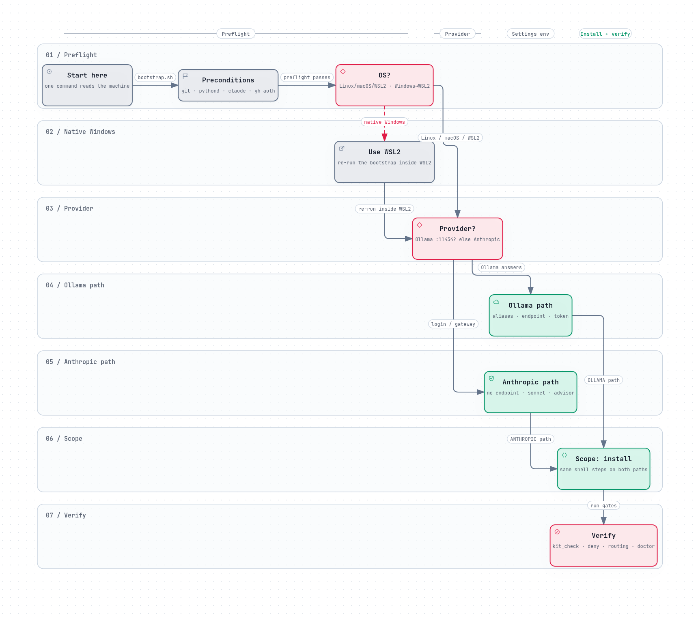

# FACTA Playbook — how we work

This repo is the operating contract: **which plugins to run, which playbook
governs each kind of implementation, and which repositories make up the
working set.** Product-facing conventions (identity, launches, copy) stay in
their own repos; this one is about how the work gets done.

The playbooks were written for **[Heimdall](https://github.com/Facta-Dev/heimdall-platform)** and are language-agnostic —
Heimdall is the reference implementation; every other project adopts them by
adapting the stack profiles, not the rules.

---

## 0. Start here — the install decision tree

One command reads the machine and walks the tree (shell only, zero model
tokens; `--dry-run` previews the plan without touching anything):

```bash
bash ~/ai-coding-playbook/scripts/claude-kit/bootstrap.sh --dry-run   # preview
bash ~/ai-coding-playbook/scripts/claude-kit/bootstrap.sh             # install
```

```text
              PRECONDITIONS: git · python3 ≥ 3.9 · claude ≥ 2.1.251 · gh auth
                       │
                  OS?
             ├─ Linux / macOS / WSL2 ──────► continue
             └─ native Windows ─► use WSL2 first, re-run inside it
                       │
              PROVIDER?
             ├─ Ollama answers at 127.0.0.1:11434 ──► OLLAMA path
             │    settings env = tier aliases (opus/sonnet/haiku → Ollama
             │    cloud models) + endpoint + literal token `ollama` + cheap
             │    subagent routing.  Verify: §9 probes of the routing runbook.
             └─ otherwise (Anthropic login / gateway) ─► ANTHROPIC path
                  settings env = none (no endpoint pinning); `model: sonnet`
                  still applies; native --advisor available (runbook §7)
                       │
              SCOPE — the same shell steps on both paths
             ├─ user kit      install-user-kit.sh [--provider=ollama|anthropic|auto]
             ├─ kit check     kit_check.py            (0 errors required)
             ├─ working set   clone-repos.sh --group=selected --dir ~/work
             ├─ skill packs   install-skill-packs.sh --dir ~/work
             ├─ cost tracker  ~/work/claude-code-cli-cost-tracker/install.sh
             └─ each repo     configure-repo.sh <repo> --kit=<golang|nodejs|python|rust|java|extension|desktop|frontend-mobile|mobile-android|mobile-ios>

VERIFY: kit_check.py · deny probe (PLAYBOOK_INSTALL §5) · routing probes (§9)
        · /context · /doctor
```

[](docs/architecture/install-decision-tree.workflow.html)

The image above is the same tree rendered with [Archify](https://github.com/tt-a1i/archify); click it for the interactive version. Source: [`install-decision-tree.workflow.json`](docs/architecture/install-decision-tree.workflow.json).

The provider branch changes only which settings env lands in
`~/.claude/settings.json`; everything downstream is identical shell work.
[`bootstrap.sh`](scripts/claude-kit/bootstrap.sh) runs the four chain steps and prints the two judgment-call
steps it does not automate (per-repo wiring and the tracker's own installer).

Flags, groups, verification and rollback: [PLAYBOOK_INSTALL.md](PLAYBOOK_INSTALL.md).
[`install-skill-packs.sh`](scripts/claude-kit/install-skill-packs.sh) registers the marketplaces from GitHub by default
(`--local` resolves them from the clones instead).

## 1. Working model

- **Spec-driven + test-driven.** Nothing ships without an approved spec; the
  gate is fail-closed ([`package_builder`](https://github.com/Facta-Dev/package_builder) at [`pb.facta.dev`](https://pb.facta.dev) instantiates the
  scaffold, the spec gate decides whether it may merge).
- **Architecture is a contract, not a preference.** Backend = hexagonal
  (ports & adapters) organized by vertical slices; frontend = MVVM with a
  shared SDK across web, mobile and extension; routes follow the URL contract
  where the *user-type segment never authorizes*.
- **Tests are audit evidence.** The suite is designed so the same artifacts
  serve SOC 2 / ISO 27001 control evidence — not a separate compliance
  exercise bolted on later.
- **Several `claude` sessions run in parallel**, so every repo carries the
  Claude Code implementation kit: rules, agents, skills, hooks, permissions,
  memory and the collaboration protocol ([`PLAYBOOK_CLAUDE_CODE.md`](PLAYBOOK_CLAUDE_CODE.md)).
- **Conventional commits, English code and comments**, traceability over a
  clean tree: everything the work produced is committed (assets, prompts,
  logs, costs).
- **Cheap model writes, cheap model digs, strong model decides.** The tiering
  and the [`advisor`](kit/agents/advisor.md) agent are specified in
  [`CLAUDE_CODE_ROUTING_MODELS_OLLAMA.md`](CLAUDE_CODE_ROUTING_MODELS_OLLAMA.md); every active repo carries the
  matching `model-routing:ollama` block in its [`CLAUDE.md`](CLAUDE.md).

## 2. Plugins

Baseline, enabled globally in `~/.claude/settings.json` — every machine:

| Plugin | Marketplace | What it gives us |
| --- | --- | --- |
| [`ecc@ecc`](https://github.com/affaan-m/ECC) | [`affaan-m/ECC`](https://github.com/affaan-m/ECC) | Agent/skill/workflow pack: review, planning, build and audit workflows |
| [`ponytail@ponytail`](https://github.com/DietrichGebert/ponytail) | [`DietrichGebert/ponytail`](https://github.com/DietrichGebert/ponytail) | Lazy-senior-dev discipline: smallest diff, stdlib first, no speculative abstraction |
| [`rust-analyzer-lsp@claude-plugins-official`](https://github.com/anthropics/claude-plugins-official) | [official](https://github.com/anthropics/claude-plugins-official) | Rust language server (`v0ss`, `ReachPilotPro`) |
| [`claude-model-router-hook@claude-model-router-hook`](https://github.com/tzachbon/claude-model-router-hook) | — | Routes each request to the tier it deserves |
| `nanobanana@creding-plugins` | — | Image generation (`nanobanana:generate-image`) |

Plugin components are namespaced (`/ecc:*` commands, `ecc:*` agents). Never copy
a plugin component into `~/.claude`: it shadows the plugin agent by name and
bills its description every turn.

Stack and craft skill packs install on top of the baseline through
[`scripts/claude-kit/install-skill-packs.sh`](scripts/claude-kit/install-skill-packs.sh): [`beautiful-go`](https://github.com/Facta-Dev/beautifulgo),
[`beautiful-nodejs`](https://github.com/Facta-Dev/beautifulnodejs),
[`beautiful-python`](https://github.com/Facta-Dev/beautifulpython),
[`beautiful-rust`](https://github.com/Facta-Dev/beautifulrust),
[`mattpocock-skills`](https://github.com/mattpocock/skills),
`motionsites-web-builder`, the six
[`garden-skills`](https://github.com/Facta-Dev/garden-skills) plugins,
[`ui-ux-pro-max`](https://github.com/nextlevelbuilder/ui-ux-pro-max-skill) and
[`superpowers`](https://github.com/Facta-Dev/superpowers). `ponytail` stays on the baseline upstream marketplace.

Project-level extras live in the project's `.claude/settings.json` — the
frontend/site repo ([`facta_frontend`](https://github.com/Facta-Dev/facta_frontend)) is the current example:
[`ei2`](https://github.com/Facta-Dev/ei2), [`pb`](https://github.com/Facta-Dev/package_builder),
the ten [`voltagent-*`](https://github.com/VoltAgent/voltagent) agent packs,
[`claude-seo@agricidaniel-claude-seo`](https://github.com/AgriciDaniel/claude-seo) and
[`github@claude-plugins-official`](https://github.com/anthropics/claude-plugins-official).

Rule: install at project level only what the baseline does not cover, and
never duplicate a baseline plugin in a project file.

## 3. Standard playbooks

| File | Governs | Use when |
| --- | --- | --- |
| [`PLAYBOOK_INSTALL.md`](PLAYBOOK_INSTALL.md) | Installation and bootstrap: clone order, idempotent kit configuration, user-scope validation, minimal-token install path | Preparing a new machine or re-provisioning one |
| [`PLAYBOOK_CLAUDE_CODE.md`](PLAYBOOK_CLAUDE_CODE.md) | The Claude Code implementation kit: files, agents, skills, rules, hooks, permissions, memory, collaboration protocol, parallel sessions, SDD + TDD loop | Starting a repo, or auditing whether a repo is agent-ready |
| [`PLAYBOOK_BACKEND.md`](PLAYBOOK_BACKEND.md) | Backend architecture: hexagonal + vertical slices, language-agnostic folder and dependency rules | Any backend service, any language |
| [`PLAYBOOK_JAVA_J2EE.md`](PLAYBOOK_JAVA_J2EE.md) | Java enterprise (J2EE / Jakarta EE 11): Maven modules, CDI, JPA/JTA, JMS/outbox, JAX-RS, app-server deployment | Any Java enterprise backend |
| [`PLAYBOOK_FRONTEND.md`](PLAYBOOK_FRONTEND.md) | Frontend on React: SPA, MVVM + shared SDK (the client playbooks specialize it) | Any web client |
| [`PLAYBOOK_CHROME_EXTENSION.md`](PLAYBOOK_CHROME_EXTENSION.md) | Chrome MV3 extension: service worker, messaging, permissions, store review | Any extension |
| [`PLAYBOOK_DESKTOP_QT.md`](PLAYBOOK_DESKTOP_QT.md) | Desktop client on Qt/QML: layering, threading, packaging and updates | Desktop clients |
| [`PLAYBOOK_CLI.md`](PLAYBOOK_CLI.md) | Cross-platform terminal CLI/TUI: headless core + many frontends, stdout/stderr and exit-code contracts, PTY tests, signing and updates | Any CLI/TUI product |
| [`PLAYBOOK_FRONTEND_MOBILE.md`](PLAYBOOK_FRONTEND_MOBILE.md) | Mobile frontend on React Native + Expo: variants, device classes, quality governor, scene engines, push | Any RN/Expo app |
| [`PLAYBOOK_MOBILE_ANDROID_KOTLIN.md`](PLAYBOOK_MOBILE_ANDROID_KOTLIN.md) | Native Android on Kotlin + Compose: Gradle module graph, UDF, Navigation 3, FCM, ARCore | Any native Android app |
| [`PLAYBOOK_MOBILE_IOS_SWIFT.md`](PLAYBOOK_MOBILE_IOS_SWIFT.md) | Native iOS on Swift 6 + SwiftUI written as code: Swift packages, Observation/MVVM, APNs, StoreKit, scene engines, App Store | Any native iOS app |
| [`PLAYBOOK_URLS.md`](PLAYBOOK_URLS.md) | Route/URL contract for API and SPA routes; the user-type segment never authorizes | Designing endpoints or permissions |
| [`PLAYBOOK_TESTS.md`](PLAYBOOK_TESTS.md) | Testing contract, slice-aligned, doubling as audit evidence | Every implementation |
| [`PLAYBOOK_SECURITY.md`](PLAYBOOK_SECURITY.md) | Security contract with per-language profiles (Node, Python, Go, Rust) | Every backend, before release |
| [`PLAYBOOK_AUDIT.md`](PLAYBOOK_AUDIT.md) | SOC 2 / ISO 27001 / ISO 9001 preparation, consuming the other playbooks as controls | Certification, enterprise or regulated deals |
| [`PLAYBOOK_REA.md`](PLAYBOOK_REA.md) | REA setup: register the reverse-engineering MCP + skill with every agent on the machine | Analyzing binaries, bundles or captured traffic |
| [`CLAUDE_CODE_ROUTING_MODELS_OLLAMA.md`](CLAUDE_CODE_ROUTING_MODELS_OLLAMA.md) | Model tiers (`opus`/`sonnet`/`haiku`), `advisor` agent, settings, verification, gotchas, rollback | Setting up a new machine or a new repo |

### Playbook copies per kit

Every kit ships its own byte-specialized copies of the root playbooks. The
backend kits carry the six shared contracts; the client kits add their stack
playbook and `PLAYBOOK_FRONTEND.md`. Together with the table above, this
covers every `PLAYBOOK_*.md` file in the repository.

| Kit | Playbook copies |
| --- | --- |
| [`golang/`](golang/) | [`PLAYBOOK_BACKEND.md`](golang/PLAYBOOK_BACKEND.md), [`PLAYBOOK_TESTS.md`](golang/PLAYBOOK_TESTS.md), [`PLAYBOOK_SECURITY.md`](golang/PLAYBOOK_SECURITY.md), [`PLAYBOOK_URLS.md`](golang/PLAYBOOK_URLS.md), [`PLAYBOOK_AUDIT.md`](golang/PLAYBOOK_AUDIT.md), [`PLAYBOOK_CLAUDE_CODE.md`](golang/PLAYBOOK_CLAUDE_CODE.md) |
| [`rust/`](rust/) | [`PLAYBOOK_BACKEND.md`](rust/PLAYBOOK_BACKEND.md), [`PLAYBOOK_TESTS.md`](rust/PLAYBOOK_TESTS.md), [`PLAYBOOK_SECURITY.md`](rust/PLAYBOOK_SECURITY.md), [`PLAYBOOK_URLS.md`](rust/PLAYBOOK_URLS.md), [`PLAYBOOK_AUDIT.md`](rust/PLAYBOOK_AUDIT.md), [`PLAYBOOK_CLAUDE_CODE.md`](rust/PLAYBOOK_CLAUDE_CODE.md) |
| [`nodejs/`](nodejs/) | [`PLAYBOOK_BACKEND.md`](nodejs/PLAYBOOK_BACKEND.md), [`PLAYBOOK_TESTS.md`](nodejs/PLAYBOOK_TESTS.md), [`PLAYBOOK_SECURITY.md`](nodejs/PLAYBOOK_SECURITY.md), [`PLAYBOOK_URLS.md`](nodejs/PLAYBOOK_URLS.md), [`PLAYBOOK_AUDIT.md`](nodejs/PLAYBOOK_AUDIT.md), [`PLAYBOOK_CLAUDE_CODE.md`](nodejs/PLAYBOOK_CLAUDE_CODE.md) |
| [`python/`](python/) | [`PLAYBOOK_BACKEND.md`](python/PLAYBOOK_BACKEND.md), [`PLAYBOOK_TESTS.md`](python/PLAYBOOK_TESTS.md), [`PLAYBOOK_SECURITY.md`](python/PLAYBOOK_SECURITY.md), [`PLAYBOOK_URLS.md`](python/PLAYBOOK_URLS.md), [`PLAYBOOK_AUDIT.md`](python/PLAYBOOK_AUDIT.md), [`PLAYBOOK_CLAUDE_CODE.md`](python/PLAYBOOK_CLAUDE_CODE.md) |
| [`java/`](java/) | [`PLAYBOOK_BACKEND.md`](java/PLAYBOOK_BACKEND.md), [`PLAYBOOK_TESTS.md`](java/PLAYBOOK_TESTS.md), [`PLAYBOOK_SECURITY.md`](java/PLAYBOOK_SECURITY.md), [`PLAYBOOK_URLS.md`](java/PLAYBOOK_URLS.md), [`PLAYBOOK_AUDIT.md`](java/PLAYBOOK_AUDIT.md), [`PLAYBOOK_CLAUDE_CODE.md`](java/PLAYBOOK_CLAUDE_CODE.md) |
| [`extension/`](extension/) | [`PLAYBOOK_CHROME_EXTENSION.md`](extension/PLAYBOOK_CHROME_EXTENSION.md), [`PLAYBOOK_FRONTEND.md`](extension/PLAYBOOK_FRONTEND.md), [`PLAYBOOK_TESTS.md`](extension/PLAYBOOK_TESTS.md), [`PLAYBOOK_SECURITY.md`](extension/PLAYBOOK_SECURITY.md), [`PLAYBOOK_URLS.md`](extension/PLAYBOOK_URLS.md), [`PLAYBOOK_AUDIT.md`](extension/PLAYBOOK_AUDIT.md), [`PLAYBOOK_CLAUDE_CODE.md`](extension/PLAYBOOK_CLAUDE_CODE.md) |
| [`desktop/`](desktop/) | [`PLAYBOOK_DESKTOP_QT.md`](desktop/PLAYBOOK_DESKTOP_QT.md), [`PLAYBOOK_FRONTEND.md`](desktop/PLAYBOOK_FRONTEND.md), [`PLAYBOOK_TESTS.md`](desktop/PLAYBOOK_TESTS.md), [`PLAYBOOK_SECURITY.md`](desktop/PLAYBOOK_SECURITY.md), [`PLAYBOOK_URLS.md`](desktop/PLAYBOOK_URLS.md), [`PLAYBOOK_AUDIT.md`](desktop/PLAYBOOK_AUDIT.md), [`PLAYBOOK_CLAUDE_CODE.md`](desktop/PLAYBOOK_CLAUDE_CODE.md) |
| [`frontend-mobile/`](frontend-mobile/) | [`PLAYBOOK_FRONTEND_MOBILE.md`](frontend-mobile/PLAYBOOK_FRONTEND_MOBILE.md), [`PLAYBOOK_FRONTEND.md`](frontend-mobile/PLAYBOOK_FRONTEND.md), [`PLAYBOOK_TESTS.md`](frontend-mobile/PLAYBOOK_TESTS.md), [`PLAYBOOK_SECURITY.md`](frontend-mobile/PLAYBOOK_SECURITY.md), [`PLAYBOOK_URLS.md`](frontend-mobile/PLAYBOOK_URLS.md), [`PLAYBOOK_AUDIT.md`](frontend-mobile/PLAYBOOK_AUDIT.md), [`PLAYBOOK_CLAUDE_CODE.md`](frontend-mobile/PLAYBOOK_CLAUDE_CODE.md) |
| [`mobile-android/`](mobile-android/) | [`PLAYBOOK_MOBILE_ANDROID_KOTLIN.md`](mobile-android/PLAYBOOK_MOBILE_ANDROID_KOTLIN.md), [`PLAYBOOK_FRONTEND.md`](mobile-android/PLAYBOOK_FRONTEND.md), [`PLAYBOOK_TESTS.md`](mobile-android/PLAYBOOK_TESTS.md), [`PLAYBOOK_SECURITY.md`](mobile-android/PLAYBOOK_SECURITY.md), [`PLAYBOOK_URLS.md`](mobile-android/PLAYBOOK_URLS.md), [`PLAYBOOK_AUDIT.md`](mobile-android/PLAYBOOK_AUDIT.md), [`PLAYBOOK_CLAUDE_CODE.md`](mobile-android/PLAYBOOK_CLAUDE_CODE.md) |
| [`mobile-ios/`](mobile-ios/) | [`PLAYBOOK_MOBILE_IOS_SWIFT.md`](mobile-ios/PLAYBOOK_MOBILE_IOS_SWIFT.md), [`PLAYBOOK_FRONTEND.md`](mobile-ios/PLAYBOOK_FRONTEND.md), [`PLAYBOOK_TESTS.md`](mobile-ios/PLAYBOOK_TESTS.md), [`PLAYBOOK_SECURITY.md`](mobile-ios/PLAYBOOK_SECURITY.md), [`PLAYBOOK_URLS.md`](mobile-ios/PLAYBOOK_URLS.md), [`PLAYBOOK_AUDIT.md`](mobile-ios/PLAYBOOK_AUDIT.md), [`PLAYBOOK_CLAUDE_CODE.md`](mobile-ios/PLAYBOOK_CLAUDE_CODE.md) |

### 3.1 User-scope kit and install path

[`kit/`](kit/) is the canonical user-scope (`~/.claude`) layer, versioned here so a new
machine is one command away; [`scripts/claude-kit/`](scripts/claude-kit/) is the install layer.

| Path | What it is |
| --- | --- |
| [`kit/CLAUDE.md`](kit/CLAUDE.md) | User-scope instructions (English artifacts, model tiers, kit governance) |
| [`kit/agents/`](kit/agents/) | [`advisor`](kit/agents/advisor.md) (read-only decision advisor) and [`kit-curator`](kit/agents/kit-curator.md) (kit maintenance) |
| [`kit/skills/`](kit/skills/) | The 8 SDD + audit skills: [`spec-new`](kit/skills/spec-new/), [`spec-clarify`](kit/skills/spec-clarify/), [`spec-plan`](kit/skills/spec-plan/), [`spec-tasks`](kit/skills/spec-tasks/), [`tdd-cycle`](kit/skills/tdd-cycle/), [`spec-verify`](kit/skills/spec-verify/), [`retro`](kit/skills/retro/), [`kit-audit`](kit/skills/kit-audit/) |
| [`kit/templates/sdd/`](kit/templates/sdd/) | Spec, plan, tasks and lessons templates |
| [`kit/settings.fragment.json`](kit/settings.fragment.json) | Base settings fragment merged into `~/.claude/settings.json` on every machine: default model (`sonnet` — the cost lever) and the deny list. Provider-agnostic |
| [`kit/settings.ollama.json`](kit/settings.ollama.json) | Ollama-only fragment, merged on top when Ollama is the provider: tier aliases (`opus`/`sonnet`/`haiku` → Ollama cloud models), local endpoint and the fixed literal token `ollama`, cheap subagent routing |
| [`scripts/claude-kit/`](scripts/claude-kit/) | [`bootstrap.sh`](scripts/claude-kit/bootstrap.sh) (decision tree: OS + Ollama/Claude detection, chains the installers), [`install-user-kit.sh`](scripts/claude-kit/install-user-kit.sh) (kit into `~/.claude`, `--provider` picks the settings env), [`clone-repos.sh`](scripts/claude-kit/clone-repos.sh) (working set by group), [`install-skill-packs.sh`](scripts/claude-kit/install-skill-packs.sh) (register + install the skill-pack plugins), [`configure-repo.sh`](scripts/claude-kit/configure-repo.sh) (wire one repo, `--check` to verify), [`kit_check.py`](scripts/claude-kit/kit_check.py) (read-only validator), [`dedupe_plugins.py`](scripts/claude-kit/dedupe_plugins.py) (move user copies of plugin components aside) — flags and the no-delete contract: [scripts/claude-kit/README.md](scripts/claude-kit/README.md) |
| [`install/repos.txt`](install/repos.txt) | The working-set inventory — one `group\|org/repo\|why` per line, mirrored from §4. Single source of truth for [`clone-repos.sh`](scripts/claude-kit/clone-repos.sh) |

The installers never delete and never overwrite without `--force`; see
[`PLAYBOOK_INSTALL.md`](PLAYBOOK_INSTALL.md) for the full bootstrap (clone, install, configure,
verify) and [`kit/README.md`](kit/README.md) for the ownership rules.

### 3.2 Per-stack kits

Each kit directory ships a runnable template for its stack, the playbooks
specialized to it, and the matching `.claude/` plane:

| Directory | Content | Status |
| --- | --- | --- |
| [`golang/`](golang/) | Runnable Go template (slices, auth core, worker, realtime) + [`AGENTS.md`](golang/AGENTS.md), [`MEMORY.md`](golang/MEMORY.md), 6 backend playbooks, 11 agents, 9 skills/commands, kit linters | Ready |
| [`rust/`](rust/) | Runnable Rust workspace (11 crates, axum 0.8, sqlx 0.8, sessions, outbox, realtime) + [`AGENTS.md`](rust/AGENTS.md), [`MEMORY.md`](rust/MEMORY.md), 6 backend playbooks, 11 agents (incl. `unsafe-reviewer`), 9 skills/commands, contract evals | Ready |
| [`nodejs/`](nodejs/) | Runnable Node 24 + TypeScript template (Fastify 5, Kysely, full auth core, outbox worker, WebSocket + SSE) + [`docs/`](nodejs/docs/) 00–14, [`AGENTS.md`](nodejs/AGENTS.md), [`MEMORY.md`](nodejs/MEMORY.md), 6 backend playbooks, 11 agents, 9 skills/commands, 14 kit contract evals | Ready |
| [`python/`](python/) | Runnable Python 3.12 + uv template (FastAPI, pydantic v2, SQLAlchemy 2 async, Alembic, full auth core, outbox worker, WebSocket + SSE) + [`docs/`](python/docs/) 00–14, [`AGENTS.md`](python/AGENTS.md), [`MEMORY.md`](python/MEMORY.md), 6 backend playbooks, 11 agents, 9 skills/commands, 14 kit contract evals | Ready |
| [`java/`](java/) | Runnable Jakarta EE 11 template (Java 21, Maven, CDI, JPA/Hibernate, Flyway, JAX-RS, widgets slice, JUnit/ArchUnit tests) + [`docs/`](java/docs/) 00–14 + ADRs, [`AGENTS.md`](java/AGENTS.md), [`MEMORY.md`](java/MEMORY.md), 6 backend playbooks, 7 agents, 6 skills/commands, contract evals | Ready (Maven gates in CI) |
| [`extension/`](extension/) | Runnable Chrome MV3 template (Vite 7, React 19 side panel, classic service worker, zod message protocol with sender validation, versioned storage, managed policy, zero host permissions) + [`docs/`](extension/docs/) 00–14, [`AGENTS.md`](extension/AGENTS.md), [`MEMORY.md`](extension/MEMORY.md), 7 client playbooks, 11 agents, 9 skills/commands, node contract evals | Ready |
| [`desktop/`](desktop/) | Runnable Qt 6 Widgets template (C++20, CMake presets, one static library per layer with link-time rules, MVVM notes slice, SQLite, managed policy, headless Qt Test) + [`docs/`](desktop/docs/) 00–14, [`AGENTS.md`](desktop/AGENTS.md), [`MEMORY.md`](desktop/MEMORY.md), 7 client playbooks, 11 agents, 9 skills/commands, C++ contract evals | Ready |
| [`frontend-mobile/`](frontend-mobile/) | Runnable React Native + Expo template (SDK 58, React 19.3, RN 0.88, plain App entry, device tiers + quality governor, typed route table, MVVM notes slice, vitest architecture tests, Metro export gate) + [`docs/`](frontend-mobile/docs/) 00–14, [`AGENTS.md`](frontend-mobile/AGENTS.md), [`MEMORY.md`](frontend-mobile/MEMORY.md), 7 client playbooks, 11 agents, 9 skills/commands, node contract evals | Ready |
| [`mobile-android/`](mobile-android/) | Runnable native Android template (Gradle 9.6, AGP 9.5, Kotlin 2.4, Compose, one Gradle module per layer, Navigation 3 typed NavKey, UDF notes slice, JVM tests, Gradle kit evals) + [`docs/`](mobile-android/docs/) 00–14, [`AGENTS.md`](mobile-android/AGENTS.md), [`MEMORY.md`](mobile-android/MEMORY.md), 7 client playbooks, 11 agents, 9 skills/commands, JVM contract evals | Ready |
| [`mobile-ios/`](mobile-ios/) | Runnable native iOS template (Swift 6, SwiftUI, iOS 18, XcodeGen `project.yml`, one SwiftPM package per layer, typed `NotesRoute` enum, UDF notes slice, Swift Testing, node contract evals, native gates that SKIP off macOS) + [`docs/`](mobile-ios/docs/) 00–14, [`AGENTS.md`](mobile-ios/AGENTS.md), [`MEMORY.md`](mobile-ios/MEMORY.md), 7 client playbooks, 11 agents, 9 skills/commands, node contract evals | Ready (native gates pending macOS/CI) |

The [Go directory](golang/) is the reference implementation for the backend kits; the
[extension kit](extension/) is the reference for the client kits.

Every kit is a **runnable template**, not a snapshot: a renamed copy is a
working project. The contract a kit must satisfy — required surface, two eval
tiers, frozen domain-adapted fixtures, local playbook copies — is
[`PLAYBOOK_CLAUDE_CODE.md`](PLAYBOOK_CLAUDE_CODE.md) §21; the shared gate surface (`make ci`, `make evals`,
`make verify`) and what each gate proves is [`PLAYBOOK_TESTS.md`](PLAYBOOK_TESTS.md) §12.

### 3.3 Client families and the instruction budget

Each client family gets its own playbook and its own path-scoped rule
(`frontend.md`, `desktop.md`, `mobile.md`, `android.md`, `extension.md`), and **none is
`@`-imported**. The harness keeps the first 40,000 chars of an instruction
file and caps the always-on set ([CLAUDE.md](kit/CLAUDE.md)/[AGENTS.md](golang/AGENTS.md) + imports + path-less
rules) at 120,000 chars; importing a playbook set is how a repo silently loses
half its contract while warning every session.

[`scripts/instruction-budget.sh`](scripts/instruction-budget.sh) ships in every kit and runs from
[`verify-template.sh`](golang/scripts/verify-template.sh); it fails when a file would be truncated or the set is
over budget. To adopt a playbook, add the rule that names it — not an import.
When a playbook passes ~40k chars it stops working as one instruction file:
split it by concern.

### 3.4 The Beautiful series

Every stack playbook has a runnable, machine-checkable companion repository.
Each one ships three standard Agent Skills — write (`<stack>-best-practices`),
review (`<stack>-review`) and port (`<stack>-port`) — plus a drop-in linter
config whose rules are proven to fire, a skill validator, and the same gate
shape (`check-skill`, `check-examples`, `check-lints` or the native
equivalent). The playbooks are the contract; these repositories are the
enforcement and the worked examples for frontier models.

| Playbook | Companion repo(s) | Stack |
| --- | --- | --- |
| [`PLAYBOOK_BACKEND.md`](PLAYBOOK_BACKEND.md) | [beautifulgo](https://github.com/Facta-Dev/beautifulgo), [beautifulnodejs](https://github.com/Facta-Dev/beautifulnodejs), [beautifulpython](https://github.com/Facta-Dev/beautifulpython), [beautifulrust](https://github.com/Facta-Dev/beautifulrust) | Go, Node.js/TypeScript, Python, Rust |
| [`PLAYBOOK_JAVA_J2EE.md`](PLAYBOOK_JAVA_J2EE.md) | [beautiful-j2ee](https://github.com/Facta-Dev/beautiful-j2ee) | Java enterprise (J2EE / Jakarta EE 11) |
| [`PLAYBOOK_FRONTEND.md`](PLAYBOOK_FRONTEND.md) | [beautifulreact](https://github.com/Facta-Dev/beautifulreact) | React 19 + TypeScript |
| [`PLAYBOOK_CHROME_EXTENSION.md`](PLAYBOOK_CHROME_EXTENSION.md) | [beautifulextension](https://github.com/Facta-Dev/beautifulextension) | Chrome MV3 + TypeScript |
| [`PLAYBOOK_DESKTOP_QT.md`](PLAYBOOK_DESKTOP_QT.md) | [beautifulqt](https://github.com/Facta-Dev/beautifulqt) | Qt 6 + C++20 |
| [`PLAYBOOK_FRONTEND_MOBILE.md`](PLAYBOOK_FRONTEND_MOBILE.md) | [beautifulreactnative](https://github.com/Facta-Dev/beautifulreactnative) | React Native + Expo |
| [`PLAYBOOK_MOBILE_ANDROID_KOTLIN.md`](PLAYBOOK_MOBILE_ANDROID_KOTLIN.md) | [beautifulandroid](https://github.com/Facta-Dev/beautifulandroid) | Kotlin + Compose |
| [`PLAYBOOK_MOBILE_IOS_SWIFT.md`](PLAYBOOK_MOBILE_IOS_SWIFT.md) | [beautifulios](https://github.com/Facta-Dev/beautifulios) | Swift 6 + SwiftUI |
| [`PLAYBOOK_CLI.md`](PLAYBOOK_CLI.md) | [beautifulcli](https://github.com/Facta-Dev/beautifulcli) | TypeScript CLI/TUI |

The shared contracts — [`PLAYBOOK_URLS.md`](PLAYBOOK_URLS.md), [`PLAYBOOK_TESTS.md`](PLAYBOOK_TESTS.md),
[`PLAYBOOK_SECURITY.md`](PLAYBOOK_SECURITY.md), [`PLAYBOOK_AUDIT.md`](PLAYBOOK_AUDIT.md) and [`PLAYBOOK_CLAUDE_CODE.md`](PLAYBOOK_CLAUDE_CODE.md) —
apply across the series: every companion repo carries the same three-skill
shape, the same "unbreakable contract" wording, and a CI workflow, and every
rule it enforces cites the playbook it comes from. All repositories are public
under <https://github.com/Facta-Dev> and link to each other as siblings. The
twelve companion repositories are also listed under skills in [§4.1](#41-skills-and-factory-packs).


## 4. Skills, tooling and references

Orgs: [**Facta-Dev**](https://github.com/Facta-Dev) (skills and tooling),
[**contextzero**](https://github.com/contextzero) (tooling), and
[**matiasbaglieri**](https://github.com/matiasbaglieri) (personal tooling).
Visibility varies; several public repos are forked skill packs vendored for
use, not authored here.

### 4.1 Skills and factory packs

| Repo | What it is |
| --- | --- |
| [Facta-Dev/skills](https://github.com/Facta-Dev/skills) | Engineering skill pack ("skills for real engineers") |
| [Facta-Dev/skills-images-video-audio-3d](https://github.com/Facta-Dev/skills-images-video-audio-3d) | Image, video, audio and 3D generation skills (84 skills) |
| [Facta-Dev/garden-skills](https://github.com/Facta-Dev/garden-skills) | Web design, knowledge retrieval, video presentation skill pack |
| [beautifulgo](https://github.com/Facta-Dev/beautifulgo), [beautifulnodejs](https://github.com/Facta-Dev/beautifulnodejs), [beautifulpython](https://github.com/Facta-Dev/beautifulpython), [beautifulrust](https://github.com/Facta-Dev/beautifulrust), [beautiful-j2ee](https://github.com/Facta-Dev/beautiful-j2ee), [beautifulreact](https://github.com/Facta-Dev/beautifulreact), [beautifulextension](https://github.com/Facta-Dev/beautifulextension), [beautifulcli](https://github.com/Facta-Dev/beautifulcli), [beautifulreactnative](https://github.com/Facta-Dev/beautifulreactnative), [beautifulqt](https://github.com/Facta-Dev/beautifulqt), [beautifulandroid](https://github.com/Facta-Dev/beautifulandroid), [beautifulios](https://github.com/Facta-Dev/beautifulios) | The twelve Beautiful-series skill packs (see [§3.4](#34-the-beautiful-series)) |
| [Facta-Dev/archify](https://github.com/Facta-Dev/archify) | Architecture / workflow / sequence diagram skill |
| [Facta-Dev/ponytail](https://github.com/Facta-Dev/ponytail) | Fork of the lazy-senior-dev skill behind the `ponytail` plugin |
| [Facta-Dev/superpowers](https://github.com/Facta-Dev/superpowers), [Facta-Dev/frontend-slides](https://github.com/Facta-Dev/frontend-slides), [Facta-Dev/marketingskills](https://github.com/Facta-Dev/marketingskills), [Facta-Dev/ui-ux-pro-max-skill](https://github.com/Facta-Dev/ui-ux-pro-max-skill), [Facta-Dev/awesome-claude-skills](https://github.com/Facta-Dev/awesome-claude-skills), [Facta-Dev/awesome-claude-*](https://github.com/orgs/Facta-Dev/repositories?q=awesome-claude) | Vendored skill/framework collections |

### 4.2 Internal tooling

| Repo | What it is |
| --- | --- |
| [Facta-Dev/ai-coding-playbook](https://github.com/Facta-Dev/ai-coding-playbook) | This repo: working model, plugins, playbooks |
| [Facta-Dev/aws-ec2-setup](https://github.com/Facta-Dev/aws-ec2-setup) | Declarative Ubuntu infrastructure stack (PostgreSQL 17 + pgvector) |
| [Facta-Dev/claude-code-cli-cost-tracker](https://github.com/Facta-Dev/claude-code-cli-cost-tracker) | Cost tracking for the `claude` CLI |
| [matiasbaglieri/terrain](https://github.com/matiasbaglieri/terrain) | Agent tooling: RTK-style read/grep, skills and codegraph wiring |
| [Facta-Dev/OmniRoute](https://github.com/Facta-Dev/OmniRoute) | Model/gateway routing dashboard (private working copy of [diegosouzapw/OmniRoute](https://github.com/diegosouzapw/OmniRoute)) |
| [contextzero/repomix](https://github.com/contextzero/repomix) | Private working copy of [yamadashy/repomix](https://github.com/yamadashy/repomix) with local changes on `main` |

### 4.3 Reference clones (upstream, read-only)

Cloned for study or as vendored dependencies, not owned or contributed to:
[storytold/craft-anything](https://github.com/storytold/craft-anything), [rmcrackan/Libation](https://github.com/rmcrackan/Libation), [OlaProeis/Ferrite](https://github.com/OlaProeis/Ferrite),
[jo-inc/camofox-browser](https://github.com/jo-inc/camofox-browser), [aldinokemal/go-whatsapp-web-multidevice](https://github.com/aldinokemal/go-whatsapp-web-multidevice),
[EasyDevv/project-to-markdown](https://github.com/EasyDevv/project-to-markdown), [JoasASantos/REA-Prompts](https://github.com/JoasASantos/REA-Prompts),
[samber/cc-skills-golang](https://github.com/samber/cc-skills-golang), and the upstream forks in the Facta-Dev org
([ChatDev](https://github.com/Facta-Dev/ChatDev), [Fooocus](https://github.com/Facta-Dev/Fooocus), [FreeCAD](https://github.com/Facta-Dev/FreeCAD), [HunyuanVideo](https://github.com/Facta-Dev/HunyuanVideo), [MinerU](https://github.com/Facta-Dev/MinerU), [Wav2Lip](https://github.com/Facta-Dev/Wav2Lip),
[facefusion](https://github.com/Facta-Dev/facefusion), …).

---

## 5. Adding a repo to the inventory

A repo belongs here when it is actively worked on. To add one:

1. Add a row to the matching table — repo and one line of role.
2. Append the `model-routing:ollama` block to its [`CLAUDE.md`](CLAUDE.md) (idempotent
   marker; see [`CLAUDE_CODE_ROUTING_MODELS_OLLAMA.md` §6](CLAUDE_CODE_ROUTING_MODELS_OLLAMA.md)).
3. Enable only the project-level plugins the baseline does not cover.
4. Point the repo's [`CLAUDE.md`](CLAUDE.md) at the playbooks in [§3](#3-standard-playbooks) instead of restating
   them — through a path-scoped rule, never an `@`-import (§3.3).
5. Configure it with [`scripts/claude-kit/configure-repo.sh`](scripts/claude-kit/configure-repo.sh) `<repo> --kit=<lang>`
   and confirm with `--check`; then run [`kit_check.py`](scripts/claude-kit/kit_check.py) and confirm the repo
   carries no user-scope duplicate of a plugin command or agent.
