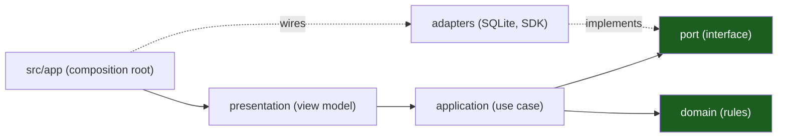

# Qt 6 Desktop Template — Documentation

The handbook of the desktop template: **C++20, Qt 6 Widgets, CMake, one
static library per layer**. It describes the kit as it is — the layers, the
port that owns the data, the storage adapter, the SDK, the guards — and marks
the parts that are still to be built as known gaps.

> 15 chapters · 4 reference documents · 2 ADRs.

## The one rule

**Dependencies point inward, and the GUI thread never blocks.** The domain
knows nothing about widgets, SQLite, HTTP or the operating system; the
composition root (`src/app/main.cpp`) knows everything and wires it together.
A layer that breaks the rule fails at configure time or at link time, not in
review. See [Hexagonal Layers & MVVM](04-hexagonal-layers-and-mvvm.md).

## Start here

New to the kit? Read [00 — Overview & Principles](00-overview-and-principles.md),
then [04 — Hexagonal Layers & MVVM](04-hexagonal-layers-and-mvvm.md) and
[06 — Repository Layout & Project Skeleton](06-repository-layout-and-project-skeleton.md).
Starting a project? Copy the kit, run `scripts/rename.sh`, then follow
[13 — Playbooks](13-playbooks.md). Reviewing a change? Read
[07 — Threading & the GUI Thread](07-threading-and-the-gui-thread.md) and
[12 — Testing & CI](12-testing-and-ci.md).

## Chapters

| #   | Chapter                                                                 | What it covers                                                        |
| --- | ------------------------------------------------------------------------ | --------------------------------------------------------------------- |
| 00  | [Overview & Principles](00-overview-and-principles.md)                   | The one idea, ten principles, the chapter map                         |
| 01  | [Support Matrix & Reference Hardware](01-support-matrix-and-reference-hardware.md) | Minimum OS builds, the hardware floor, the budgets                  |
| 02  | [Widgets versus Qt Quick](02-widgets-versus-qt-quick.md)                 | Why the UI is Widgets, and the narrow door to Qt Quick                |
| 03  | [The No-GPU Fallback](03-no-gpu-fallback.md)                             | Compatibility Mode, safe mode, what the kit ships today               |
| 04  | [Hexagonal Layers & MVVM](04-hexagonal-layers-and-mvvm.md)               | The layers, the port, `Result`, the view model, the three guards      |
| 05  | [Vertical Slicing](05-vertical-slicing.md)                               | One slice per capability, end to end, with the shipped `notes` slice  |
| 06  | [Repository Layout & Project Skeleton](06-repository-layout-and-project-skeleton.md) | The tree, the targets, the presets, how to start a project   |
| 07  | [Threading & the GUI Thread](07-threading-and-the-gui-thread.md)         | The thread rules, the blocking call that must go, the fix             |
| 08  | [Storage & Migrations](08-storage-and-migrations.md)                     | SQLite, WAL, `PRAGMA user_version`, forward-only migrations          |
| 09  | [Offline & Outbox](09-offline-and-outbox.md)                             | The cache is a projection, the outbox that is still to come           |
| 10  | [Telemetry](10-telemetry.md)                                             | The redacting ring buffer, and what it is not                         |
| 11  | [Packaging & Updates](11-packaging-and-updates.md)                       | The artifacts per OS, signing, the signed update channel              |
| 12  | [Testing & CI](12-testing-and-ci.md)                                     | The nine suites, the helpers, the gates, the commands                 |
| 13  | [Playbooks](13-playbooks.md)                                             | The eight changes you will make most                                  |
| 14  | [Glossary](14-glossary.md)                                               | Every term used in this set                                           |

## Reference

| Document                                                             | What it covers                                                                       |
| -------------------------------------------------------------------- | ----------------------------------------------------------------------------------- |
| [Support Matrix](support-matrix.md)                                   | The per-release table: minimum OS, architectures, display servers, end of support     |
| [Data Flows](data-flows.md)                                           | Two flows, with the thread of every hop and the trust boundary on every hop         |
| [Admin Guide](admin-guide.md)                                         | The policy keys, the source per OS, how an enterprise publishes and verifies it      |
| [ADR 0001 — Qt Widgets over Qt Quick](adr/0001-qt-widgets-over-qt-quick.md) | Why Widgets is the default, and the fallback path                             |
| [ADR 0002 — One static library per layer](adr/0002-one-static-library-per-layer.md) | The link-time dependency rules, and why a violation is a build error      |

## The gates

| Command                     | What it proves                                                                |
| --------------------------- | ----------------------------------------------------------------------------- |
| `make ci`                   | Format check, configure, build and the whole CTest suite                      |
| `make build`                | Configure and compile every target                                             |
| `make test`                 | The suite, headless (`QT_QPA_PLATFORM=offscreen`)                             |
| `make lint`                 | `clang-format --dry-run -Werror` over every source (skipped without the tool)  |
| `make tidy`                 | `clang-tidy` over `src/` and `packages/` (skipped without the tool)            |
| `make evals`                | The `.claude` contract harness                                                |
| `make verify`               | `make test`                                                                    |
| `bash scripts/verify-template.sh` | The whole kit, renamed in a temp copy, gate by gate                      |

## Known gaps of the template

The kit ships the seams, not the filled-in product. The gaps are listed in
[00 — Overview & Principles §7](00-overview-and-principles.md) and in each
chapter; the ones that bite first are the synchronous repository call on the
GUI thread ([07](07-threading-and-the-gui-thread.md)), the missing keystore
backends ([07](07-threading-and-the-gui-thread.md) and the source comments)
and the absent outbox ([09](09-offline-and-outbox.md)).

## Where the code is

| Topic                     | File                                                            |
| ------------------------- | --------------------------------------------------------------- |
| The composition root      | [`src/app/main.cpp`](../src/app/main.cpp)                       |
| The example slice         | [`src/features/notes/`](../src/features/notes/)                 |
| The port of the slice     | [`…/application/note_repository.h`](../src/features/notes/application/include/desktop/notes/application/note_repository.h) |
| The SQLite adapter        | [`…/adapters/sqlite_note_repository.h`](../src/features/notes/adapters/include/desktop/notes/adapters/sqlite_note_repository.h) |
| The SDK client            | [`packages/sdk-cpp/src/notes_client.cpp`](../packages/sdk-cpp/src/notes_client.cpp) |
| The storage adapter       | [`src/infrastructure/src/storage/note_store.cpp`](../src/infrastructure/src/storage/note_store.cpp) |
| The platform layer        | [`src/platform/`](../src/platform/)                             |
| The architecture guard    | [`tests/_platform/architecture/tst_architecture.cpp`](../tests/_platform/architecture/tst_architecture.cpp) |
| The link rules            | [`CMakeLists.txt`](../CMakeLists.txt)                           |
