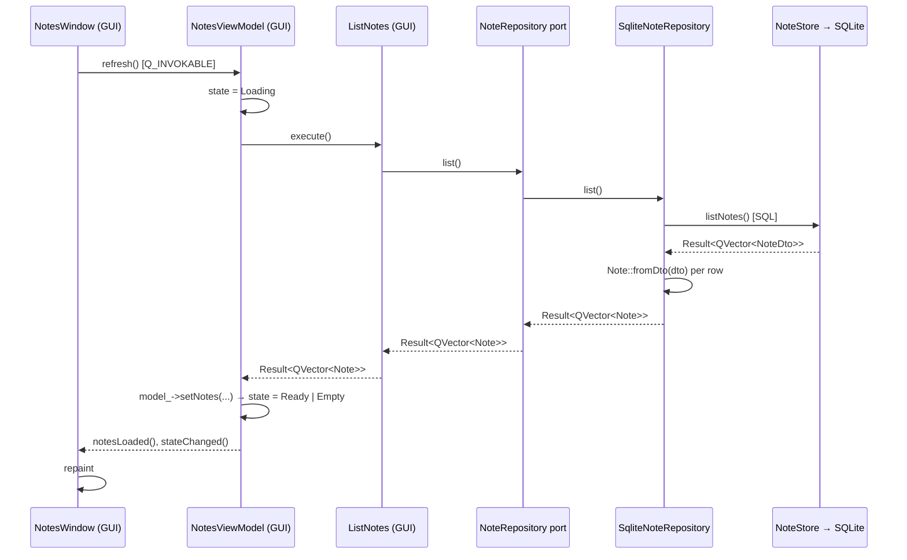
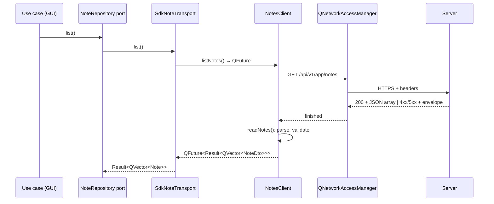

# Data Flows

Two flows, described hop by hop: **the thread each hop runs on**, and
**the trust boundary each hop crosses**.

- [Flow A — the view and the local projection](#flow-a--the-view-and-the-local-projection)
- [Flow B — the SDK and the HTTP boundary](#flow-b--the-sdk-and-the-http-boundary)

## The rules the flows obey

1. The GUI thread never blocks ([07](07-threading-and-the-gui-thread.md)).
2. Errors cross a boundary as values (`Result<T>`), never as exceptions.
3. The domain re-validates anything that comes from outside it.
4. The URL never authorizes: the server decides, the client only reports.

## Flow A — the view and the local projection

The read path, from the click to the painted list.

### The hops

| # | Hop | Thread | Boundary | What crosses it |
| --- | --- | --- | --- | --- |
| 1 | Window → view model | GUI | — | A command; no data is trusted yet |
| 2 | View model → use case | GUI | — | A domain request |
| 3 | Use case → port | GUI | **The port** | The interface; no data |
| 4 | Port → adapter | GUI | — | The same domain types |
| 5 | Adapter → store | GUI | **The storage boundary** | SQL over a local file |
| 6 | Store → adapter | GUI | **The storage boundary** | Rows, as DTOs |
| 7 | Adapter → domain | GUI | **The validation boundary** | A DTO becomes a `Note`, or an error |
| 8 | View model → view | GUI | — | Signals and model rows |

### The trust boundaries

| Boundary | What crosses | What the receiver must do |
| --- | --- | --- |
| **The port** | Nothing but the interface | The consumer defines it; the adapter implements it |
| **The storage boundary** | Rows written by a previous version of the app, or by a bug | Re-apply the invariants: `Note::fromDto` rejects a title over 120 characters, a body over 10 000, or markup |
| **The validation boundary** | The DTO | The domain is the only place a business rule may live |
| **The UI boundary** | Model rows and state | The view renders; it never validates and never calls a use case |

### The write path

The same path, plus the domain check:

| # | Hop | Thread | What happens |
| --- | --- | --- | --- |
| 1 | Window → view model | GUI | `addNote(title, body)` |
| 2 | View model → use case | GUI | `AddNote::execute(title, body)` |
| 3 | Use case → domain | GUI | `Note::create(id, title, body, now, now)` — the invariants are applied here |
| 4 | Use case → port → adapter → store | GUI | The upsert, then the read-back |

The domain is the **first** thing that touches the user's text. The window
does not check the length; the domain does, and it returns
`Result<Note>` with a `ValidationFailed` code when it refuses.

### The known deviation

Steps 5 and 4 run `QSqlQuery::exec()` **on the GUI thread**. The whole
sequence above is synchronous, which is why the flow diagram has one actor
that never changes thread. The target flow has a worker:

| Hop | Today | Target |
| --- | --- | --- |
| Store call | GUI thread | Storage worker |
| Return | Synchronous `Result` | `QFuture<Result>` resolved on the GUI thread |
| View model | Reads the result directly | `QFutureWatcher` sets the state when it resolves |

The rest of the flow — the boundaries, the validation, the error contract —
does not change. See [07](07-threading-and-the-gui-thread.md) and
[13 — Playbooks §8](13-playbooks.md).

## Flow B — the SDK and the HTTP boundary

The path the `SdkNoteTransport` and the `NotesClient` implement. It is
**not wired into the composition root today** — `main.cpp` binds the SQLite
adapter — but the code and the tests exist.

### The hops

| # | Hop | Thread | Boundary | What crosses it |
| --- | --- | --- | --- | --- |
| 1 | Use case → port → adapter | GUI | The port | The domain request |
| 2 | Adapter → SDK client | GUI | — | A call; the client owns the URL and the headers |
| 3 | SDK → `QNetworkAccessManager` | The client's thread | — | A `QNetworkRequest` |
| 4 | `QNetworkAccessManager` → server | The client's thread | **The network boundary** | HTTPS, `Authorization: Bearer …`, `X-Client: desktop` |
| 5 | Server → client | The client's thread | **The network boundary** | A status code and a body |
| 6 | Client → adapter | The client's thread | **The wire boundary** | A parsed, validated DTO — or an error |
| 7 | Adapter → domain | GUI | **The validation boundary** | The DTO becomes a `Note` |
| 8 | Adapter → use case → view model | GUI | — | The `Result` |

### The headers the client sets

| Header | Value | Why |
| --- | --- | --- |
| `Content-Type` | `application/json` | The body is JSON |
| `Accept` | `application/json` | The answer is JSON |
| `X-Client` | `desktop` | Identifies the client to the server |
| `Authorization` | `Bearer <token>` | Only when a token is set; an empty token means "not signed in" |

The routes are built in one place — `NotesClient::notesPath()` and
`NotesClient::notePath()` — and nowhere else:

| Method | Route |
| --- | --- |
| `GET` | `/api/v1/app/notes` |
| `POST` | `/api/v1/app/notes` |
| `GET` | `/api/v1/app/notes/{noteId}` |

The namespace in the path never authorizes anything: the server decides what
the session may do, and the client only reports the answer.

### The trust boundaries

| Boundary | What crosses | What the receiver must do |
| --- | --- | --- |
| **The network boundary** | An untrusted body from the network | Parse it; never trust the shape |
| **The wire boundary** | The status code and the body | The **envelope wins over the status**: a `403` with a valid envelope reports the envelope's code |
| **The shape boundary** | The JSON | A body that is not the expected shape is a `Server` error, not a crash |
| **The credential boundary** | The bearer token | The token goes in a header and nowhere else — never in a URL, a query parameter or a log ([10](10-telemetry.md)) |

The status → `ErrorCode` mapping is one function:

| Status | `ErrorCode` |
| --- | --- |
| 401 | `Unauthenticated` |
| 403 | `PermissionDenied` |
| 404 | `NotFound` |
| 409 | `Conflict` |
| 422 | `ValidationFailed` |
| 429 | `RateLimited` |
| ≥ 500 | `Server` |
| no status at all | `Network` |

A transport failure — no status code — is the only thing that becomes
`Network`. A `4xx` or `5xx` **is** a response, and the caller decides what
to do with it.

### The two transports

| Transport | Where | Retry | Used by |
| --- | --- | --- | --- |
| `HttpTransport` | `src/infrastructure/` | Bounded: 2 retries, 250 ms base delay, on 429 and 5xx | Nothing yet |
| `NotesClient` | `packages/sdk-cpp/` | None | The SDK adapter |

> **Known gap.** Two transports, two retry policies. The SDK owns its own
> `QNetworkAccessManager` and does not use `HttpTransport`, so a request
> that goes through the SDK gets no retry, while a request that goes through
> the infrastructure transport gets one. Unify them before shipping: the SDK
> should use `HttpTransport`, or `HttpTransport` should be deleted.

`HttpTransport`'s budget, for reference: a 15 000 ms timeout, at most 2
retries, a 250 ms base delay, and a 4 MB cap on the response body. The
timeout is enforced per reply, not per attempt.

## The two flows side by side

| | Flow A — local | Flow B — remote |
| --- | --- | --- |
| Terminal | SQLite | The server |
| Trust boundary | The storage boundary | The network boundary |
| The domain validates | Yes, on the way out of the adapter | Yes, on the way out of the adapter |
| Errors | `Result<T>` | `Result<T>` |
| Thread | GUI today, worker in the target | The client's thread |
| Asynchronous | No (today) | Yes — a `QFuture` |
| In the composition root | **Yes** | Not wired |

## See also

- [Hexagonal Layers & MVVM](04-hexagonal-layers-and-mvvm.md) — the port and
  the guards.
- [Threading & the GUI Thread](07-threading-and-the-gui-thread.md) — the
  threads of each hop.
- [Storage & Migrations](08-storage-and-migrations.md) — the storage
  boundary.
- [Offline & Outbox](09-offline-and-outbox.md) — what happens between the
  click and the server.
