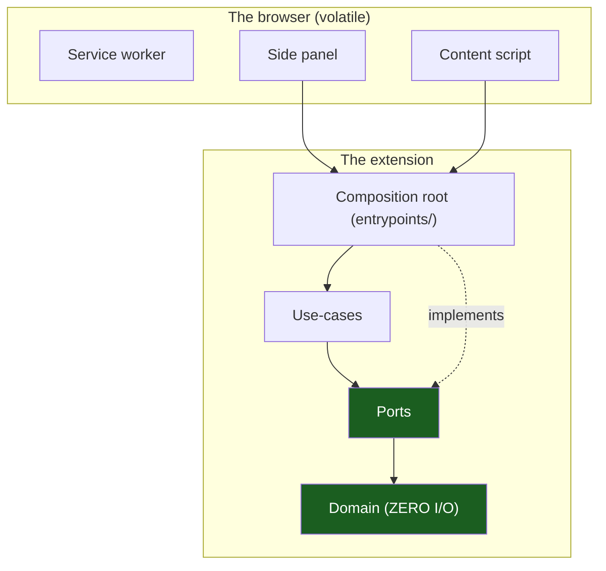

# Overview & Principles

The entry chapter. It states the one structural idea — **hexagonal (ports &
adapters) + vertical slicing, expressed inside the four execution contexts of
a Manifest V3 extension** — and the principles that follow. Generic: the
template ships one example slice (`notes`) that you replace with your own.

## 1. The problem this solves

A Chrome extension is not one program. It is four programs that share a
profile, a storage area and a message bus, and that are killed at different
moments:

- The **service worker** stops after ~30 seconds of inactivity.
- The **side panel** and the **options page** live as long as their tab.
- The **content script** lives inside a page it does not own.

If the code is written as one flat bundle, the result is a worker that keeps
state it will lose, a panel that calls `chrome.*` directly, and a content
script that trusts whatever message arrives. The architecture keeps them apart
with one discipline: **dependencies point inward, toward the rules, never
outward toward the browser API.**



The composition roots are the only files that know the browser exists.

## 2. The eight principles

1. **The platform folder owns `chrome.*`.** `src/platform/**` is the only
   place allowed to touch the extension API; ESLint and dependency-cruiser
   both fail the build otherwise.
2. **Register listeners at the top level.** The worker starts cold; anything
   registered later misses its event.
3. **Keep no state in a module global** that must survive a worker restart.
   Storage is the state.
4. **Contracts are zod schemas, shared by both ends.** The worker and the
   panel validate against the same file, so a shape change breaks one side
   only.
5. **Validate the sender before the payload.** A message is trusted when it
   is _received_, not when it is parsed.
6. **Features are sealed.** A slice never imports another slice; shared code
   goes to `src/contracts` or `src/shared-kernel`.
7. **The administrator wins.** Managed policy beats user settings; an unknown
   or invalid policy fails closed.
8. **Least privilege.** Three permissions, no host permissions, no remote
   code. A permission bump is a review, not a one-line change.

## 3. The chapter map

| #   | Chapter                                                             | What it covers                                          |
| --- | ------------------------------------------------------------------- | ------------------------------------------------------- |
| 01  | [Platform Model](01-platform-model-and-execution-contexts.md)       | The four contexts, their lifetime and their trust       |
| 02  | [Service Worker Lifetime](02-service-worker-lifetime.md)            | Cold start, event-driven work, what survives            |
| 03  | [Layers & MVVM](03-hexagonal-layers-and-mvvm.md)                    | Domain, application, adapters, view models              |
| 04  | [Vertical Slicing](04-vertical-slicing.md)                          | One slice per feature, sealed barrels                   |
| 05  | [Directory Structure](05-directory-structure.md)                    | The tree, the aliases, the project skeleton             |
| 06  | [Manifest & Permissions](06-manifest-and-permission-engineering.md) | The single manifest source, the permission posture      |
| 07  | [Messaging](07-messaging-and-sender-validation.md)                  | The envelope, the sender allowlist, the error codes     |
| 08  | [Storage & Migrations](08-storage-and-migrations.md)                | The three areas, versions, corrupt-record policy        |
| 09  | [Policy](09-policy-admin-over-user.md)                              | Managed over user, the resolver, fail-closed reads      |
| 10  | [Security & CSP](10-security-and-csp.md)                            | Trust boundaries, the default CSP, what the kit refuses |
| 11  | [Telemetry](11-telemetry.md)                                        | The redacting ring buffer, and what it is not           |
| 12  | [Testing & CI](12-testing-and-ci.md)                                | The test tiers, the gates, the commands                 |
| 13  | [Playbooks](13-playbooks.md)                                        | The five changes you will make most                     |
| 14  | [Glossary](14-glossary.md)                                          | Every term used in this set                             |

## 4. Worked example

The shipped `notes` slice is the worked example of every chapter:

```text
src/features/notes/
├── domain/note.ts                      # the rules, pure
├── application/ports.ts                # NoteRepository, the interface the slice owns
├── application/use-cases.ts            # listNotes, addNote
├── adapters/out/rpc-note-repository.ts # the implementation over the message protocol
├── viewmodels/notes-view-model.ts      # presentation state, no React
├── ui/NotesPanel.tsx                   # the React surface
├── ui/useNotesViewModel.ts             # useSyncExternalStore binding
├── contracts/index.ts                  # re-exports of the shared zod schemas
└── index.ts                            # the barrel the entrypoints import
```

The side panel imports `createNotesViewModel` from the barrel and never from
a layer inside it. The worker imports `createNotesHandlers` and never from
the UI. That is the whole idea in one screen.

## Do / Don't

| Do                                                 | Don't                                                 |
| -------------------------------------------------- | ----------------------------------------------------- |
| Put browser calls in `src/platform/**`             | Call `chrome.*` from a component or a use case        |
| Read state from storage on every worker start      | Keep a counter in a module global                     |
| Add a permission through the register and a review | Add `host_permissions` to make a fetch work           |
| Validate the sender before parsing the payload     | Trust `sender.tab.id` because the message looks right |
| Return `Result` from a use case                    | Throw for an expected failure                         |

## See also

- [Platform Model & Execution Contexts](01-platform-model-and-execution-contexts.md)
- [Playbooks](13-playbooks.md)
- [Glossary](14-glossary.md)
- The kit instruction file: [`AGENTS.md`](../AGENTS.md)
