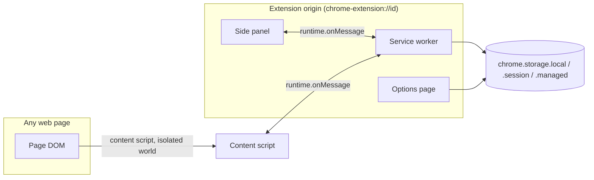
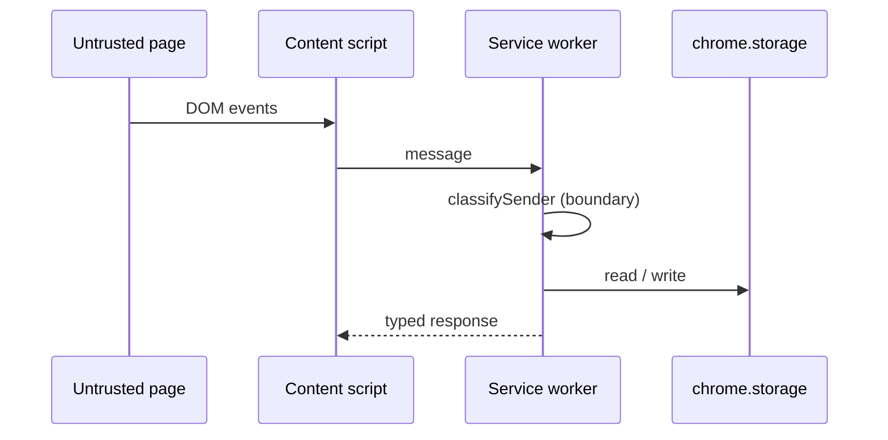

# Platform Model & Execution Contexts

A Manifest V3 extension runs in several contexts at once. Each has its own
lifetime, its own view of the world and its own trust level. Most extension
bugs are really context bugs: code written for a page tries to run in a
worker, or a worker tries to keep a page's state.

## 1. The contexts the kit ships

| Context        | Entry point                              | Lifetime                                   | Sees                                  | Trust                              |
| -------------- | ---------------------------------------- | ------------------------------------------ | ------------------------------------- | ---------------------------------- |
| Service worker | `entrypoints/background.ts`              | Started on event, stopped after ~30 s idle | All extension APIs                    | Full (it is the extension)         |
| Side panel     | `entrypoints/sidepanel/main.tsx`         | As long as the panel is open               | Extension APIs, `chrome.storage`      | Full, same origin as the extension |
| Options page   | `entrypoints/options/main.ts`            | As long as the tab is open                 | Extension APIs                        | Full, same origin as the extension |
| Content script | `entrypoints/content/example.content.ts` | As long as the host page lives             | The page DOM and a limited API subset | Untrusted page context             |



## 2. What each context may do

- The **worker** owns the message server, the storage stores and the policy
  reader. It is the only context that lives long enough to hold a lock, and
  the only one that can answer a message.
- The **side panel** is a React application. It reaches the data only
  through the messaging client: it never opens a store, never reads
  `chrome.storage` and never dispatches handlers.
- The **options page** is a plain page that renders the effective policy.
  It is read-only by design.
- The **content script** runs in an isolated world. It sees the DOM of a page
  it does not own. It holds no secret and acts on nothing it has not
  validated.

## 3. The trust boundary, once



The dashed line is the boundary: everything left of the worker is untrusted
input. The worker is where a message becomes an action, and it re-checks the
sender on every message — the sender class of a previous message is not a
credential.

## 4. The platform layer

`src/platform/**` is the adapter over the browser. It is the only folder
allowed to name `chrome`:

| File                        | Exposes            | Notes                                                                          |
| --------------------------- | ------------------ | ------------------------------------------------------------------------------ |
| `src/platform/runtime.ts`   | `RuntimePort`      | `chrome.runtime.id`, `onMessage`, `sendMessage`, and `contentScriptPatterns()` |
| `src/platform/storage.ts`   | `StorageAdapter`   | `local`, `session`, `managed` areas plus `createWriteThrough`                  |
| `src/platform/sidepanel.ts` | `setPanelBehavior` | `chrome.sidePanel.setPanelBehavior`                                            |

The platform never returns a `chrome.*` type across its boundary: it hands
out plain values (`PlatformSender` is a plain object, not a
`chrome.runtime.MessageSender`). That keeps the rest of the code testable
without a browser and keeps the type surface small.

## 5. Worked example

The worker reads the match patterns of its own manifest and uses them as the
allowlist for content-script senders:

```ts
registerMessageServer({
  runtime,
  logger,
  senderPolicy: {
    extensionId: runtime.id,
    extensionOrigin: `chrome-extension://${runtime.id}`,
    contentScriptPatterns: contentScriptPatterns(),
  },
  handlers: createNotesHandlers(store),
});
```

`contentScriptPatterns()` reads `chrome.runtime.getManifest().content_scripts[].matches`,
so the sender allowlist can never drift from the manifest.

## Do / Don't

| Do                                              | Don't                                      |
| ----------------------------------------------- | ------------------------------------------ |
| Assume a context may be dead between two events | Assume a DOM node survives in the worker   |
| Keep the browser call in `src/platform/**`      | Import `chrome` types into a feature       |
| Treat a content script as untrusted input       | Trust a message because it came from a tab |
| Use the options page for policy display         | Use the options page as a second worker    |

## See also

- [Service Worker Lifetime](02-service-worker-lifetime.md)
- [Messaging & Sender Validation](07-messaging-and-sender-validation.md)
- [Data Flows](data-flows.md)
