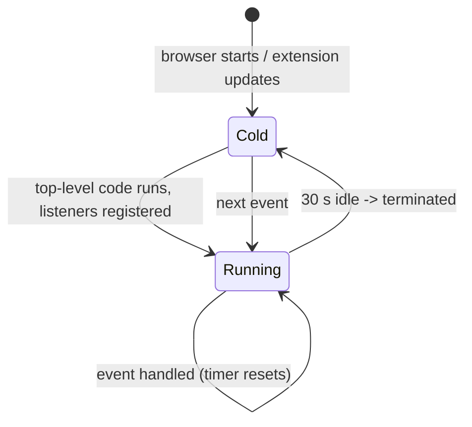

# Service Worker Lifetime

The service worker is the only context that can hold a lock and the only one
that dies without warning. Every design decision in the kit follows from one
fact: **the worker is restarted from scratch, at an unpredictable moment, and
it is expected to do the right thing immediately.**

## 1. The rules Chrome enforces

- The worker starts **cold** when an event wakes it.
- It is terminated after ~30 seconds of inactivity (the timer resets on
  every event and on every `fetch`).
- A worker that is starting cannot receive events: listeners registered
  asynchronously are missed.
- `chrome.storage` survives; module globals do not.



## 2. What the kit does about it

| Rule                                        | Where it lives                                                                         | Why                                                                          |
| ------------------------------------------- | -------------------------------------------------------------------------------------- | ---------------------------------------------------------------------------- |
| Listeners are registered at the top level   | `entrypoints/background.ts`                                                            | A listener registered after an `await` misses the event that woke the worker |
| No state in module globals                  | `src/storage/notes-store.ts` memoizes only the _load promise_ and resets it on failure | A cached value would silently go stale after a restart                       |
| Durable writes go to `chrome.storage.local` | `src/platform/storage.ts`                                                              | Storage outlives the worker                                                  |
| Long work is chunked per event              | The message handlers are short                                                         | An event that outlives the worker is lost                                    |
| Periodic work uses `chrome.alarms`          | The manifest asks for the `alarms` permission                                          | An alarm re-wakes the worker reliably                                        |

The worker is written as a composition root: it builds the runtime, the
storage adapter, the logger, the store and the handler table, and wires them
together. It contains no logic of its own.

## 3. The mirror, and its ceiling

`createWriteThrough(durable, mirror, delayMs = 250)` writes to
`chrome.storage.local` first and mirrors into `chrome.storage.session` after
a 250 ms debounce. The debounce exists to coalesce bursts of writes.

The ceiling is explicit in the source: a debounce timer does not survive the
worker, so a mirror write can be lost when the worker is terminated between
the durable write and the flush. The durable write is the one that matters;
the session copy is a cache the worker may rebuild at any time. When the
mirror ever becomes load-bearing, flush it from an alarm or drop it.

## 4. Restart-safety checklist

Ask these four questions of any new worker-side code:

1. **Where does this value live after a restart?** If the answer is "in a
   variable", it is a bug.
2. **What happens if this event arrives twice?** The store serialises its
   writes through a promise queue, so an overlapping `add` cannot interleave.
3. **What happens if this write fails halfway?** The store either writes the
   whole record or leaves the previous one; a partial record is not a state
   the schema allows.
4. **Do I need an alarm to wake the worker?** If the work must happen on a
   schedule, use `chrome.alarms`; a `setInterval` dies with the worker.

## 5. Worked example

The store memoizes its load promise and clears it when the load fails, so a
transient storage error does not poison the worker for the rest of its life:

```ts
const open = (): Promise<NotesRecord> => {
  opened ??= load().catch((error: unknown) => {
    opened = undefined; // the next call tries again
    throw error;
  });
  return opened;
};
```

## Do / Don't

| Do                                           | Don't                                 |
| -------------------------------------------- | ------------------------------------- |
| Register the listener before any `await`     | Register it inside a promise callback |
| Persist anything that must survive a restart | Keep a session variable in the worker |
| Use `chrome.alarms` for periodic work        | Use `setInterval` in the worker       |
| Assume the worker can be killed mid-task     | Assume an in-flight write completed   |

## See also

- [Platform Model & Execution Contexts](01-platform-model-and-execution-contexts.md)
- [Storage & Migrations](08-storage-and-migrations.md)
- [Telemetry](11-telemetry.md)
