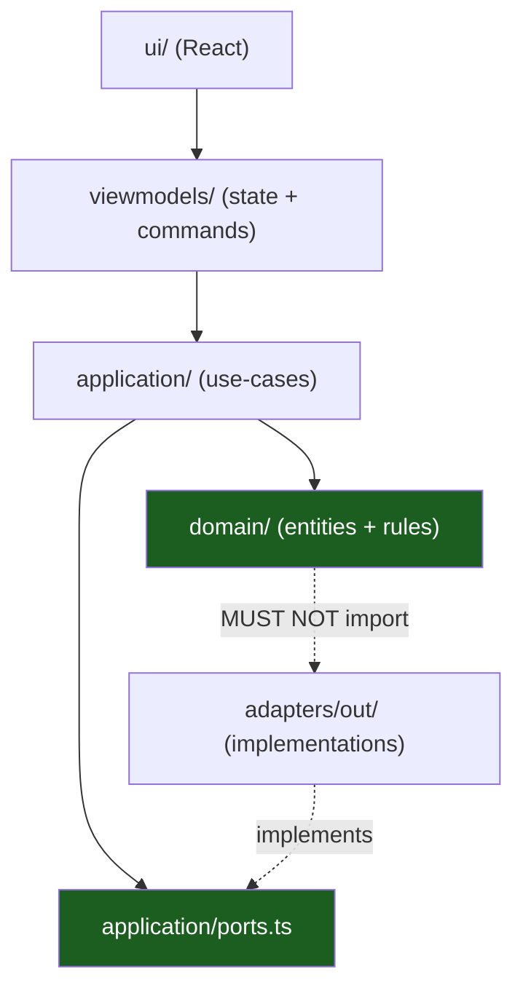

# Hexagonal Layers & MVVM

Inside a slice, the code is split by **what changes**: the product rules
change when the product changes, the mechanism changes when the browser
changes. The split is hexagonal (ports & adapters) on one side and MVVM on
the other — the two meet at the view model.

## 1. The layers of a slice



| Layer           | Owns                               | May import                                | Must not import                      |
| --------------- | ---------------------------------- | ----------------------------------------- | ------------------------------------ |
| `domain/`       | Entities, invariants, value errors | `src/shared-kernel`                       | Anything else in the slice, `chrome` |
| `application/`  | Use-cases, ports (interfaces)      | `domain/`, `src/shared-kernel`            | Adapters, `chrome`, React            |
| `adapters/out/` | Implementations of the ports       | `application/`, `domain/`, `src/platform` | The UI, the worker                   |
| `viewmodels/`   | Presentation state and commands    | `application/`, `domain/`                 | React, `chrome`                      |
| `ui/`           | The React surface                  | `viewmodels/`                             | `chrome`, `application/` details     |

The dependency-cruiser rules enforce the same table:

- no domain → application edge;
- no application → adapters edge (the use-case depends on the _interface_);
- no cross-feature import.

## 2. Ports: the interface the slice owns

The slice declares the interface it needs, not the interface the browser
happens to offer:

```ts
export interface NoteRepository {
  list(): Promise<Result<Note[], NotesError>>;
  add(draft: NoteDraft): Promise<Result<Note, NotesError>>;
}
```

`src/features/notes/adapters/out/rpc-note-repository.ts` implements it over
the message protocol — through `src/messaging/client.ts`, never `chrome.*`.
A test implements it with a fake. The use-case does not know which one it
got, and it re-applies the domain rules to whatever comes back, so an
adapter never decides what a surface may render.

## 3. MVVM, mapped onto the extension

| MVVM part  | In this kit                      | Notes                                              |
| ---------- | -------------------------------- | -------------------------------------------------- |
| Model      | `domain/` + `application/`       | Entities and use-cases; no framework               |
| View       | `ui/NotesPanel.tsx`              | A pure function of the view-model state            |
| ViewModel  | `viewmodels/notes-view-model.ts` | State, commands and their transitions              |
| Binding    | `ui/useNotesViewModel.ts`        | `useSyncExternalStore` over `getState`/`subscribe` |
| Repository | `adapters/out/`                  | The port implementation, injected                  |

The view-model holds a `NotesStatus` (`loading`, `ready`, `empty`, `error`),
the notes, the fields being typed and a `submitting` flag. It exposes
`getState`, `subscribe`, `setTitle`, `setBody`, `load` and `submit`. The
React component only renders that state and calls those commands, so the
whole panel can be tested without a DOM.

## 4. Errors as values

Expected failures are values, not exceptions:

```ts
export type Result<T, E> = { ok: true; value: T } | { ok: false; error: E };
```

A use-case returns `Result<Note, NotesError>`; the view-model turns a
failure into `status: "error"` and an `error` message; the UI renders it in
a `role="alert"` region. Only a programming error (a thrown exception)
reaches the boundary — and the message server catches it and answers
`internal`.

## 5. Worked example

One call, four layers:

```ts
// ui → viewmodel → application → port → adapter → chrome.storage
await viewModel.submit();
//   validates the draft in domain/note.ts
//   calls addNote(repository, draft)
//   calls repository.add(draft)
//   the adapter writes chrome.storage.local
```

The same call works in a test with the fake repository in
`tests/_shared/fakes/fake-storage.ts`, because the use-case never touches the
browser.

## Do / Don't

| Do                                         | Don't                                    |
| ------------------------------------------ | ---------------------------------------- |
| Declare the port in the consuming slice    | Import `chrome.storage` into a use-case  |
| Keep the domain free of React and `chrome` | Put a `useState` in a view-model         |
| Return `Result` for an expected failure    | Throw `Error` for a validation failure   |
| Inject the adapter at the root             | Construct the adapter inside a component |

## See also

- [Vertical Slicing](04-vertical-slicing.md)
- [Messaging & Sender Validation](07-messaging-and-sender-validation.md)
- [The `notes` slice, file by file](../src/features/notes/index.ts)
