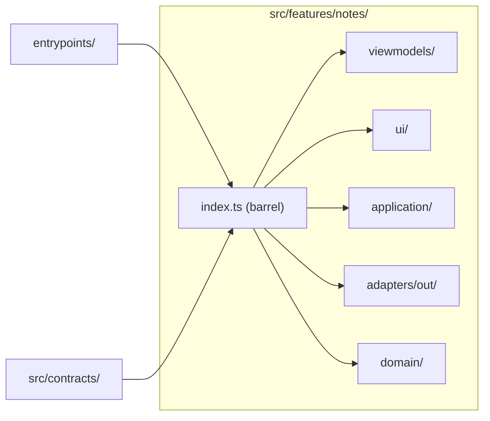

# Vertical Slicing

A **slice** is one feature, cut end to end: its rules, its use-cases, its
storage, its messages and its UI. Slices are the unit of work, of review and
of ownership. The template ships exactly one, `notes`, as the reference.

## 1. What a slice owns

| Asset         | Owner of the `notes` slice                                        |
| ------------- | ----------------------------------------------------------------- |
| Storage key   | `notes:record` (plus `notes:record.backup` for a dropped record)  |
| Message types | `notes.list`, `notes.add`                                         |
| UI surface    | The side panel (`src/features/notes/ui/NotesPanel.tsx`)           |
| Domain rules  | Title ≤ 120 characters, body ≤ 10 000 characters, plain text only |

Two slices never share a storage key, never share a message type and never
import each other. The ESLint rule `no-restricted-imports` blocks any import
that starts with `@features/` from inside `src/features/**`; dependency-cruiser
has the matching `no-cross-feature-imports` rule.

## 2. The anatomy of a slice



- **`index.ts` is the only public face.** The composition roots import from
  the barrel, never from a layer inside it. A slice may reorganise its
  internals without touching an entrypoint.
- **`contracts/index.ts` re-exports the shared zod schemas** so the slice has
  one place to reach for its shapes. It deliberately does _not_ re-export the
  length constants: the contract bounds what may travel on the wire, the
  domain bounds what may be a note.

## 3. Where the cross-slice code goes

| Need                            | Home                                                             |
| ------------------------------- | ---------------------------------------------------------------- |
| A shape both ends must agree on | `src/contracts/` (zod schema)                                    |
| A stable error code             | `src/shared-kernel/errors.ts`                                    |
| An id type                      | `src/shared-kernel/ids.ts`                                       |
| A `Result`                      | `src/shared-kernel/result.ts`                                    |
| A browser call                  | `src/platform/`                                                  |
| A rule that two features share  | Extract it into `src/shared-kernel` — never import across slices |

The kit does not ship a "shared features" folder on purpose: the moment two
slices need the same code, that code was not slice code.

## 4. Adding a slice

The `add-slice` skill (`.claude/skills/add-slice/SKILL.md`) and the
`/add-slice` command (`.claude/commands/add-slice.md`) carry the full
recipe. The short version:

1. Create `src/features/<slice>/` with the layer folders.
2. Write the domain first: the entity, its invariants, its `Result` errors.
3. Declare the port in `application/ports.ts`.
4. Write the use-cases in `application/use-cases.ts`.
5. Implement the port in `adapters/out/`.
6. Add the view model and the UI, or reuse an existing surface.
7. Write the barrel and export everything the entrypoints need.
8. Wire the handlers in `src/messaging/` and register them in
   `entrypoints/background.ts`.
9. Write the tests under `tests/<slice>/`.

## 5. Worked example

The `notes` slice is reached from the two ends:

```ts
// entrypoints/sidepanel/main.tsx
import {
  createNotesViewModel,
  createRpcNoteRepository,
  NotesPanel,
} from "../../src/features/notes";

// entrypoints/background.ts
import { createNotesHandlers } from "../src/messaging/notes";
```

The panel and the worker share the slice's types but never its internals, and
the two never import each other.

## Do / Don't

| Do                                          | Don't                                                          |
| ------------------------------------------- | -------------------------------------------------------------- |
| Give every slice its own storage key prefix | Store two features under one key                               |
| Import a slice through its barrel           | Import `src/features/notes/domain/note` from an entrypoint     |
| Put a shared contract in `src/contracts`    | Export a shared entity from one slice and import it in another |
| Add a slice with its own tests              | Extend the `notes` slice with an unrelated feature             |

## See also

- [Layers & MVVM](03-hexagonal-layers-and-mvvm.md)
- [Directory Structure](05-directory-structure.md)
- [Playbooks](13-playbooks.md)
