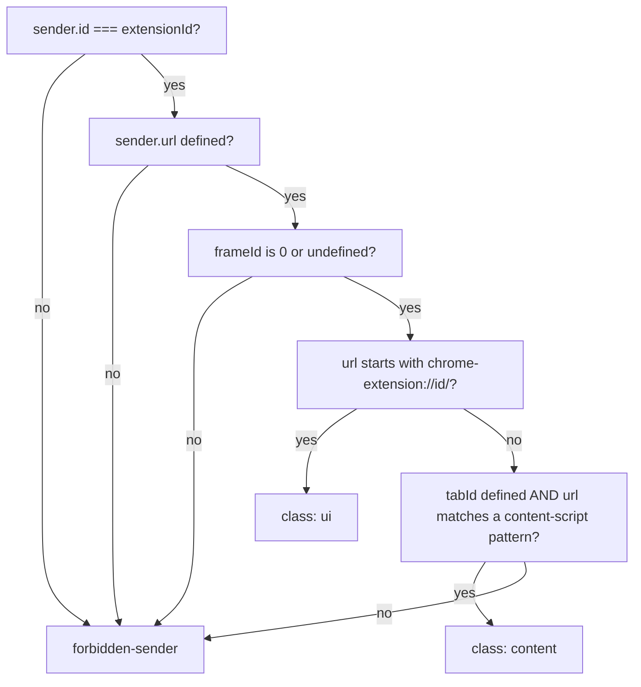

# Messaging & Sender Validation

The extension's only inbound channel is `chrome.runtime.onMessage`. Every
message that arrives is untrusted input until the worker has classified the
sender and validated the envelope.

## 1. The envelope

```ts
{ v: 1, id: "<request id>", type: "notes.list", correlationId: "<id>", payload: { ... } }
```

The contract lives in `src/contracts/protocol.ts` and is validated by **both**
ends with the same zod schemas. A response is either

```ts
{ v, id, correlationId, type, ok: true, payload }
```

or

```ts
{ v, id, correlationId, type, ok: false, payload: { code, message } }
```

`PROTOCOL_VERSION` is `1`; a message with another version is rejected as a
`bad-envelope`.

## 2. The message table

```ts
export const PROTOCOL = {
  "notes.list": {
    type: "notes.list",
    response: NotesListResponseSchema,
    senders: ["ui", "content"],
  },
  "notes.add": { type: "notes.add", response: NotesAddResponseSchema, senders: ["ui"] },
} as const;
```

The table is the whole surface of the extension: the type, the shape of the
answer and **which context classes may send it**. `notes.add` is `ui` only —
a content script may read the notes but may not write them.

## 3. The order of checks in the server

`registerMessageServer` (`src/messaging/server.ts`) checks in this order, and
stops at the first failure:

| #   | Check                                                    | Error code          |
| --- | -------------------------------------------------------- | ------------------- |
| 1   | `classifySender(sender, senderPolicy)`                   | `forbidden-sender`  |
| 2   | `MessageHeaderSchema.safeParse(message)`                 | `bad-envelope`      |
| 3   | `definition(type)` — is the type known?                  | `unknown-type`      |
| 4   | Is the sender class allowed for this type?               | `forbidden-sender`  |
| 5   | `RequestSchema.safeParse(message)`                       | `validation-failed` |
| 6   | Run the handler (in a `try`/`catch`)                     | `internal`          |
| 7   | Validate the success payload against the response schema | `internal`          |

Step 1 before step 2 is the point: an unknown sender is rejected before the
extension looks at what it said.

## 4. Sender classification

`classifySender` (`src/security/sender.ts`) returns a `SenderClass` — `ui`
or `content` — or an error:



- Another extension, a web page, an unknown context → refused.
- A frame (`frameId !== 0`) → refused; the kit expects the top frame only.
- An extension page (side panel, options page) → `ui`.
- A page that matches one of the manifest's content-script patterns → `content`.
- Anything else → refused.

The patterns come from `contentScriptPatterns()`, which reads the manifest
itself, so the allowlist can never drift from the manifest.

## 5. Error codes

`src/shared-kernel/errors.ts` defines the closed set the extension answers
with: `bad-envelope`, `unknown-type`, `forbidden-sender`, `validation-failed`,
`not-found`, `internal`. A handler that fails does not throw to the caller;
it answers `internal` and the failure is logged.

## 6. The client side

`src/messaging/client.ts` provides `createRpcClient(runtime)`: it validates
the request against `RequestSchema` before sending and the answer against
`ResponseSchema` after receiving, and it returns a `Result`. The side panel
uses it through `createRpcNoteRepository`, so every read and every write
crosses the worker and the record keeps a single writer. Keep it that way:
a second context that opens the store directly can lose a concurrent write.

## 7. Worked example

A content script asks for the notes:

```ts
const answer = await chrome.runtime.sendMessage({
  v: 1,
  id: crypto.randomUUID(),
  correlationId: crypto.randomUUID(),
  type: "notes.list",
  payload: {},
});
```

The worker answers `forbidden-sender` if the script runs on a page outside
the manifest's patterns, and `validation-failed` if the payload is not the
empty object the contract requires.

## Do / Don't

| Do                                               | Don't                                     |
| ------------------------------------------------ | ----------------------------------------- |
| Classify the sender before parsing               | Parse first and validate the sender after |
| Declare the allowed sender classes in `PROTOCOL` | Check the sender class inside a handler   |
| Answer with a stable error code                  | Throw across the message boundary         |
| Validate the response on the client              | Trust the shape of the answer             |

## See also

- [Data Flows](data-flows.md)
- [Security & CSP](10-security-and-csp.md)
- [The protocol contract](../src/contracts/protocol.ts)
