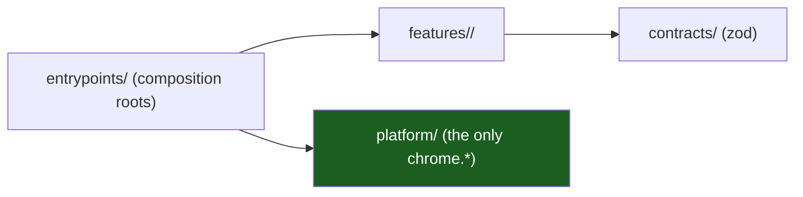

# Extension Template Documentation

The handbook of the Chrome extension template: **Manifest V3, TypeScript,
React 19, zod, Vite**. It describes the kit as it is — the four execution
contexts, the layers, the messaging, the storage, the policy and the gates.

> 14 chapters · 4 reference documents · 2 ADRs.

## The one rule

**The browser is an adapter.** `src/platform/**` is the only place allowed to
name `chrome.*`; everything else depends on plain ports and zod contracts.
See [Manifest & Permissions](06-manifest-and-permission-engineering.md) and
[Layers & MVVM](03-hexagonal-layers-and-mvvm.md).

## Start here

New to the kit? Read [00 — Overview & Principles](00-overview-and-principles.md),
then [01 — Platform Model](01-platform-model-and-execution-contexts.md) and
[03 — Layers & MVVM](03-hexagonal-layers-and-mvvm.md). Starting a project?
Jump to [05 — Directory Structure](05-directory-structure.md) and
[13 — Playbooks](13-playbooks.md). Reviewing a change? Read
[07 — Messaging](07-messaging-and-sender-validation.md) and
[10 — Security & CSP](10-security-and-csp.md).

## Chapters

| #   | Chapter                                                                            | What it covers                                                 |
| --- | ---------------------------------------------------------------------------------- | -------------------------------------------------------------- |
| 00  | [Overview & Principles](00-overview-and-principles.md)                             | The one idea, eight principles, the chapter map                |
| 01  | [Platform Model & Execution Contexts](01-platform-model-and-execution-contexts.md) | The four contexts, their lifetime and their trust              |
| 02  | [Service Worker Lifetime](02-service-worker-lifetime.md)                           | Cold start, event-driven work, what survives                   |
| 03  | [Hexagonal Layers & MVVM](03-hexagonal-layers-and-mvvm.md)                         | Domain, application, adapters, view models, ports              |
| 04  | [Vertical Slicing](04-vertical-slicing.md)                                         | One slice per feature, sealed barrels, shared code             |
| 05  | [Directory Structure & Project Skeleton](05-directory-structure.md)                | The tree, the aliases, how to copy the template                |
| 06  | [Manifest & Permission Engineering](06-manifest-and-permission-engineering.md)     | The single manifest source, the permission posture, the review |
| 07  | [Messaging & Sender Validation](07-messaging-and-sender-validation.md)             | The envelope, the sender allowlist, the error codes            |
| 08  | [Storage & Migrations](08-storage-and-migrations.md)                               | The three areas, versions, the corrupt-record policy           |
| 09  | [Policy](09-policy-admin-over-user.md)                                             | Managed over user, the resolver, failing closed                |
| 10  | [Security & CSP](10-security-and-csp.md)                                           | The boundaries, the default CSP, the known gaps                |
| 11  | [Telemetry](11-telemetry.md)                                                       | The redacting ring buffer, and what it is not                  |
| 12  | [Testing & CI](12-testing-and-ci.md)                                               | The test tiers, the gates, the commands                        |
| 13  | [Playbooks](13-playbooks.md)                                                       | The five changes you will make most                            |
| 14  | [Glossary](14-glossary.md)                                                         | Every term used in this set                                    |

## Reference

| Document                                                                                        | What it covers                                                                           |
| ----------------------------------------------------------------------------------------------- | ---------------------------------------------------------------------------------------- |
| [Permissions Register](permissions-register.md)                                                 | Every permission and host pattern, the review, the removal path                          |
| [Data Flows](data-flows.md)                                                                     | The panel, the content script and the policy flows, with the trust boundary on every hop |
| [Admin Guide](admin-guide.md)                                                                   | How an enterprise publishes the managed policy, and how to verify it                     |
| [ADR 0001 — Vite and vite-plugin-web-extension](adr/0001-vite-and-vite-plugin-web-extension.md) | The build, the `entrypoints/` root, the alternatives                                     |
| [ADR 0002 — Classic service worker](adr/0002-classic-service-worker.md)                         | Why the worker is a classic bundle with no `type: module`                                |

## The gates

| Command                  | What it proves                                                |
| ------------------------ | ------------------------------------------------------------- |
| `make ci`                | Typecheck, lint (ESLint + dependency-cruiser), tests, build   |
| `pnpm run test:platform` | The architecture tests: no `chrome` outside `src/platform`    |
| `pnpm run evals`         | The `.claude` kit: agents, skills, commands, manifest posture |
| `pnpm run verify`        | The template itself, renamed in a temp dir, gate by gate      |

## Known gaps of the template

| Gap                                                               | Where it is documented                                                |
| ----------------------------------------------------------------- | --------------------------------------------------------------------- |
| The managed policy schema is not wired into the manifest          | [Admin Guide](admin-guide.md), [Policy](09-policy-admin-over-user.md) |
| The manifest declares no `key`, so the extension id is not stable | [Manifest & Permissions](06-manifest-and-permission-engineering.md)   |
| The content script pattern is an example site                     | [Permissions Register](permissions-register.md)                       |

## Where the code is

| Topic                 | File                                                            |
| --------------------- | --------------------------------------------------------------- |
| The manifest          | [`src/manifest.ts`](../src/manifest.ts)                         |
| The message contract  | [`src/contracts/protocol.ts`](../src/contracts/protocol.ts)     |
| The sender allowlist  | [`src/security/sender.ts`](../src/security/sender.ts)           |
| The message server    | [`src/messaging/server.ts`](../src/messaging/server.ts)         |
| The policy resolver   | [`src/policy/resolver.ts`](../src/policy/resolver.ts)           |
| The notes store       | [`src/storage/notes-store.ts`](../src/storage/notes-store.ts)   |
| The example slice     | [`src/features/notes/index.ts`](../src/features/notes/index.ts) |
| The composition roots | [`entrypoints/background.ts`](../entrypoints/background.ts)     |
| The agent guide       | [`AGENTS.md`](../AGENTS.md)                                     |
