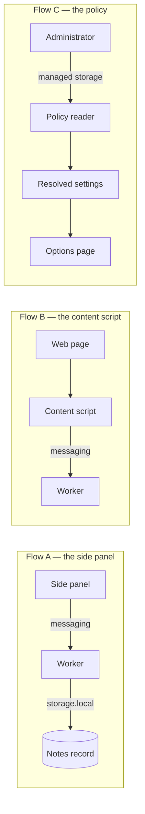
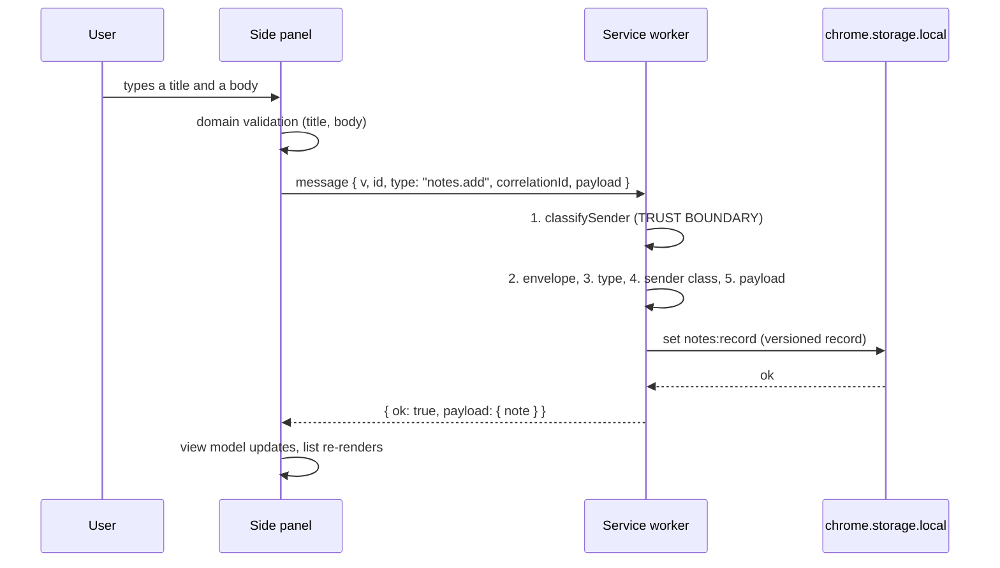
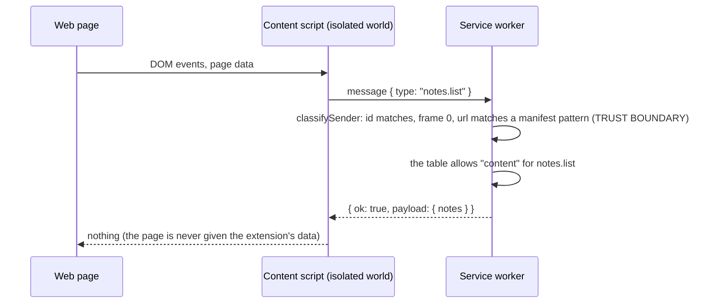
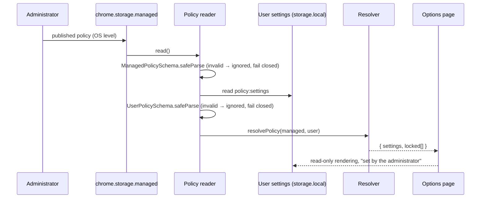

# Data Flows

Three flows, each with the trust boundary written on every hop. A flow that
has no boundary marked is a flow nobody reviewed.

## 1. The flows at a glance



## 2. Flow A — side panel, messaging, worker, storage

The intended path: the panel asks the worker, the worker owns the write.



| Hop | From → to         | Trust boundary                                  | The check                                                                                        |
| --- | ----------------- | ----------------------------------------------- | ------------------------------------------------------------------------------------------------ |
| 1   | User → panel      | The user's input is data                        | The domain validates the title and the body; the contract bounds them at 200 / 20 000 characters |
| 2   | Panel → worker    | **Yes — the extension boundary**                | `classifySender`: same extension id, a URL under `chrome-extension://<id>/`, top frame           |
| 3   | Worker → handler  | Same boundary, one step later                   | The envelope, the known type, the allowed sender class, the payload schema                       |
| 4   | Handler → storage | Not a trust boundary, but a durability boundary | The record is parsed against a strict schema before it is written                                |
| 5   | Worker → panel    | The response is untrusted like any answer       | The response schema is validated by the client                                                   |

### What the shipped code does

The panel sends every read and every write through the worker. Its
composition root builds the repository over the client:

```ts
const repository = createRpcNoteRepository(createRpcClient(createRuntime()));
```

The slice ships one adapter, the one the panel needs: the port implemented
over the message protocol. `listNotes` re-applies the domain rules to whatever
the worker answers, so a record written by an older build is dropped before
it reaches the UI.

## 3. Flow B — the content script



| Hop                     | Trust boundary                   | The check                                                                                                                                                      |
| ----------------------- | -------------------------------- | -------------------------------------------------------------------------------------------------------------------------------------------------------------- |
| Page → content script   | **Yes — the page is untrusted**  | The content script imports nothing, holds no secret and reads no page value; the shipped example only sets a dataset attribute                                 |
| Content script → worker | **Yes — the extension boundary** | `classifySender` requires the sender id to be this extension, the frame to be the top frame and the URL to match one of the manifest's content-script patterns |
| Worker → handler        | Same boundary                    | The `PROTOCOL` table lists the sender classes per type: `notes.list` accepts `ui` and `content`; `notes.add` accepts `ui` only                                 |
| Worker → content script | The answer is untrusted          | The response is validated against the response schema                                                                                                          |

The pattern check is the important one: a message from a _page_ (not a
content script) never carries an extension sender id, and a content script
running on a page outside the manifest's patterns is refused even though the
message itself is perfectly well formed.

## 4. Flow C — the policy



| Hop                             | Trust boundary                                  | The check                                                                                 |
| ------------------------------- | ----------------------------------------------- | ----------------------------------------------------------------------------------------- |
| Administrator → managed storage | **Yes — the organisational boundary**           | `ManagedPolicySchema`; unknown keys are dropped, invalid values are ignored               |
| Managed → resolver              | The precedence is decided here                  | Managed wins per field; the flags merge; the user fills the gaps                          |
| User settings → resolver        | The user is less trusted than the administrator | `UserPolicySchema` is strict: an unexpected key invalidates the settings                  |
| Resolver → URL check            | —                                               | `isUrlAllowed`: the kill switch first, then the blocked hosts, then a non-empty allowlist |
| Resolver → options page         | —                                               | The locked settings are rendered read-only                                                |

## 5. Where the boundaries are enforced in code

| Boundary                          | File                                                     | Test                                                       |
| --------------------------------- | -------------------------------------------------------- | ---------------------------------------------------------- |
| The extension boundary (messages) | `src/security/sender.ts`                                 | `tests/_platform/security/sender-allowlist.test.ts`        |
| The message contract              | `src/messaging/server.ts`, `src/contracts/protocol.ts`   | `tests/notes/frontend/contract/message-server.test.ts`     |
| The storage boundary              | `src/storage/notes-store.ts`, `src/contracts/storage.ts` | `tests/notes/frontend/unit/storage/notes-store.test.ts`    |
| The policy boundary               | `src/policy/reader.ts`, `src/policy/resolver.ts`         | `tests/notes/frontend/unit/policy/policy-resolver.test.ts` |
| The browser boundary              | `src/platform/**`                                        | `tests/_platform/architecture/platform-isolation.test.ts`  |

## 6. See also

- [Messaging & Sender Validation](07-messaging-and-sender-validation.md)
- [Storage & Migrations](08-storage-and-migrations.md)
- [Policy](09-policy-admin-over-user.md)
