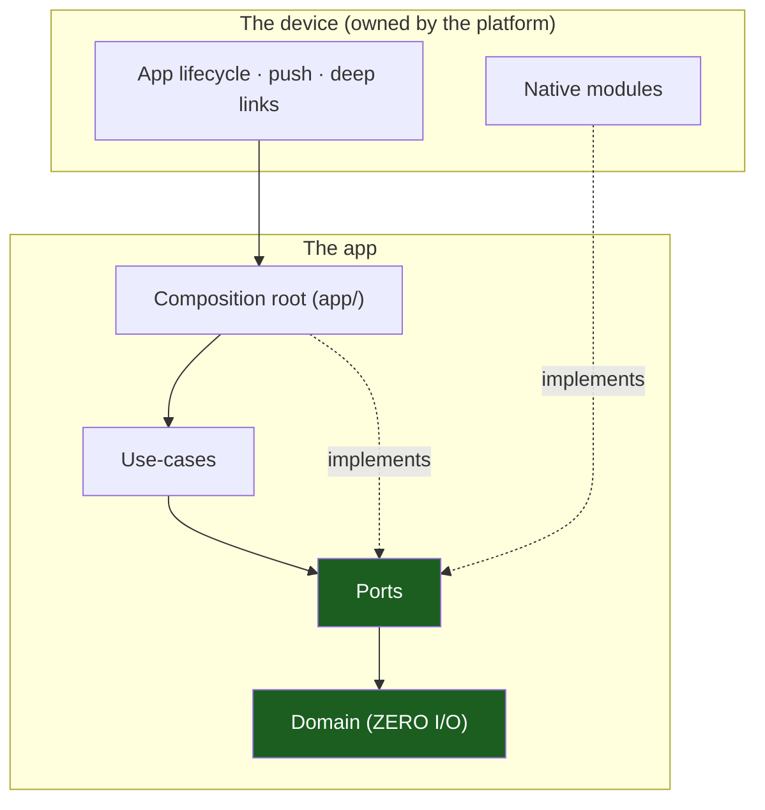

# Overview & Principles

The entry chapter. It states the one structural idea — **hexagonal (ports &
adapters) + vertical slicing, expressed inside the React Native runtime** — and
the principles that follow. Generic: the template ships one example slice
(`notes`) that you replace with your own.

## 1. The problem this solves

A React Native app is not one program. It is at least four that share a
process, a native bridge and a device:

- the **JavaScript thread**, where your code runs and where every heavy
  computation competes with rendering;
- the **UI thread**, owned by the platform, that commits the frames;
- the **native modules**, one C++/Java/Objective-C world per capability
  (secure store, notifications, sensors);
- the **operating system**, which kills your process whenever it likes and
  delivers push notifications, deep links and app lifecycle events whenever
  it likes.

If the code is written as one flat bundle, the result is a screen that
imports `expo-secure-store` directly, a domain rule that reads a device
sensor, a use case that blocks the JS thread on a network call, and a push
handler that trusts whatever the OS delivered. The architecture keeps them
apart with one discipline: **dependencies point inward, toward the rules,
never outward toward the device.**



The composition root is the only file that knows the device exists.

## 2. The ten principles

1. **The device is an adapter.** `packages/core` declares the ports; only
   `adapters/out` names `expo-*` or a native module. ESLint and the
   architecture test fail the build otherwise.
2. **The JS thread is a scarce resource.** No disk, no network wait, no
   parse-heavy work in a render path.
3. **Errors are values.** `Result<T, E>` crosses every boundary; an expected
   failure never throws.
4. **The domain owns the rules.** Length bounds, trimming, plain-text
   rejection live in `domain/`; the view never validates a business rule.
5. **The port is owned by the consumer.** The slice declares the interface it
   needs; the adapter implements it; the composition root wires them.
6. **Every screen has a status.** The eight `UiStatus` values are the
   contract between a view model and a view; a view renders all of them.
7. **Design for the floor.** Every feature has a low-tier path; a high tier
   adds fidelity, never different logic.
8. **The local database is a projection.** The server is the authority; a
   mutation it has not accepted yet lives in an outbox.
9. **Nothing sensitive is in the bundle.** Tokens live in the keystore, not in
   the JavaScript bundle, not in SQLite, not in a log.
10. **A template states its gaps.** Every unfinished seam is named, with the
    file that must change.

## 3. The chapter map

| #   | Chapter                                                                            | What it covers                                           |
| --- | ---------------------------------------------------------------------------------- | -------------------------------------------------------- |
| 01  | [Platform Model & Expo Runtime](01-platform-model-and-expo-runtime.md)             | Threads, native modules, lifecycle, cold start           |
| 02  | [Device Tiers & the Quality Governor](02-device-tiers-and-the-quality-governor.md) | Tiers, thermal, memory, the governor, the budgets        |
| 03  | [Layers & MVVM](03-hexagonal-layers-and-mvvm.md)                                   | Domain, application, adapters, view models, the statuses |
| 04  | [Vertical Slicing](04-vertical-slicing.md)                                         | One slice per feature, sealed barrels                    |
| 05  | [Directory Structure](05-directory-structure.md)                                   | The tree, the aliases, the project skeleton              |
| 06  | [Variants & Monorepo](06-variants-and-monorepo.md)                                 | `APP_VARIANT`, per-variant native modules, EAS           |
| 07  | [Navigation, Routes & Deep Links](07-navigation-routes-and-deep-links.md)          | The route grammar, builders, deep links                  |
| 08  | [Offline, Outbox & Sync](08-offline-outbox-and-sync.md)                            | The projection, the outbox, idempotency, conflicts       |
| 09  | [Security & Secure Store](09-security-and-secure-store.md)                         | The keystore, the bundle, tokens, device integrity       |
| 10  | [Push Notifications](10-push-notifications.md)                                     | FCM v1, APNs, registration, rotation, routing            |
| 11  | [Telemetry](11-telemetry.md)                                                       | Redaction, crashes, markers, what must never be logged   |
| 12  | [Testing & CI](12-testing-and-ci.md)                                               | The tiers, the gates, the commands                       |
| 13  | [Playbooks](13-playbooks.md)                                                       | The six changes you will make most                       |
| 14  | [Glossary](14-glossary.md)                                                         | Every term used in this set                              |

Reference material: [Device Support Matrix](device-support-matrix.md),
[Data Flows](data-flows.md), [Admin Guide](admin-guide.md),
[ADR 0001](adr/0001-expo-with-a-plain-app-entry.md),
[ADR 0002](adr/0002-source-only-workspace-packages.md).

## 4. Worked example

The shipped `notes` slice is the worked example of every chapter:

```text
packages/feature-notes/src/
├── domain/note.ts                  # the rules, pure
├── application/ports.ts            # NotesRepositoryPort, the interface the slice owns
├── application/use-cases.ts        # listNotes, addNote
├── adapters/out/in-memory-notes-repository.ts # the implementation over an array
├── viewmodels/notes-view-model.ts  # the presentation state and the commands
├── views/use-notes-view-model.ts   # the React binding of the view model
├── views/notes-screen.tsx          # the React Native surface
└── index.ts                        # the barrel the app imports
```

The app imports `createNotesViewModel` from the barrel and never from a layer
inside it. The screen never imports the repository. That is the whole idea in
one screen.

## 5. Do / Don't

| Do                                  | Don't                                    |
| ----------------------------------- | ---------------------------------------- |
| Put device calls in `adapters/out`  | Import `expo-secure-store` in a view     |
| Return `Result` from a use case     | Throw for an expected failure            |
| Render all eight statuses           | Show a spinner forever on a failure      |
| Measure on the low tier             | Assume a flagship behaves like the floor |
| Keep the token in the keystore      | Put the token in the bundle or in SQLite |
| Name a gap in the code and the docs | Leave a `TODO` in a shipped template     |

## 6. The chapter map, second view

| Question                            | Chapter                                                                                        |
| ----------------------------------- | ---------------------------------------------------------------------------------------------- |
| "Why is my screen slow on Android?" | [01](01-platform-model-and-expo-runtime.md), [02](02-device-tiers-and-the-quality-governor.md) |
| "Where do I put this code?"         | [03](03-hexagonal-layers-and-mvvm.md), [04](04-vertical-slicing.md)                            |
| "How do I add a screen?"            | [13](13-playbooks.md)                                                                          |
| "How do I add a route?"             | [07](07-navigation-routes-and-deep-links.md)                                                   |
| "How do I add a native capability?" | [13](13-playbooks.md), [01](01-platform-model-and-expo-runtime.md)                             |
| "What may I log?"                   | [11](11-telemetry.md)                                                                          |
| "What may I ship?"                  | [12](12-testing-and-ci.md), [Admin Guide](admin-guide.md)                                      |

## 7. Known gaps of the template

These are real and are **not** defects to fix blindly — each needs a product
decision. Every gap names the file that must change.

| Gap                                                                                  | Where it lives                                                          | Chapter                                      |
| ------------------------------------------------------------------------------------ | ----------------------------------------------------------------------- | -------------------------------------------- |
| **No local projection and no outbox**: the repository adapter is in-memory           | `packages/feature-notes/src/adapters/out/in-memory-notes-repository.ts` | [08](08-offline-outbox-and-sync.md)          |
| **No push registration adapter**: `PushPort` has no production implementation        | `packages/core/src/ports.ts`                                            | [10](10-push-notifications.md)               |
| **No secure store adapter**: `SecureStorePort` has no production implementation      | `packages/core/src/ports.ts`                                            | [09](09-security-and-secure-store.md)        |
| **No network state adapter**: `NetworkStatePort` has no production implementation    | `packages/core/src/ports.ts`                                            | [08](08-offline-outbox-and-sync.md)          |
| **No deep link adapter**: `DeepLinkPort` has no production implementation            | `packages/core/src/ports.ts`                                            | [07](07-navigation-routes-and-deep-links.md) |
| **No logger and no telemetry sink**                                                  | —                                                                       | [11](11-telemetry.md)                        |
| **No crash reporter, no performance markers**                                        | —                                                                       | [11](11-telemetry.md)                        |
| **One variant**: the Expo config names one app; a variant matrix is an adoption step | `app/app.json`                                                          | [06](06-variants-and-monorepo.md)            |
| **No EAS profile, no store build**                                                   | —                                                                       | [06](06-variants-and-monorepo.md)            |

## See also

- [Platform Model & Expo Runtime](01-platform-model-and-expo-runtime.md)
- [Playbooks](13-playbooks.md)
- [Glossary](14-glossary.md)
- The agent runtime: [`.claude/`](../.claude/)
