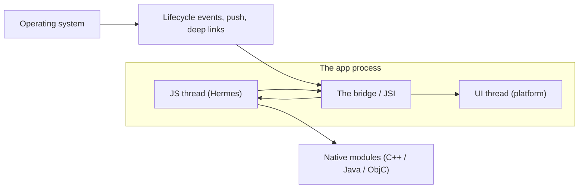
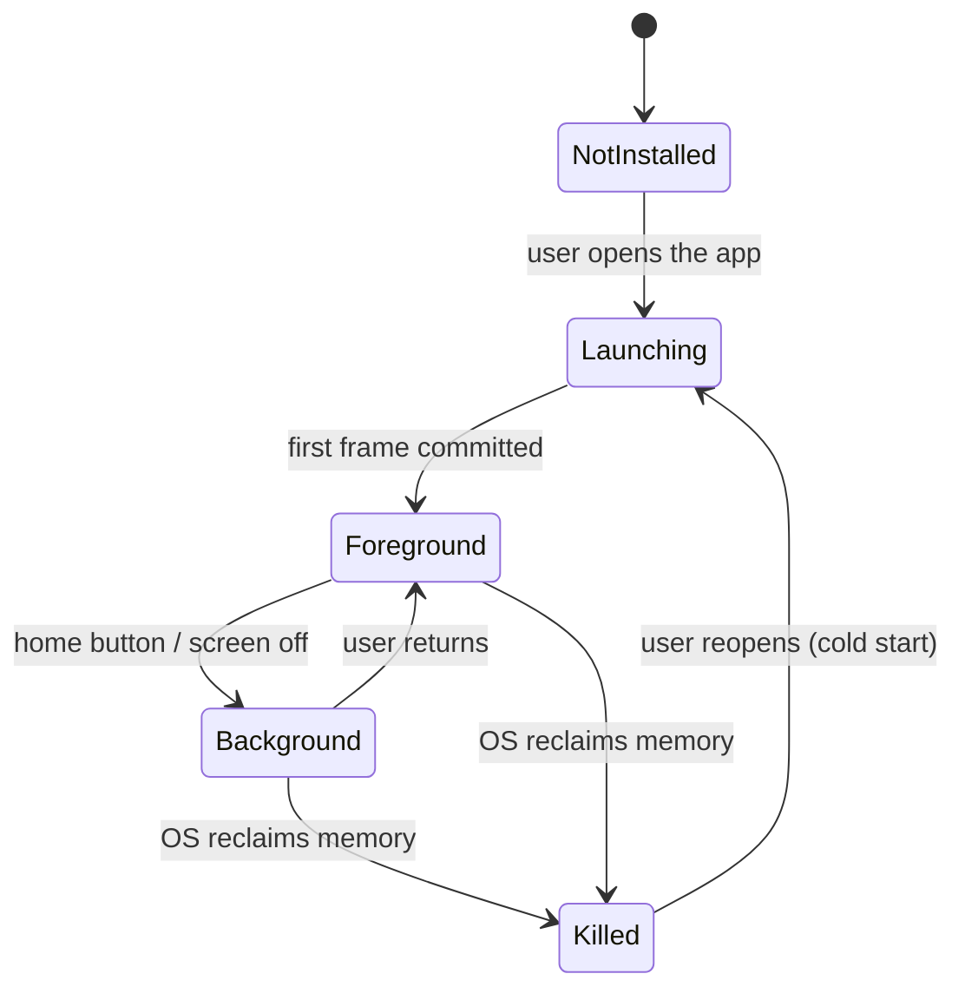
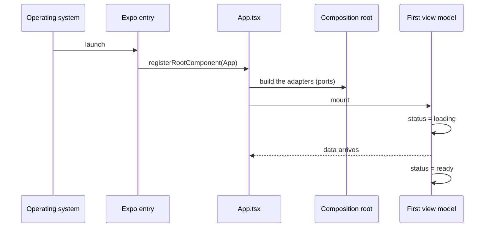

# Platform Model & Expo Runtime

A React Native app is not one program. It is a JavaScript thread, a UI thread
owned by the operating system, a set of native modules, and a lifecycle the
app does not control. Most mobile bugs are runtime bugs: code written for the
UI thread runs on the JS thread, a listener registered too late misses the
event, or state that must survive was kept in a module global.

## 1. The parts of the runtime the kit ships against

| Part               | What it is                                                             | Who owns it   | Your code runs on it   |
| ------------------ | ---------------------------------------------------------------------- | ------------- | ---------------------- |
| **JS thread**      | The Hermes runtime that executes your bundle                           | React Native  | Yes — all of it        |
| **UI thread**      | The thread that lays out and commits frames                            | The platform  | No                     |
| **Native modules** | One native world per capability (secure store, notifications, sensors) | Expo / the OS | Only in `adapters/out` |
| **App lifecycle**  | Foreground, background, killed, cold start                             | The OS        | You observe it         |
| **Metro**          | The dev bundler                                                        | The toolchain | Development only       |

Everything crosses the bridge. A bridge crossing is a serialization, a
context switch and a place where a call can be slow.

## 2. The JS thread is the scarce resource

The JS thread runs **your** code: React rendering, your event handlers, your
promises, your timers. It also runs the work you scheduled without thinking:
JSON parsing of a large payload, a synchronous `SecureStore` read, a sort of
ten thousand rows, a `zod` parse of a 2 MB body.

| Work                              | Where it runs                 | Verdict                                                             |
| --------------------------------- | ----------------------------- | ------------------------------------------------------------------- |
| React render and commit           | JS thread + UI thread         | Normal                                                              |
| `zod` parse of a list response    | JS thread                     | Bound it: parse once, at the boundary, cap the size                 |
| Sorting or filtering a large list | JS thread                     | Do it in the query, or on a smaller projection                      |
| Network I/O                       | Native threads, awaited on JS | Fine — the await yields                                             |
| `SecureStore.get`                 | Native, awaited               | Fine, but it is async for a reason; do not call it in a render path |
| A `while` loop over 10 000 items  | JS thread                     | Never in a render path; never in a list item                        |

The rule is short: **no work over ~16 ms on the JS thread inside a render or
a scroll handler.** Everything else is a budget question
([02](02-device-tiers-and-the-quality-governor.md)).

## 3. The UI thread is not yours

The platform's UI thread commits the frames. You never touch it directly in
React Native — but you can starve it:

- a view that changes state on every frame forces a commit every frame;
- a long list that re-renders every item on one keystroke does the same;
- a `StyleSheet` object rebuilt on every render allocates on every render.

The kit's answer is the view model: the state a screen renders changes on a
command, not on a timer, and the view is a pure function of that state
([03](03-hexagonal-layers-and-mvvm.md)).

## 4. The app lifecycle

| State          | What you may rely on                                                    | What the kit does                                         |
| -------------- | ----------------------------------------------------------------------- | --------------------------------------------------------- |
| **Foreground** | The JS thread is alive; timers fire; the UI updates                     | The normal path; the view model drives the screen         |
| **Background** | The JS thread may run briefly, then is suspended; timers are unreliable | Nothing is assumed to survive; state is re-read on resume |
| **Killed**     | Nothing is alive; only the OS-held state survives                       | Nothing in memory is durable; the local projection is     |
| **Cold start** | The bundle is loaded, then `App.tsx` renders                            | See §5                                                    |

## 5. Cold start

A cold start is: the OS launches the process, the bundle is loaded and
evaluated, `App.tsx` renders, the composition root builds its adapters, the
first screen asks for data.

The order matters, because the composition root is where the wiring happens:

Two rules follow:

1. **Register the listeners at the top level of the composition root.** A
   listener registered after an `await` misses the event that woke the app.
2. **Do not do work in module scope.** A module global that must survive the
   process is a bug: the projection is the state.

## 6. What survives the background

| Thing                                  | Survives background? | Survives a kill? | Notes                                      |
| -------------------------------------- | -------------------- | ---------------- | ------------------------------------------ |
| JavaScript memory                      | Sometimes, briefly   | No               | The OS suspends and then kills the process |
| The local SQLite database              | Yes                  | Yes              | Durable, on disk                           |
| The secure store (Keychain / Keystore) | Yes                  | Yes              | Durable, OS-managed                        |
| The push registration on the server    | Yes                  | Yes              | The server holds it, not the app           |
| A pending outbox row                   | Yes                  | Yes              | It is in the database, not in memory       |
| A timer                                | No                   | No               | Never schedule correctness on a timer      |

**The rule: anything that must survive is written to disk before it is
needed.** The outbox ([08](08-offline-outbox-and-sync.md)) exists for exactly
this reason.

## 7. Native modules

A native module is a C++/Java/Objective-C implementation reached over the
bridge. The `expo-*` packages are native modules with a JavaScript facade.

| Module                   | Capability                        | The port it implements |
| ------------------------ | --------------------------------- | ---------------------- |
| `expo-secure-store`      | Keychain / Keystore               | `SecureStorePort`      |
| `expo-notifications`     | FCM / APNs, channels, permissions | `PushPort`             |
| `expo-network` / NetInfo | Reachability and connection type  | `NetworkStatePort`     |
| `expo-linking`           | Deep links and universal links    | `DeepLinkPort`         |

The ports live in `packages/core/src/ports.ts`; the adapters live in
`packages/<feature>/src/adapters/out/` or, for the shell, in `app/`. The
rule that matters is the import rule, not the module list:

> Only an adapter may import `expo-*` or `react-native` native modules. The
> architecture test fails the build when a domain, an application or a view
> does.

## 8. The composition root

`app/App.tsx` is the composition root of this kit. It is the only place that
may:

- import an adapter and a port at the same time;
- decide which adapter implements which port;
- hold the services a view model needs.

It contains no rules. A rule that ends up in `App.tsx` is a rule that cannot be
tested.

## Do / Don't

| Do                                                | Don't                                 |
| ------------------------------------------------- | ------------------------------------- |
| Read state from the local projection on resume    | Keep it in a module global            |
| Register the lifecycle listeners at the top level | Register them after the first `await` |
| Parse a payload once, at the boundary             | Parse it in every list item           |
| Ask the port for the device capability            | Import `expo-device` in a view        |
| Assume a timer may not fire                       | Assume a timer will fire              |
| Keep the composition root free of rules           | Put a validation in `App.tsx`         |

## See also

- [Device Tiers & the Quality Governor](02-device-tiers-and-the-quality-governor.md)
- [Layers & MVVM](03-hexagonal-layers-and-mvvm.md)
- [Navigation, Routes & Deep Links](07-navigation-routes-and-deep-links.md)
