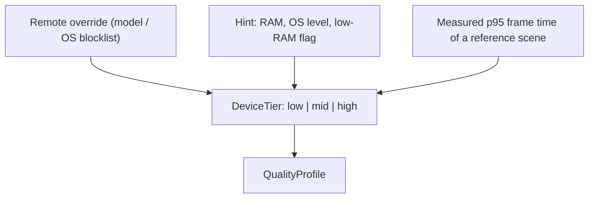

# Device Tiers & the Quality Governor

A React Native app must run well on a five-year-old Android phone with 3 GB
of RAM, not only on a flagship. The template answers that with two mechanisms:
a **device tier** computed at runtime, and a **quality governor** that
degrades the experience while the device is under stress.

The rule that carries the chapter: **a high tier adds fidelity, never
different logic.** A feature that only works on a flagship is a feature that
does not work.

## 1. The three tiers

| Tier     | Typical profile                                                                                        | What it may enable                                                                      |
| -------- | ------------------------------------------------------------------------------------------------------ | --------------------------------------------------------------------------------------- |
| **low**  | ≤ 3 GB RAM, little-core CPU (Cortex-A53/A55 class), entry GPU, eMMC, aggressive OEM battery killer     | 30 fps budget, render scale 0.7, no shadows, aggressive LOD, textures 512, no AR, no 3D |
| **mid**  | 4–6 GB RAM, mid-tier SoC (Snapdragon 6/7 series, Dimensity 700/800, A-series from ~3–4 years ago), UFS | 30–60 fps, render scale 0.85, simple post-processing, texture 1024                      |
| **high** | ≥ 8 GB, flagship SoC                                                                                   | 60 fps, render scale 1.0, full shadows and reflections, texture 2048, AR and heavy 3D   |

The tier is a **hint**, not a verdict. A device is tiered by its class and
then re-tiered by what it actually did
([§3](#3-where-the-tier-comes-from)).

## 2. The budgets

Starting points for a **low-class device in a release build**. They are
calibration targets, not laws: measure them on your own pool
([Device Support Matrix](device-support-matrix.md)).

| Metric                               | Low budget                         | Mid budget |
| ------------------------------------ | ---------------------------------- | ---------- |
| Cold start to interactive (JS shell) | ≤ 3.5 s                            | ≤ 2.5 s    |
| Touch response                       | ≤ 100 ms                           | ≤ 100 ms   |
| JS frame rate in lists and forms     | 60 fps target, ≥ 30 fps worst case | 60 fps     |
| Shell memory resident (no 3D)        | ≤ ~180 MB                          | ≤ ~180 MB  |
| 3D scene memory (whole process)      | ≤ ~300 MB                          | ≤ ~450 MB  |
| 3D frame rate                        | stable 30                          | 30–60      |
| Crash-free sessions                  | ≥ 99.5 %                           | ≥ 99.5 %   |
| Memory growth over 30 min            | ≈ 0                                | ≈ 0        |

The **memory growth over a session** budget is the one that catches a leak
that no other budget catches: the process may stay under its ceiling and
still degrade every ten minutes.

## 3. Where the tier comes from



The shipped resolver is `packages/core/src/device-tier.ts`. It takes a
`DeviceSignals` — every field optional — and returns a tier:

```ts
export interface DeviceSignals {
  readonly totalRamGb?: number;
  readonly lowRamDevice?: boolean;
  readonly osApiLevel?: number;
  readonly measuredFrameP95Ms?: number;
}
```

| Signal                   | Source                                            | Effect                                        |
| ------------------------ | ------------------------------------------------- | --------------------------------------------- |
| The low-RAM flag         | The OS (`isLowRamDevice` on Android)              | Forces `low`                                  |
| Total RAM                | The device module                                 | ≤ 3 GB → `low`; ≤ 6 GB → `mid`; more → `high` |
| OS / API level           | The device module                                 | < 26 → `low`; ≤ 30 → `mid`; more → `high`     |
| **Measured performance** | A first-run micro-benchmark, stored and refreshed | The measurement wins                          |
| Remote overrides         | Remote config, by device model and OS             | Forces the tier                               |

The rules, as the shipped code implements them:

1. `tierFromSignals` reads the hints **in order**: the low-RAM flag wins,
   then the RAM size, then the OS level. A device with no signal at all is
   `mid` — the market default, which the measurement then corrects.
2. `resolveDeviceTier` applies the measurement on top: a p95 above
   `LOW_TIER_FRAME_P95_MS` (33 ms) forces `low`; a p95 above
   `MID_TIER_FRAME_P95_MS` (20 ms) caps the tier at `mid`.
3. **The measurement never raises the tier.** A phone that once rendered one
   scene fast is not evidence that it is a high-tier phone.
4. `parseDeviceTier` reads a tier out of a persisted or remote value and
   returns `null` for anything unknown: a broken override falls back to the
   detected tier, it never guesses.
5. `weakerTier(a, b)` returns the lower of two tiers — the conservative
   answer, used when an override and a measurement disagree.

## 4. The governor contract

The governor lives in `packages/core/src/quality-governor.ts`. It is a pure
function: the device tier plus the current sensors in, a `QualityProfile`
out. It does not read the device itself — the sensors arrive through a port
— so it is testable without a phone.

```ts
export interface QualityProfile {
  readonly renderScale: number; // 0.5 … 1.0
  readonly frameBudgetMs: number; // 16 = 60 fps, 33 = 30 fps
  readonly shadowsEnabled: boolean;
  readonly textureResolution: number;
  readonly particleBudget: number;
}

export interface GovernorInput {
  readonly tier: DeviceTier;
  readonly thermal: ThermalState; // nominal | fair | serious | critical
  readonly memoryPressure: MemoryPressure; // normal | warning | critical
  readonly batterySaver?: boolean;
}
```

The three functions, and what each one owns:

| Function                                             | What it does                                                 |
| ---------------------------------------------------- | ------------------------------------------------------------ |
| `baseProfile(tier)`                                  | The profile of a healthy device of that tier                 |
| `governQuality(input)`                               | The baseline, lowered by the harshest signal that is present |
| `mayStepUp(healthyForMs, minimumHealthyMs = 30_000)` | Whether the runtime loop may step the profile back up        |

The baselines, shipped:

| Tier   | `renderScale` | `frameBudgetMs` | `shadowsEnabled` | `textureResolution` | `particleBudget` |
| ------ | ------------- | --------------- | ---------------- | ------------------- | ---------------- |
| `low`  | 0.7           | 33              | `false`          | 512                 | 100              |
| `mid`  | 0.85          | 24              | `true`           | 1024                | 400              |
| `high` | 1             | 16              | `true`           | 2048                | 1000             |

The degraded profile is one step down from the baseline: the render scale
loses 0.15 (never below `MIN_RENDER_SCALE`, 0.5), the frame budget becomes
`DEGRADED_FRAME_BUDGET_MS` (33 ms, i.e. 30 fps), the shadows go off, and
the texture resolution and the particle budget are halved (the texture
resolution never below 256).

The knobs it moves, from low to high:

| Knob                                     | Low → High            |
| ---------------------------------------- | --------------------- |
| Render scale                             | 0.7 → 0.85 → 1.0      |
| Frame budget                             | 33 ms → 24 ms → 16 ms |
| Shadows / post-processing                | off → on              |
| Texture resolution                       | 512 → 1024 → 2048     |
| Particle budget                          | 100 → 400 → 1000      |
| Mesh LOD, visible entities               | aggressive → generous |
| Map layers (3D buildings, label density) | off / simple → rich   |
| Camera tracking / AR                     | off → on              |

## 5. Step down, step up, hysteresis

| Trigger                                     | Action                                          |
| ------------------------------------------- | ----------------------------------------------- |
| Thermal state `serious` or `critical`       | Step down                                       |
| Memory pressure `warning` or `critical`     | Step down                                       |
| Battery saver on                            | Step down                                       |
| Rolling p95 frame time over the budget      | Step down (the runtime loop calls the governor) |
| Sustained healthy period (30 s of good p95) | Step up, one step only                          |

`governQuality` decides the profile from the signals it is given; the
**runtime loop** is what calls it over time, and what owns the step up. The
hysteresis is `mayStepUp(healthyForMs, minimumHealthyMs = 30_000)`: the
profile steps back up only after thirty seconds of healthy signals.

The hysteresis matters: a governor that flips every few seconds produces
visible pulsing. The rule is **step down immediately, step up only after a
sustained healthy period**, and never by more than one step at a time.

A step down is a **profile change, never a code path change**. The feature
still works; it renders fewer particles.

## 6. The user and the operator both have a say

| Source         | What it may set                                             |
| -------------- | ----------------------------------------------------------- |
| The user       | A performance mode: **Auto / Battery saver / High quality** |
| Managed config | A forced profile; the user's choice is ignored              |
| Remote config  | A default profile and a per-model blocklist                 |
| The governor   | The live profile, overriding the default                    |

The precedence is the same as everywhere else in this repository: **managed
config beats the user setting, and the runtime measurement beats both.**

## 7. What the template ships, and what it does not

| Piece                                        | Status in the template                                                        |
| -------------------------------------------- | ----------------------------------------------------------------------------- |
| `DeviceTier` and the tier resolution         | **Shipped**, in `packages/core/src/device-tier.ts`                            |
| `baseProfile`, `governQuality`, `mayStepUp`  | **Shipped**, in `packages/core/src/quality-governor.ts`                       |
| The quality profile and its knobs            | **Shipped**, in `packages/core/src/quality-governor.ts`                       |
| The sensors that feed the governor           | **Not shipped** — a device-capability port must be implemented by the product |
| The runtime loop that calls the governor     | **Not shipped** — the hysteresis loop is an adoption step                     |
| The micro-benchmark that measures p95        | **Not shipped** — a benchmark scene is a product decision                     |
| Remote config and managed config             | **Not shipped** — see [Admin Guide](admin-guide.md)                           |
| The engine adapters that consume the profile | **Not shipped** — the template has no 3D engine                               |

The governor is shipped without sensors on purpose: a governor that is wired
to a fake sensor would be a claim the template cannot keep. The port is the
seam; the product fills it.

## Do / Don't

| Do                                                    | Don't                                     |
| ----------------------------------------------------- | ----------------------------------------- |
| Measure the tier, do not guess it from the model name | Trust the marketing tier of a device      |
| Step down the profile, not the feature                | Hide a feature because the device is slow |
| Keep a hysteresis on the step up                      | Let the profile flap every second         |
| Let a remote override force the tier                  | Let the user override a managed blocklist |
| Test the governor with fake sensors                   | Test the governor on a single flagship    |

## See also

- [Platform Model & Expo Runtime](01-platform-model-and-expo-runtime.md)
- [Device Support Matrix](device-support-matrix.md)
- [Playbooks](13-playbooks.md)
