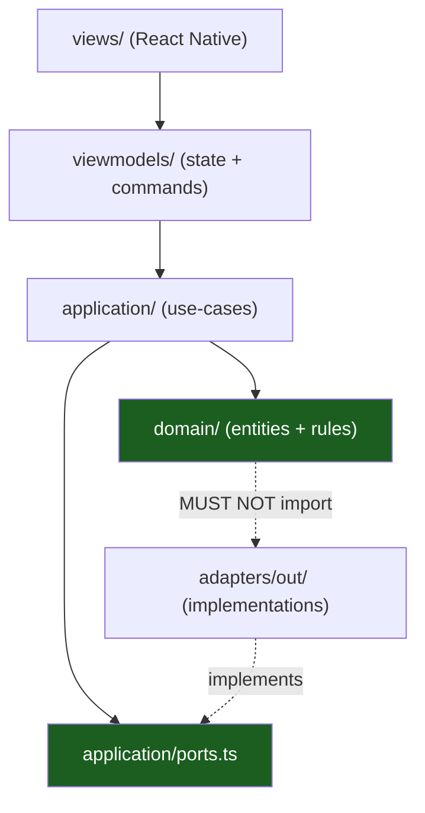

# Hexagonal Layers & MVVM

Inside a slice, the code is split by **what changes**: the product rules
change when the product changes, the device changes when the OS changes. The
split is hexagonal (ports & adapters) on one side and MVVM on the other — the
two meet at the view model.

## 1. The layers of a slice



| Layer           | Owns                               | May import                                       | Must not import                     |
| --------------- | ---------------------------------- | ------------------------------------------------ | ----------------------------------- |
| `domain/`       | Entities, invariants, value errors | `packages/core` (the `Result`)                   | `react`, `react-native`, `expo-*`   |
| `application/`  | Use-cases, the port the slice owns | `domain/`, `packages/core`, `packages/contracts` | `react`, `react-native`, `expo-*`   |
| `adapters/out/` | The implementation of the port     | `application/`, `domain/`, `expo-*`              | The views                           |
| `viewmodels/`   | Presentation state and commands    | `application/`, `domain/`                        | `react-native`, `expo-*`            |
| `views/`        | The React Native surface           | `viewmodels/`, design tokens                     | `**/adapters/**`, `**/*repository*` |

The architecture test enforces the same table:

- no `react`, `react-native` or `expo-*` import in the core, the contracts,
  the domain or the application layer;
- no `react-native` or `expo-*` import in the view models;
- no adapter or repository import in the views.

## 2. Ports: the interface the slice owns

The slice declares the interface it needs, not the interface the device
happens to offer:

```ts
export interface NotesRepositoryPort {
  list(): Promise<readonly Note[]>;
  save(note: Note): Promise<void>;
}
```

The adapter in `packages/feature-notes/src/adapters/out/` implements it. A
test implements it with a fake. The use-case does not know which one it got,
and it re-applies the domain rules to whatever comes back, so an adapter
never decides what a surface may render.

The port speaks plain values and rejects with a thrown error; the **use-case
is the layer that turns that into a `Result`**. `listNotes` and `addNote`
catch the failure and return `Result<T, NotesError>`, so no expected
failure ever escapes as an exception.

## 3. The platform ports

Four ports live in `packages/core/src/ports.ts` and are shared by every slice:

| Port               | What it abstracts                                | Typical implementation   |
| ------------------ | ------------------------------------------------ | ------------------------ |
| `PushPort`         | Permission, device token, incoming notifications | `expo-notifications`     |
| `SecureStorePort`  | Keychain / Keystore                              | `expo-secure-store`      |
| `NetworkStatePort` | Reachability and connection type                 | `expo-network` / NetInfo |
| `DeepLinkPort`     | The initial link and the links that arrive later | `expo-linking`           |

They are declared in `core` and implemented in `adapters/out` — a slice that
needs a capability the core does not declare yet adds the port to the
consuming slice first
([Playbooks §3](13-playbooks.md#3-add-a-port-and-its-adapter)).

## 4. MVVM, mapped onto React Native

| MVVM part  | In this kit                      | Notes                                            |
| ---------- | -------------------------------- | ------------------------------------------------ |
| Model      | `domain/` + `application/`       | Entities and use-cases; no framework             |
| View       | `views/notes-screen.tsx`         | A pure function of the view-model state          |
| ViewModel  | `viewmodels/notes-view-model.ts` | State, commands and their transitions            |
| Binding    | `views/use-notes-view-model.ts`  | The hook that subscribes React to the view model |
| Repository | `adapters/out/`                  | The port implementation, injected                |

The view model is **framework-free**: it is a plain object with a state, a
subscription and the commands.

```ts
export interface NotesViewModel {
  getState(): NotesViewState;
  subscribe(listener: () => void): () => void;
  load(): Promise<void>;
  add(draft: NoteDraft): Promise<void>;
}
```

React enters through the binding in `views/`, which is the only file in the
slice that imports `react`:

```ts
export function useNotesViewModel(viewModel: NotesViewModel) {
  const state = useSyncExternalStore(viewModel.subscribe, viewModel.getState, viewModel.getState);
  const load = useCallback(() => void viewModel.load(), [viewModel]);
  const add = useCallback(
    (title: string, body: string) => void viewModel.add({ title, body }),
    [viewModel],
  );
  return { state, load, add };
}
```

That split is what lets the view model be tested without a renderer: the
test drives `load()` and reads `getState()`, and never touches React.

## 5. The eight statuses

Every view model exposes exactly one `status`. The set is closed, and a
view renders all eight:

| Status           | Meaning                                             | The view shows                          |
| ---------------- | --------------------------------------------------- | --------------------------------------- |
| `loading`        | The first load is in flight                         | A spinner or a skeleton                 |
| `ready`          | There is data                                       | The data                                |
| `empty`          | The request succeeded and there is nothing to show  | The empty state                         |
| `forbidden`      | The server refused the action (403)                 | The permission message                  |
| `not-found`      | The resource does not exist (404)                   | The not-found state                     |
| `offline`        | There is no network and no cached answer            | The offline state with the retry action |
| `error`          | Something else failed                               | The error message with the retry action |
| `policy-blocked` | Managed config or a kill switch forbids the feature | The blocked message                     |

Two rules make the set useful:

- **`empty` is not `ready`.** A list with zero items and a list with items
  are different screens; a view that treats them as one ships a blank page
  that looks broken.
- **`policy-blocked` is not `forbidden`.** `forbidden` is the server saying
  _this user_ may not; `policy-blocked` is the operator saying _nobody_ may.
  They have different messages and different escalation paths.

The mapping from a failure to a status happens **once**, in the view model
(or in a mapper it calls), never in the view.

## 6. Errors as values

Expected failures are values, not exceptions:

```ts
export type Result<T, E> = { ok: true; value: T } | { ok: false; error: E };
```

`Result` lives in `packages/core/src/result.ts`. A use-case returns
`Result<Note, NotesError>`; the view model turns a failure into a status and
an error message; the view renders it. Only a programming error (a thrown
exception) reaches the boundary — and it is caught there.

## 7. The import rules, in one table

| From            | May import                                         | Forbidden                           |
| --------------- | -------------------------------------------------- | ----------------------------------- |
| `domain/`       | `packages/core`                                    | `react`, `react-native`, `expo-*`   |
| `application/`  | `domain`, `packages/core`, `packages/contracts`    | `react`, `react-native`, `expo-*`   |
| `adapters/out/` | `application`, `domain`, `packages/core`, `expo-*` | `views`, `viewmodels`               |
| `viewmodels/`   | `application`, `domain`, `packages/core`           | `react-native`, `expo-*`            |
| `views/`        | `viewmodels`, `packages/core`                      | `**/adapters/**`, `**/*repository*` |
| `app/`          | Everything                                         | Business rules                      |

## 8. The architecture suite

The rules are not a review guideline. Two mechanisms enforce them, and they
must agree.

**ESLint**, in `eslint.config.mjs`, scopes `no-restricted-imports` by
directory: the core and the contracts may not import `react`, `react-native`
or `expo`; the domain and the application layer may not; the view models may
not import `react-native` or `expo`; the views may not import an adapter or
a repository. The scopes are directories, so a new file needs no config
change.

**A static test**, `tests/_platform/architecture/import-boundaries.test.ts`,
reads the source files as text, extracts the import specifiers with a
regular expression and fails when one of the six boundaries is crossed. It
also asserts that the view model carries the **eight statuses** of the
playbook, so the shared set cannot be quietly shortened.

It is a **test**, not a lint rule, so it runs with `pnpm test` and not only
with `pnpm run lint`. A violation is a red test, not a review comment.
`pnpm run test:platform` runs this suite alone.

## Do / Don't

| Do                                         | Don't                                    |
| ------------------------------------------ | ---------------------------------------- |
| Declare the port in the consuming slice    | Import `expo-secure-store` in a use-case |
| Keep the domain free of React Native       | Put a `useState` in the domain           |
| Return `Result` for an expected failure    | Throw `Error` for a validation failure   |
| Render all eight statuses                  | Show a spinner forever on `error`        |
| Inject the adapter at the composition root | Construct the adapter inside a component |

## See also

- [Vertical Slicing](04-vertical-slicing.md)
- [Playbooks](13-playbooks.md)
- [The `notes` slice, file by file](../packages/feature-notes/src/index.ts)
