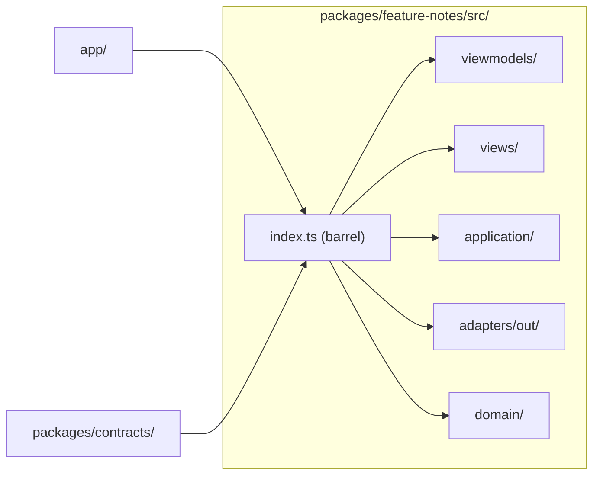

# Vertical Slicing

A **slice** is one feature, cut end to end: its rules, its use-cases, its
storage, its notifications and its UI. Slices are the unit of work, of review
and of ownership. The template ships exactly one, `notes`, as the reference.

## 1. What a slice owns

| Asset              | Owner of the `notes` slice                                        |
| ------------------ | ----------------------------------------------------------------- |
| Local tables       | The `notes` table in the local projection                         |
| Route paths        | `/app/notes/entries` and `/app/notes/entries/{noteId}`            |
| Notification types | The `notes.*` notification types                                  |
| Domain rules       | Title ≤ 120 characters, body ≤ 10 000 characters, plain text only |

Two slices never share a local table, never share a route namespace and never
import each other: the slice is a workspace package with its own
`package.json`, and only what it declares in its dependencies is importable
from it.

## 2. The anatomy of a slice



- **`index.ts` is the only public face.** The app imports from the barrel,
  never from a layer inside it. A slice may reorganise its internals without
  touching the app.
- **The barrel re-exports what the app needs**: the domain functions and the
  length constants, the use-cases, the port types, the adapter factory, the
  view model, the hook and the screen. The domain's own bounds are exported
  because they are the same numbers the contract enforces — the slice
  declares them once and the contract mirrors them.

## 3. Where the cross-slice code goes

| Need                            | Home                                                         |
| ------------------------------- | ------------------------------------------------------------ |
| A shape both ends must agree on | `packages/contracts/` (zod schema)                           |
| A stable error code             | `packages/core/src/`                                         |
| A `Result`                      | `packages/core/src/result.ts`                                |
| A port shared by every slice    | `packages/core/src/ports.ts`                                 |
| A device call                   | `adapters/out/` of the slice that needs it                   |
| A rule two features share       | Extract it into `packages/core` — never import across slices |

The kit does not ship a "shared features" folder on purpose: the moment two
slices need the same code, that code was not slice code.

## 4. Adding a slice

The `add-slice` skill and the `/add-slice` command carry the full recipe. The
short version:

1. Create `packages/feature-<slice>/src/` with the layer folders.
2. Write the domain first: the entity, its invariants, its `Result` errors.
3. Declare the port in `application/ports.ts`.
4. Write the use-cases in `application/use-cases.ts`.
5. Implement the port in `adapters/out/`.
6. Add the view model and the view.
7. Write the barrel and export what the app needs.
8. Add the routes to `packages/contracts/src/routes.ts`.
9. Write the tests under `tests/<slice>/`.

## 5. Worked example

The `notes` slice is reached from the app:

```ts
// app/App.tsx
import {
  createInMemoryNotesRepository,
  createNotesViewModel,
  useNotesViewModel,
  NotesScreen,
} from "@<scope>/feature-notes";
```

The app imports the barrel and never a file inside it. The screen never
imports the repository. The view model never imports an adapter.

## 6. The package boundary

A slice is a **workspace package**, not a folder. That gives it:

- its own `package.json`, so its dependencies are declared and reviewable;
- its own dependency graph in the Metro bundle;
- the ability to be replaced wholesale by a product.

The workspace name is `@<scope>/feature-<slice>`; the import specifier is
the same. The package points its `main` and `types` at `src/index.ts`
([ADR 0002](adr/0002-source-only-workspace-packages.md)).

## Do / Don't

| Do                                            | Don't                                                          |
| --------------------------------------------- | -------------------------------------------------------------- |
| Give every slice its own table namespace      | Store two features under one table                             |
| Import a slice through its barrel             | Import `packages/feature-notes/src/domain/note` from `app/`    |
| Put a shared contract in `packages/contracts` | Export a shared entity from one slice and import it in another |
| Add a slice with its own tests                | Extend the `notes` slice with an unrelated feature             |

## See also

- [Layers & MVVM](03-hexagonal-layers-and-mvvm.md)
- [Directory Structure](05-directory-structure.md)
- [Playbooks](13-playbooks.md)
