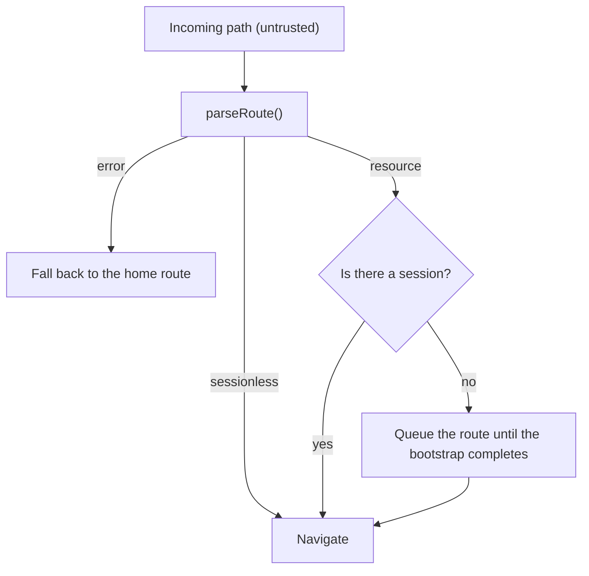
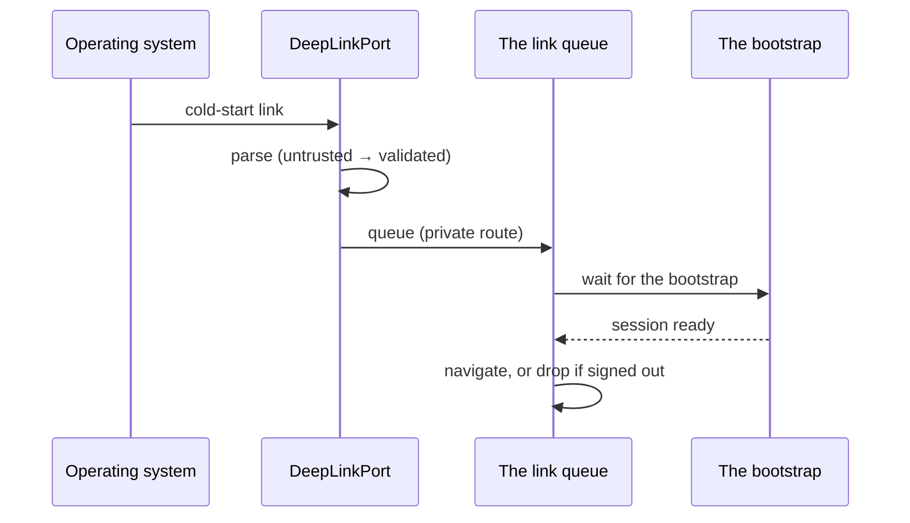

# Navigation, Routes & Deep Links

The route grammar is shared with the web and desktop clients, so a link sent
in a message, a push notification or a browser resolves to the same path
everywhere. The typed route table lives in `packages/contracts/src/routes.ts`
and is the only place a path is written down.

## 1. The route grammar

```text
/{userType}/{module}/{resource}
/{userType}/{module}/{resource}/{resourceId}
/{userType}/{module}/{resource}/{resourceId}/{subresource}
```

Three, four or five segments. The fifth is the optional `{subresource}` of
the shared platform grammar
([`PLAYBOOK_URLS.md`](../PLAYBOOK_URLS.md)).

| Segment       | Meaning                                   | Example    |
| ------------- | ----------------------------------------- | ---------- |
| `userType`    | The experience namespace                  | `app`      |
| `module`      | The backend slice the resource belongs to | `notes`    |
| `resource`    | The plural resource                       | `entries`  |
| `resourceId`  | The identifier of one resource            | `ntf_123`  |
| `subresource` | The nested collection of one resource     | `comments` |

The namespaces are shipped as a constant:

```ts
export const USER_TYPES = [
  "app",
  "admin",
  "owner",
  "manager",
  "agent",
  "partner",
  "public",
] as const;
```

Worked examples from the family:

```text
/app/market/products/{productId}
/app/game/encounters/{encounterId}
/app/avatar/avatars/{avatarId}
/app/notes/entries/{noteId}
/app/notes/entries/{noteId}/comments
```

The session-less routes are outside the grammar, because they have no
resource:

```text
/onboarding  /login  /register  /forgot-password  /reset-password  /verify-email
```

**The `userType` segment never authorizes.** It is an experience namespace:
`/app` does not mean "signed in" and does not mean "allowed". The server
decides what a session may do; the client only reflects the answer
([`forbidden` and `policy-blocked`](03-hexagonal-layers-and-mvvm.md#5-the-eight-statuses)).

## 2. The typed route table

`packages/contracts/src/routes.ts` holds the table, the builders and the
parser. A table entry says what a path means; a builder returns the path.

```ts
export interface RouteSpec {
  readonly userType: UserType;
  readonly module: string;
  readonly resource: string;
  readonly byId: boolean;
}

export const ROUTE_TABLE: readonly RouteSpec[] = [
  { userType: "app", module: "notes", resource: "entries", byId: true },
  { userType: "app", module: "market", resource: "products", byId: true },
  { userType: "app", module: "notifications", resource: "preferences", byId: false },
  { userType: "admin", module: "tenants", resource: "users", byId: true },
];
```

`byId` says whether the route accepts a resource id: the preferences route
does not, so a path with an id under it is refused.

> **Known gap.** The shared grammar has an optional fifth `{subresource}`
> segment, but a `RouteSpec` declares no subresource and no row of the
> table declares one: a path with five segments is grammatically valid and
> refused as an unknown route. Add the field and the row when the app needs
> a nested collection.

The builders are typed, and the resource id is validated — an id that would
change the shape of the path is a programming error, not a URL:

```ts
export function resourcePath(
  userType: UserType,
  module: string,
  resource: string,
  resourceId?: string,
): string;
export function notesListPath(userType?: UserType): string;
export function notePath(noteId: string, userType?: UserType): string;
export function sessionlessPath(route: SessionlessRoute): string;
```

**No path is ever written by hand.** A notification payload, a view model
command and a test all call the same builder. A hand-written path is a path
that drifts.

## 3. Parsing an incoming path

A path that arrives from outside — a deep link, a push payload — is
**untrusted input**. The shipped parser answers three questions: is this a
known route, does it have the parameters it requires, and may this screen be
opened without a session?

```ts
export function parseRoute(path: string): Result<ParsedRoute, RouteError>;
```

The result is a value, not an exception:

| Kind          | When                                                             |
| ------------- | ---------------------------------------------------------------- |
| `sessionless` | The path is one of the six session-less routes                   |
| `resource`    | The path is in the table; `resourceId` is present when it may be |
| `unknown`     | The path is not in the table — the caller decides what to do     |

The failure codes are `unknown-route` and `invalid-path`. A path that is not
absolute, that has a segment count other than three, four or five, that is
not in the table, that carries a subresource no row declares, that carries an
id a route does not take, or whose id does not match `RESOURCE_ID`
(`/^[A-Za-z0-9_-]{1,128}$/`) is refused.



Three rules, in order:

1. **Unknown route → the home route.** Never a crash, never a blank screen.
2. **Invalid parameter → the home route.** The parameter is validated by
   the parser, not by a regular expression in the caller.
3. **A private route without a session → queue it**, do not navigate to
   `/login` and lose the destination.

## 4. Universal links and app links

| Kind           | Form                                         | Needs                                      |
| -------------- | -------------------------------------------- | ------------------------------------------ |
| Universal link | `https://<domain>/app/notes/entries/ntf_123` | `apple-app-site-association` on the domain |
| App link       | `https://<domain>/app/notes/entries/ntf_123` | `assetlinks.json` on the domain            |
| Custom scheme  | `<app>://app/notes/entries/ntf_123`          | The scheme in `app/app.json`               |

The universal link is the one to prefer: it is verified by the OS, so an app
that claims the domain cannot be impersonated by another app. A custom scheme
is not verified and must be treated as untrusted input — which it already is,
because every incoming path is parsed through the route table.

> **Known gap.** The template ships the route table and the parser, not the
> native configuration: `app/app.json` sets the scheme, and the associated
> domain files are a deployment step
> ([Admin Guide](admin-guide.md)). A domain that does not publish
> `apple-app-site-association` or `assetlinks.json` opens the browser
> instead of the app.

## 5. The `DeepLinkPort`

The port is declared in `packages/core/src/ports.ts`:

```ts
export interface DeepLinkPort {
  initial(): Promise<ParsedLink | null>;
  onLink(callback: (link: ParsedLink) => void): Unsub;
}
```

`initial()` returns the link the app was **launched with** — the cold-start
case. `onLink` delivers the links that arrive while the app is running. Both
go through the same parser; there is no second path.

## 6. Queuing a cold-start link

A tap on a notification, or a link that opens the app from the browser,
arrives **before the bootstrap finishes**: the session is not known yet, the
local projection is not open, the user may not even be signed in.

The rule from the playbook, implemented as a queue in the app shell:

1. The incoming link is parsed immediately — a bad link is rejected before
   anything else.
2. If the route is public, it is navigated to once the shell is ready.
3. If the route is private and there is no session, the link is **queued**.
4. The queue is drained after the bootstrap: if the user signed in, the
   queued route is navigated to; if not, the app lands on the login route
   and the queued route is dropped.



The queue is **in memory and short-lived**: it holds one link, it is drained
once, and it is dropped when the app is killed. A link that must survive a
kill is a notification, not a deep link.

## 7. Navigation without a file-based router

The template has **no `expo-router`** and no file-system routing: the
entry is a plain `App.tsx` ([ADR 0001](adr/0001-expo-with-a-plain-app-entry.md)).
The navigation state lives in the app shell, and the shell resolves a route
against the table.

The consequences worth knowing:

| Consequence                                   | Why                                                    |
| --------------------------------------------- | ------------------------------------------------------ |
| The route table is the single source of truth | There is no directory whose names are the truth        |
| A screen is a component, not a directory      | Adding a screen is adding a file, not a convention     |
| Navigation is a value, not an imperative API  | The stack is state, so it can be serialised and tested |
| A deep link needs an explicit match           | Nothing is mounted by path by accident                 |
| The typed routes are compile-time checked     | `notePath(id)` cannot lose its parameter               |

The price is honest: writing a screen means writing the route, the builder
and the branch that renders it. The benefit is that the link that arrives
from the OS and the link the app navigates to come from the same table.

## Do / Don't

| Do                                                         | Don't                                         |
| ---------------------------------------------------------- | --------------------------------------------- |
| Build every path with the route builders                   | Write a path string in a component            |
| Parse every incoming path through `parseRoute`             | Trust a path that "looks right"               |
| Let the parser validate the resource id                    | Interpolate a parameter into a path unchecked |
| Queue a cold-start private link until the session is known | Navigate to `/login` and lose the destination |
| Treat a custom scheme link as untrusted                    | Trust the link because the OS opened the app  |

## See also

- [Layers & MVVM](03-hexagonal-layers-and-mvvm.md)
- [Push Notifications](10-push-notifications.md)
- [ADR 0001 — Expo with a plain `App.tsx` entry](adr/0001-expo-with-a-plain-app-entry.md)
