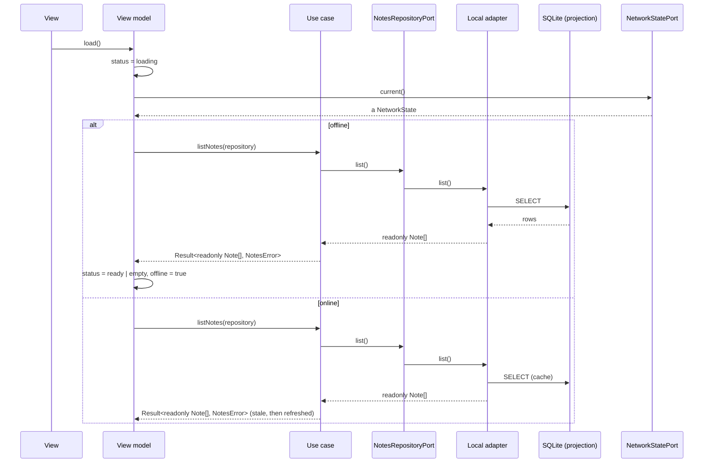
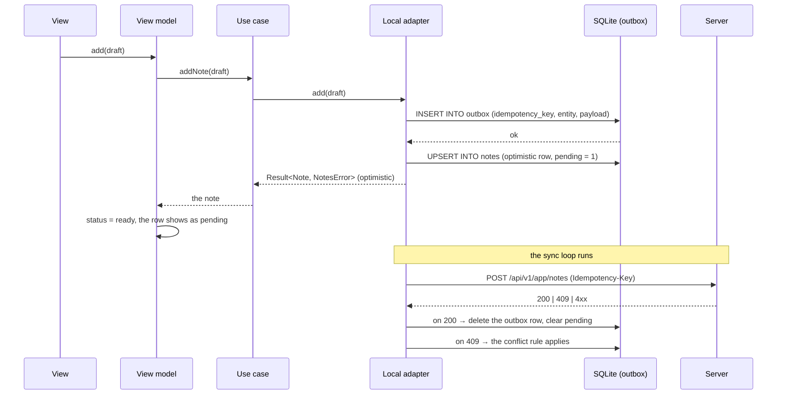

# Offline, Outbox & Sync

The local database is a **projection** of what the server said, not a second
source of truth. A mutation the server has not accepted yet lives in an
**outbox** until it is. This chapter describes the contract; the template
ships the ports and the shape, not a filled-in sync engine.

## 1. The projection

The projection is a local SQLite database (`expo-sqlite`, WAL mode) that
holds:

| Table    | Holds                                                   | Written by       |
| -------- | ------------------------------------------------------- | ---------------- |
| `notes`  | The last known state of the server's notes              | The sync adapter |
| `outbox` | The mutations the server has not accepted yet           | The write path   |
| `meta`   | The sync cursor, the last sync time, the schema version | The sync adapter |

Three properties make it a projection and not a database of record:

1. **The server can contradict it.** Every row may be replaced by the server
   at any time.
2. **It may be wiped.** Clearing the projection is always safe; the app
   re-fetches.
3. **It is versioned.** A row written by a newer schema is refused, not
   half-read.

## 2. The read path



The rule the view model follows: **when the network is down, the projection
answers and the status is `offline`**, not `error`. An offline device that
shows the cached list with an offline banner is working; an offline device
that shows an error is broken.

## 3. The write path and the outbox

A write that must survive the app being killed cannot live in memory. It is
written to the outbox **first**, and sent **second**.



The optimistic row is a **presentation choice**, not a fact: the UI may show
the note immediately with a "pending" marker, and the server's answer is the
truth. If the app is killed between the outbox insert and the request, the
row is still there and the sync loop picks it up.

## 4. The idempotency key

Every outbox row carries a key that the server treats as the identity of the
request:

```text
Idempotency-Key: <outbox row id>
```

The rules:

| Rule                                                          | Why                                                    |
| ------------------------------------------------------------- | ------------------------------------------------------ |
| The key is generated **once**, when the outbox row is created | A key regenerated on retry is a second mutation        |
| The key is sent on **every** retry of that row                | The server deduplicates on the key, not on the attempt |
| A retried row keeps its key forever                           | The server may remember it for 24 hours or more        |
| Two different mutations never share a key                     | Sharing one silently drops one of them                 |

The server answers a repeated key with the **original** response. That is
what makes the retry safe.

## 5. Backoff

A failed outbox row is retried with exponential backoff and jitter:

| Attempt | Delay                 |
| ------- | --------------------- |
| 1       | immediately           |
| 2       | ~1 s + jitter         |
| 3       | ~2 s + jitter         |
| 4       | ~4 s + jitter         |
| n       | ~2ⁿ⁻¹ seconds, capped |

Three rules on top of the exponential curve:

1. **A 4xx that is not a conflict is terminal.** The row goes to a `failed`
   state and is not retried; a validation error will never succeed.
2. **A 5xx and a network failure are retryable.** They are retried with the
   backoff above.
3. **The rows of one entity are ordered.** Two edits to the same note are
   sent in the order they were made, so the server never sees an older
   version after a newer one.

The retry is **event-driven, not a polling loop**: the sync runs when the
app becomes active, when the network comes back, and when the user pulls to
refresh. The OS may suspend the app at any moment, and the outbox survives
that.

## 6. Conflicts

A conflict is the server saying "the state you based this on is not the
current state". It is a **typed result**, not an exception:

| Server answer                | Meaning                       | The client's job                              |
| ---------------------------- | ----------------------------- | --------------------------------------------- |
| `200`                        | Accepted                      | Delete the outbox row, clear the pending flag |
| `409` with a current version | The row changed               | Apply the conflict rule, then delete the row  |
| `409` with a field error     | The payload is invalid        | Surface the error, move the row to `failed`   |
| `422`                        | The payload failed validation | Surface the error, move the row to `failed`   |

The conflict rule is a **product decision** and the template does not make it
for you. The three usual ones:

| Rule            | Behaviour                                              | Cost                        |
| --------------- | ------------------------------------------------------ | --------------------------- |
| Last write wins | The server's state is kept; the local row is refreshed | The user's edit is lost     |
| Local wins      | The mutation is replayed on top of the server's state  | The server's change is lost |
| Manual          | The user chooses, in the view                          | A dialog on every conflict  |

Whichever you pick, it is applied **in the view model**, and the result is a
`Result` the view renders. It is never applied silently in the adapter.

## 7. The sync cursor and the schema gate

| Item                         | Where it lives      | What it does                                             |
| ---------------------------- | ------------------- | -------------------------------------------------------- |
| The sync cursor              | The `meta` table    | The server's "everything after this point" marker        |
| The schema version           | The `meta` table    | Refuses to read a projection written by a newer build    |
| The server's minimum version | The server's answer | An old client is told to upgrade, not allowed to corrupt |

A projection written by a **newer** schema version is refused, not
half-read: the app clears it and re-fetches. Half-reading is how a client
corrupts a server's data.

## 8. What the template ships

| Piece                                      | Status in the template                                                                  |
| ------------------------------------------ | --------------------------------------------------------------------------------------- |
| The `NetworkStatePort` declaration         | **Shipped**, in `packages/core/src/ports.ts`                                            |
| The `NotesRepositoryPort` declaration      | **Shipped**, in `packages/feature-notes/src/application/ports.ts`                       |
| The in-memory repository adapter           | **Shipped**, in `packages/feature-notes/src/adapters/out/in-memory-notes-repository.ts` |
| The projection tables and the outbox shape | **Not shipped** — no SQLite schema, no outbox table                                     |
| The idempotency key, the backoff           | **Not shipped** — see §4 and §5                                                         |
| The SQLite adapter (`expo-sqlite`)         | **Not shipped** — a product decision                                                    |
| The HTTP adapter that talks to the server  | **Not shipped** — the SDK is a product decision                                         |
| The conflict rule                          | **Not shipped** — see §6                                                                |
| The sync scheduler                         | **Not shipped** — a product decision                                                    |

> **Known gap.** The shipped `notes` adapter resolves its reads in memory:
> there is no local database, no outbox table and no HTTP adapter. The port
> (`NotesRepositoryPort`) and the use-cases that wrap it in a `Result` are
> the seams a product fills in without inventing shapes. See
> [00 — Overview & Principles §7](00-overview-and-principles.md).

## Do / Don't

| Do                                            | Don't                                      |
| --------------------------------------------- | ------------------------------------------ |
| Write the outbox row before the request       | Send first and hope the app survives       |
| Generate the idempotency key once             | Regenerate it on every retry               |
| Answer an offline read from the projection    | Show an error when the device is offline   |
| Apply the conflict rule in the view model     | Resolve a conflict silently in the adapter |
| Refuse a projection written by a newer schema | Read it field by field and hope            |

## See also

- [Layers & MVVM](03-hexagonal-layers-and-mvvm.md)
- [Data Flows](data-flows.md)
- [Playbooks](13-playbooks.md)
