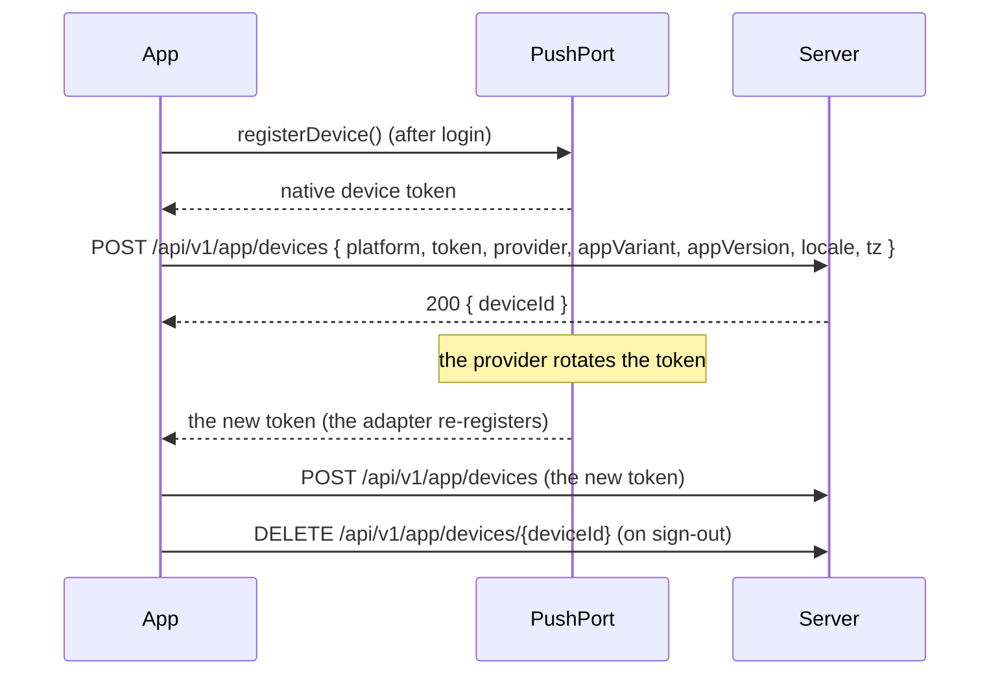

# Push Notifications

Push is a **channel, not a data path**. The payload says "something
happened"; the app fetches the details after the tap. This chapter covers
the contract the template ships and the adapters a product must add.

## 1. The architecture

```text
App (expo-notifications) ──permission──► OS
   │ device token (FCM on Android, APNs on iOS)
   ▼
POST /api/v1/app/devices { platform, token, provider, appVariant, appVersion, locale, tz }
   ▼
Backend notifications slice: registry, preferences, templates, dedupe,
   rate limits → provider adapters (FCM HTTP v1, APNs) → delivery receipts
```

The app's job is three things and no more: **ask for the permission, register
the device token, and route the tap.**

## 2. The `PushPort`

```ts
export interface PushPort {
  permissionState(): Promise<PermissionState>;
  requestPermission(): Promise<PermissionState>;
  registerDevice(): Promise<DeviceRegistration>;
  unregisterDevice(): Promise<void>;
  onNotification(callback: (notification: IncomingNotification) => void): Unsub;
  onTap(callback: (notification: IncomingNotification) => void): Unsub;
}
```

The port is declared in `packages/core/src/ports.ts`. It is
deliberately thin: a permission state, a registration, two subscriptions. It
knows nothing about FCM, about channels, or about what a notification means.

## 3. The permission states

The port ships three states:

| State          | Meaning                                | The app's behaviour                        |
| -------------- | -------------------------------------- | ------------------------------------------ |
| `undetermined` | The user has not been asked yet        | Ask at the right moment, not at launch     |
| `granted`      | The user allowed notifications         | Register the device                        |
| `denied`       | The user refused, or the OS blocked it | Do not ask again; offer the settings route |

Two rules:

- **Ask in context.** The prompt appears when the feature that needs it is
  used for the first time, not on the first launch. A prompt on the first
  launch is refused at a much higher rate.
- **Android 13+ requires `POST_NOTIFICATIONS`.** Without the runtime
  permission, notifications **silently never appear**. There is no error;
  there is only silence.

## 4. The notification contract

The payload is versioned and minimal. The template ships the **port**, not
the payload schema: the shape below is the contract a product adopts, and
the `IncomingNotification` type of the port is the part the app code sees.

```json
{
  "v": 1,
  "type": "notes.reminder",
  "category": "transactional",
  "deepLink": "<app>://app/notes/entries/ntf_123",
  "correlationId": "…",
  "collapseKey": "note:ntf_123",
  "ttl": 86400,
  "priority": "high",
  "title": "…",
  "body": "…",
  "data": { "noteId": "ntf_123" }
}
```

| Field         | Rule                                                                   |
| ------------- | ---------------------------------------------------------------------- |
| `v`           | The payload version; an unknown version is ignored safely and counted  |
| `type`        | Dotted, namespaced, versioned by convention; unknown types are ignored |
| `category`    | One of the categories below; it drives the channel and the preference  |
| `deepLink`    | A path built by the route builders; validated against the route table  |
| `collapseKey` | Replaces a stale alert about the same entity                           |
| `ttl`         | Per type: a price drop expires, an order shipment persists             |
| `data`        | Identifiers only — never content                                       |

**The lock screen is public.** A payload that carries a token, an address, a
message body or a price is a leak. The payload carries identifiers; the app
fetches the truth after the tap, with a session.

## 5. The categories

| Category           | Examples                                     | Default                |
| ------------------ | -------------------------------------------- | ---------------------- |
| `transactional`    | Order status, payment issues, password reset | On, high importance    |
| `account-security` | New login, password changed                  | On, cannot be disabled |
| `game-events`      | Nearby spawns, event start                   | On, user-tunable       |
| `social`           | Friend requests, mentions                    | On                     |
| `avatar`           | Session invites                              | On                     |
| `promotions`       | Offers, price drops                          | **Off until opted in** |

A category maps to an Android channel and an iOS notification category. The
user's per-category preference is stored **server-side** and applied when the
server sends, so a change follows the user to a new device.

## 6. The token lifecycle



| Event                    | What the app does                                                                   |
| ------------------------ | ----------------------------------------------------------------------------------- |
| After login              | Register the device; **never before**                                               |
| On every app start       | Re-register, to detect a rotation                                                   |
| On a token refresh event | Register the new token, replace the old (the adapter subscribes; the port does not) |
| On sign-out              | Unregister the device                                                               |
| On account deletion      | Unregister the device, then wipe the local data                                     |
| On a permission change   | Report the new state so the server stops sending                                    |

The server prunes dead tokens itself: the provider returns `UNREGISTERED` or
`NotRegistered`, and the server removes the registration.

## 7. Handling states

| App state      | What happens                                                                                                                          |
| -------------- | ------------------------------------------------------------------------------------------------------------------------------------- |
| **Foreground** | The app receives the notification and shows an in-app banner through the notifier. The OS alert is not duplicated unless configured.  |
| **Background** | The OS displays the notification. A tap launches or resumes the app and delivers the payload.                                         |
| **Killed**     | A tap cold-starts the app; the initial notification is retrieved and queued until the bootstrap completes.                            |
| **Signed out** | The payload is still parsed — but the private route is queued, and it is dropped if no session appears. The alert content is generic. |

The foreground case is the one that needs a decision: a notification that
arrives while the user is looking at the screen must not be both an OS alert
and an in-app banner. The template's rule is **the in-app banner wins**, and
the OS alert is suppressed for foreground receipts.

## 8. Notification routing

The tap is a deep link and follows the same rules as any other
([07](07-navigation-routes-and-deep-links.md)):

```ts
function handleTap(n: IncomingNotification, nav: Navigator, session: SessionPort) {
  const parsed = parseRoute(n.data.deepLink ?? ""); // allowlist, validated parameters
  if (!parsed.ok) return nav.go(homeRoute());
  if (!session.isAuthenticated()) return queueUntilSession(parsed.value);
  nav.go(parsed.value); // never a state change from the payload
}
```

The three rules, one more time:

1. **Validate the type.** An unknown type is ignored and counted.
2. **Validate the link.** It goes through the route table, never through a
   hand-written `switch` on a string.
3. **Never act on the payload.** A notification opens a screen; it does not
   delete, pay or confirm anything.

## 9. Low-end and OEM realities

| Reality                                                      | Consequence                                               |
| ------------------------------------------------------------ | --------------------------------------------------------- |
| Aggressive OEM battery managers kill background work         | Delivery is delayed; a data-only message may never arrive |
| High-priority FCM is throttled                               | Only genuinely time-critical alerts use it                |
| Background JS is unreliable                                  | Never depend on it for correctness                        |
| Android channels are created at install, not at first launch | A channel that does not exist shows no alert              |
| The device is offline                                        | The message is queued by the provider and delivered later |

The rule that follows: **never depend on push for correctness.** The app
reconciles on foreground and over realtime. Push is the wake-up channel.

## 10. What the template ships

| Piece                                                 | Status                                                                 |
| ----------------------------------------------------- | ---------------------------------------------------------------------- |
| `PushPort` declaration                                | **Shipped**, `packages/core/src/ports.ts`                              |
| The notification payload schema and the category list | **Not shipped** — the contract is a product decision                   |
| The permission states                                 | **Shipped**, in the port's types (`undetermined`, `denied`, `granted`) |
| The `expo-notifications` adapter                      | **Not shipped** — a product decision                                   |
| The device registration request                       | **Not shipped** — needs the API base URL                               |
| The server-side notifications slice                   | **Not shipped** — it is a backend concern                              |
| The per-category preference store                     | **Not shipped** — it is server-side                                    |

## Do / Don't

| Do                                  | Don't                            |
| ----------------------------------- | -------------------------------- |
| Register the device after login     | Register on the first launch     |
| Put identifiers in the payload      | Put content in the payload       |
| Ignore an unknown notification type | Guess what an unknown type means |
| Reconcile on foreground             | Depend on push for correctness   |
| Unregister on sign-out              | Keep a dead registration         |
| Ask for the permission in context   | Ask on the first launch          |

## See also

- [Navigation, Routes & Deep Links](07-navigation-routes-and-deep-links.md)
- [Security & Secure Store](09-security-and-secure-store.md)
- [Admin Guide](admin-guide.md)
