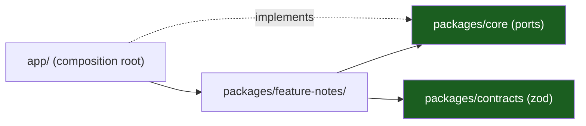

# Mobile Template Documentation

The handbook of the React Native template: **Expo SDK 58, React Native 0.88.1,
React 19.3.0, TypeScript, pnpm workspace**. It describes the kit as it is —
the runtime, the layers, the ports, the device tiers, the routes — and marks
the parts a product must still adopt as gaps rather than faking them.

> 15 chapters · 3 reference documents · 2 ADRs.

## The one rule

**The device is an adapter.** `packages/core` declares the ports; only
`adapters/out` may import `expo-*` or a native module. The domain, the
application layer and the views never name a device API.
See [Layers & MVVM](03-hexagonal-layers-and-mvvm.md) and
[Platform Model](01-platform-model-and-expo-runtime.md).

## Start here

New to the kit? Read [00 — Overview & Principles](00-overview-and-principles.md),
then [01 — Platform Model](01-platform-model-and-expo-runtime.md) and
[03 — Layers & MVVM](03-hexagonal-layers-and-mvvm.md). Starting a project?
Jump to [05 — Directory Structure](05-directory-structure.md) and
[13 — Playbooks](13-playbooks.md). Reviewing a change? Read
[09 — Security & Secure Store](09-security-and-secure-store.md) and
[12 — Testing & CI](12-testing-and-ci.md).

## Chapters

| #   | Chapter                                                                            | What it covers                                                  |
| --- | ---------------------------------------------------------------------------------- | --------------------------------------------------------------- |
| 00  | [Overview & Principles](00-overview-and-principles.md)                             | The one idea, ten principles, the chapter map                   |
| 01  | [Platform Model & Expo Runtime](01-platform-model-and-expo-runtime.md)             | The JS thread, the UI thread, native modules, the app lifecycle |
| 02  | [Device Tiers & the Quality Governor](02-device-tiers-and-the-quality-governor.md) | low/mid/high, thermal, memory, the governor contract, budgets   |
| 03  | [Hexagonal Layers & MVVM](03-hexagonal-layers-and-mvvm.md)                         | The layers, the ports, the eight statuses, the import rules     |
| 04  | [Vertical Slicing](04-vertical-slicing.md)                                         | One slice per feature, sealed barrels, shared code              |
| 05  | [Directory Structure](05-directory-structure.md)                                   | The tree of this kit, how to instantiate it                     |
| 06  | [Variants & Monorepo](06-variants-and-monorepo.md)                                 | The variant seam, per-variant native modules, EAS               |
| 07  | [Navigation, Routes & Deep Links](07-navigation-routes-and-deep-links.md)          | The route grammar, the builders, untrusted params, cold start   |
| 08  | [Offline, Outbox & Sync](08-offline-outbox-and-sync.md)                            | The SQLite projection, the outbox, idempotency, conflicts       |
| 09  | [Security & Secure Store](09-security-and-secure-store.md)                         | The keystore, bundle secrets, tokens, pinning, device integrity |
| 10  | [Push Notifications](10-push-notifications.md)                                     | FCM v1/APNs, device registration, token rotation, routing       |
| 11  | [Telemetry](11-telemetry.md)                                                       | Redaction, crash reporting, performance markers, never-logged   |
| 12  | [Testing & CI](12-testing-and-ci.md)                                               | The tiers, the locations, the commands, the gates               |
| 13  | [Playbooks](13-playbooks.md)                                                       | The six changes you will make most                              |
| 14  | [Glossary](14-glossary.md)                                                         | Every term used in this set                                     |

## Reference

| Document                                                                                | What it covers                                                                    |
| --------------------------------------------------------------------------------------- | --------------------------------------------------------------------------------- |
| [Device Support Matrix](device-support-matrix.md)                                       | Tier definitions, the reference devices, what each tier may enable, the test pool |
| [Data Flows](data-flows.md)                                                             | Five flows, with the trust boundary marked on every hop                           |
| [Admin Guide](admin-guide.md)                                                           | Push credentials, store configuration, managed config keys, how to verify them    |
| [ADR 0001 — Expo with a plain `App.tsx` entry](adr/0001-expo-with-a-plain-app-entry.md) | Why there is no file-based router, and what that buys                             |
| [ADR 0002 — Source-only workspace packages](adr/0002-source-only-workspace-packages.md) | Why `main`/`types` point at `src`, and why there is no build step                 |

## The gates

Every command runs from the workspace root, after `pnpm install`.

| Command                   | What it proves                                                             |
| ------------------------- | -------------------------------------------------------------------------- |
| `pnpm run typecheck`      | `tsc --noEmit` over the build program and the test program                 |
| `pnpm run lint`           | ESLint plus the per-directory architecture guards                          |
| `pnpm test`               | Vitest: the slices, the contracts, the platform and the architecture suite |
| `pnpm run test:platform`  | Vitest over `tests/_platform` only — the architecture suite                |
| `pnpm run export:android` | The Expo bundle exports for Android                                        |
| `pnpm run evals`          | The `.claude` kit: agents, skills, commands, placeholder leaks             |
| `pnpm run ci`             | typecheck → lint → test → export:android                                   |
| `pnpm run verify`         | The template itself, renamed in a temp dir, gate by gate                   |
| `make ci`                 | The same gate, through the Makefile                                        |

`make` mirrors the pnpm scripts: `install`, `build`, `test`, `lint`,
`typecheck`, `format`, `format-check`, `evals`, `verify`, `ci`.

## Known gaps of the template

The template ships the seams. The gaps are listed in
[00 — Overview & Principles §7](00-overview-and-principles.md) and in each
chapter; the ones that bite first are the missing local projection and
outbox ([08](08-offline-outbox-and-sync.md)), the missing push registration
adapter ([10](10-push-notifications.md)) and the absence of a logger or a
telemetry sink ([11](11-telemetry.md)).

## Where the code is

| Topic                  | File                                                                      |
| ---------------------- | ------------------------------------------------------------------------- |
| The app entry          | [`app/App.tsx`](../app/App.tsx)                                           |
| The workspace packages | [`packages/`](../packages/)                                               |
| The ports              | [`packages/core/src/ports.ts`](../packages/core/src/ports.ts)             |
| The route table        | [`packages/contracts/src/routes.ts`](../packages/contracts/src/routes.ts) |
| The example slice      | [`packages/feature-notes/`](../packages/feature-notes/)                   |
| The architecture suite | [`tests/_platform/architecture/`](../tests/_platform/architecture/)       |
| The agent runtime      | [`.claude/`](../.claude/)                                                 |
