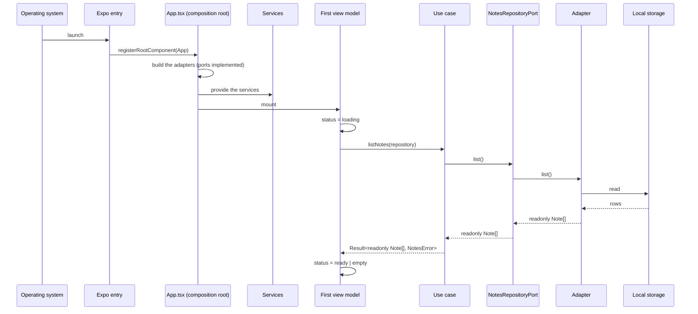
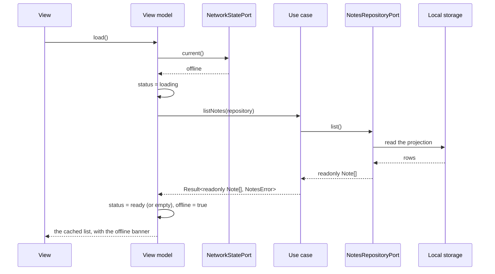
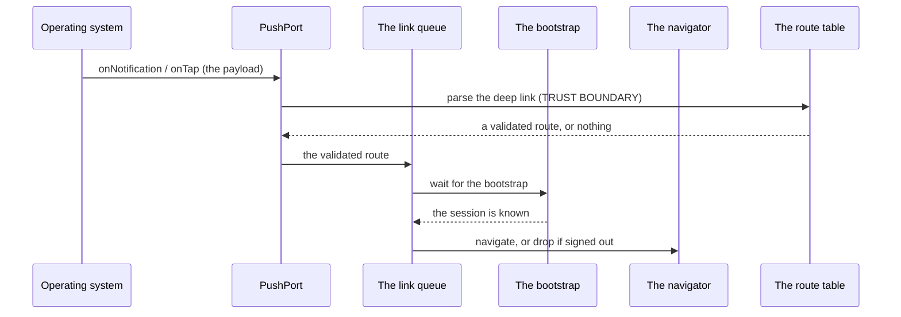
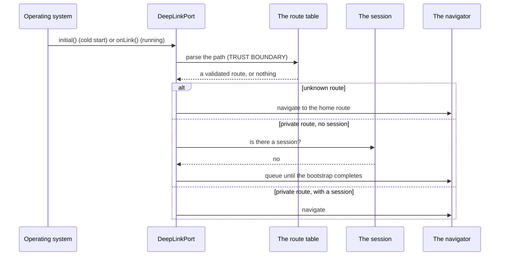
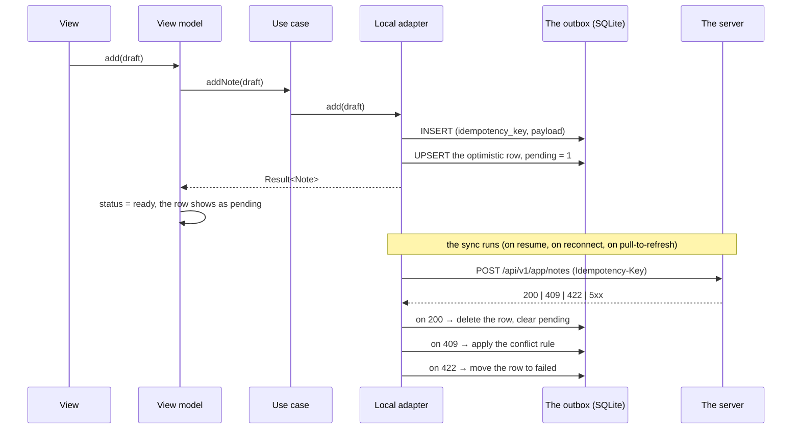

# Data Flows

Five flows, each with the trust boundary written on every hop. A flow that
has no boundary marked is a flow nobody reviewed.

- [Flow A — startup](#flow-a--startup)
- [Flow B — the list, offline](#flow-b--the-list-offline)
- [Flow C — the push tap](#flow-c--the-push-tap)
- [Flow D — the deep link](#flow-d--the-deep-link)
- [Flow E — the outbox sync](#flow-e--the-outbox-sync)

## The rules the flows obey

1. Errors cross a boundary as values (`Result<T, E>`), never as exceptions.
2. The domain re-validates anything that comes from outside it.
3. The URL never authorizes: the server decides, the client only reports.
4. A payload from outside is untrusted until a schema has parsed it.
5. The device APIs are reachable only from `adapters/out/`.

## Flow A — startup

From the launch to the first screen with data.

| #   | Hop                           | Boundary                    | What crosses it                               |
| --- | ----------------------------- | --------------------------- | --------------------------------------------- |
| 1   | OS → the entry                | **The platform boundary**   | A launch; the app has no say in it            |
| 2   | The entry → `App.tsx`         | —                           | A registration                                |
| 3   | `App.tsx` → the adapters      | **The port boundary**       | An interface; the consumer declares it        |
| 4   | The view model → the use case | —                           | A plain command                               |
| 5   | The use case → the port       | **The port boundary**       | A domain request                              |
| 6   | The adapter → the storage     | **The storage boundary**    | Rows written by a previous version of the app |
| 7   | The storage → the domain      | **The validation boundary** | A stored row becomes a `Note`, or an error    |

The composition root is the only hop where a port and an adapter meet. That
is why a fake can replace the adapter in a test without touching anything
else.

The adapter the template ships is the in-memory one
(`packages/feature-notes/src/adapters/out/in-memory-notes-repository.ts`). It
answers the port with an array; a SQLite or MMKV adapter replaces it without
the use cases changing.

## Flow B — the list, offline

The same read path, with the network down.

| Hop                                | Boundary             | The check                                         |
| ---------------------------------- | -------------------- | ------------------------------------------------- |
| The view model → the use case      | The application      | The use-case does not know the source of the data |
| The use case → the port            | The port             | The port speaks domain types only                 |
| The adapter → the storage          | The storage boundary | The rows are parsed against the schema before use |
| The network state → the view model | The device boundary  | `NetworkStatePort` is the only place that asks    |
| The projection → the view          | The UI boundary      | `offline` is a status, not an exception           |

The rule the flow encodes: **an offline device that shows the cached list is
working; an offline device that shows an error is broken.** The status is
`offline`, never `error`, when the network is simply absent.

## Flow C — the push tap

From the notification arriving to the screen opening.

| Hop                        | Boundary                    | The check                                                                       |
| -------------------------- | --------------------------- | ------------------------------------------------------------------------------- |
| The OS → the port          | **The platform boundary**   | The payload is untrusted; the type and the link are parsed before anything else |
| The port → the route table | **The validation boundary** | An unknown type is ignored; an unknown route falls back to home                 |
| The route → the queue      | —                           | The link is queued, not navigated                                               |
| The queue → the navigator  | —                           | The route is navigated only after the session is known                          |

Three rules, in order: **validate the type, validate the link, never act on
the payload.** A notification opens a screen; it never deletes, pays or
confirms.

## Flow D — the deep link

| Hop                         | Boundary                    | The check                                                     |
| --------------------------- | --------------------------- | ------------------------------------------------------------- |
| The OS → the port           | **The platform boundary**   | A custom scheme is not verified by the OS; it is untrusted    |
| The port → the route table  | **The validation boundary** | The pattern, the segment count and the parameters are checked |
| The route → the session     | —                           | A private route needs a session                               |
| The session → the navigator | —                           | A queued link is dropped when there is no session             |

The cold-start case is the reason the queue exists: the link arrives before
the app knows who the user is.

## Flow E — the outbox sync

The write path, from the tap to the server's answer. **The outbox, the
projection and the HTTP adapter are not shipped by the template**: the flow
is the shape a product adopts
([08 — Offline, Outbox & Sync](08-offline-outbox-and-sync.md)).

| Hop                          | Boundary                 | The check                                                       |
| ---------------------------- | ------------------------ | --------------------------------------------------------------- |
| The view → the view model    | —                        | The command is a plain value                                    |
| The view model → the port    | The port                 | The domain rules are applied before the write                   |
| The adapter → the outbox     | **The storage boundary** | The row is durable before the request is made                   |
| The adapter → the server     | **The network boundary** | The idempotency key makes the retry safe                        |
| The server → the adapter     | **The wire boundary**    | The answer is parsed; an unknown shape is an error, not a crash |
| The adapter → the view model | —                        | The conflict is resolved in the view model, in view of the rule |

The order is the contract: **the outbox row is written first**. A request
that is sent before the row is durable is a mutation that is lost when the
app is killed.

## Where the boundaries are enforced in code

| Boundary                     | Where                                                                       |
| ---------------------------- | --------------------------------------------------------------------------- |
| The device (the platform)    | `packages/*/src/adapters/out/`                                              |
| The port                     | `packages/core/src/ports.ts`, `packages/feature-*/src/application/ports.ts` |
| The validation (the payload) | `packages/contracts/`                                                       |
| The storage                  | The adapter in `adapters/out/` — the outbox is not shipped by the template  |
| The network                  | The HTTP adapter — not shipped by the template                              |
| The route                    | `packages/contracts/src/routes.ts`                                          |
| The log                      | The redacting logger — not shipped by the template                          |

## See also

- [Layers & MVVM](03-hexagonal-layers-and-mvvm.md)
- [Offline, Outbox & Sync](08-offline-outbox-and-sync.md)
- [Navigation, Routes & Deep Links](07-navigation-routes-and-deep-links.md)
