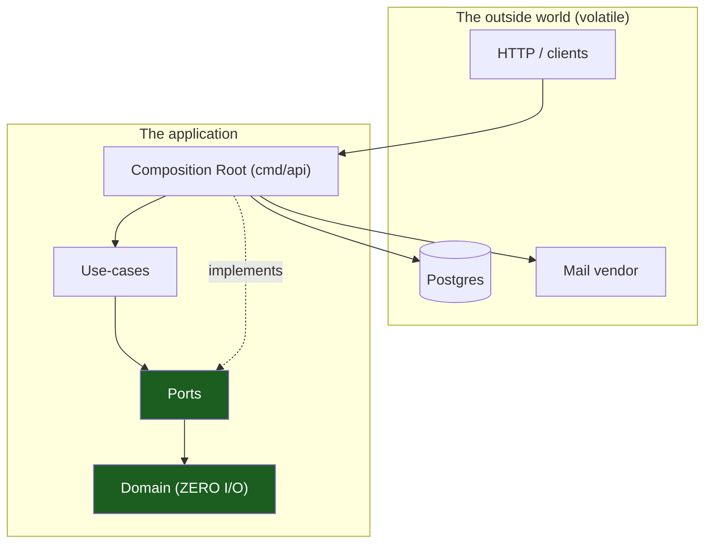
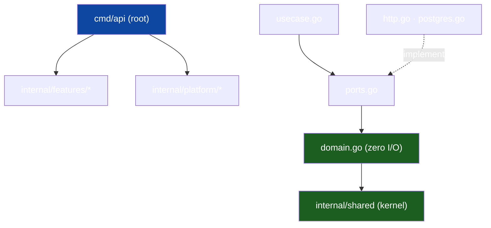

# Overview & Principles

The entry chapter. It states the one structural idea — **hexagonal (ports &
adapters) + vertical slicing, expressed as a single Go module** — and the ~8
principles that follow. Generic; replace `<app>` with your project and
`<scope>` with your module prefix.

## 1. The problem this solves

An application accumulates two kinds of code that change for different reasons:

- **Business rules** — what the product *means*; changes when the product does.
- **Mechanisms** — how it talks to the world (DB, HTTP, mail); changes when
  infrastructure does.

If tangled, every DB swap risks the rules and every rule change risks the
wiring. The architecture keeps them apart with one discipline: **dependencies
point inward, toward the business rules, never outward toward mechanisms.** The
green nodes of the graph below never import the volatile ones.

## 2. The layers, as Go files

| Ring | Where | Knows about | Volatility |
|------|-------|-------------|-----------|
| **Domain** | `internal/features/<slice>/domain.go` | types, IDs, enums, errors, rules — imports stdlib + `internal/shared` only | very low |
| **Ports** | `…/<slice>/ports.go` | interfaces the use case needs | low |
| **Use-cases** | `…/<slice>/usecase.go` | one feature's flow | medium |
| **Adapters** | `…/<slice>/{http,postgres}.go` | concrete I/O over `gen/db`, `gen/api` | high |
| **Root** | `cmd/api/main.go`, `module.go` `Register` | wiring | highest |

### Worked example

The import graph of the shipped skeleton:

## 3. Vertical slicing on top of horizontal layers

Each feature owns its stack end to end — `domain.go` through `module.go` — in
one directory ("tall, but narrow"). Two slices share code through
`internal/shared` (kernel) or `internal/platform` (transversal infra), never
by importing each other. [Vertical Slicing](02-vertical-slicing.md) holds the
slice boundaries and the shipped six.

## 4. The core principles

### P1 — Dependencies point inward
Enforced twice: Go's package graph, and depguard in `.golangci.yml` turning
forbidden files into red lint failures ([Dependency Rules](04-dependency-rules.md)).

### P2 — The domain has zero I/O
`domain.go` imports stdlib and `internal/shared` only. If a rule needs data
from the world, it receives it as an argument.

### P3 — Depend on interfaces, not concretions
A use case declares what it needs **as the consumer** in `ports.go` — 1–2
methods, satisfied implicitly by the adapter; `main.go` injects the
implementation ([Hexagonal Architecture](01-hexagonal-architecture.md) §2).
### P4 — One vertical slice per feature
New capability → new directory under `internal/features/`, wired at the root.
The skeleton ships six — replace `widgets`, keep the rest.

### P5 — A single composition root wires everything
One place (`cmd/api/main.go`) knows every concrete type: it builds pool,
adapters, hub and sender, then calls each slice's `Register(mux, deps)`;
nothing depends on `cmd/` ([Request Lifecycle](07-request-lifecycle.md)).

### P6 — Lean on the toolchain
`golangci-lint` v2 + depguard, `go vet`, `gofmt` — code that compiles can
still fail `make ci`. Generated code (`internal/gen`) is committed.

### P7 — Reversible migrations
Every goose migration annotation-ships its rollback (`-- +goose Down` section); **migrations never run at server
startup** — `make migrate` is a deploy step.

### P8 — Fakes, not mocks
Port interfaces are small, so unit tests write plain in-memory fakes — no
mocking framework, no database, no network, no timers to fake.

## 5. Runtime cooperation

At runtime control flow crosses outward — root → use case → port → adapter;
the outward *call* is fine, an outward *import* is forbidden. The interface is
the seam.

## 6. Why one module, not many

A single module keeps tooling (`go tool sqlc`, `go tool goose`) and CI simple;
depguard supplies the discipline the stdlib cannot. **Don't:** split into Go
modules per slice (version-skew hell) or add an edge "just for convenience."

## See also

- [Package topology](03-package-topology.md) · [Dependency rules](04-dependency-rules.md)