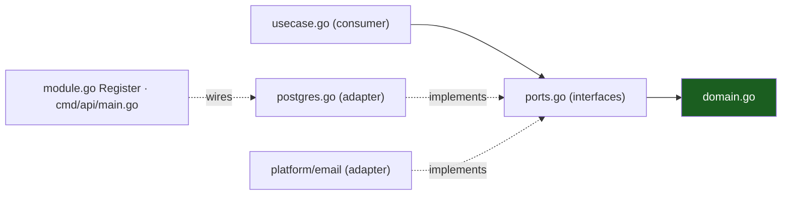

# Hexagonal Architecture

Ports & adapters in Go. The domain sits at the center, declares nothing, and
knows nothing; everything that touches the world enters through a port the
*consumer* declared.

## 1. The three parts

- **Domain** (`domain.go`): types, invariants, errors. Pure Go — stdlib +
  `internal/shared`. Imports nothing else.
- **Ports**: one or two interfaces per feature, **defined by the consumer**
  (the use case) in `ports.go`. Not "the repository interface next to the
  adapter" — the interface exists because the use case needs it.
- **Adapters**: structs that *implement* a port, living in the same slice for
  slice-local ones (`postgres.go`, `platform/email` for mail) but wired
  nowhere but the composition root.



## 2. Consumer-defined ports

The counter-intuitive part, and the important one: the **use case writes the
interface**, in its own package, shaped exactly to its needs — narrow,
Go-idiomatic, often one method. The adapter satisfies it implicitly (Go has
structural interfaces; the adapter may not even import the port package).

```go
// internal/features/authsignup/ports.go
type UserWriter interface {
    InsertPendingUser(ctx context.Context, u User) error
    ReissueVerification(ctx context.Context, userID ID, code Code) error
}

type MailQueue interface { // platform type, but the name the slice chose
    Enqueue(ctx context.Context, msg email.Message) error
}
```

`usecase.go` holds only these types. `postgres.go` (a pgx-backed struct) and
`platform/email` satisfy them; `module.go` wires `New(usecase.New(pgAdapter,
hub))`. Swapping Postgres for anything else touches one file.

## 3. Driving vs driven

- **Driving** (left): HTTP handlers, WS handler — the *world calls us*. In
  this layout they are the `http.go` adapter: decode request, call the use
  case, encode the `{detail, code}` envelope.
- **Driven** (right): Postgres, mail queue, hub, clock — *we call the world*.
  These are the `postgres.go` adapters and platform packages.

Both directions cross a port; only the driven side is faked in unit tests.

## 4. The composition root

One file type knows concretions: `cmd/api/main.go` (and `cmd/worker/main.go`
for the worker).

```go
// module.go — per-slice entry the root calls
func Register(mux *http.ServeMux, d Deps) {
    h := http.NewHandler(d.Store, d.Queue, d.Now)
    mux.HandleFunc("POST /api/v1/auth/signup", h.Signup)
    mux.HandleFunc("POST /api/v1/auth/verify", h.Verify)
}
```

`Register(mux, Deps)` is the whole wiring contract: the root builds `Deps`
(concrete adapters from `internal/gen/db` + pgxpool, the platform hub, the
mail sender), and the slice exposes nothing else. `test/acceptance` calls the
same `Register` with fakes — the acceptance test *is* the proof that the root
is the only place that knows types.

## 5. What the seam buys

- **Unit tests without I/O**: fakes implement `ports.go` in ~10 lines each.
- **Adapter swaps**: SMTP → console sender under `<APP>_OFFLINE=true` is a
  selection function, not a refactor.
- **The linter as lawyer**: depguard forbids `pgx`/`net/http` inside
  `domain.go`; violations are red before review.
- **Onboarding**: read one slice top-down and you have read the entire
  architecture once.

## Do / Don't

- **Do** put the interface where the need lives (`ports.go`); keep it 1–2
  methods.
- **Do** make adapters dumb: query, map, return domain types — no rules there.
- **Don't** declare a repository interface "for the future" — no consumer, no
  port (this is GoYAGNI, [Design Patterns](05-design-patterns.md)).
- **Don't** let `domain.go` import `net/http`, `pgx`, or another feature's
  package. depguard will catch you; fix the shape, not the lint.

## Worked example: signup

1. `domain.go` — `User` pending state, `ErrEmailTaken`, code generator.
2. `ports.go` — `UserWriter`, `MailQueue`.
3. `usecase.go` — `Signup(ctx, in)` → insert pending user, issue 6-digit code,
   enqueue verification mail; idempotent via re-signup rule.
4. `http.go` — `POST /api/v1/auth/signup`, validates at the edge, 201/409.
5. `postgres.go` — inserts via `gen/db` methods.
6. `module.go` — `Register`.
7. `cmd/api/main.go` — wires pgx adapter + `platform/email` queue.

Six files, one feature, zero cross-slice imports.

## See also

- [Vertical Slicing](02-vertical-slicing.md)
- [Design Patterns](05-design-patterns.md)
- [Request Lifecycle](07-request-lifecycle.md)