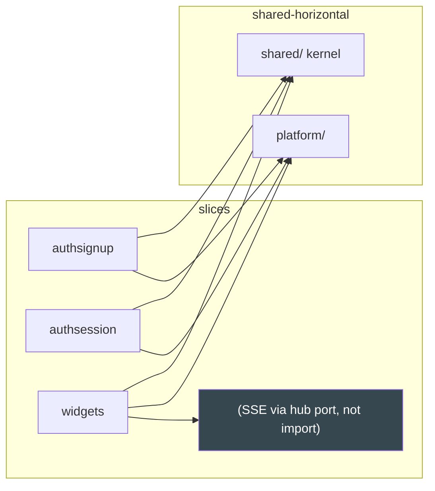

# Vertical Slicing

Layering is horizontal (domain → ports → use case → adapters). **Vertical
slicing** cuts the other way: every feature owns its full stack in one
directory. This template ships six slices; you replace the example and add
your own.

## 1. The unit: `internal/features/<slice>/`

A slice is a *capability*, not a table. It contains everything that churns
together, top-down:

```
internal/features/widgets/
├── domain.go    pure types + rules + errors (stdlib + shared only)
├── ports.go     the interfaces this feature needs (consumer-defined)
├── usecase.go   orchestration: rules first, I/O last
├── http.go      ServeMux adapters, edge validation, envelope
├── postgres.go  pgx/gen-db adapters
├── queries.sql  sqlc source for this slice (schema = migrations/)
└── module.go    Register(mux, Deps) — the wiring contract
```

Slices are "tall but narrow": from the HTTP route down to the domain rows,
with zero sideways imports. Tests, queries and specs live beside
(`*_test.go`, the slice's `queries.sql`, `specs/features/<slice>.feature`).

## 2. The shipped six

| Slice | Owns | Tables |
|---|---|---|
| `authsignup` | signup (idempotent), verify email, resend code | `users`, `email_verifications` |
| `authsession` | login, refresh (rotation), logout, me | `sessions` |
| `authpassword` | forgot/validate/reset code + rate limit, change password | `password_resets` |
| `adminusers` | admin list/get/update users, audit logging | `users` (admin ops), `audit_logs` |
| `widgets` | worked example: CRUD + SSE lifecycle events | `widgets` |
| `realtime` | WebSocket endpoint `GET /api/v1/ws` | — (hub lives in platform) |

Boundaries: `authsignup` and `authpassword` never call `authsession`; login
and reset can both need to revoke sessions — the *capability* is duplicated
through a port, or the shared method is promoted into `shared/`/`platform/`
(kernel-only). If two slices keep reaching for the same port, that is the
signature of a missing shared port, not an import to add.

### How coarse is coarse enough?

One slice ≈ one bounded feature (a group of use cases over one aggregation).
The signup trio (signup/verify/resend) churns together — one slice. Splitting
`verify` into its own directory would triple the boilerplate for nothing;
merging all three auth slices would bury `signup` under `password` code. When
a slice's `domain.go` passes ~200 lines, that is usually two features
sharing a directory — split by behavior, not by file count.

## 3. Slices never import each other



The widgets slice publishes `created/updated/deleted` into the hub **through
an event-bus port** — it does not import the `realtime` slice's HTTP handler.
The realtime slice and the platform hub are the same mechanism at different
altitudes: the *port* (narrow event bus) lives with the consumer, the *hub
implementation* lives in `internal/platform/realtime`.

## 4. Adding a slice

The recipe is [Playbook §1](12-playbooks.md); the checklist: mkdir, six
files, queries + migration + `make generate`, godog spec if behavioral, wire in
`cmd/api/main.go`, `make ci`. Nothing else in the codebase changes — no
registry edits, no god files. If adding your slice edits three files outside
`internal/features/` and `cmd/`, the template regressed.

## 5. Anti-patterns

- **Layer-packages across the whole app** (`internal/repos/`,
  `internal/services/`, `internal/handlers/`): the slice is replaced by a
  *horizontal* directory set, so a feature touches five trees. The six files
  per slice exist precisely to kill those god-directories.
- **Cross-slice imports "temporarily"**: depguard denies
  `internal/features/**` imports from inside features. The fix is a port or a
  kernel promotion, never an exception comment.
- **A slice that owns another slice's table**: ownership follows capability.
  `adminusers` may update `users`, but it does not own the signup flow — it
  consumes an admin-shaped port, and its SQL is its own, in its own
  `queries.sql`.
- **Shared mutable singletons in slices**: per-slice state is a dependency of
  `Register`; anything global should live in `platform/` and be injected.

## See also

- [Hexagonal Architecture](01-hexagonal-architecture.md)
- [Package Topology](03-package-topology.md)
- [Dependency Rules](04-dependency-rules.md)