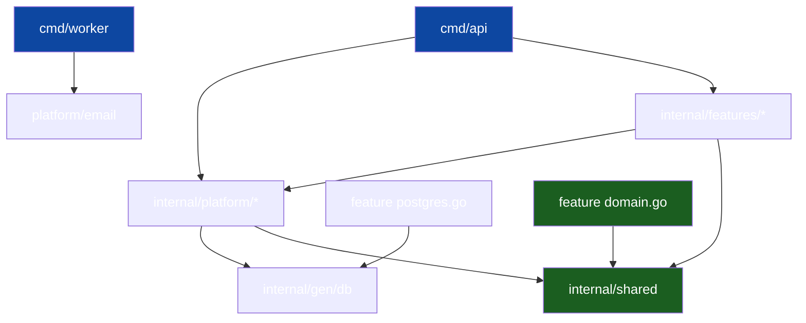

# Package Topology

The dependency graph of the single Go module: which packages exist, what each
is allowed to know, and who sits where. This is the Go template's answer to
the sibling's crate-per-concern workspace: one module, many packages, the
edges enforced by depguard.

## 1. Package taxonomy

| Package | Kind | May import | Never imports |
|---|---|---|---|
| `internal/features/<slice>/domain.go` | domain | stdlib, `internal/shared` | anything else |
| `…/<slice>/ports.go` | ports | domain | adapters, other slices |
| `…/<slice>/usecase.go` | use case | domain, ports | `pgx`, `net/http`, other slices |
| `…/<slice>/http.go` | driving adapter | use case, `httpx`, gen/api models | other slices |
| `…/<slice>/postgres.go` | driven adapter | gen/db | `net/http`, other slices |
| `…/<slice>/module.go` | wiring | all files in its slice | other slices |
| `internal/shared/*` | kernel | stdlib only | anything |
| `internal/platform/*` | transversal infra | stdlib, gen/db, shared | `internal/features/**` |
| `internal/gen/db`, `gen/api` | generated (committed) | — | — |
| `cmd/api`, `cmd/worker` | composition roots | everything | — (nobody imports them) |

## 2. The import graph

Arrows converge on `shared/` and each slice's `domain.go`. Nothing points at
`cmd/`; nothing points sideways between features.

## 3. `shared/` vs `platform/`

Both are horizontal, and the line matters:

- **`shared/` is the kernel** — types and rules so fundamental they may never
  depend on a mechanism: `apperr` (stable error codes: `AUTH_EMAIL_NOT_VERIFIED`,
  …), `rolex` (the single role definition with `AtLeast`), tiny value types.
  If a file in `shared/` grows an import beyond stdlib, move it to `platform/`.
- **`platform/` is transversal infra** — `authx` (JWT, middleware, password
  hashing), `email` (Message, outbox queue, sender, templates, `RunWorker`),
  `realtime` (hub), `config` (env/v11), `httpx` (middleware chain, envelope).
  It may touch pgx and the generated code; it may **not** import features.
  Features may import platform packages — but prefer declaring the narrow
  port in `ports.go` and letting platform satisfy it, so the slice stays
  readable as a stand-alone contract.

## 4. `internal/gen/` — generated, committed

Two generators, both sources under version control, both outputs committed:

- the slice's `queries.sql` (schema pointed at `migrations/`) → **sqlc** →
  `internal/gen/db` (package `db`): typed queries per slice. The adapter in
  `postgres.go` is the only consumer.
- `specs/openapi.yaml` → **oapi-codegen/v2** (models only) →
  `internal/gen/api` (package `api`): wire-format types shared by `http.go`
  adapters.

Regenerate with `make generate`; never hand-edit `gen/`. CI
asserts regeneration is a no-op (committed artifacts + gen-check keep the
build deterministic without a generator in the loop).

## 5. Role → package map

| Task | Lives in |
|---|---|
| Business rule change | `domain.go` (its tests) |
| New query | the slice's `queries.sql` + `postgres.go` |
| New endpoint | `http.go` route in `module.go`; OpenAPI entry |
| New vendor integration | new `platform/<x>/` port + adapter |
| Cross-cutting concern | `platform/httpx` middleware |
| Wiring change | `cmd/api/main.go` only |
| Kernel types | `internal/shared` |

## 6. Why packages, not modules

One module keeps `go test ./...`, tool-deps (`go tool sqlc`, `go tool goose`),
and CI cheap; Go packages are the unit of isolation and cycles are impossible.
Two modules or a workspace would buy nothing but version skew between
`shared/` copies. depguard supplies the file-level law (`domain.go`
purity, slice isolation) that package boundaries alone cannot.

## See also

- [Vertical Slicing](02-vertical-slicing.md)
- [Dependency Rules](04-dependency-rules.md)
- [Project Skeleton](13-project-skeleton.md)