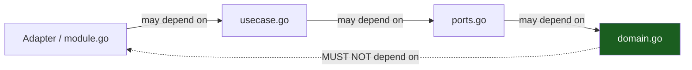

# Dependency Rules & Boundaries

The dependency rule in depth: allowed vs forbidden edges, and how depguard in
`.golangci.yml` turns the architecture into red-on-save lint output.

## 1. The rule

**Source-code dependencies only point toward more-stable code.** An outer file
may name an inner one; an inner one must never name an outer. No cycles —
though in Go the compiler catches package cycles alone, the interesting
edges are *file-level within one package tree*.



## 2. Allowed edges

| From | To | OK? |
|---|---|---|
| `cmd/api`, `cmd/worker` | any internal package | yes — the roots know everything |
| feature `http.go` / `postgres.go` / `module.go` | own slice's files, `platform/`, `shared/` | yes |
| `usecase.go` | `ports.go`, `domain.go` | yes |
| `ports.go` | `domain.go` | yes |
| `domain.go` | stdlib, `internal/shared` | yes |
| feature `postgres.go` | `internal/gen/db` | yes |
| anything internal | `internal/gen/**` | only adapters to `gen/db`, http to `gen/api` |
| `internal/platform/*` | `shared/`, stdlib, `gen/db` | yes (never features) |

## 3. Forbidden edges

| From | To | Why |
|---|---|---|
| `domain.go` | `net/http`, `net/*`, `pgx`, any adapter | domain is zero-I/O |
| `usecase.go` | `net/http`, `pgx` | mechanism names belong to adapters |
| any `internal/features/*` file | another feature's package | slices stay independent |
| `internal/platform/**` | `internal/features/**` | platform serves features, never consumes them |
| any package outside a feature's files | its `module.go`'s `Register` internals | wiring is the root's job |
| any package | `cmd/**` | nothing depends on the root |
| adapters | `gen/api` models outside `http.go` | wire types stop at the edge |

## 4. Enforcement: depguard in `.golangci.yml`

`golangci-lint` v2 config; the skeleton ships the authoritative file — the
essence, condensed:

```yaml
version: "2"
linters:
  settings:
    depguard:
      rules:
        domain-pure:
          list-mode: strict
          files: ["**/features/**/domain.go"]
          deny:
            - pkg: net
              desc: domain is I/O-free
            - pkg: github.com/jackc/pgx/**
              desc: domain is storage-free
            - pkg: github.com/<scope>/<app>/internal/platform/**
              desc: domain knows only the kernel
        slice-isolation:
          files: ["**/features/**"]
          deny:
            - pkg: github.com/<scope>/<app>/internal/features/**
              desc: slices never import each other
```

Because the module path is still `<scope>/<app>` pre-rename, the rules rename
with the project — `scripts/rename.sh` substitutes them like everything else.

Stacked enforcement, in order:

1. **depguard** — file-level law; `make ci` fails red with the violating edge.
2. **Go package graph** — cross-package cycles cannot compile at all.
3. **Generated-code hygiene** — `make generate`/`make gen-check` must stay quiet;
   CI regenerates and diffs.
4. **Review** — the "depends on the interface but reaches for the adapter"
   smell; depguard cannot see it because it is a constructor argument, not an
   import.

## 5. Invariants the structure protects

- **One error vocabulary.** Adapters map driver errors *inward*; use cases
  return domain errors; the stable `code` for the `{detail, code}` envelope is
  decided once, in `internal/shared/apperr`. Callers never see `pgx.ErrNoRows`.
- **SQL lives only in per-slice `queries.sql` files.** A raw `pgx` query in `postgres.go`
  bypassing gen/db, or worse in `usecase.go`, is a leak — depguard denies the
  import shape; review denies the bypass.
- **Wire types stop at the edge.** `gen/api` models are decoded/encoded in
  `http.go`; domain types travel inward and back.
- **Slices keep separate migration ownership.** A slice's tables appear in its
  own queries file; another slice reading them directly is an edge violation.
- **Migrations never run at startup.** Nothing in `platform/` knows how to
  apply them; `make migrate` does, in a deploy step you control.

## Do / Don't

- **Do** add a narrow port when a slice needs what another slice owns — even
  if its adapter today is a thin proxy to the other slice's adapter.
- **Do** promote a genuinely shared type to `shared/` once two slices need it.
- **Don't** use `//nolint:depguard` to sneak an edge; if the edge is needed,
  the topology is wrong (or the rule is — fix the rule in review, never the
  call site).
- **Don't** create `internal/utils`. `shared/` is a kernel, not a junk drawer;
  anything "util" is either a mechanism (→ `platform/`) or a domain concept
  (→ the slice that owns it).

## See also

- [Package Topology](03-package-topology.md)
- [Testing & CI](11-testing-and-ci.md)
- [Hexagonal Architecture](01-hexagonal-architecture.md)