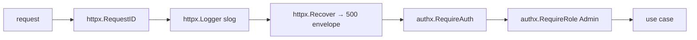
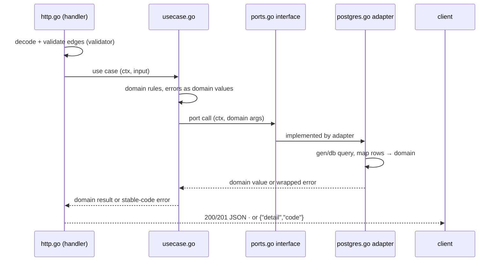

# Request Lifecycle

One request's full path through the hexagon: from `net/http`'s mux through the
middleware chain into the identity context, the use case, the port, and the
adapter — plus the aside for connections that never end (WS) or stream (SSE).

## 1. The mux

Go 1.27's `http.ServeMux` does method + wildcard matching natively — no
router library:

```go
mux.HandleFunc("POST /api/v1/auth/signup", authsignup.Deps{...}.Signup)
mux.HandleFunc("PUT /api/v1/admin/users/{id}", ...)
r.PathValue("id") // handler-side
```

Routes are declared in each slice's `module.go: Register(mux, Deps)`; the
composition root owns the mux itself. One mount point per slice keeps route
inventory in one readable place.

## 2. The middleware chain

Per-route or per-group via `httpx.Chain` ([Design Patterns §3](05-design-patterns.md)):



- `RequireAuth` resolves the token — `Authorization: Bearer`, else the cookie
  when a cookie name is configured — parses it with the HS256 verifier, builds
  `authx.Identity`, stores it in context; failures answer `401` with the
  `{detail, code}` envelope, `AUTH_TOKEN_INVALID`.
- `RequireRole(min)` then checks `rolex.AtLeast(identity.Role, min)`; failure
  is 403 `AUTH_FORBIDDEN`.

## 3. Identity in context

The identity travels as a context value, typed so collisions are impossible:

```go
type ctxKey struct{}
func WithIdentity(ctx context.Context, id Identity) context.Context
func From(ctx context.Context) Identity // zero-value Identity if absent
```

Use cases never re-parse tokens and never see `*http.Request` — the handler
passes `r.Context()` plus the parsed input struct. That boundary is what lets
the same use case serve HTTP, a WS handshake, or a CLI.

## 4. The inward slide



Edge rules: `http.go` validates at the trust boundary (`validator/v10` +
required-field checks) because the domain must not trust wire data; `domain.go`
re-checks invariants because adapters and tests may call it directly. Error
flow is strictly a `%w` chain ending in `apperr` codes; the envelope mapper in
`httpx` is the only place that renders HTTP status from a code.

## 5. Aside: WebSocket and SSE requests

Two endpoints do not terminate — the lifecycle diverges after `RequireAuth`:

- **WS** `GET /api/v1/ws?token=<jwt>` — the realtime slice takes the token
  from the query, parses it directly with the verifier (browsers cannot set
  `Authorization` on `WebSocket`), and on failure closes with code **4001
  `authentication_failed`**. On success it upgrades (`coder/websocket`),
  subscribes to the identity room on the hub, and pumps frames both ways with
  ping keepalive ([Realtime](09-realtime-and-streaming.md)).
- **SSE** `GET /api/v1/widgets/events` — behind the normal auth chain; the
  handler subscribes to the widgets room, writes `text/event-stream` events,
  and calls `http.Flusher.Flush()` per event; the hub channel + `ctx.Done()`
  drive teardown.

Both stream paths must read from `r.Context()` for cancellation — the client
disconnect *is* the context canceling — and never hold database rows while
streaming.

## 6. The worker's lifecycle (for contrast)

No request at all: `cmd/worker/main.go` builds the same config + pool and runs
two loops, both exiting on SIGTERM via the same context discipline. The email
outbox loop is `email.RunWorker(ctx, queue, sender, poll)` with jittered
backoff; the janitor loop ticks every `<APP>_JANITOR_POLL` (default 1h) and
issues idempotent DELETEs — expired-but-still-active `sessions`, and expired
`email_verifications` / `password_resets` — logging only when it actually
removed rows. Both loops never touch rotation history or audit rows, so
running one worker per deployment is safe and running two is harmless
(idempotent, replica-safe). One mental model, two entrypoints — a single
binary deploy still needs *a* worker process, or mail and purges stop.

## 7. Aside: redirect endpoints (302, never JSON)

Two lifecycle shapes sit outside the JSON envelope rule:

- **GitHub OAuth** — `/api/v1/auth/github/login` and `/api/v1/auth/github/callback`
  answer **302** redirects (authorize URL, then the frontend success URL with
  the token pair in the fragment or the error in the query). Errors that
  browser flows would never see (provider disabled) still use the JSON
  envelope with 403.
- **WS/SSE** — §5 above; the same "the handler decides the wire shape"
  principle, just held open instead of redirected.

## See also

- [Auth Architecture](06-auth-architecture.md) — what `Identity` carries
- [Realtime & Streaming](09-realtime-and-streaming.md)
- [Errors, Config & Observability](10-error-config-observability.md) — the
  envelope mapping