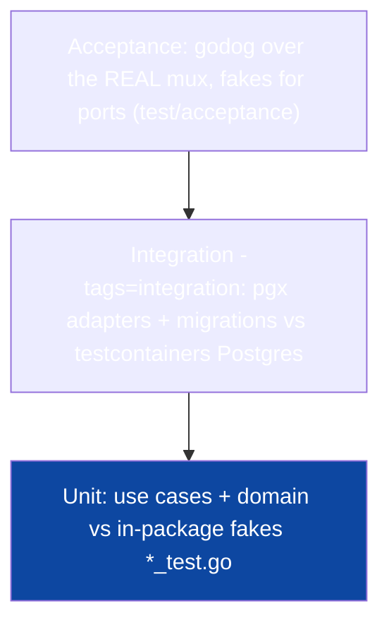

# Testing & CI

The test pyramid as this stack expresses it — unit fakes, testcontainers
integration, godog acceptance on a fake-wired real mux — and the one gate:
`make ci`.

## 1. The pyramid



| Level | Runner | Database | Speed | Catches |
|---|---|---|---|---|
| **Unit** | `go test ./...` | fakes | ms | business rules, envelope mapping |
| **Integration** | `make test-int` (`-tags=integration`) | testcontainers PG 17 | sec | SQL truth, migrations, adapter mapping |
| **Acceptance** | `make accept` (godog) | none — fakes | fast | behavioral contracts end to end |

## 2. Unit: fakes, not mocks

Ports are consumer-defined interfaces
([Design Patterns §2](05-design-patterns.md)), so a fake is a struct — no
mocking framework, no `reflect` magic, no brittle `AssertCalled`:

```go
type fakeStore struct{ saved User }
func (f *fakeStore) InsertPendingUser(ctx context.Context, u User) error { f.saved = u; return nil }
```

Fakes live in the same package's `*_test.go`. Table-driven cases cover
branches; `go-cmp` diffs domain structs; testify assertions where they are
clearer. Rules worth enforcing: no `time.Sleep`, no network, no clock — a
clock is a port (`Now func() time.Time`), injection is two lines.

## 3. Integration: `-tags=integration`

Files declare `//go:build integration` so everyday `go test ./...` skips them.
A suite-level `TestMain` boots one Postgres 17 container
(`testcontainers-go`), runs migrations, and hands out per-test schemas (fast
isolation, no global lock). What lives here: pgx adapters' mapping truth,
`SELECT ... FOR UPDATE SKIP LOCKED` claim semantics of the outbox queue,
and the migrate-up/down migrations. CI keeps it to its own job.

## 4. Acceptance: godog on the fake-wired mux

`specs/features/*.feature` holds behavioral contracts; `test/acceptance/`
builds the **real** mux via the slices' `Register(mux, Deps)` with in-memory
fakes (including a fake clock, a capture mail queue, a fake Google ID-token
verifier, and a fake GitHub client so both social flows run offline with
deterministic codes like `good-code` / `ada-code`) wrapped in
`httptest`, then runs godog:

```gherkin
Feature: signup gates
  Scenario: unverified user cannot log in
    Given an unverified user with email "a@b.co" and password "secret1!"
    When they log in
    Then the response code is 403 "AUTH_EMAIL_NOT_VERIFIED"
```

This is the proof of the composition root: `test/acceptance/fakes.go` is the
second wiring of the same `Register` — if a slice's `Deps` needed anything a
fake cannot provide, acceptance would fail and the architecture violated.
The features shipped with the template cover every auth slice
(`authsignup`, `authsession`, `authpassword`, `authoauth`,
`session-mgmt`, `admin-users`) plus widgets; list endpoints return bare
arrays, so those specs assert with the `the list has N entries` /
`... on entry 0` steps rather than the object-based `the response lists N
items` step.

## 5. The gate: `make ci`

```sh
make ci   # gofmt check + go vet + golangci-lint run + gen-check + go test
```

- **gofmt** — formatting is not negotiable, so diffs stay content-only.
- **gen-check** — `make generate` must leave the committed `internal/gen/**`
  byte-identical; stale generated code fails the gate.
- **golangci-lint v2** — depguard architecture rules
  ([Dependency Rules](04-dependency-rules.md)), vet, and a curated linter set;
  no `//nolint` escapes in the shipped code.
- **`go test`** — the unit tier (internal/cmd/test packages), offline, no
  docker. `go mod tidy` stays quiet — INV-T3 hygiene (`go.sum` exists only
  post-rename).

CI (`.github/workflows/ci.yml`) adds the integration job (testcontainers +
docker-in-docker or a Postgres service) and the acceptance job; `make ci`
remains the local gate. Coverage targets behavior, not lines — the pyramid's
shape is the coverage policy.

## 6. CI hygiene

- Generated artifacts are committed (`internal/gen/**`), and CI checks
  regeneration is a no-op — no generation step can hide edits.
- Caching: `GOCACHE` + module cache keyed on `go.sum`.
- The vulnerability scan (`make vuln` / govulncheck) runs as its own job — see
  [Errors, Config & Observability §5](10-error-config-observability.md).
- Race detector: `go test -race ./internal/platform/realtime/...` at minimum;
  the hub is the concurrency surface.

## Do / Don't

- **Do** test use cases through fakes first; add a godog scenario when the
  behavior is contract.
- **Do** keep fakes in `*_test.go` — they are not production interfaces.
- **Don't** run Postgres in unit tests, or fake Postgres in integration
  tests — each level earns its keep at its altitude.
- **Don't** merge with red `make ci`; the lint rules encode the architecture,
  and a suppressed violation is an architecture decision taken in private.

## See also

- [Playbooks](12-playbooks.md) — test placement per change type
- [Dependency Rules](04-dependency-rules.md)
- [Realtime & Streaming](09-realtime-and-streaming.md) — race-detector surface