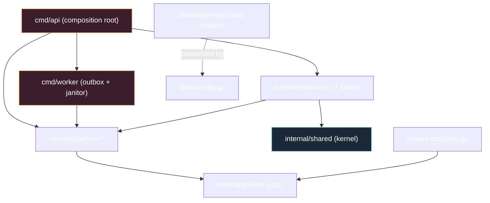

# Project Skeleton

The annotated guide to the literal `skeleton/` directory next to this `docs/`
tree. Everything is generic until `scripts/rename.sh` runs — the module path
`github.com/<scope>/<app>` is a placeholder and the project cannot build
before that.

## 1. The shape you are building toward



## 2. Directory layout

```text
skeleton/
├── go.mod                    # module github.com/<scope>/<app> — pinned requires, NO go.sum
├── Makefile                  # ci · test · test-int · accept · generate · gen-check · migrate-{up,down,add} · vuln
├── .golangci.yml             # v2 — depguard architecture rules (the dependency law)
├── .env.example              # placeholder values; JWT_SECRET placeholder-guarded
├── .github/workflows/        # ci.yml + deploy · docker-publish · rollback
├── cmd/
│   ├── api/main.go           # root: config → pgxpool → adapters → Register → ListenAndServe
│   └── worker/main.go        # root: config → pool → email outbox loop + janitor loop
├── internal/
│   ├── features/             # authsignup · authsession · authpassword · authoauth · adminusers · widgets · realtime
│   │   └── <each>            # domain.go ports.go usecase.go http.go postgres.go module.go (+ *_test.go)
│   ├── platform/             # authx · oauthx · email · realtime · config · httpx (transversal infra)
│   ├── shared/               # apperr (stable codes) · rolex (role hierarchy) · authz (self-or-subordinate) — kernel only
│   └── gen/                  # COMMITTED generated code (never hand-edit)
├── migrations/               # 0001_init.sql + 0002_profiles.sql (Up + Down); timestamped files
├── sqlc.yaml                 # schema = migrations; queries live in each slice
├── specs/                    # openapi.yaml + api.gen.yaml + features/*.feature
├── test/acceptance/          # godog runner + fakes.go (full app, no DB)
└── scripts/                  # rename.sh · verify-template.sh · hooks/guard-bash.sh
```

Conventions:
1. **Same six files per slice, always.** "Where does X live?" is answerable by
   file kind, never by grep. Tests ride alongside in `*_test.go`.
2. **Generated code is committed** (`internal/gen/**`) so builds are
   deterministic and CI needs no generator in the loop; `make generate` /
   `make gen-check` keep it honest.

## 3. `go.mod` — the keystone

Module path `github.com/<scope>/<app>` (placeholder until rename), `go 1.27`,
every direct dependency pinned to a modern major (`requires` in the template;
resolved fully by `go mod tidy` at instantiation). INV-T3: **no `go.sum` is
committed** — it cannot be generated while the module path is a placeholder,
and `go.sum` is untouched by the rename, so the pinned requires stay valid.

## 4. `.golangci.yml` — architecture as config

v2 config with `depguard` file-scoped rules: `domain-pure` (no `net`, no
`pgx`, no `platform` in `**/features/**/domain.go`), `slice-isolation` (no
feature→feature imports). Everything else is the curated standard set. See
[Dependency Rules §4](04-dependency-rules.md) for the condensed config.

## 5. Makefile

```
make ci           fmt-check + vet + golangci-lint + gen-check + test
make test         unit tier (integration tags skipped by default)
make test-int     -tags=integration: testcontainers Postgres 17
make accept       godog over test/acceptance (fake-wired mux)
make generate     sqlc + oapi-codegen (gen-check verifies no drift)
make migrate-up / migrate-down / migrate-add NAME=
make vuln         govulncheck
make run          go run ./cmd/api (set <APP>_DATABASE_URL first)
```

## 6. The composition roots

`cmd/api/main.go` (one function, sequential): load config → open pool → build
adapters (gen/db stores, hub, mail sender with the offline selector) →
`middleware chain` → each slice's `Register(mux, deps)` → graceful
`ListenAndServe` (SIGINT/SIGTERM closes the server, drains in-flight
handlers). `cmd/worker/main.go` opens the same pool and runs two loops —
`email.RunWorker` (outbox polling) and the janitor
(`<APP>_JANITOR_POLL`, default 1h: expired sessions + stale verification and
reset codes) — same image, different entrypoint, because the outbox
deserves its own lifecycle. Both roots validate config at boot; neither
applies migrations.

## 7. What ships in the box (and what does not)

Ships: seven slices (authsignup, authsession, authpassword, authoauth,
adminusers, widgets, realtime), the full auth core — passwords, Google One
Tap + GitHub social sign-in (`platform/oauthx`), session management with the
admin auth-session surface and anomalies, the `authz` self-or-subordinate
guard, outbox email, a worker janitor, WS + SSE, health gates, CI, compose
for dev, `.claude/` agency layer, docs tree.

Does **not** ship: billing/Stripe, a frontend, migrations-at-startup,
multi-replica realtime (Redis adapter is the documented evolution), otel (cut;
seams documented). Delete the `widgets` example and your rename is done; the
rest is product-ready scaffolding.

## See also

- [Playbooks](12-playbooks.md) — the first changes you will make
- [Package Topology](03-package-topology.md)
- [Testing & CI](11-testing-and-ci.md)