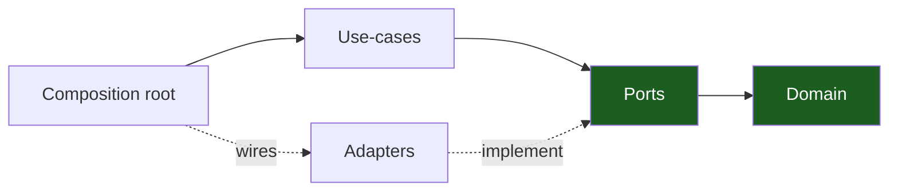

# Backend Go Architecture Handbook

A **generic, reusable** reference for building a Go backend with **hexagonal
architecture (ports & adapters) + vertical slicing**, realized as a single Go
module (stdlib `net/http`, pgx/v5, sqlc, goose). Every chapter teaches the
pattern abstractly first, then shows a worked example (`### Worked example`)
so you can lift the structure into any project. Replace `<app>` with your
project name and `<scope>` with your org/module prefix throughout.

> 15 chapters · adapted to Go 1.27 idioms (consumer-defined interfaces,
> `context.Context`, error wrapping, middleware chaining).

## The one rule

**Dependencies point inward.** The domain knows nothing about I/O; the
composition root (`cmd/api/main.go`) knows about everything and wires it
together. Everything else makes that rule cheap to follow and hard to break.
See [Dependency Rules](04-dependency-rules.md).

## Start here

New? Read [00 — Overview & Principles](00-overview-and-principles.md), then
[01 — Hexagonal Architecture](01-hexagonal-architecture.md) and
[03 — Package Topology](03-package-topology.md). Starting a fresh project?
Jump to [13 — Project Skeleton](13-project-skeleton.md) and
[12 — Playbooks](12-playbooks.md).

## Contents

| # | Chapter | What it covers |
| --- | --- | --- |
| 00 | [Overview & Principles](00-overview-and-principles.md) | The one idea + 8 principles + chapter map |
| 01 | [Hexagonal Architecture](01-hexagonal-architecture.md) | Ports & adapters, consumer-declared interfaces, dependency inversion |
| 02 | [Vertical Slicing](02-vertical-slicing.md) | One feature per package over a shared kernel; the six shipped slices |
| 03 | [Package Topology](03-package-topology.md) | Package taxonomy, the import graph, role→package map |
| 04 | [Dependency Rules](04-dependency-rules.md) | Allowed/forbidden edges, enforced by depguard in `.golangci.yml` |
| 05 | [Design Patterns](05-design-patterns.md) | Functional options, middleware chaining, wrapper adapters — Go-idiomatic |
| 06 | [Auth Architecture](06-auth-architecture.md) | bcrypt+pepper, JWT + rotating refresh, codes, RBAC, audit |
| 07 | [Request Lifecycle](07-request-lifecycle.md) | Middleware → identity context → use case → port → adapter; WS/SSE aside |
| 08 | [Persistence & Migrations](08-persistence-and-migrations.md) | pgx pool, sqlc per-slice queries, annotated reversible goose migrations, never at startup |
| 09 | [Realtime & Streaming](09-realtime-and-streaming.md) | Hub contract, WebSocket frames + close 4001, SSE flushing, Redis evolution |
| 10 | [Errors, Config & Observability](10-error-config-observability.md) | `{detail, code}` envelope, env/v11, slog, health gates, govulncheck |
| 11 | [Testing & CI](11-testing-and-ci.md) | Test pyramid, fakes over mocks, godog acceptance, `make ci` |
| 12 | [Playbooks](12-playbooks.md) | Add a slice, add a port+adapter, ship a migration, expose an endpoint, add an email template |
| 13 | [Project Skeleton](13-project-skeleton.md) | Annotated tree of the shipped `skeleton/` |
| 14 | [Glossary](14-glossary.md) | Every architectural term defined |

## How to apply this to a new project

1. Copy the module layout from [Project Skeleton](13-project-skeleton.md).
2. Put your types and rules in the **domain** files (`domain.go`, stdlib +
   `shared/` only).
3. Declare what you need from the world as **consumer-defined interfaces**
   in `ports.go`; implement them as **adapters** wired only at the
   **composition root**.
4. Add each feature as a **vertical slice** under `internal/features/`.
5. Keep the [dependency rule](04-dependency-rules.md) green; depguard makes
   violations red, not reviewable.