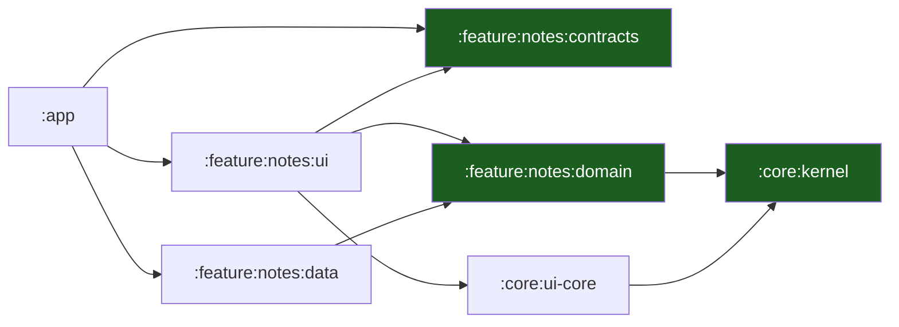

# Overview & Principles

The entry chapter. It states the one structural idea — **a Gradle module per
layer, hexagonal inside each slice, unidirectional data flow in the
presentation** — and the principles that follow. Generic: the template ships
one example slice (`notes`) that you replace with your own.

## 1. What this template is

A starting point for a **native Android client**: Kotlin 2.4, Jetpack
Compose, Gradle 9.6 with the Android Gradle Plugin, one Gradle module per
layer, and a composition root that wires everything by hand.

| | |
| --- | --- |
| Language | Kotlin 2.4.21 |
| UI | Jetpack Compose, Material 3, Compose BOM 2026.09.00 |
| Navigation | Navigation3 1.2.1, typed `NavKey` routes |
| Build | Gradle 9.6.0, AGP 9.5.1, version catalog |
| SDK | `compileSdk` / `targetSdk` 37, `minSdk` 26, JVM target 17 |
| Async | kotlinx.coroutines 1.11.0, lifecycle 2.11.0 |
| Tests | JUnit 4; JVM unit tests in every module (instrumented tests are an adoption step) |

It ships a worked slice (`notes`) end to end — entity, port, use case,
in-memory adapter, ViewModel, Compose screen — so the shape of a feature is
visible before a line of product code is written.

It is a **template**, not a product: `scripts/rename.sh` turns it into a
project, and the seams a product needs but a template cannot decide for you
(the database, the push pipeline, the keystore) are documented as gaps rather
than faked.

## 2. The one rule

**The module graph is the architecture.**

The rule is not a review guideline. It is enforced by the build, twice over:

| Guard | When it fires | What it sees |
| --- | --- | --- |
| The Gradle `dependencies` blocks | Compile time | A module that asks for a dependency it may not have |
| `scripts/check-architecture.sh` | CI | A pure JVM module that applies an Android plugin, an `android.*` import in the kernel or the domain, a `ui` → `data` edge, a second application module |

The second reason the rule holds: **`:core:kernel`, `:feature:notes:domain`
and `:feature:notes:contracts` are pure JVM modules** (`kotlin("jvm")`).
The Android SDK is not on their classpath. A domain file that imports
`android.content.Context` does not compile. The layering is not a
convention the team must remember; it is a compile error waiting to happen.

The third reason: **the composition root is `:app`**. It is the only module
that sees every layer, and it builds the object graph by hand
([ADR 0003](adr/0003-manual-di-in-the-app-module.md)). A use case cannot
reach for a concrete adapter, because it does not know one exists.

## 3. The ten principles

1. **The module graph is the dependency rule.** A module that does not
   depend on another cannot import it ([03](03-layers-modules-and-udf.md)).
2. **The domain is pure JVM.** No `android.*`, no Compose, no coroutines
   beyond `Flow`. Entities and use cases are plain Kotlin classes.
3. **Unidirectional data flow.** `UiState` down, `UiEvent` up, effects on a
   separate one-shot channel. No business logic in a composable. The shipped
   slice names them `NotesState`, `NotesEvent` and `NotesEffect`.
4. **Errors are values.** `Outcome<T>` crosses every boundary; an expected
   failure is never an exception.
5. **The port is owned by the consumer.** The domain declares the interface
   it needs; `:feature:notes:data` implements it. The interface lives with
   the use case, not with the repository.
6. **Cross-slice access goes through `contracts`.** A slice never imports
   another slice's `domain` or `data` — only its published `contracts`.
7. **The main thread is sacred.** No disk, no network, no JSON parsing, no
   crypto on the thread that draws. The dispatcher is injected
   ([01](01-platform-model-and-android-runtime.md)).
8. **Routes are typed values.** A `NavKey` is a `@Serializable` data class;
   there is no hand-written path string
   ([06](06-navigation-routes-and-deep-links.md)).
9. **Nothing sensitive is logged, built into the binary, or persisted in the
   clear.** Redaction is on by default; secrets never enter `BuildConfig`
   ([09](09-security-and-keystore.md), [11](11-telemetry.md)).
10. **A template states its gaps.** Every unfinished seam is named, with the
    module that must change. A gap you have to discover by reading code is a
    defect of the template.

## 4. The chapter map

| Chapter | Read it when |
| --- | --- |
| [01 — Platform Model & Android Runtime](01-platform-model-and-android-runtime.md) | You write anything that touches the main thread or the process lifecycle |
| [02 — Device Tiers & the Quality Governor](02-device-tiers-and-the-quality-governor.md) | You add something that costs memory, frames or battery |
| [03 — Layers, Modules & UDF](03-layers-modules-and-udf.md) | You add a module or a ViewModel |
| [04 — Vertical Slicing](04-vertical-slicing.md) | You add a feature |
| [05 — Project Layout & Build Logic](05-project-layout-and-build-logic.md) | You start the project from the template |
| [06 — Navigation Routes & Deep Links](06-navigation-routes-and-deep-links.md) | You add a screen or a deep link |
| [07 — Auth & Platform Features](07-auth-and-platform-features.md) | You add sign-in, registration or a device call |
| [08 — Offline, Outbox & Sync](08-offline-outbox-and-sync.md) | You add a write path or a cache |
| [09 — Security & Keystore](09-security-and-keystore.md) | You touch secrets, the network config or the manifest |
| [10 — Push Notifications](10-push-notifications.md) | You add a notification type |
| [11 — Telemetry](11-telemetry.md) | You add a log line or a marker |
| [12 — Testing & CI](12-testing-and-ci.md) | You add a test or wire a pipeline |
| [13 — Playbooks](13-playbooks.md) | You need the recipe for a common change |
| [14 — Glossary](14-glossary.md) | A word in this set is unfamiliar |

Reference material: [Support Matrix](support-matrix.md),
[Data Flows](data-flows.md), [Admin Guide](admin-guide.md),
[Dependency Register](dependency-register.md),
[ADR 0001](adr/0001-one-gradle-module-per-layer.md),
[ADR 0002](adr/0002-navigation3-typed-navkeys.md),
[ADR 0003](adr/0003-manual-di-in-the-app-module.md).

## 5. The worked example

The shipped `notes` slice is the worked example of every chapter:

| Module                            | What it holds                                                        |
| --------------------------------- | -------------------------------------------------------------------- |
| `:feature:notes:contracts`       | The `NavKey` routes and the interfaces other slices may call         |
| `:feature:notes:domain`          | The `Note` entity, the `NoteRepository` port, the use cases          |
| `:feature:notes:data`            | The in-memory adapter that implements the port                        |
| `:feature:notes:ui`              | The Compose screen, the ViewModel, `NotesState`/`NotesEvent`/`NotesEffect` |
| `:app`                            | The manifest, `MainActivity`, the `App()` composition root, the `NavDisplay` host |

The app module imports the UI module and the data module; the UI module
imports the domain module; the data module implements the domain's port. No
module reaches sideways. That is the whole idea in one screen.

## Do / don't

| Do | Don't |
| --- | --- |
| Put the rule in the domain, in one place | Validate the same rule in the screen and the use case |
| Return `Outcome<T>` from a port | Throw for an expected failure |
| Build the graph in `:app` | Construct an adapter inside a use case |
| Inject the dispatcher | Call `Dispatchers.IO` inside a class |
| Name a gap in the code and the docs | Leave a `TODO` in a shipped template |

## Known gaps of the template

These are real, and each needs a product decision — not a blind fix.

| Gap | Where it lives | Chapter |
| --- | --- | --- |
| **No persistence**: the `notes` repository is an in-memory adapter; nothing survives the process | `:feature:notes:data` | [08](08-offline-outbox-and-sync.md) |
| **No network client**: there is no SDK, no HTTP transport and no server contract | — | [07](07-auth-and-platform-features.md) |
| **No DI framework**: `:app` builds the graph by hand | `:app` | [ADR 0003](adr/0003-manual-di-in-the-app-module.md) |
| **No `Application` subclass**: the composition root is the `App()` composable, so there is no per-process hook and no StrictMode | `:app` | [01](01-platform-model-and-android-runtime.md) §4 |
| **No device tier or quality governor**: the tier model is specified, nothing measures it | — | [02](02-device-tiers-and-the-quality-governor.md) |
| **No push pipeline**: no `FirebaseMessagingService`, no channels, no token registration | — | [10](10-push-notifications.md) |
| **No deep-link parser**: the routes are typed, but no parser, no intent filter and no shared route table | — | [06](06-navigation-routes-and-deep-links.md) |
| **No keystore**: no Keystore-backed encryption, no `Tink`, no `network_security_config` | — | [09](09-security-and-keystore.md) |
| **No telemetry**: no logger, no ring buffer, no crash reporter, no remote analytics, no performance markers | — | [11](11-telemetry.md) |
| **No release pipeline**: no AAB, no Play App Signing, no staged rollout | — | [Admin Guide](admin-guide.md) |

## See also

- [Playbook Native Android Kotlin](../PLAYBOOK_MOBILE_ANDROID_KOTLIN.md) — the
  decisions this template implements.
- [ADR 0001 — One Gradle module per layer](adr/0001-one-gradle-module-per-layer.md)
- [ADR 0002 — Navigation3 typed NavKeys](adr/0002-navigation3-typed-navkeys.md)
- [ADR 0003 — Manual DI in the app module](adr/0003-manual-di-in-the-app-module.md)
