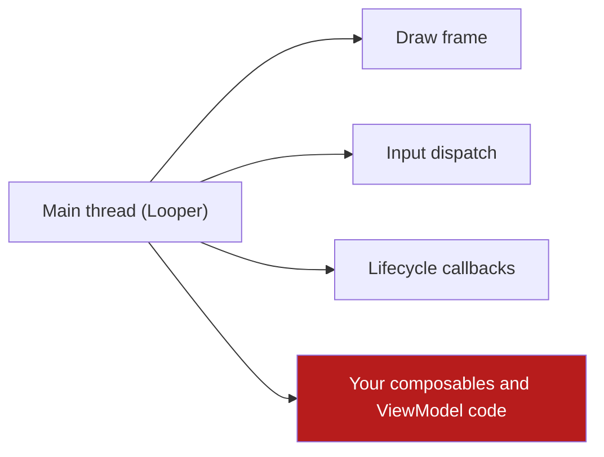

# Platform Model & Android Runtime

Android is not one program. It is a **runtime** that owns your process, your
threads and your lifetimes, and it makes decisions about them that your code
must survive. This chapter is about that runtime: the process, the main
thread, the lifecycle, the `Application`, StrictMode, and the limits the
platform puts on background work.

## 1. The process is the unit of survival

An Android app is a **process** the system may kill at any time, without
warning and without a callback, when memory is under pressure. The rules
that follow are not style preferences; they are the shape of the platform.

| Fact | Consequence for the code |
| --- | --- |
| The process can be killed while the user is in the app | Anything that must survive lives in storage, not in a field |
| The process is recreated from scratch after a kill | `Application.onCreate` runs again; there is no "warm" instance |
| The Activity is recreated on a configuration change | `rememberSaveable` or `SavedStateHandle`, not a plain field |
| The system may restore a killed process from a saved bundle | The saved state must be small, typed and safe to parse |

The template follows the platform: **the `notes` slice keeps no durable
state at all** ([08](08-offline-outbox-and-sync.md)), so a process death
costs nothing today. The moment a projection is added, the projection — not
the ViewModel — becomes the thing that survives.

## 2. The main thread

The **main thread** is the thread that runs the `Looper` and that draws the
frame. Everything on it is serialized behind everything else on it.



A frame that misses its deadline is a **jank**: the user sees a stutter.
On a low-end device — 2 usable cores, eMMC storage — the main thread is
already the busiest thread in the app.

The rule: **nothing on the main thread may block**. Concretely, these are
off-limits there:

| Operation | Where it goes |
| --- | --- |
| Disk I/O (files, `SharedPreferences`, a database) | An injected `io` dispatcher |
| Network I/O | An injected `io` dispatcher, inside a `suspend` function |
| JSON parsing of a large body | An injected `default` dispatcher |
| Crypto (key derivation, hashing a password) | An injected `default` dispatcher |
| A `sleep`, a `Thread.sleep`, a busy loop | Never — use `delay` in a coroutine |

Injected dispatchers, not the literal:

```kotlin
// Bad: the class is now untestable on the JVM and hidden behind a global.
suspend fun load() = withContext(Dispatchers.IO) { repository.list() }

// Good: the dispatcher is a constructor parameter of the class that owns
// the coroutine. In the template that is the ViewModel; the use case stays a
// plain suspend function.
class NotesViewModel(
    private val loadNotes: LoadNotes,
    private val dispatcher: CoroutineDispatcher = Dispatchers.IO,
)
```

The template's `:core:kernel` and `:feature:notes:domain` modules are pure
JVM, so the dispatcher is a plain constructor parameter and a test passes
`UnconfinedTestDispatcher` (or a `TestScope` dispatcher) instead of waiting
on a real thread. That is a direct consequence of
[ADR 0001](adr/0001-one-gradle-module-per-layer.md).

## 3. The lifecycle

Android's lifecycle is a **state machine**, and the platform is explicit
about it. The classic four states every `Activity` passes through:

| State | Meaning | What survives |
| --- | --- | --- |
| **Created** | The instance exists; the UI is not visible | Fields, saved state |
| **Started** | The UI is visible but not in the foreground | The ViewModel |
| **Resumed** | The UI is in the foreground and has focus | The ViewModel |
| **Stopped** | The UI is not visible | The ViewModel |
| **Destroyed** | The instance is going away | Nothing but saved state |

Two of these carry the weight the app must respect:

- **The `ViewModel` survives configuration changes** and lives until the
  Activity is finished. It is the right home for screen state, and the wrong
  home for anything that must survive the process.
- **`onSaveInstanceState` survives the process.** What you put there is
  written to a bundle, which is **not** a database: keep it small, and
  treat it as untrusted input when you read it back.

The template uses `androidx.lifecycle` 2.11.0: the ViewModel comes from
`lifecycle-viewmodel-compose`, and the state is collected with
`collectAsStateWithLifecycle()`, which stops collecting when the UI is not
active. That detail matters on a low-end device: a collector that keeps
running in the background burns CPU for a screen nobody is looking at.

## 4. Where the composition root lives

`Application.onCreate` runs once per process, before any Activity exists. It
is the natural place for the object graph that the whole app shares.

**The template ships no `Application` subclass.** The composition root is
the `App()` composable in `:app`'s `MainActivity`, and the wiring happens
where the ViewModel is built:

```kotlin
// MainActivity.kt — the composition root in the template.
val viewModel: NotesViewModel = viewModel {
    NotesViewModel(LoadNotes(InMemoryNoteRepository()))
}
```

That is enough for a template with one adapter and one use case. It is
deliberately the **smallest** correct answer, not the general one: a
project that gains per-process work needs the `Application` subclass, and
the rules for it are the ones below.

| Concern | Where it belongs |
| --- | --- |
| The object graph (repositories, use cases, ViewModel factories) | `Application.onCreate`, held by a field |
| Work that must happen once per process (a cache warm-up, a token refresh) | `Application.onCreate`, on a background scope |
| Anything that needs an Activity or a `Context` | Not here — pass the `Application` context down |

**Never hold an Activity, a View or a `Context` obtained from an Activity in
a field of `Application`.** It is a memory leak and, since
`onTrimMemory` cannot clean it, it is a slow out-of-memory crash on exactly
the low-end devices the template targets.

The `Application` subclass is the adoption step, and it brings StrictMode
with it (§5): a debug-only `Application` is the only place the policies can
be installed.

## 5. StrictMode

StrictMode is a debug-only watchdog. It is **not** installed in the
template — there is no `Application` subclass to install it in (§4). A
project that adds one installs it in the debug source set with the
penalties that catch the three classic main-thread mistakes:

```kotlin
// The shape a project adopts in its debug Application subclass. The two
// policies that matter for this template are the disk and network
// penalties: they turn a blocked main thread into a visible error instead
// of a jank report.
class DebugApplication : Application() {
    override fun onCreate() {
        super.onCreate()
        StrictMode.setThreadPolicy(
            StrictMode.ThreadPolicy.Builder()
                .detectDiskReads()
                .detectDiskWrites()
                .detectNetwork()
                .penaltyLog()
                .build(),
        )
    }
}
```

| Policy | What it catches |
| --- | --- |
| `detectDiskReads` / `detectDiskWrites` | A file or database read on the main thread |
| `detectNetwork` | A socket opened on the main thread |
| `detectCustomSlowCalls` | A call that takes longer than the threshold |
| `penaltyLog` | Prints the offending stack trace |
| `penaltyDeath` | Crashes the process (too blunt for day-to-day work) |

StrictMode is a **debug-only** tool. It must never be enabled in a release
build: the penalties cost real time and the crash is a real crash. It goes
in the debug source set only.

## 6. Background limits

This is where most "it works on my device" Android bugs live. The platform
restricts background execution in ways that are **per-device and
per-manufacturer**, not per-API.

| Limit | What it means for the app |
| --- | --- |
| **Doze** | In deep idle, the device is effectively asleep: no network, no alarms, no `JobScheduler` work |
| **App Standby / standby buckets** | The app is put in a bucket; the bucket decides how much it may run |
| **Background execution limits** | An app in the background may not start a background service |
| **Foreground service types** | A foreground service must declare a type (`location`, `microphone`, …) and a matching permission, and Play reviews it |
| **Background location** | `ACCESS_BACKGROUND_LOCATION` is a separate grant that is only allowed after the foreground grant, and only with a Play declaration |
| **OEM battery managers** | Aggressive vendor implementations kill background work even where AOSP would not |

The rules that keep a template out of trouble:

1. **Design for no background execution.** A push message is the wake-up
   channel; the app reconciles when it is in the foreground.
2. **Never ask for a battery-optimization exemption.** Play restricts it, and
   it is a bad signal.
3. **Use `WorkManager`** for deferrable work: it is the only scheduler that
   respects Doze and standby buckets. See
   [08](08-offline-outbox-and-sync.md).
4. **Do not depend on a background wake-up for correctness.** If the user
   must see the result, reconcile on foreground.

## 7. Memory

Android's memory model is unforgiving: a process is killed when it crosses
the system's limit for the device's RAM class.

| Signal | Meaning |
| --- | --- |
| `ActivityManager.isLowRamDevice()` | The device is in the low-RAM class; the system will kill aggressively |
| `ComponentCallbacks2.onTrimMemory(level)` | The system is under pressure; evict caches now |
| `TRIM_MEMORY_RUNNING_LOW` | Mild pressure: drop the caches |
| `TRIM_MEMORY_UI_HIDDEN` | The UI is gone: release what the UI held |
| `TRIM_MEMORY_COMPLETE` | The process is about to be killed: persist and let go |
| `ApplicationExitInfo` | On the **next** start, why the last process died (OOM, memory limiter, ANR) |

`ApplicationExitInfo` is the signal most apps ignore and should not: a
process killed by the memory limiter is a **correctness** event, not a
performance event. The template does not read it yet; the adoption path is
in [02](02-device-tiers-and-the-quality-governor.md) and
[08](08-offline-outbox-and-sync.md).

## 8. The rules that fall out of all of this

| Rule | Why |
| --- | --- |
| The domain is pure JVM, so it never touches a `Context` | A domain that needs a `Context` is doing I/O, and I/O does not belong in the domain |
| Dispatchers are injected | A test must not wait on a real thread |
| Long-lived objects live in the `Application`; screen state lives in the ViewModel; durable state lives in storage | Each has a different lifetime, and mixing them is the classic Android bug |
| Nothing blocks the main thread | It is the only thread that must answer the user |
| Reconcile on foreground | Background execution is not guaranteed |
| Release what `onTrimMemory` tells you to | The system's kill is not negotiable |

## Do / don't

| Do | Don't |
| --- | --- |
| Inject the dispatcher | Call `Dispatchers.IO` inside a class |
| Collect with `collectAsStateWithLifecycle()` | Collect in a `LaunchedEffect` that never stops |
| Hold the `Application` context, never the Activity | Store an Activity in a singleton |
| Read `onTrimMemory` as an eviction signal | Wait for the system to kill you |
| Use `WorkManager` for deferrable work | Poll with a timer in a service |
| Enable StrictMode in debug only | Ship the penalties in release |

## See also

- [Device Tiers & the Quality Governor](02-device-tiers-and-the-quality-governor.md)
  — what to do when the memory signal fires.
- [Layers, Modules & UDF](03-layers-modules-and-udf.md) — where the
  dispatcher is injected.
- [Offline, Outbox & Sync](08-offline-outbox-and-sync.md) — the background
  work that survives Doze.
- [Playbook Native Android Kotlin §§4.4, 14](../PLAYBOOK_MOBILE_ANDROID_KOTLIN.md)
  — the concurrency and background rules.
