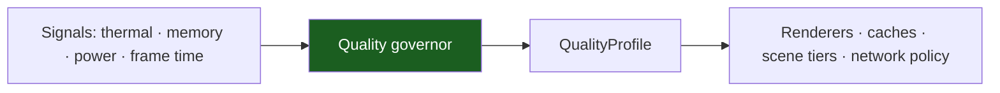

# Device Tiers & the Quality Governor

Android runs on hardware the app does not choose: a 2 GB Go-edition phone
and a flagship are the same APK. The template's answer is a **device tier**
(low / mid / high) and a **quality governor** that degrades the experience
gracefully instead of dropping frames.

> **Known gap — do not copy a fiction.** The template **does not ship** a
> device-tier detector or a governor. There is no `:core:device` module and
> no tier code in the tree. This chapter specifies the contract a project
> must implement and the budgets it must hold to; the adoption path is in
> §6. Nothing in the template reads
> `ActivityManager.isLowRamDevice()` today.

## 1. The three tiers

| Tier | Roughly | What it means |
| --- | --- | --- |
| **Low** | ≤ 3 GB RAM, little-core CPUs, entry GPUs, eMMC storage, Go editions | The floor. The app must be usable, not fast. |
| **Mid** | 4–6 GB RAM, mainstream SoC | The reference device. |
| **High** | ≥ 8 GB RAM, capable GPU | The ceiling. |

**Low is the floor, not an edge case.** A tier system that only degrades
*below* a threshold is a tier system that fails on the devices that need it
most. The template's budgets in §5 are written for the Low tier.

## 2. How a tier is decided

Detection is a **hint**; the measured result and the runtime governor win.
The three inputs, in order of authority:

| Input | Signals | Authority |
| --- | --- | --- |
| **Static hint** | `ActivityManager.isLowRamDevice()`, `MemoryInfo.totalMem`, `Build.VERSION.MEDIA_PERFORMANCE_CLASS` (API 31+), `Build.SOC_MODEL` (API 31+), `SDK_INT`, supported ABIs, GL ES / Vulkan feature levels | A starting guess |
| **Measured** | A first-run micro-benchmark: reference-scene p95 frame time, startup time | Wins over the hint |
| **Remote override** | Remote config keyed by `Build.MODEL` / SoC / API level: a forced tier or a blocklist | Wins over everything, for a device the team has seen misbehave |

Two rules:

1. **Persist the tier.** Recomputing it on every launch is a startup cost
   for a value that changes rarely.
2. **Re-evaluate after an OS update, an app update, and a repeated
   frame-drop event.** A device that was mid yesterday may be low today —
   the storage got slower, the OS got more aggressive.

> The reported RAM is not the usable RAM. `MemoryInfo.totalMem` on a 3 GB
> device reports roughly a third of the marketing number as available to the
> app. Tier on the reported number, never on the marketing number.

## 3. The governor contract

The governor is a small, testable component with a fixed shape. It takes
runtime signals and produces a **quality profile**; nothing else in the app
may read the thermal or memory state directly.

**Inputs** (all optional; a missing signal is not a reason to crash):

| Signal | Source |
| --- | --- |
| Thermal status and headroom | `PowerManager.getCurrentThermalStatus()`; the headroom forecast on API 30+ |
| Memory pressure | `ComponentCallbacks2.onTrimMemory(level)` |
| Power save mode | `PowerManager.isPowerSaveMode` |
| Frame health | `JankStats` or `Window` frame metrics |
| Previous exit reason | `ApplicationExitInfo` (memory limiter, OOM, ANR) |
| The user's choice | Auto · Battery saver · High quality, in settings |

**Output**: a `QualityProfile` — a value, not a set of scattered booleans.

| Knob | What it controls |
| --- | --- |
| Render scale | The resolution the app renders at (0.5 – 1.0) |
| Frame cap | The target frame rate (30 / 60) |
| Effects | Shadows, blur, post-processing — the expensive visual layer |
| Texture quality | Resolution of the loaded textures |
| Scene tier | Which engine tier is allowed (2D fallback → Filament → Godot → Unity) |
| Particles | Particle count and lifetime |
| Prefetch | Whether large assets and images may be prefetched |

**The two rules that make a governor work**:

| Rule | Why |
| --- | --- |
| **Step down immediately** on a breach | A user feels the drop; they never feel the recovery |
| **Step up only after a sustained healthy period** (hysteresis) | Otherwise the app oscillates, and oscillation is worse than either state |

The governor is **overridable by remote config and by managed policy**, and a
policy-forced profile wins over both the detected tier and the user's
setting. That is the same precedence rule as the rest of the kit: the
administrator over the user ([Admin Guide](admin-guide.md)).

## 4. The thermal signal

Thermal throttling is the most under-handled signal on Android, because it
is invisible until it is catastrophic.

| API level | What is available |
| --- | --- |
| API 29+ | `PowerManager.getCurrentThermalStatus()` — a status, not a rate |
| API 30+ | `addThermalStatusListener()` and the headroom forecast, which projects the status forward |

The pattern that works:

1. Listen to the thermal status.
2. On `THERMAL_STATUS_SEVERE` or worse, **step the profile down before the
   hardware throttles** — the throttle itself is the failure the governor
   exists to prevent.
3. On API 30+, use the headroom forecast to step down *early*, before the
   status changes.

A governor that reacts to `onTrimMemory` but ignores the thermal signal
will still hit the wall on a device that is hot but not short on memory.

## 5. The budgets

Starting points, calibrated for the **Low** tier with a release build and a
baseline profile. A native app should beat the cross-platform numbers.

| Metric | Budget (Low) | Budget (Mid) |
| --- | --- | --- |
| Cold start, time to initial display (TTID) | ≤ 2.5 s | ≤ 1.8 s |
| Time to fully drawn (TTFD, `reportFullyDrawn()`) | ≤ 3.5 s | ≤ 2.5 s |
| Slow/frozen frames | Jank rate < 5 % in main flows; zero frozen frames in a scroll benchmark | — |
| Touch response | ≤ 100 ms | — |
| Shell memory (PSS, no 3D) | ≤ ~120 MB | — |
| 3D scene memory (total process PSS) | ≤ ~300 MB | ≤ ~450 MB |
| 3D frame rate | Stable 30 fps (render scale ≤ 0.75) | 30–60 fps |
| Download size (per device, AAB) | ≤ ~25–35 MB for a form-and-list app | — |
| Memory growth over 30 minutes | ≈ 0 | — |
| Network | Works on slow 3G; request count and payload budget per screen | — |

The memory ceilings are **correctness** constraints, not goals: the platform
kills a process that crosses the limit for the device's RAM class, and
`ApplicationExitInfo` reports the kill on the next start.

## 6. The adoption path

The template ships the tier model as a specification. To implement it, in
this order:

1. **Add `:core:device`** — an Android library module (it needs
   `ActivityManager`, `PowerManager`, `Build`): the `DeviceCapabilityPort`,
   the `QualityProfile` value, and the governor.
2. **Keep it a port.** The domain declares `DeviceCapabilityPort`; the
   implementation lives in `:core:device`. The pure-JVM modules stay pure.
3. **Read the signals** on a background dispatcher, publish them as a
   `StateFlow<Thermal>`, and cache the tier in `DataStore` (or
   `SharedPreferences`, for a single integer).
4. **Write the governor as a pure function** of `(profile, signals) →
   profile`. Pure functions are testable on the JVM, with no device and no
   Android framework — which is the whole reason the tier detection lives in
   a module of its own.
5. **Wire the profile to the consumers**: the render scale, the cache caps,
   the prefetch policy.
6. **Add the remote override** — a forced tier per `Build.MODEL`, and a
   blocklist for devices that misbehave.
7. **Measure on the Low pool.** An emulator is not a low-end device.

## 7. What this means for the template today

| Concern | State in the template |
| --- | --- |
| Device tier detection | **Not implemented** — no tier code in the tree |
| The quality governor | **Not implemented** — the contract is specified in §3 |
| A `QualityProfile` value | **Not implemented** — the module `:core:device` does not exist |
| The budgets | **Specified** in §5, not measured |
| The device pool | **Specified** in [Support Matrix](support-matrix.md) |

The template is deliberately unaffected by this: it is a form-and-list app
with one in-memory repository, and none of its current code paths have a
quality knob. The chapter exists so that the **first** feature with a
quality dimension starts from a contract instead of from an ad-hoc flag.

## Do / don't

| Do | Don't |
| --- | --- |
| React to the thermal status before it throttles | Wait for the frames to drop |
| Step down immediately, step up slowly | Oscillate between two profiles |
| Read signals off the main thread | Poll `getCurrentThermalStatus()` in a loop |
| Let a policy-forced profile win | Let the user's setting override the administrator |
| Measure on a real Low device | Measure on an emulator |

## See also

- [Platform Model & Android Runtime](01-platform-model-and-android-runtime.md)
  — the memory signals the governor consumes.
- [Support Matrix](support-matrix.md) — the reference devices and the pool.
- [Playbook Native Android Kotlin §3](../PLAYBOOK_MOBILE_ANDROID_KOTLIN.md) —
  the device classes and the budgets.
