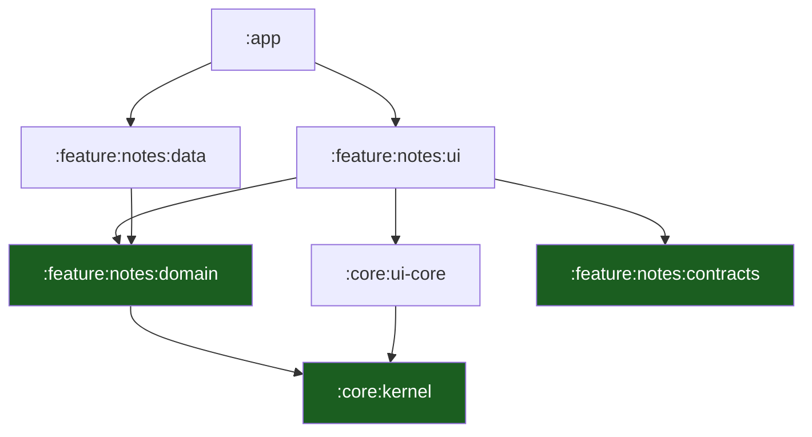

# Layers, Modules & UDF

The architecture of the template, in three parts: the **module graph** (what
may depend on what), the **presentation model** (`UiStatus`, `UiEvent`,
`UiEffect`), and the **architecture check** that keeps both true.

## 1. The module graph

Eight modules. Each one is a Gradle project, and each one declares its own
dependencies — which is what makes the rule a build fact.

| Module | Kind | Holds | May depend on |
| --- | --- | --- | --- |
| `:app` | Android application | The manifest, `MainActivity`, the `App()` composition root, the `NavDisplay` host | every feature module, `:core:kernel`, `:core:ui-core` |
| `:core:kernel` | **Pure JVM** | `Outcome<T>`, the id types, the error codes | nothing but the Kotlin stdlib |
| `:core:ui-core` | Android library | `UiStatus`, the closed status set | `:core:kernel` |
| `:feature:notes:contracts` | **Pure JVM** | The `@Serializable` `NavKey` routes | the Navigation3 runtime and the serialization library |
| `:feature:notes:domain` | **Pure JVM** | The `Note` entity, the `NoteRepository` port, the use cases | `:core:kernel` |
| `:feature:notes:data` | Android library | The in-memory adapter implementing the port | `:feature:notes:domain` |
| `:feature:notes:ui` | Android library | The Compose screen, the ViewModel, `NotesState`/`NotesEvent`/`NotesEffect` | `:feature:notes:domain`, `:feature:notes:contracts`, `:core:ui-core` |
| `:evals` | **Pure JVM** | The JUnit contract tests for the `.claude` layer | nothing internal — it reads the kit's files at runtime |



### The edges that matter

| Edge | Why it is allowed |
| --- | --- |
| `:app → :feature:notes:ui` | The app hosts the screen; it does not implement it |
| `:app → :feature:notes:data` | The app chooses the adapter — that is the whole point of the port |
| `:app → :feature:notes:contracts` | The app registers the route types in its `entryProvider` |
| `:feature:notes:ui → :feature:notes:domain` | The ViewModel calls use cases |
| `:feature:notes:data → :feature:notes:domain` | The adapter implements the domain's port |
| `:feature:notes:ui → :feature:notes:contracts` | The screen needs the route types |
| `:feature:notes:ui → :core:ui-core` | The screen renders the shared `UiStatus` set |
| `:core:ui-core → :core:kernel` | `UiStatus` carries a correlation id from the kernel |
| `:feature:notes:domain → :core:kernel` | The domain returns `Outcome<T>` |
| everything → `:core:kernel` | The kernel is the base |

### The edges that are forbidden

| Forbidden | Because | Who stops it |
| --- | --- | --- |
| `:feature:notes:ui → :feature:notes:data` | The presentation layer never picks an implementation; `:app` does | `check-architecture.sh` |
| `:feature:notes:data → :feature:notes:ui` | The storage never reaches up to the surface | `check-architecture.sh` |
| `:feature:notes:domain → :feature:notes:data` | The dependency would point outward, from the rules to the storage | The compiler: `data` depends on `domain`, not the other way round |
| `:feature:notes:domain → :feature:notes:ui` | The rules must not know the surface | The compiler: `ui` depends on `domain`, not the other way round |
| `:core:kernel → any project module` | The kernel is the base; it depends on nothing internal | `check-architecture.sh` |
| any pure JVM module → an Android module | The Android SDK is not on its classpath | The compiler |
| `:evals → any project module` | The contract tests read the kit's files, not its code | `check-architecture.sh` |
| `:feature:notes:ui → :feature:notes:domain` of **another** slice | Cross-slice access goes through `contracts` ([04](04-vertical-slicing.md)) | **Nobody yet** — it is a rule the team holds, not a rule the build holds |

The last row is the honest gap: the architecture check does not scan for
cross-slice imports, because the shipped tree has one slice and a rule that
cannot be exercised is a rule that is not tested. It becomes a check when
the second slice lands.

The rows in the middle are not stylistic. In a pure JVM module, an `import
android.content.Context` **does not compile** — the SDK is not on the
classpath. The layering is enforced by the compiler before a reviewer ever
sees the diff.

## 2. `Outcome<T>`: errors are values

The kernel's outcome type is a sealed type with two arms. An expected
failure is a **value**, not a thrown exception.

```kotlin
sealed interface Outcome<out T> {
    data class Success<T>(val value: T) : Outcome<T>
    data class Failure(val error: AppError) : Outcome<Nothing>
}
```

The rules:

| Rule | Why |
| --- | --- |
| A port returns `Outcome<T>` | The caller must handle the failure; the compiler forces it |
| `AppError` is a closed set in the kernel | The caller never guesses an error code |
| `CancellationException` is always rethrown | Swallowing it breaks structured concurrency |
| A failure is logged **once**, at the layer that decides what to do with it | Three layers logging the same failure is the most common defect |

## 3. The UDF contract

The presentation layer is **unidirectional**: state flows down, events flow
up, effects leave the screen once.

| Type | Direction | Lifetime | Purpose |
| --- | --- | --- | --- |
| `UiState` | Down | Recomposed | Everything the screen renders |
| `UiEvent` | Up | Consumed | What the user did |
| `UiEffect` | Out | **One-shot** | What the screen must do outside its own rendering: navigate, show a snackbar, request a permission |

Those three are the generic names. The shipped slice calls them
`NotesState`, `NotesEvent` and `NotesEffect` (`NotesUi.kt`); the shared
status set is `UiStatus`, and it lives in `:core:ui-core` so every slice
renders the same closed set.

### `UiStatus`

Every screen's state carries a status. There is one closed set, and every
screen handles all of it — a screen that only handles `Ready` is an
incomplete screen.

| Status | When |
| --- | --- |
| `Loading` | A read is in flight |
| `Ready` | There is data to show |
| `Empty` | The read succeeded and there is nothing |
| `Offline` | The last operation failed because the device has no usable connection |
| `Forbidden` | The server refused the operation |
| `NotFound` | The resource is gone |
| `Error` | Anything else, with a `correlationId` |
| `PolicyBlocked` | A managed policy blocked the operation |

The status is **one value, not a set of booleans**. Booleans admit
contradictory states (`loading = true` and `empty = true`); a sealed
hierarchy does not.

### The ViewModel rules

| Rule | Why |
| --- | --- |
| The ViewModel exposes `StateFlow<UiState>` | The state is always observable and always current |
| The ViewModel never holds a `Context`, an Activity or a composable | A ViewModel that holds a UI reference leaks it |
| The ViewModel depends on use cases, not on repositories | The rule lives in the use case |
| The ViewModel takes a `dispatcher` in its constructor | A test must not wait on a real thread |
| The ViewModel exposes `onEvent(UiEvent)` and nothing else public | One entry point for the screen |
| Effects are delivered through a `Channel` with `Channel.BUFFERED` and a single consumer | An effect that is re-delivered on rotation is a duplicate navigation |
| Screen inputs that must survive a process death go through `SavedStateHandle` | `remember` does not survive |
| The ViewModel holds no Android UI types | It stays testable on the JVM |

### The screen rules

| Rule | Why |
| --- | --- |
| A composable is a function of `UiState` | The screen is a rendering, not a controller |
| A composable sends `UiEvent`s and observes `UiState` | It never calls a use case |
| No business logic in a composable | It is not covered by a unit test and it recomposes |
| `@Immutable` on the state, `key` and `contentType` in every lazy list | Skipping requires stable inputs |
| Collect with `collectAsStateWithLifecycle()` | A background collector burns CPU |

## 4. The architecture check

`scripts/check-architecture.sh` is the machine check. It reads the build
files and the sources and fails when the graph is wrong.

| What it checks | How |
| --- | --- |
| A pure JVM module applies no Android plugin | The module's `plugins` block in its build file |
| `:core:kernel` depends on no other module | The module's `dependencies` block |
| `:core:kernel` and `:feature:notes:domain` import no `android.*` or `androidx.*` | A source scan of the module's `src/` |
| `:feature:notes:ui` does not depend on `:feature:notes:data` | The build file and a source scan of the module's `src/` |
| `:feature:notes:data` does not depend on `:feature:notes:ui` | The module's `dependencies` block |
| Only `:app` applies `android.application` | Every other module's `plugins` block |
| `:evals` depends on no module of the app | The module's `dependencies` block |

Those are the script's **six** rules (the `ui → data` and `data → ui`
bans are one rule, checked in both directions), and there is nothing else in
it. The script is deliberately narrow: it checks the edges the compiler
cannot catch, and it does not try to be a linter.

It is a **gate, not a lint**: it exits non-zero, so CI fails. It runs as the
first step of the gate set:

```sh
bash scripts/check-architecture.sh
```

Some rules are enforced twice on purpose. A `ui → data` dependency compiles
fine but is banned by the check; an `android.*` import in a pure JVM module
does not compile at all. The compiler catches the impossible mistakes; the
script catches the possible ones.

## 5. The `:app` module

`:app` is the composition root and it is **thin**: it builds the object
graph, hosts the `NavDisplay`, and contains no rules.

```kotlin
// MainActivity.kt — the composition root in the template. There is no
// Application subclass and no container class: the graph is built here,
// once, at the point where it is needed.
val viewModel: NotesViewModel = viewModel {
    NotesViewModel(LoadNotes(InMemoryNoteRepository()))
}
```

Three rules:

| Rule | Why |
| --- | --- |
| `:app` chooses the implementation of every port | That is the only place that may |
| `:app` contains no business rule | A rule in the root is a rule nobody can reuse |
| `:app` is the only module that owns the Android entry points and chooses the adapters | A `Context` in a use case is a `Context` in a unit test |

See [ADR 0003](adr/0003-manual-di-in-the-app-module.md) for why there is no
DI framework in the template.

## Do / don't

| Do | Don't |
| --- | --- |
| Return `Outcome<T>` from every port | Throw for an expected failure |
| Keep one status value per screen | Model the state as five booleans |
| Inject the dispatcher into the ViewModel | Call `Dispatchers.IO` inside the ViewModel |
| Choose the adapter in `:app` | Construct an adapter inside a use case |
| Keep the domain in a pure JVM module | Import `android.content.Context` in a use case |
| Route a one-shot action through an effect | Put a navigation call in the state |

## See also

- [Vertical Slicing](04-vertical-slicing.md) — how a slice is cut.
- [ADR 0001 — One Gradle module per layer](adr/0001-one-gradle-module-per-layer.md)
- [ADR 0003 — Manual DI in the app module](adr/0003-manual-di-in-the-app-module.md)
- [Playbook Native Android Kotlin §4](../PLAYBOOK_MOBILE_ANDROID_KOTLIN.md)
  — the layers and the UDF rules.
