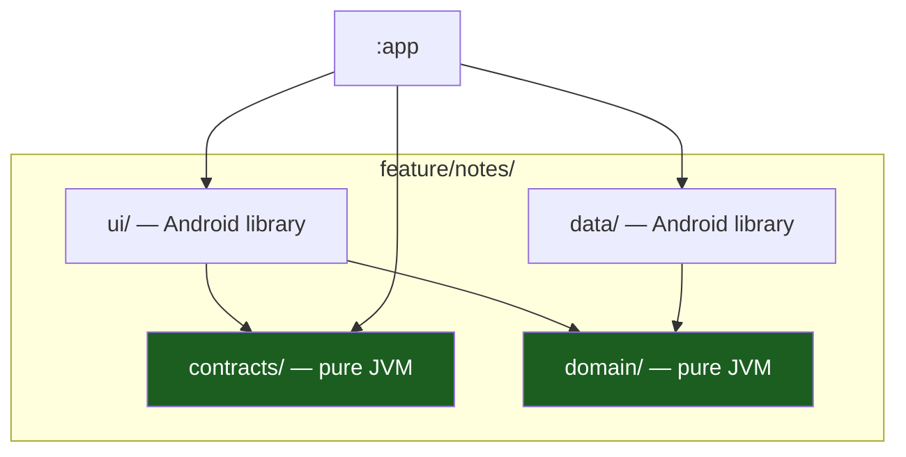
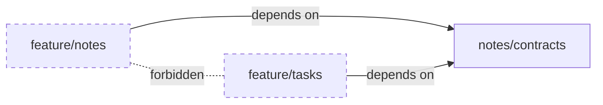

# Vertical Slicing

A **slice** is one feature, cut end to end: its routes, its rules, its ports,
its use cases, its adapter and its screen. Slices are the unit of work, of
review and of ownership. The template ships exactly one, `notes`, as the
reference.

## 1. The four quadrants

Every slice is four Gradle modules. The split is not a diagram: it is four
directories, four build files and four sets of allowed dependencies.



| Quadrant | Module kind | Holds | May depend on |
| --- | --- | --- | --- |
| **contracts** | Pure JVM | The `@Serializable` `NavKey` routes, the interfaces other slices may call | no module of this project — the Navigation3 runtime and the serialization library |
| **domain** | Pure JVM | The entity, the port, the use cases | `:core:kernel` |
| **data** | Android library | The adapter that implements the port | the slice's `domain`, Android APIs |
| **ui** | Android library | The screen, the ViewModel, the state and events | the slice's `domain` and `contracts`, `:core:ui-core` |

## 2. What each quadrant owns

| Asset | Owner of the `notes` slice |
| --- | --- |
| Route type | `NotesRoute` in `contracts` |
| Domain rules | The `Note` entity: an id and a title, plain text only |
| Port | `NoteRepository`, declared in `domain` |
| Storage | The in-memory list in `data` |
| UI surface | The Compose screen and its ViewModel in `ui` |
| Wiring | `:app` — and only `:app` |

Two slices never share a route type, never share a port and never import
each other's `domain` or `data`. The rule is checked by
`scripts/check-architecture.sh`.

## 3. The contracts quadrant

`contracts` is the **published face** of a slice. It holds two kinds of
thing:

| What | Why it is public |
| --- | --- |
| The `NavKey` route types | The app module must be able to register the screen; a route is a value another module has to hold |
| The cross-slice interfaces | Another slice may call this one, but only through a declared interface |

What `contracts` deliberately does **not** hold:

| Not here | Because |
| --- | --- |
| The entity | It is an implementation detail of the slice; another slice gets a DTO or a projection |
| The port | The port belongs to the slice that consumes it ([03](03-layers-modules-and-udf.md)) |
| The length constants | The contract bounds what may travel; the domain bounds what may exist |

`contracts` is a **pure JVM** module, so the route types carry no Android
type. A route is `@Serializable` data — an id, a set of flags — and nothing
else.

## 4. The domain quadrant

The domain holds the rules and the use cases, and it is **pure Kotlin**:

| Holds | Example |
| --- | --- |
| The entity | `Note(id, title)` with its invariants |
| The port | `NoteRepository` — the interface the use cases need |
| The use cases | `LoadNotes` — returning `Outcome<T>`. A write use case lands with the first product feature ([08](08-offline-outbox-and-sync.md)) |
| The dispatchers they need | None, in this shape: the use case is a plain suspend function and the ViewModel owns the dispatcher. Never `Dispatchers.IO` inline |

Three rules:

1. **No `android.*` import.** The SDK is not on the classpath; this is a
   compile error, not a review comment.
2. **No Compose import.** The domain does not know a screen exists.
3. **The port is declared here, not in `data`.** The consumer owns the
   interface; the producer implements it.

## 5. The data quadrant

`data` holds the **adapters**: the implementations of the domain's ports.
Today there is exactly one — an in-memory repository.

```kotlin
// The shape of the adapter. It implements the port the domain declared and
// knows nothing about the domain's rules beyond the types it exchanges.
class InMemoryNoteRepository : NoteRepository {
    private val notes = listOf(
        Note(NoteId("1"), "Welcome to <app>"),
        Note(NoteId("2"), "Your second note"),
    )

    override suspend fun list(): Outcome<List<Note>> = Outcome.Success(notes)
}
```

Two things about `data` that the module boundary enforces:

| Rule | Consequence |
| --- | --- |
| `data` may use Android APIs | A Room DAO, a `DataStore`, a `Context` — all allowed here and only here |
| `data` may not know the UI | There is no Compose on its classpath path from the domain, and no reason for it to depend on `ui` |

The adapter is where the **storage decision** lives. The template's
in-memory adapter is the placeholder for Room
([08](08-offline-outbox-and-sync.md)); the domain does not change when it
is replaced.

## 6. The ui quadrant

`ui` holds the screen and the ViewModel — and it talks to the domain, never
to `data`.

```kotlin
// The ViewModel depends on the use case, not on the repository.
class NotesViewModel(
    private val loadNotes: LoadNotes,
    private val dispatcher: CoroutineDispatcher = Dispatchers.IO,
) : ViewModel() { /* ... */ }
```

| Rule | Why |
| --- | --- |
| The ViewModel takes use cases, not repositories | The rule lives in the use case, not in the ViewModel |
| The screen renders `UiState` and sends `UiEvent` | The UDF contract ([03](03-layers-modules-and-udf.md)) |
| The screen never imports `data` | The presentation layer does not choose the implementation |

The `ui` module is an **Android library**, not an application module: it has
no manifest entry of its own, no `Application` and no launcher icon. It is
linked into `:app`.

## 7. Cross-slice access

The rule is the same as in the backend: **cross-slice access only through
`contracts`**.

| Need | Where it goes |
| --- | --- |
| Another slice calls this one | Declare an interface in `contracts`; the caller depends on `contracts` only |
| Two slices need the same entity | It was not slice code: move it to `:core:kernel` |
| Two slices need the same route | It belongs in a shared `contracts` module, or in `:core:ui-core` if it is navigation plumbing |
| Two slices need the same rule | Extract it into the domain, or into `:core:kernel` if it is truly universal |



Two slices must not depend on each other's `domain` or `data`. The reason
is practical: a direct slice-to-slice dependency makes both slices
impossible to delete, to rename or to extract.

> **Known gap.** The architecture check does **not** scan for cross-slice
> imports. The template ships one slice, so the rule cannot be exercised
> against it, and a check with no fixture is a check nobody runs. The rule
> becomes a script rule when the second slice lands
> ([03](03-layers-modules-and-udf.md) §4).

## 8. Adding a slice

The short recipe; the full one is in
[13 — Playbooks](13-playbooks.md).

1. Create `feature/<slice>/{contracts,domain,data,ui}` and include the four
   modules in `settings.gradle.kts`.
2. **Domain first**: the entity, its invariants, the port, the use cases.
   No Android, no Compose.
3. **Contracts**: the `NavKey` route types and any interface other slices
   may call.
4. **Data**: the adapter implementing the port.
5. **Ui**: the ViewModel, the state, the events, the effects, the screen.
6. Register the route in `:app` — in the `entryProvider`, and nowhere else.
7. Wire the implementations in the `:app` composition root.
8. Write the tests: the use cases against a fake repository, the ViewModel
   against the use cases.

## Do / don't

| Do | Don't |
| --- | --- |
| Declare the port in the domain | Declare the port in the adapter |
| Depend on another slice's `contracts` | Import another slice's `domain` or `data` |
| Keep the entity inside the slice | Export the entity in `contracts` |
| Choose the adapter in `:app` | Let the ViewModel construct one |
| Delete the `notes` slice when you start | Keep it as a second, unused slice |

## See also

- [Layers, Modules & UDF](03-layers-modules-and-udf.md) — the module graph.
- [Project Layout & Build Logic](05-project-layout-and-build-logic.md) — the
  tree.
- [Playbooks](13-playbooks.md) — the recipe for adding a slice.
- [Playbook Native Android Kotlin §4](../PLAYBOOK_MOBILE_ANDROID_KOTLIN.md)
  — the layer table.
