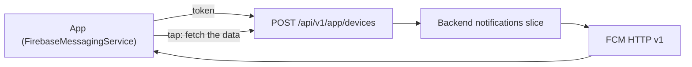

# Push Notifications

Push is a **channel, not a data path**. The payload carries a small hint
("something changed in this category"); the app fetches the real data after
the tap. A payload that carries the content is a payload that leaks on a
locked screen.

> **Known gap — do not copy a fiction.** The template **does not implement**
> push. There is no `FirebaseMessagingService`, no notification channel, no
> token registration and no `POST_NOTIFICATIONS` request in the tree. This
> chapter specifies the contract and the adoption path.

## 1. The architecture



The backend owns the device registry, the preferences, the templates and the
scheduling. The app owns the token, the channels and the routing of an
incoming message.

| Component | Owner |
| --- | --- |
| The device registry (`token`, `variant`, `locale`, `tz`, the channel states) | The backend |
| The token lifecycle | The app |
| The channels and their importance | The app |
| The notification content | The backend, from a template |
| The routing of a tap | The app, through the route allowlist |

The **FCM HTTP v1** API is the transport; the legacy FCM endpoint is
retired.

## 2. The token lifecycle

| Event | The app does |
| --- | --- |
| **After login** | Register the device with the backend |
| **On every app start** | Register again — the backend's registry may be stale |
| **On `onNewToken`** | Enqueue the upload; **do not** call the network on the callback thread |
| **On logout** | `deleteToken()` and unregister on the server |
| **On account deletion** | The same, plus the server cascades the deletion ([07](07-auth-and-platform-features.md)) |
| **On `UNREGISTERED` from the provider** | The server prunes the token |

The registration payload:

```json
{
  "platform": "android",
  "token": "<fcm-registration-token>",
  "provider": "fcm",
  "appVariant": "<app>",
  "versionCode": 1,
  "locale": "en-US",
  "tz": "America/Argentina/Buenos_Aires",
  "notificationsEnabled": true,
  "channelStates": { "promotions": "off" }
}
```

The upload must be a **deferred, retryable job** — a `WorkManager` task with
a network constraint — not a call on the `onNewToken` callback, which
Android gives a few seconds.

## 3. The message payload

The same shape as the other clients of the platform:

| Field | Meaning |
| --- | --- |
| `v` | The payload schema version |
| `type` | The message type — the routing key |
| `category` | The channel category |
| `deepLink` | The route to open on a tap |
| `correlationId` | The correlation id, carried into the app's own logs |
| `collapseKey` | The key that collapses a burst into one notification |
| `ttl` | How long the message is worth delivering |
| `priority` | The delivery priority |

Two rules:

| Rule | Why |
| --- | --- |
| The payload is **minimal** | It is visible on a locked screen, and it crosses an unreliable network |
| The payload is **validated against a versioned schema** before use | An unknown or malformed payload is dropped, not rendered |

A **notification message** carries a user-visible alert. A **data message**
is a sync hint only — the app may use it to refresh, and it must not be
relied on: the system may deprioritise a high-priority data message that
does not result in a visible notification.

## 4. Channels

Channels are created on API 26+ and are **immutable in their importance**:
changing the importance of a channel requires a **new channel id**, because
the user may have already changed the old one's settings.

| Channel | Category | Default |
| --- | --- | --- |
| `transactional` | Order and payment updates | High |
| `account-security` | Sign-in alerts, password changes | High, and not disableable |
| `game-events` | Live gameplay events | Low |
| `social` | Messages and reactions | High |
| `avatar` | Session reminders | Default |
| `promotions` | Marketing | **Off until the user opts in** |

The rules:

| Rule | Why |
| --- | --- |
| The channels are created at app start | A notification for a channel that does not exist is dropped silently |
| `promotions` is created **disabled** | Marketing never arrives without an opt-in |
| The channel states are reported to the server | The backend needs to know what the user can actually receive |
| A channel the user disabled is not re-enabled by the app | The user's choice is final; a new id is a new channel, and it is only created for a genuinely new category |

## 5. The permission

`POST_NOTIFICATIONS` is a **runtime permission on API 33+**.

| Rule | Why |
| --- | --- |
| Request it at a **contextual moment** — after the first order, after the first catch — not at first launch | A prompt with no context is a denial |
| Show a **primer** first | The user deserves to know what the permission is for |
| After repeated denials, the system stops prompting | Deep-link to the app's notification settings instead of asking again |
| Report the permission state to the server | The backend must not send what cannot be shown |

```kotlin
// The shape of the request. The launcher is created in the composable and
// the result is handled there.
val launcher = rememberLauncherForActivityResult(
    ActivityResultContracts.RequestPermission()
) { granted -> /* report the state to the server */ }
```

## 6. The tap

A tap must land on a **screen**, with a sensible back stack.

| Rule | Why |
| --- | --- |
| The `PendingIntent` targets an **Activity directly** | Android 12+ forbids the trampoline: a service or receiver cannot relay the tap |
| The `PendingIntent` is `FLAG_IMMUTABLE` | Another app must not rewrite it ([09](09-security-and-keystore.md)) |
| The Activity parses the `deepLink` through the **same parser** as an App Link | One parser, one set of rules ([06](06-navigation-routes-and-deep-links.md)) |
| The route is validated against the allowlist | The payload is untrusted |
| A synthetic back stack is built | Up lands on a sensible parent |
| **No state-changing action from the payload** | A tap may open a screen that offers an action; the user confirms it |

## 7. Lock-screen privacy

| Rule | Why |
| --- | --- |
| No PII in the title or the body | The lock screen shows them to anyone |
| `setPublicVersion` for a sensitive channel | The private version is the detailed one, shown after unlock |
| The details are **fetched after the tap** | The data never sits in the notification |
| Rich content (images, `MessagingStyle`) is skipped on the Low tier | An image in a notification is a memory and a download cost |

## 8. Low-end and OEM realities

This is where push delivery actually fails.

| Reality | Consequence |
| --- | --- |
| Aggressive OEM battery managers kill background work | A message may arrive hours late, or not at all |
| Doze and the standby buckets defer delivery | The same |
| The network is slow or metered | A large payload may never arrive |

The rules:

| Rule | Why |
| --- | --- |
| Keep the payload small | It is the only part that must survive a bad network |
| **Never depend on background execution** | It is not guaranteed on any device |
| **Never request a battery-optimization exemption** | Play restricts it, and it is a bad signal |
| Reconcile on **foreground** | The projection is refreshed anyway ([08](08-offline-outbox-and-sync.md)) |
| Offer a one-time in-app guide to the OEM's settings when delivery fails repeatedly | The user can fix what the app cannot |
| Test with Doze and the standby buckets, and on the OEM devices in the pool | A device farm of AOSP devices proves nothing about a Huawei |

## 9. The server side

| Concern | Rule |
| --- | --- |
| The device registry | One row per (app, device, token) |
| The preferences | Per category, per device |
| The templates | Localised, per category |
| The scheduling | By the device's timezone |
| The rate limits and the collapse | A per-category limit and a `collapseKey` |
| The idempotency of a send job | The same job id does not send twice |
| The receipts | A delivery receipt and an open receipt |
| The dead-token pruning | `UNREGISTERED` and `INVALID_ARGUMENT` remove the token |
| The audit trail | Transactional and security notifications are auditable |
| The kill switch | A per-category switch that stops sending |

## 10. The adoption path

1. **Add Firebase Messaging** to the app module. `google-services.json` is
   **not** a secret, but it is per-variant, and it is not in the template.
2. **Add the `FirebaseMessagingService`.** `onNewToken` enqueues an upload;
   `onMessageReceived` validates the payload, builds the notification and
   returns **quickly** — the heavy work goes to a `WorkManager` job.
3. **Create the channels** at app start, with the importance of §4.
4. **Request `POST_NOTIFICATIONS`** at a contextual moment, with the primer.
5. **Register the device** after login and on every start
   ([07](07-auth-and-platform-features.md)).
6. **Add the tap routing**: the Activity, the immutable `PendingIntent`, the
   shared deep-link parser, the synthetic back stack.
7. **Add the server side**: the registry, the templates, the kill switch.
8. **Test on the pool**: Doze, standby buckets, and the OEM devices.

## Do / don't

| Do | Don't |
| --- | --- |
| Fetch the content after the tap | Put the content in the payload |
| Target an Activity directly with an immutable `PendingIntent` | Use a notification trampoline |
| Create the channels at start | Assume the channel exists |
| Keep `promotions` off until the user opts in | Create it enabled and hope |
| Ask for the notification permission at a contextual moment | Ask at first launch |
| Reconcile on foreground | Depend on the background wake-up |
| Report the permission and channel states to the server | Assume the server knows |

## See also

- [Navigation Routes & Deep Links](06-navigation-routes-and-deep-links.md)
  — the parser a tap shares with an App Link.
- [Security & Keystore](09-security-and-keystore.md) — the `PendingIntent`
  and the lock-screen rules.
- [Auth & Platform Features](07-auth-and-platform-features.md) — the device
  registration payload.
- [Playbook Native Android Kotlin §8](../PLAYBOOK_MOBILE_ANDROID_KOTLIN.md)
  — the push rules.
