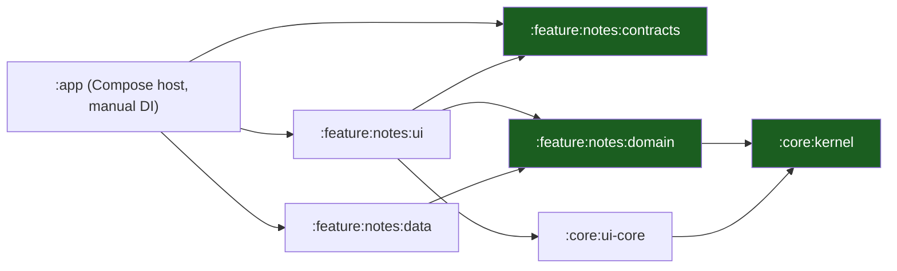

# Native Android Template — Documentation

The handbook of the native Android template: **Kotlin 2.4, Jetpack Compose,
Gradle 9.6 with one module per layer**. It describes the kit as it is — the
module graph, the UDF presentation model, the typed navigation, the gates —
and marks the parts that are still to be built as known gaps.

> 15 chapters · 4 reference documents · 3 ADRs.

## The one rule

**The module graph is the architecture.** `:core:kernel` and
`:feature:notes:domain` are pure JVM modules: the Android SDK is not on
their classpath, so the domain *cannot* import `android.*` — not by
convention, not by review, but by the compiler. Only `:app` sees every layer,
and it wires them by hand. See
[Layers, Modules & UDF](03-layers-modules-and-udf.md) and
[ADR 0001](adr/0001-one-gradle-module-per-layer.md).

## Start here

New to the kit? Read
[00 — Overview & Principles](00-overview-and-principles.md), then
[01 — Platform Model & Android Runtime](01-platform-model-and-android-runtime.md)
and [03 — Layers, Modules & UDF](03-layers-modules-and-udf.md). Starting a
project? Jump to
[05 — Project Layout & Build Logic](05-project-layout-and-build-logic.md) and
[13 — Playbooks](13-playbooks.md). Reviewing a change? Read
[06 — Navigation & Deep Links](06-navigation-routes-and-deep-links.md) and
[09 — Security & Keystore](09-security-and-keystore.md).

## Chapters

| #   | Chapter                                                                        | What it covers                                                            |
| --- | ------------------------------------------------------------------------------ | ------------------------------------------------------------------------- |
| 00  | [Overview & Principles](00-overview-and-principles.md)                         | The one rule, ten principles, the chapter map, the known gaps             |
| 01  | [Platform Model & Android Runtime](01-platform-model-and-android-runtime.md)   | The process, the main thread, the lifecycle, StrictMode, background limits |
| 02  | [Device Tiers & the Quality Governor](02-device-tiers-and-the-quality-governor.md) | Low, mid and high, the thermal signal, the governor contract, the budgets |
| 03  | [Layers, Modules & UDF](03-layers-modules-and-udf.md)                         | The module graph, `UiStatus`/`UiEvent`/`UiEffect`, the ViewModel rules     |
| 04  | [Vertical Slicing](04-vertical-slicing.md)                                     | The four quadrants of a slice, cross-slice access through `contracts`      |
| 05  | [Project Layout & Build Logic](05-project-layout-and-build-logic.md)           | The tree, the version catalog, the convention-plugin adoption path         |
| 06  | [Navigation Routes & Deep Links](06-navigation-routes-and-deep-links.md)      | Typed `NavKey`, back stacks, the route parity test, App Links              |
| 07  | [Auth & Platform Features](07-auth-and-platform-features.md)                   | Onboarding, login, registration, forgot password, Credential Manager       |
| 08  | [Offline, Outbox & Sync](08-offline-outbox-and-sync.md)                       | The Room projection, the outbox, WorkManager, idempotency, conflicts       |
| 09  | [Security & Keystore](09-security-and-keystore.md)                            | Keystore and Tink, no secrets in `BuildConfig`, integrity, Play policy    |
| 10  | [Push Notifications](10-push-notifications.md)                                | FCM v1, channels, token rotation, notification routing, `POST_NOTIFICATIONS` |
| 11  | [Telemetry](11-telemetry.md)                                                  | Redaction, crash reporting, performance markers, what must never be logged |
| 12  | [Testing & CI](12-testing-and-ci.md)                                          | JVM tests, the architecture check, the evals, the gates |
| 13  | [Playbooks](13-playbooks.md)                                                  | The six changes you will make most                                        |
| 14  | [Glossary](14-glossary.md)                                                    | Every term used in this set                                               |

## Reference

| Document                                                       | What it covers                                                                              |
| -------------------------------------------------------------- | ------------------------------------------------------------------------------------------- |
| [Support Matrix](support-matrix.md)                           | The device tiers, the reference devices, what each tier may enable, the device pool        |
| [Data Flows](data-flows.md)                                   | Startup, the notes list, an offline mutation, a deep link, a push tap — a trust boundary on every hop |
| [Admin Guide](admin-guide.md)                                 | Managed configuration, the Play Console setup, signing, how to verify a deployment          |
| [Dependency Register](dependency-register.md)                 | Every dependency: version, why it is there, the path that removes it                       |
| [ADR 0001 — One Gradle module per layer](adr/0001-one-gradle-module-per-layer.md) | Why the dependency rule is a build fact and not a review comment      |
| [ADR 0002 — Navigation3 typed NavKeys](adr/0002-navigation3-typed-navkeys.md) | Why routes are typed values and not strings                       |
| [ADR 0003 — Manual DI in the app module](adr/0003-manual-di-in-the-app-module.md) | Why there is no DI framework in the template and what it would cost    |

## The gates

| Command                          | What it proves                                                             |
| -------------------------------- | -------------------------------------------------------------------------- |
| `bash scripts/check-architecture.sh` | The module graph: no forbidden dependency, no `android.*` in a pure JVM module |
| `./gradlew :app:assembleDebug`   | The app compiles and packages against the real toolchain                   |
| `./gradlew test`                 | The unit tests of every JVM module                                         |
| `./gradlew testDebugUnitTest`    | The unit tests of every Android module (`variant` + `Debug` + `UnitTest`)  |
| `./gradlew :app:lintDebug`       | Android Lint on the debug variant: no hardcoded string, no unused resource |
| `./gradlew :evals:test`          | The `.claude` layer: agents, skills, commands, manifest posture             |
| `make ci`                         | The architecture check, both test suites, Android Lint and the debug build, in one go |
| `bash scripts/verify-template.sh` | The kit still builds after `rename.sh` — the substitution contract, proven |

## Known gaps of the template

The template ships the seams, not the filled-in product. The gaps are listed
in [00 — Overview & Principles](00-overview-and-principles.md) and in each
chapter; the ones that bite first are the missing persistence
([08](08-offline-outbox-and-sync.md)), the missing push pipeline
([10](10-push-notifications.md)) and the missing keystore wiring
([09](09-security-and-keystore.md)).

| Gap                                                                       | Where it is documented                                                     |
| ------------------------------------------------------------------------- | -------------------------------------------------------------------------- |
| No persistence: the `notes` repository is an in-memory adapter             | [Offline, Outbox & Sync](08-offline-outbox-and-sync.md)                    |
| No network client and no server contract implemented                       | [Auth & Platform Features](07-auth-and-platform-features.md)                |
| No DI framework: `:app` builds the object graph by hand                    | [ADR 0003](adr/0003-manual-di-in-the-app-module.md)                        |
| No `Application` subclass: the composition root is the `App()` composable    | [Platform Model & Android Runtime](01-platform-model-and-android-runtime.md) §4 |
| No device tier or quality governor implementation                          | [Device Tiers & the Quality Governor](02-device-tiers-and-the-quality-governor.md) |
| No push service, no notification channels, no token registration           | [Push Notifications](10-push-notifications.md)                              |
| No deep-link parser, no intent filter, no shared route table                | [Navigation Routes & Deep Links](06-navigation-routes-and-deep-links.md)   |
| No logger, no ring buffer, no remote telemetry sink, no crash reporter      | [Telemetry](11-telemetry.md)                                               |
| No keystore, no encrypted storage, no network security config               | [Security & Keystore](09-security-and-keystore.md)                        |

## Where the code is

| Topic                    | Module                                     |
| ------------------------ | ------------------------------------------ |
| The composition root     | `:app`                                     |
| The kernel               | `:core:kernel`                             |
| The shared status set     | `:core:ui-core`                            |
| The slice contracts      | `:feature:notes:contracts`                 |
| The slice domain         | `:feature:notes:domain`                    |
| The slice data adapter   | `:feature:notes:data`                      |
| The slice UI             | `:feature:notes:ui`                        |
| The `.claude` contract tests | `:evals`                                |
| The architecture gate    | `scripts/check-architecture.sh`             |
| This documentation set   | `docs/`                                     |

The module graph, and what each module may depend on, is in
[03 — Layers, Modules & UDF](03-layers-modules-and-udf.md).
