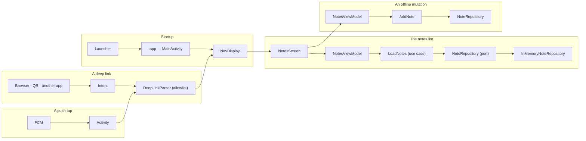
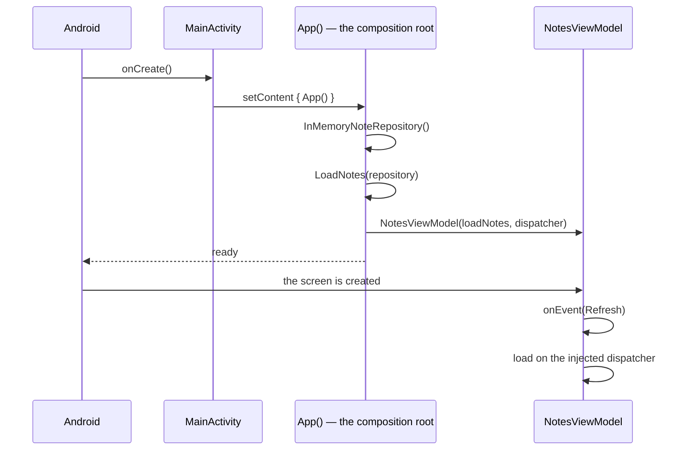
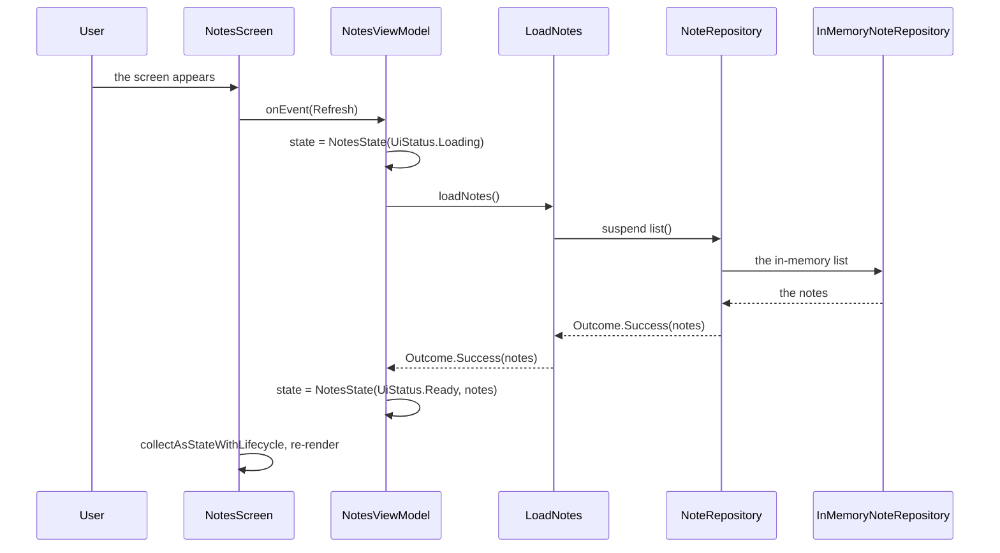
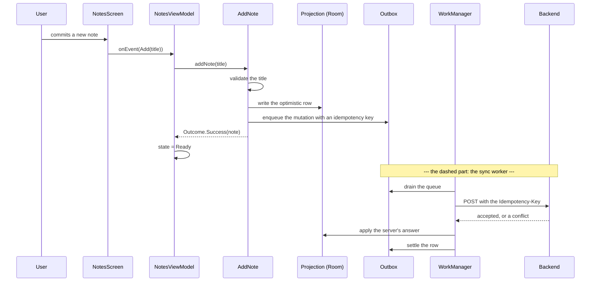
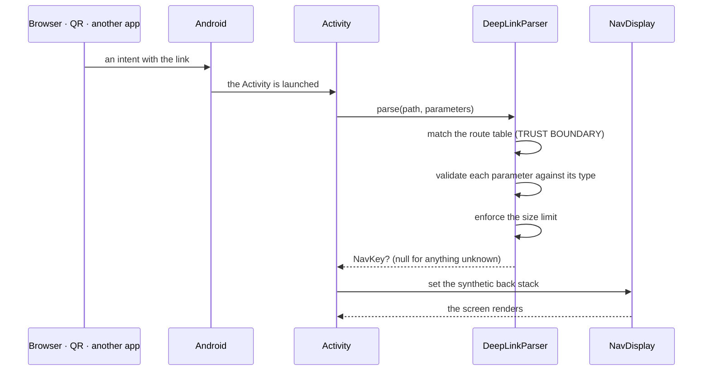
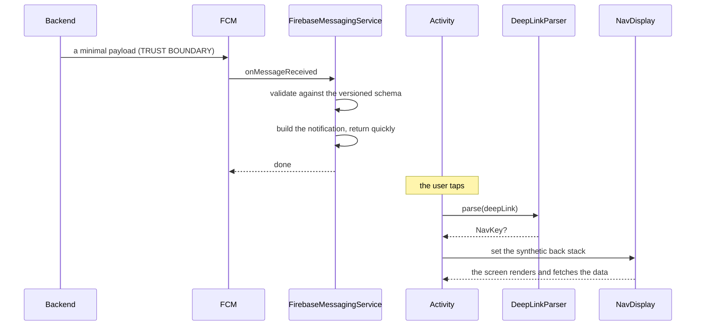

# Data Flows

Five flows, each with the trust boundary written on every hop. A flow that
has no boundary marked is a flow nobody reviewed.

Two of the five exist in the template today (startup, the notes list). The
other three — the offline mutation, the deep link and the push tap — are
drawn so the boundary is designed **before** the code is written; each says
so at its head.

## 1 · The flows at a glance

## 2 · Flow A — startup

| Hop | From → to | Trust boundary | The check |
| --- | --- | --- | --- |
| 1 | OS → Activity | The platform is trusted | — |
| 2 | Activity → composition root | Not a trust boundary; a **construction** boundary | The root builds plain objects; it does no I/O |
| 3 | Composition root → ViewModel | Not a trust boundary | The ViewModel receives use cases, never a repository it built itself |
| 4 | ViewModel → use case | The use case is trusted code | The dispatcher is injected, so the call leaves the main thread |

The rule that matters: **the graph is built in one place, the composition
root**, and it is built from objects that hold no `Context`. A `ViewModel`
that received the `Application` context could keep it across a configuration
change safely; one that received an Activity could not.

## 3 · Flow B — the notes list

The intended path: the screen asks the ViewModel, the ViewModel asks a use
case, the use case asks the port.

| Hop | From → to | Trust boundary | The check |
| --- | --- | --- | --- |
| 1 | User → screen | The user's input is data | The domain owns the rules; the screen never re-implements them |
| 2 | Screen → ViewModel | Not a trust boundary | The screen sends a typed `NotesEvent`; it never calls a use case |
| 3 | ViewModel → use case | Not a trust boundary | The use case is the only thing that knows the rule |
| 4 | Use case → port | The **data boundary** | The port speaks domain types; the adapter translates |
| 5 | Adapter → screen | The response is untrusted like any answer | The use case validates what the adapter returns, so a record written by an older build is dropped before it reaches the UI |

The last row is the one people skip: the adapter's output is **validated by
the use case**. The adapter is where the platform lives, and the platform
can return anything.

The status the user sees is a single value: `UiStatus.Loading`,
`UiStatus.Ready`, `UiStatus.Empty` or `UiStatus.Error`. Not five booleans.
The notes travel beside the status in `NotesState`, not inside it, so the
same closed status set serves every slice.

## 4 · Flow C — an offline mutation

> The template ships **no** write path and **no** outbox
> ([08](08-offline-outbox-and-sync.md)). This is the flow a project must
> build; the dashed hops are the ones that do not exist yet.

| Hop | From → to | Trust boundary | The check |
| --- | --- | --- | --- |
| 1 | User → screen | The user's input is data | The domain validates it |
| 2 | Screen → ViewModel | Not a trust boundary | A typed `NotesEvent` |
| 3 | ViewModel → use case | Not a trust boundary | The use case owns the rule |
| 4 | Use case → projection | The **durability boundary** | The projection and the outbox are written **in one transaction** |
| 5 | Outbox → backend | The **network boundary** | The idempotency key makes a retry safe; the server authorizes |
| 6 | Backend → worker | The response is untrusted | The error envelope wins over the status code; a conflict is a typed outcome |
| 7 | Worker → projection | Not a trust boundary | The server's version wins; the local pending change is rejected visibly |

Two properties the flow must preserve:

| Property | Where it comes from |
| --- | --- |
| **The user never waits for the network** | The optimistic row is written locally; the sync is a separate job |
| **A rejected mutation is visible** | The outbox row settles into `rejected`, and the screen shows it |

## 5 · Flow D — a deep link

> The template ships **no** deep-link parser and **no** intent filter
> ([06](06-navigation-routes-and-deep-links.md)). This is the flow a project
> must build; the flow is drawn so the boundary is designed before the code
> exists.

| Hop | From → to | Trust boundary | The check |
| --- | --- | --- | --- |
| 1 | Outside → the app | **Yes — the external boundary** | The link is untrusted, whoever sent it |
| 2 | Activity → parser | Not a trust boundary; the **validation** point | The path must match the route table; an unknown path returns `null` |
| 3 | Parser → parameters | The same boundary | Each parameter is validated against its expected type; the size is bounded |
| 4 | Parser → `NavKey` | Not a trust boundary | A typed value, never a string |
| 5 | `NavKey` → back stack | Not a trust boundary | The stack is built from the route hierarchy, so **Up** lands on a real parent |
| 6 | Screen → server | The **network boundary** | The server authorizes; the link never authorizes |

The rule that is easiest to get wrong: **a link received while signed out
is queued and resumed after the login**, not dropped and not replayed
blindly. And no state-changing action is ever performed from a link — a
link may open a screen that *offers* an action, and the user confirms it.

## 6 · Flow E — a push tap

> The template ships **no** push pipeline and **no** notification service
> ([10](10-push-notifications.md)). This is the flow a project must build.

| Hop | From → to | Trust boundary | The check |
| --- | --- | --- | --- |
| 1 | Backend → FCM → app | **Yes — the provider boundary** | The payload is minimal and validated against a versioned schema; an unknown type is dropped |
| 2 | Service → notification | Not a trust boundary | No PII in the title or the body; the channel's importance applies |
| 3 | Tap → Activity | The **external boundary** | The `PendingIntent` is immutable and targets the Activity directly — no trampoline |
| 4 | Activity → parser | The same boundary as a deep link | The **same parser**, the same allowlist, the same validation |
| 5 | Screen → server | The network boundary | The data is fetched after the tap; the payload never carries it |

The push and the deep link share the parser on purpose. Two parsers mean
two rule sets, and the second one is the one with the bug.

## 7 · Where the boundaries are enforced

| Boundary | Where it lives | Test |
| --- | --- | --- |
| The data boundary (port ↔ adapter) | `NoteRepository` in `domain` | The use-case test, against the fake |
| The module boundary | The Gradle dependencies | `scripts/check-architecture.sh` |
| The main-thread boundary | The injected dispatcher | Every unit test uses a `TestScope` dispatcher |
| The external boundary (links, pushes) | The deep-link parser in `contracts` — **not implemented** | The parser test, in the JVM suite |
| The durability boundary | The projection and the outbox — **not implemented** | The migration test and the outbox test |
| The network boundary | The SDK client — **not implemented** | The contract test, against a mock server |

## 8 · The boundaries that do not exist yet

| Boundary | State |
| --- | --- |
| The external boundary (links, pushes) | **Not implemented** — there is no deep-link parser in the tree ([06](06-navigation-routes-and-deep-links.md)) |
| The network boundary | **Not implemented** — there is no client in the template |
| The durability boundary | **Not implemented** — the repository is in memory |
| The provider boundary (FCM) | **Not implemented** |

Every boundary the template does not implement is a boundary a project must
build explicitly. The chapters that specify them are
[08](08-offline-outbox-and-sync.md), [07](07-auth-and-platform-features.md)
and [10](10-push-notifications.md).

## See also

- [Navigation Routes & Deep Links](06-navigation-routes-and-deep-links.md)
  — the parser and the synthetic back stack.
- [Offline, Outbox & Sync](08-offline-outbox-and-sync.md) — the mutation
  flow.
- [Push Notifications](10-push-notifications.md) — the payload and the tap.
- [Layers, Modules & UDF](03-layers-modules-and-udf.md) — the state and the
  events.
