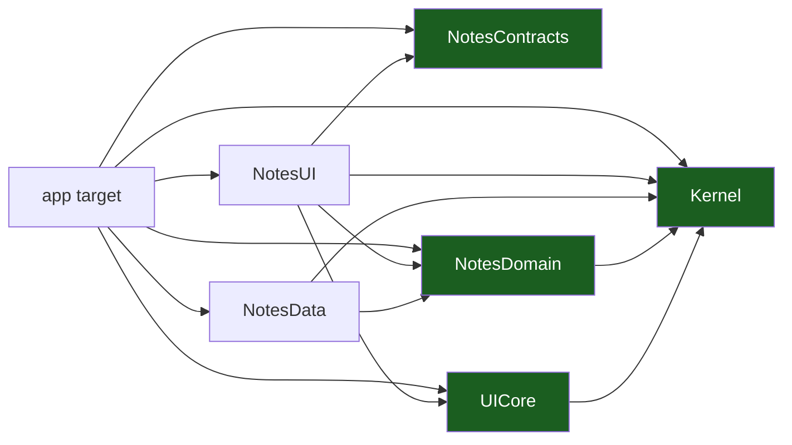

# Overview & Principles

The entry chapter. It states the one structural idea — **a SwiftPM package
per layer, hexagonal inside each slice, unidirectional data flow in the
presentation** — and the principles that follow. Generic: the template ships
one example slice (`notes`) that you replace with your own.

## 1. What this template is

A starting point for a **native iOS client**: Swift 6 with complete strict
concurrency, SwiftUI with Observation, Xcode 16+, an XcodeGen `project.yml`
that generates the project file, **one SwiftPM package per architectural
layer**, and a composition root that wires everything by hand.

| | |
| --- | --- |
| Language | Swift 6.0 language mode (`swiftLanguageModes: [.v6]` in every manifest) |
| Concurrency | Complete strict concurrency; `@MainActor` isolation for UI, `Sendable` for values and ports |
| UI | SwiftUI, Observation (`@Observable`) — no `ObservableObject`, no `Combine` |
| Navigation | `NavigationStack` with a typed route enum (`NotesRoute`) |
| Build | XcodeGen (`project.yml`), SwiftPM tools version 6.0, Xcode 16+; the `.xcodeproj` is generated and git-ignored |
| SDK | iOS 18.0 deployment target; `platforms: [.iOS(.v18), .macOS(.v15)]` in every package |
| Async | Swift Concurrency — `async`/`await`, `AsyncStream`, actors |
| Tests | Swift Testing (`import Testing`); a `node --test` contract suite for the `.claude` layer |

It ships a worked slice (`notes`) end to end — entity, port, use case,
in-memory adapter, `@Observable` model, SwiftUI screen — so the shape of a
feature is visible before a line of product code is written.

It is a **template**, not a product: `scripts/rename.sh` turns it into a
project, and the seams a product needs but a template cannot decide for you
(the database, the push pipeline, the Keychain) are documented as gaps rather
than faked.

The gate is one command:

```sh
make ci    # the lint set + the contract evals + the native tier
```

`make ci` runs the architecture check, `node --test evals/contracts.test.mjs`
and `scripts/native-gates.sh`. The native tier needs macOS with Xcode and
XcodeGen; anywhere else it prints a visible `SKIP` and exits 0. The `.claude`
linters and the instruction budget join `make lint` only once the tree has
been renamed, because they reject the template's literal `<app>`, `<APP>`
and `<scope>` placeholders.

## 2. The one rule

**The package graph is the architecture.**



The rule is not a review guideline. It is enforced by the build, twice over:

| Guard | When it fires | What it sees |
| --- | --- | --- |
| The `dependencies:` array of each `Package.swift` | Compile time | A package that asks for a dependency it may not have — and therefore an import it may not have |
| `scripts/check-architecture.sh` | CI | A UI framework imported in a pure package, a `NotesUI → NotesData` edge, a tracked `.xcodeproj`, a package outside Swift 6 language mode |

The second reason the rule holds: **`Kernel`, `UICore`, `NotesContracts`
and `NotesDomain` are pure Swift packages**. Their manifests declare no
SwiftUI, no UIKit, no feature package above them, and
`scripts/check-architecture.sh` fails on a source scan that finds a UI
framework in one. A layer that reaches for the platform breaks the manifest
before it breaks the review
([ADR 0002](adr/0002-one-swiftpm-package-per-layer.md)).

The third reason: **the composition root is the app target**. It is the only
target that sees every layer, and it builds the object graph by hand
([ADR 0003](adr/0003-explicit-app-environment.md)). A use case cannot reach
for a concrete adapter, because it does not know one exists.

## 3. The ten principles

1. **The package graph is the dependency rule.** A package that does not
   depend on another cannot import it ([03](03-packages-layers-and-udf.md)).
2. **The domain is pure Swift.** No SwiftUI, no UIKit, no framework. Entities
   and use cases are plain `Sendable` structs.
3. **Unidirectional data flow.** State down, events up, effects on a
   separate one-shot stream. No business logic in a `View`. The shipped
   slice names them `NotesViewState`, `NotesEvent` and `NotesEffect`.
4. **Errors are values.** `Outcome<Value>` crosses every boundary; an
   expected failure is never a thrown error.
5. **The port is owned by the consumer.** The domain declares the protocol
   it needs; `NotesData` implements it. The protocol lives with the use case,
   not with the repository.
6. **Cross-slice access goes through `Contracts`.** A slice never imports
   another slice's `domain` or `data` — only its published `contracts`.
7. **The main actor is sacred.** No disk, no network, no JSON parsing, no
   crypto on the actor that draws. The work is `async` and the port decides
   where it runs ([01](01-platform-model-and-ios-runtime.md)).
8. **Routes are typed values.** `NotesRoute` is a `Hashable` enum; there is
   no hand-written path string
   ([06](06-navigation-routes-and-deep-links.md)).
9. **Nothing sensitive is logged, built into the bundle, or persisted in the
   clear.** The app declares no entitlement and no `Info.plist` usage key;
   secrets never enter the target ([09](09-security-and-keychain.md),
   [11](11-telemetry.md)).
10. **A template states its gaps.** Every unfinished seam is named, with the
    package that must change. A gap you have to discover by reading code is a
    defect of the template.

## 4. The chapter map

| Chapter | Read it when |
| --- | --- |
| [01 — Platform Model & iOS Runtime](01-platform-model-and-ios-runtime.md) | You write anything that touches the main actor or the process lifecycle |
| [02 — Device Tiers & the Quality Governor](02-device-tiers-and-the-quality-governor.md) | You add something that costs memory, frames or battery |
| [03 — Packages, Layers & UDF](03-packages-layers-and-udf.md) | You add a package or a model |
| [04 — Vertical Slicing](04-vertical-slicing.md) | You add a feature |
| [05 — Project Layout & Build Logic](05-project-layout-and-build-logic.md) | You start the project from the template |
| [06 — Navigation Routes & Deep Links](06-navigation-routes-and-deep-links.md) | You add a screen or a deep link |
| [07 — Auth & Platform Features](07-auth-and-platform-features.md) | You add sign-in, registration or a device call |
| [08 — Offline, Outbox & Sync](08-offline-outbox-and-sync.md) | You add a write path or a cache |
| [09 — Security & Keychain](09-security-and-keychain.md) | You touch secrets, the network config or a capability |
| [10 — Push Notifications](10-push-notifications.md) | You add a notification type |
| [11 — Telemetry](11-telemetry.md) | You add a log line or a marker |
| [12 — Testing & CI](12-testing-and-ci.md) | You add a test or wire a pipeline |
| [13 — Playbooks](13-playbooks.md) | You need the recipe for a common change |
| [14 — Glossary](14-glossary.md) | A word in this set is unfamiliar |

Reference material: [Support Matrix](support-matrix.md),
[Data Flows](data-flows.md), [Admin Guide](admin-guide.md),
[Dependency Register](dependency-register.md),
[ADR 0001](adr/0001-xcodegen-generated-project.md),
[ADR 0002](adr/0002-one-swiftpm-package-per-layer.md),
[ADR 0003](adr/0003-explicit-app-environment.md).

## 5. The worked example

The shipped `notes` slice is the worked example of every chapter:

| Package / target                    | What it holds                                                          |
| ----------------------------------- | ---------------------------------------------------------------------- |
| `NotesContracts`                    | The `NotesRoute` cases other slices and the app may navigate to        |
| `NotesDomain`                       | The `Note` entity, the `NoteRepository` port, the `LoadNotes` use case |
| `NotesData`                         | The in-memory adapter that implements the port                         |
| `NotesUI`                           | The SwiftUI screen, the `@Observable` model, `NotesViewState`/`NotesEvent`/`NotesEffect` |
| `<APP>` app target                  | The `@main` App, `AppEnvironment`, `Router`, `RootView`                 |

The app target imports the UI package and the data package; the UI package
imports the domain package; the data package implements the domain's port.
No package reaches sideways. That is the whole idea in one screen.

The flow, end to end, is in
[Data Flows](data-flows.md) §2–§3; the file that makes it real is
`AppEnvironment.live`:

```swift
// Apps/<APP>/Sources/AppEnvironment.swift — the composition root.
static let live = AppEnvironment {
    NotesModel(loadNotes: LoadNotes(repository: InMemoryNoteRepository()))
}
```

## Do / don't

| Do | Don't |
| --- | --- |
| Put the rule in the domain, in one place | Validate the same rule in the screen and the use case |
| Return `Outcome<Value>` from a port | Throw for an expected failure |
| Build the graph in the app target | Construct an adapter inside a use case |
| Make the port `async` and let the adapter decide where it runs | Do blocking I/O on the main actor |
| Name a gap in the code and the docs | Leave a `TODO` in a shipped template |
| Change `project.yml`, never the generated project | Edit the `.xcodeproj` |

## Known gaps of the template

These are real, and each needs a product decision — not a blind fix.

| Gap | Where it lives | Chapter |
| --- | --- | --- |
| **No persistence**: the `notes` repository is an in-memory adapter; nothing survives the process | `Packages/Feature/Notes/Data` | [08](08-offline-outbox-and-sync.md) |
| **No network client**: there is no SDK, no `URLSession` transport and no server contract | — | [07](07-auth-and-platform-features.md) |
| **No DI framework**: the app target builds the graph by hand | `Apps/<APP>/Sources` | [ADR 0003](adr/0003-explicit-app-environment.md) |
| **No generated project in the tree**: the `.xcodeproj` is produced from `project.yml` and git-ignored | `project.yml` | [ADR 0001](adr/0001-xcodegen-generated-project.md) |
| **No app delegate and no scene delegate**: the entry point is the `@main` `App` struct; there is no per-process hook and no lifecycle hook | `Apps/<APP>/Sources` | [01](01-platform-model-and-ios-runtime.md) §4 |
| **No lifecycle observer**: nothing reads `scenePhase`, so there is no pause, no privacy overlay and no reconcile-on-foreground | `Apps/<APP>/Sources` | [01](01-platform-model-and-ios-runtime.md) §3 |
| **No memory-pressure handling**: no memory-warning observer, no cache eviction | — | [01](01-platform-model-and-ios-runtime.md) §7 |
| **No device tier or quality governor**: the tier model is specified, nothing measures it | — | [02](02-device-tiers-and-the-quality-governor.md) |
| **No push pipeline**: no APNs registration, no notification categories, no token lifecycle | — | [10](10-push-notifications.md) |
| **No deep-link parser**: the routes are typed, but no parser, no associated domain and no shared route table | — | [06](06-navigation-routes-and-deep-links.md) |
| **No Keychain**: no Keychain wrapper, no ATS exception, no privacy manifest, no entitlement | — | [09](09-security-and-keychain.md) |
| **No telemetry**: no logger, no ring buffer, no crash reporter, no remote analytics, no performance markers | — | [11](11-telemetry.md) |
| **No localization catalog**: the UI strings are literals in the view | `Packages/Feature/Notes/UI` | [03](03-packages-layers-and-udf.md) §7 |
| **No release pipeline**: no signing, no TestFlight, no phased rollout | — | [Admin Guide](admin-guide.md) |

## See also

- [Playbook Native iOS Swift](../PLAYBOOK_MOBILE_IOS_SWIFT.md) — the
  decisions this template implements.
- [ADR 0001 — XcodeGen-generated project](adr/0001-xcodegen-generated-project.md)
- [ADR 0002 — One SwiftPM package per layer](adr/0002-one-swiftpm-package-per-layer.md)
- [ADR 0003 — Explicit AppEnvironment](adr/0003-explicit-app-environment.md)
