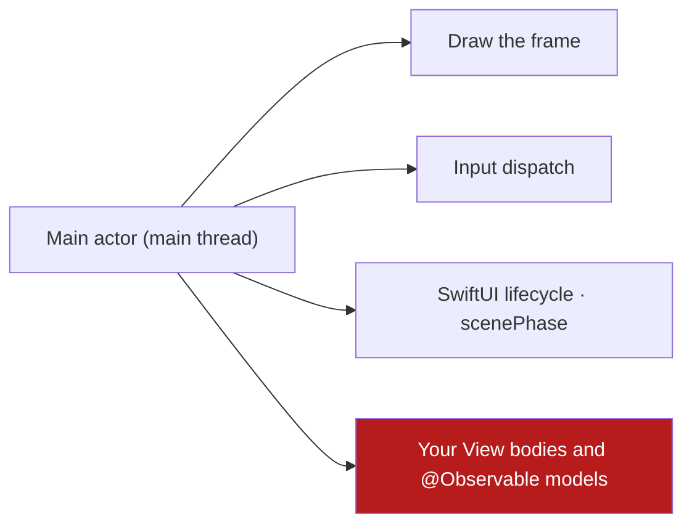

# Platform Model & iOS Runtime

iOS is not one program. It is a **runtime** that owns your process, your
threads and your lifetimes, and it makes decisions about them that your code
must survive. This chapter is about that runtime: the process, the main
actor, the SwiftUI lifecycle, `scenePhase`, the absence of an app delegate,
the hang watchdog, and the limits the platform puts on background work.

## 1. The process is the unit of survival

An iOS app is a **process** the system may kill at any time, without warning
and without a callback, when memory is under pressure. The rules that follow
are not style preferences; they are the shape of the platform.

| Fact | Consequence for the code |
| --- | --- |
| The process can be killed while the user is in the app | Anything that must survive lives in storage, not in a field |
| The process is rebuilt from scratch after a kill | The `@main` `App` struct and `AppEnvironment.live` run again; there is no "warm" instance |
| The scene is disconnected and reconnected | A `View` body is re-evaluated; the model held in `RootView`'s `@State` is not |
| The system may restore a killed process | Anything restored comes from the system's own snapshot, and it is untrusted input |

The template follows the platform: **the `notes` slice keeps no durable state
at all** ([08](08-offline-outbox-and-sync.md)), so a process death costs
nothing today. The moment a projection is added, the projection — not the
model — becomes the thing that survives.

## 2. The main actor

The **main actor** is the actor that owns the main thread, and it is where
SwiftUI draws. Everything scheduled on it is serialized behind everything
else on it.



A frame that misses its deadline is a **jank**: the user sees a stutter.
On a low-end device — an A12 with 3–4 GB of RAM — the main thread is already
the busiest thread in the app.

The rule: **nothing on the main actor may block**. Concretely, these are
off-limits there:

| Operation | Where it goes |
| --- | --- |
| Disk I/O (a file, a database, a `UserDefaults` read) | An `async` port that runs off the main actor |
| Network I/O | An `async` port that runs off the main actor |
| JSON decoding of a large body | An `async` port, off the main actor |
| Crypto (key derivation, hashing a password) | An `async` port, off the main actor |
| A blocking wait, a semaphore, a busy loop | Never — `await` a task instead |

Injected dispatchers, not the literal — the iOS spelling of the same rule:

```swift
// Bad: the work runs wherever the caller happens to be, and the caller is
// the main actor.
func load() async throws -> [Note] {
    try JSONDecoder().decode([Note].self, from: try Data(contentsOf: url))
}

// Good: the port is async, so its body is a nonisolated async function and
// runs off the main actor. The caller awaits it; the main actor is released
// while the work happens.
public protocol NoteRepository: Sendable {
    func load() async throws -> [Note]
}
```

That is a direct consequence of Swift 6's concurrency model: a **nonisolated
`async` function does not inherit the caller's actor**. It runs on the
global executor, and the `await` is the hand-off. A `MainActor`-isolated
function, by contrast, stays on the main actor.

The template's `Kernel`, `UICore`, `NotesContracts` and `NotesDomain`
packages are pure Swift, so this is a compile-time decision, not a
convention:

| Rule | Why |
| --- | --- |
| The models are `@MainActor` (`NotesModel`, `Router`) | The state is read by SwiftUI, on the main thread |
| The values are `Sendable` (`Note`, `NoteID`, `NotesViewState`, `Outcome`) | They cross the actor boundary |
| The ports are `Sendable` protocols with `async` methods | The adapter decides where the work runs; the caller never blocks |
| Strict concurrency is `complete` | A data race is a compile error, not a warning |

See [ADR 0002](adr/0002-one-swiftpm-package-per-layer.md).

## 3. The lifecycle

SwiftUI's lifecycle is a **state machine**, and the platform exposes it as
`scenePhase`: an environment value with three states.

| State | Meaning | What survives |
| --- | --- | --- |
| **`.active`** | The scene is on screen and receiving events | The model, the router path |
| **`.inactive`** | The scene is on screen but not taking input (a call, the app switcher) | The model, the router path |
| **`.background`** | The scene is not on screen | The model, the router path — for as long as the process lives |

Three of these carry the weight the app must respect:

- **The model is not the view.** A `View` is a value that SwiftUI recreates.
  In the template the model is built by the app target
  (`AppEnvironment.live`) and held by `RootView` in a `@State`, then handed
  to the screen in its initializer. A screen that built its own model would
  lose it on every re-render of the hierarchy.
- **`.background` is not a promise.** The system may suspend and then kill
  the process. Work that must complete must not depend on the app staying
  alive.
- **`.inactive` is where the privacy overlay belongs.** A screenshot taken
  from the app switcher must not show sensitive content, and the overlay has
  to appear on `.inactive`, before `.background`.

> **Known gap — do not copy a fiction.** **The template observes nothing.**
> There is no `@Environment(\.scenePhase)` in `Packages/` or `Apps/`, no
> `UIApplicationDelegateAdaptor`, no `NotificationCenter` observer for
> `UIApplication.didReceiveMemoryWarningNotification`, and no privacy
> overlay. `project.yml` sets
> `INFOPLIST_KEY_UIApplicationSceneManifest_Generation: YES`, so the system
> uses the scene lifecycle — but nothing in the app reacts to it. The rules
> below are the contract a project adopts; the rules that fall out of them
> are in §8.

## 4. Where the composition root lives

**The template ships no app delegate and no scene delegate.** The entry
point is a SwiftUI `App` struct, and the wiring happens where the model is
built:

```swift
// Apps/<APP>/Sources/AppEnvironment.swift — the composition root.
@MainActor
struct AppEnvironment {
    let makeNotesModel: @MainActor () -> NotesModel

    static let live = AppEnvironment {
        NotesModel(loadNotes: LoadNotes(repository: InMemoryNoteRepository()))
    }
}
```

That is enough for a template with one adapter and one use case. It is
deliberately the **smallest** correct answer, not the general one.

| Concern | Where it belongs |
| --- | --- |
| The object graph (the adapter, the use case, the model factories) | `AppEnvironment.live`, in the app target |
| Work that must happen once per launch (a cache warm-up, a token refresh) | The `App` struct or the `RootView`'s `.task`, on an `async` port |
| Anything that needs a window, a scene or the UIKit app object | Not here — pass what is needed down |

**Never hold a `View`, a `UIViewController` or a `UIScreen` in a model or a
domain type.** It leaks the view and it cannot be tested off the main actor
— the rule is in `AGENTS.md` and it is the reason the packages split.

A project that needs a per-process hook adds one — either by attaching a
delegate with `@UIApplicationDelegateAdaptor`, or by moving the work into the
`App` struct. The rules for it are the ones below:

| Rule | Why |
| --- | --- |
| The delegate is `NSObject`-derived and lives in the app target | It is the only place that may see every package |
| It holds no `View` and no scene | A delegate outlives the scene that created it |
| The delegate does no I/O on the main thread | `application(_:didFinishLaunchingWithOptions:)` runs on the main actor |
| It never becomes a service locator | A delegate that hands out singletons is the container the architecture refuses ([ADR 0003](adr/0003-explicit-app-environment.md)) |

## 5. The hang watchdog

iOS has no StrictMode. The equivalents are **debug-time checkers** and
**field diagnostics**, and the template ships neither.

| Tool | What it catches |
| --- | --- |
| Xcode's **Main Thread Checker** (on by default) | A main-thread API called off the main thread, and the classic UI misuse |
| **Instruments** — Hangs, Time Profiler | A main-thread stall, with the stack that caused it |
| **MetricKit** `MXHangDiagnostic` | A hang in the field, over 250 ms, with the call tree |
| **MetricKit** `MXCPUExceptionDiagnostic` | A CPU exception in the field |
| **App Store Connect** | The hang rate and the "App Responsiveness" metric that gates a release |
| **Xcode Organizer** | Aggregated hangs and terminations across the installed base |

The threshold that matters is **250 ms**: a main-thread hang longer than
that is a diagnostic, a report, and a release risk.

> **Known gap.** The template has **no hang instrumentation**: no
> `MXMetricManager` subscriber, no `os_signpost` interval, no hang
> assertion, and no `signpost` marker around startup. There is also no
> gate that measures a budget — the numbers in
> [02](02-device-tiers-and-the-quality-governor.md) §6 are specified, not
> enforced. The adoption path is in
> [11 — Telemetry](11-telemetry.md) and
> [12 — Testing & CI](12-testing-and-ci.md).

The rule that replaces StrictMode in day-to-day work: **a `Task` that
touches the main actor must not do work there**. The compile-time part is
already in place — `Sendable` values and `complete` strict concurrency make
the data race an error — but a *slow* main actor is still legal, and only
the profiler sees it.

## 6. Background limits

This is where most "it works on my device" iOS bugs live. The platform
restricts background execution in ways that are **per-device and
per-version**, not per API.

| Limit | What it means for the app |
| --- | --- |
| **Suspension** | A backgrounded app gets almost no CPU; it is kept alive by the system, not by the app |
| **No background modes declared** | The template declares **none**. Without a `UIBackgroundModes` entry, no background work runs at all |
| **`BGTaskScheduler`** | Needs both a `UIBackgroundModes` entry and a `BGTaskSchedulerPermittedIdentifiers` key; the system *decides* when it runs |
| **Background `URLSession`** | The one background transfer that survives suspension; it is not a general-purpose worker |
| **Push** | The only reliable wake-up channel |
| **Low Power Mode** | The user asks the system to save energy; it throttles background work and lowers the frame rate |
| **App Review** | A background mode must be justified; an unjustified one is a rejection |

The rules that keep a template out of trouble:

1. **Design for no background execution.** A push message is the wake-up
   channel; the app reconciles when it returns to `.active`.
2. **Never ship a background mode the app does not use.** It is a review
   question and a battery cost.
3. **Use `BGTaskScheduler` for deferrable work**, never a timer on a
   background queue. See [08](08-offline-outbox-and-sync.md).
4. **Do not depend on a background wake-up for correctness.** If the user
   must see the result, reconcile on foreground.

> **Known gap.** The template declares **no background mode**, no
> `BGTaskSchedulerPermittedIdentifiers` and registers **no task handler**
> ([08](08-offline-outbox-and-sync.md) §7).

## 7. Memory

iOS's memory model is unforgiving: a process is killed when it crosses the
system's limit for the device, and the kill is called **jetsam**.

| Signal | Meaning |
| --- | --- |
| `UIApplication.didReceiveMemoryWarningNotification` | The system is under pressure; drop what you can rebuild |
| `ProcessInfo.physicalMemory` | The device's RAM — a *hint*, not the amount available to the app |
| `os_proc_available_memory()` | What is actually available to this process right now |
| `ProcessInfo.thermalState` | The device's heat, and the throttle that follows |
| MetricKit diagnostics (`MXCrashDiagnostic`, `MXHangDiagnostic`, `MXCPUExceptionDiagnostic`) | On the **next** launch, what the last run did — including a hang or a termination by the memory limiter |

The memory warning is the signal most apps ignore and should not: a process
killed by jetsam is a **correctness** event, not a performance event. The
template does not observe it yet.

> **Known gap.** There is **no memory-warning observer**, no cache to
> evict, no `os_proc_available_memory()` sample and no MetricKit subscriber
> in the tree. The adoption path is in
> [02](02-device-tiers-and-the-quality-governor.md) §7 and
> [08](08-offline-outbox-and-sync.md).

## 8. The rules that fall out of all of this

| Rule | Why |
| --- | --- |
| The domain is pure Swift, so it never touches UIKit or SwiftUI | A domain that needs the platform is doing I/O, and I/O does not belong in the domain |
| Ports are `async`; the adapter decides where the work runs | The main actor must stay free to answer the user |
| Models are `@MainActor`, values are `Sendable` | The compiler then proves there is no race |
| The model is created by the app target and held above the screen | A screen that builds its own model loses it on every re-render |
| Observe `scenePhase` for pause, privacy and reconcile | Background execution is not guaranteed, and the screenshot is taken at `.inactive` |
| The app delegate, when it comes, holds no view and no scene | It outlives the scene that created it |
| Release what the memory warning tells you to | The system's kill is not negotiable |

## Do / don't

| Do | Don't |
| --- | --- |
| Make the port `async` and keep the work off the main actor | Do file or network I/O in a `@MainActor` method |
| Mark values `Sendable` and models `@MainActor` | Reach for `DispatchQueue.main` or a lock to make the compiler quiet |
| Own the model in the app target's `RootView` | Let a screen build its own model and lose it on every re-render |
| Reconcile on `.active` | Depend on a background wake-up for correctness |
| Drop the caches on the memory warning | Wait for jetsam |
| Keep the delegate free of views | Hold a `UIViewController` to reach the scene |

## See also

- [Device Tiers & the Quality Governor](02-device-tiers-and-the-quality-governor.md)
  — what to do when the memory signal fires.
- [Packages, Layers & UDF](03-packages-layers-and-udf.md) — where the
  `@MainActor` and `Sendable` rules live.
- [Offline, Outbox & Sync](08-offline-outbox-and-sync.md) — the background
  work that survives suspension.
- [Playbook Native iOS Swift §§4.2, 14](../PLAYBOOK_MOBILE_IOS_SWIFT.md)
  — the concurrency and background rules.
