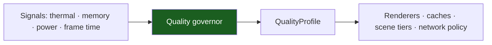

# Device Tiers & the Quality Governor

iOS runs on hardware the app does not choose: an A12 iPhone XS and an A17
Pro are the same `.app`. The template's answer is a **device tier**
(low / mid / high) and a **quality governor** that degrades the experience
gracefully instead of dropping frames.

> **Known gap — do not copy a fiction.** The template **does not ship** a
> device-tier detector or a governor. There is no `DeviceTier` type, no
> `DeviceCapabilityPort`, no `QualityProfile`, no capability detection and no
> tier code anywhere in the tree. The template does not even import
> `MetalKit`. This chapter specifies the contract a project must implement
> and the budgets it must hold to; the adoption path is in §7. Nothing in the
> template reads `ProcessInfo.thermalState` today.

## 1. The three device tiers

The classes are defined by **silicon generation and RAM**, not by a model
list, so a new device joins a tier without a table edit.

| Tier | Roughly | What it means |
| --- | --- | --- |
| **Low** | A12 (iPhone XS/XR), A13/A15 (iPhone 11, SE 2/3), 3–4 GB RAM | The floor. The app must be usable, not fast. Older GPU family, thermal throttling sooner, small RAM headroom. |
| **Mid** | A14–A16 (iPhone 12/13/14), 4–6 GB RAM | The reference class. The bulk of the active base. |
| **High** | A17 Pro and newer, 8 GB RAM | The ceiling. Optional extras. |

**Low is the floor, not an edge case.** A tier system that only degrades
*below* a threshold is a tier system that fails on the devices that need it
most. The budgets in §6 are written for the Low tier.

The reference devices and the release gate are in
[Support Matrix](support-matrix.md) §3.

## 2. The simulator is not a tier

A fourth environment exists and it is **not** a device class: the
**simulator**. It is the development and CI surface, and it is not a
measurement surface.

| Property | Simulator | Real device |
| --- | --- | --- |
| CPU and RAM | The host machine's, shared with the IDE | The device's own |
| GPU | The host's GPU, through a translation layer | The device's Metal GPU family |
| Thermal behaviour | None — it never throttles | It throttles, and that is the case the governor exists for |
| Memory ceiling | The host's | The device's jetsam limit |
| Startup measurement | Meaningless | Meaningful |
| What it is good for | Building, running the UI / integration tier, quick iteration | The budgets, the hang rate, the release gate |

Two rules follow, and both are load-bearing:

1. **A budget is never measured on a simulator.** The simulator's CPU,
   storage and GPU are the developer's machine, not the Low tier.
2. **A capability check is never trusted on a simulator.** Metal feature
   families, `ARWorldTrackingConfiguration.isSupported`, ProMotion and the
   camera all report differently — some features do not exist in the
   simulator at all. A tier resolved on the simulator is a fiction.

The template's native tier builds for
`generic/platform=iOS Simulator` — it proves the app compiles and runs
against the real SDK. It proves nothing about performance.

## 3. How a tier is decided

Detection is a **hint**; the measured result and the runtime governor win.
The four inputs, in order of authority:

| Input | Signals | Authority |
| --- | --- | --- |
| **Static hint** | `ProcessInfo.physicalMemory`, `os_proc_available_memory()`, the Metal GPU family (`MTLDevice.supportsFamily(.apple6…)`), the chip generation from the model identifier, the OS version | A starting guess |
| **Measured** | A first-run micro-benchmark: reference-scene p95 frame time, startup time | Wins over the hint |
| **Runtime** | `ProcessInfo.thermalState`, `isLowPowerModeEnabled`, memory warnings, frame timing (`CADisplayLink` / `CAMetalDisplayLink`), MetricKit history of previous hangs and jetsams | Wins over the static hint, live |
| **Remote override** | Remote config keyed by the model identifier / OS: a forced tier or a blocklist | Wins over everything, for a device the team has seen misbehave |

Three rules:

1. **Persist the tier.** Recomputing it on every launch is a startup cost
   for a value that changes rarely.
2. **Prefer feature checks over model tables.** A GPU-family check and an
   `isSupported` check survive a new device; a model list does not.
3. **Re-evaluate after an OS update, an app update, and a repeated
   hitch.** A device that was mid yesterday may be low today — the storage
   got slower, the OS got more aggressive.

> The reported RAM is not the usable RAM. `ProcessInfo.physicalMemory` on a
> 4 GB device reports the marketing number; `os_proc_available_memory()`
> reports what this process may actually use. Tier on the second, cap on
> the second, and treat the first as a starting hint only.

## 4. The governor contract

The governor is a small, testable component with a fixed shape. It takes
runtime signals and produces a **quality profile**; nothing else in the app
may read the thermal or memory state directly.

**Inputs** (all optional; a missing signal is not a reason to crash):

| Signal | Source |
| --- | --- |
| Thermal state | `ProcessInfo.thermalState` and its notification |
| Memory pressure | The memory-warning notification; `os_proc_available_memory()` |
| Low Power Mode | `isLowPowerModeEnabled` |
| Frame health | `CADisplayLink` / `CAMetalDisplayLink` frame timing; `preferredFrameRateRange` |
| Previous exit reason | MetricKit: `MXHangDiagnostic`, `MXCrashDiagnostic`, `MXCPUExceptionDiagnostic` |
| The user's choice | Auto · Battery saver · High quality, in settings |

**Output**: a `QualityProfile` — a value, not a set of scattered booleans.

| Knob | What it controls |
| --- | --- |
| Render scale | The resolution the app renders at (0.6–1.0) |
| Frame cap | The target frame rate (30 / 60 / 120) |
| Effects | Shadows, blur, materials, post-processing — the expensive visual layer |
| Texture quality | The resolution of the loaded textures |
| Scene tier | Which scene tier is allowed (2D fallback → the mid tier → the high tier) |
| Prefetch | Whether large assets and images may be prefetched, and on which network |
| Accessibility | `accessibilityReduceMotion` and `accessibilityReduceTransparency` are honoured regardless of the tier |

**The two rules that make a governor work**:

| Rule | Why |
| --- | --- |
| **Step down immediately** on a breach | A user feels the drop; they never feel the recovery |
| **Step up only after a sustained healthy period** (hysteresis) | Otherwise the app oscillates, and oscillation is worse than either state |

The governor is **overridable by remote config and by managed policy**, and a
policy-forced profile wins over both the detected tier and the user's
setting. That is the same precedence rule as the rest of the kit: the
administrator over the user ([Admin Guide](admin-guide.md)).

## 5. The thermal signal

Thermal throttling is the most under-handled signal on iOS, because it is
invisible until it is catastrophic.

| Signal | What it means |
| --- | --- |
| `ProcessInfo.thermalState` == `.nominal` | The device is cool |
| `.fair` | The system has noticed the heat; **step down here** |
| `.serious` | The throttle is imminent or starting |
| `.critical` | The device is throttling hard; the app must shed work now |

The pattern that works:

1. Observe the thermal state and its change notification.
2. On `.serious` or worse, **step the profile down before the hardware
   throttles** — the throttle itself is the failure the governor exists to
   prevent.
3. Step down at `.fair` for the expensive tiers, before `.serious`.

Low Power Mode is the other half of the signal: it is an explicit user
request, and it forces the Low profile — frame cap to 30, no AR, no camera
tracking.

A governor that reacts to memory warnings but ignores the thermal state
will still hit the wall on a device that is hot but not short on memory.

## 6. The budgets

Starting points, calibrated for the **Low** tier with a release build on
the floor device.

| Metric | Budget (Low) | Budget (Mid) |
| --- | --- | --- |
| Cold launch to first frame (TTID) | ≤ 1.5 s | ≤ 1.0 s |
| Time to usable content (cached) | ≤ 2.5 s | — |
| Main-thread hangs in the main flows | 0 over 250 ms | 0 |
| Touch response | ≤ 100 ms | — |
| Shell memory (no 3D) | ≤ ~150 MB footprint | — |
| 3D scene memory | ≤ ~600 MB footprint, under the jetsam limit | ≤ ~1 GB |
| 3D frame rate | Stable 30 fps (resolution scale ≤ 0.75) | 30–60 fps |
| Download size (market build) | ≤ ~35 MB | — |
| Memory growth over 30 minutes | ≈ 0 | — |
| Crash-free sessions | ≥ 99.5 % | — |
| Battery drain | Tracked per hour on the Low pool; no regression release over release | — |
| Network | Works on a slow connection; request count and payload budget per screen | — |

The memory ceilings are **correctness** constraints, not goals: the system
kills a process that crosses the jetsam limit, and MetricKit reports the
kill on the next launch.

## 7. The adoption path

The template ships the tier model as a specification. To implement it, in
this order:

1. **Add a package** — a `Core/Device` SwiftPM package: the
   `DeviceCapabilityPort` protocol, the `DeviceTier` and `QualityProfile`
   value types, and the governor. It must stay **pure Swift** where it can:
   the detection lives in an adapter, the decision in a pure function.
2. **Keep it a port.** The consumer declares `DeviceCapabilityPort`; the
   implementation lives in the adapter package. The pure packages stay pure
   ([03](03-packages-layers-and-udf.md)).
3. **Read the signals** off the main actor where they require it, publish
   them as an `AsyncStream<Thermal>` (the same shape as the effect stream),
   and persist the tier in `UserDefaults` (or the Keychain, if it becomes
   sensitive).
4. **Write the governor as a pure function** of `(profile, signals) →
   profile`. Pure functions are testable on the macOS host, with no device
   and no simulator — which is the whole reason the detection lives in a
   package of its own.
5. **Wire the profile to the consumers**: the render scale, the cache caps,
   the prefetch policy, the frame cap.
6. **Add the remote override** — a forced tier per model identifier, and a
   blocklist for devices that misbehave.
7. **Measure on the real Low pool.** A simulator is not a low-end device
   (§2).

## 8. What this means for the template today

| Concern | State in the template |
| --- | --- |
| Device tier detection | **Not implemented** — no tier code in the tree |
| The quality governor | **Not implemented** — the contract is specified in §4 |
| A `QualityProfile` value | **Not implemented** — the package does not exist |
| The budgets | **Specified** in §6, not measured |
| The device pool | **Specified** in [Support Matrix](support-matrix.md) §3–§4 — **not built** |
| Any Metal or scene code | **None** — the template ships no renderer |

The template is deliberately unaffected by this: it is a form-and-list app
with one in-memory repository, and none of its current code paths have a
quality knob. The chapter exists so that the **first** feature with a
quality dimension starts from a contract instead of from an ad-hoc flag.

## Do / don't

| Do | Don't |
| --- | --- |
| React to the thermal state before it throttles | Wait for the frames to drop |
| Step down immediately, step up slowly | Oscillate between two profiles |
| Cap on `os_proc_available_memory()` | Cap on the marketing RAM number |
| Measure on a real Low device | Measure on a simulator |
| Prefer a feature check over a model list | Maintain a model table |
| Honour Reduce Motion and Reduce Transparency | Spend the frame budget on an effect the user turned off |

## See also

- [Platform Model & iOS Runtime](01-platform-model-and-ios-runtime.md)
  — the memory and lifecycle signals the governor consumes.
- [Support Matrix](support-matrix.md) — the reference devices and the pool.
- [Playbook Native iOS Swift §3](../PLAYBOOK_MOBILE_IOS_SWIFT.md) —
  the device classes and the budgets.
