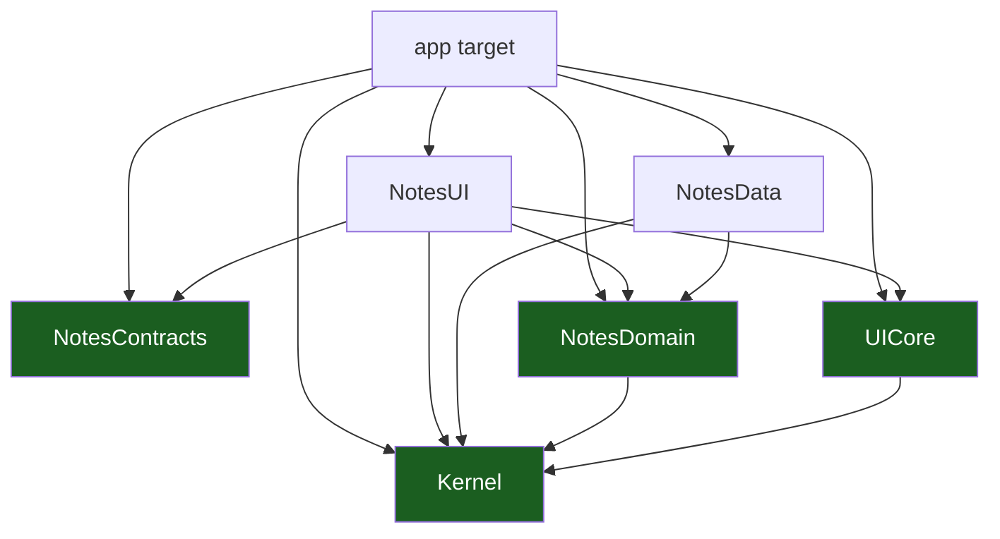

# Packages, Layers & UDF

The architecture of the template, in three parts: the **package graph** (what
may depend on what), the **presentation model** (`UiStatus`, `NotesEvent`,
`NotesEffect`), and the **architecture check** that keeps both true.

## 1. The package graph

Six SwiftPM packages plus one app target. Each one is a manifest, and each
one declares its own dependencies — which is what makes the rule a build
fact.

| Package / target | Kind | Holds | May depend on |
| --- | --- | --- | --- |
| `<APP>` app target | Application | The `@main` `App`, `AppEnvironment`, `Router`, `RootView` | every package |
| `Kernel` | **Pure Swift** | `Outcome<Value>`, `AppError`, `ErrorCode`, `NoteID` | the standard library only |
| `UICore` | **Pure Swift** | `UiStatus`, the closed status set | `Kernel` |
| `NotesContracts` | **Pure Swift** | `NotesRoute`, the typed routes | the standard library only |
| `NotesDomain` | **Pure Swift** | `Note`, the `NoteRepository` port, `LoadNotes` | `Kernel` |
| `NotesData` | Adapter | `InMemoryNoteRepository`, the adapter that implements the port | `NotesDomain`, `Kernel` |
| `NotesUI` | SwiftUI | `NotesScreen`, the `@Observable` `NotesModel`, `NotesViewState`/`NotesEvent`/`NotesEffect` | `NotesDomain`, `NotesContracts`, `Kernel`, `UICore` |
| `evals` | Node contract tests | the `.claude` contract suite | nothing app-side |



### The edges that matter

| Edge | Why it is allowed |
| --- | --- |
| `<APP> → NotesUI` | The app hosts the screen; it does not implement it |
| `<APP> → NotesData` | The app chooses the adapter — that is the whole point of the port |
| `<APP> → NotesContracts` | The app owns the typed navigation path |
| `NotesUI → NotesDomain` | The model calls use cases |
| `NotesData → NotesDomain` | The adapter implements the domain's port |
| `NotesUI → NotesContracts` | The screen needs the route type |
| `NotesUI → UICore` | The screen renders the shared `UiStatus` set |
| `NotesUI → Kernel` | The state carries `Note` values from the kernel's types |
| `UICore → Kernel` | `UiStatus` carries a correlation id from the kernel |
| `NotesDomain → Kernel` | The use case returns `Outcome<Value>` |
| everything → `Kernel` | The kernel is the base |

### The edges that are forbidden

| Forbidden | Because | Who stops it |
| --- | --- | --- |
| `NotesUI → NotesData` | The presentation layer never picks an implementation; the app target does | `check-architecture.sh` |
| `NotesData → NotesUI` | The storage never reaches up to the surface | `check-architecture.sh` |
| `NotesDomain → NotesData` | The dependency would point outward, from the rules to the storage | The compiler: `NotesData` depends on `NotesDomain`, not the other way round |
| `NotesDomain → NotesUI` | The rules must not know the surface | The compiler: `NotesUI` depends on `NotesDomain`, not the other way round |
| `Kernel → any package` | The kernel is the base; it depends on nothing internal | `check-architecture.sh` |
| `NotesContracts → any package` | The contracts are the published surface; a dependency would make every consumer drag it in | `check-architecture.sh` |
| any pure package → SwiftUI or UIKit | A pure package declares no UI framework; the domain must not reach the platform | `check-architecture.sh` |
| `evals → any Swift package` | The contract tests read the kit's files, not its code | The structure of the suite |
| `NotesUI → NotesDomain` of **another** slice | Cross-slice access goes through `contracts` ([04](04-vertical-slicing.md)) | **Nobody yet** — it is a rule the team holds, not a rule the build holds (§4) |

The rows in the middle are not stylistic. A package's `dependencies:` array
is the complete list of what it can import, so an `import NotesData` in
`NotesUI` **does not compile** — the module is not on its classpath. The
layering is enforced by the compiler before a reviewer ever sees the diff.

The UI-framework ban in the pure packages is a **manifest contract plus a
gate**: a pure package declares no SwiftUI, no UIKit, no AppKit and no
WatchKit, and `scripts/check-architecture.sh` fails on a source scan that
finds one (§4). The ban is the manifest's, and the gate is what enforces
it — a package that reaches for a framework breaks its own declared
contract, and the gate names the violation.

## 2. `Outcome<Value>`: errors are values

The kernel's outcome type is an enum with two cases. An expected failure is a
**value**, not a thrown error.

```swift
// Packages/Core/Kernel/Sources/Kernel/Outcome.swift
public enum Outcome<Value: Sendable>: Sendable {
    case success(Value)
    case failure(AppError)
}
```

The rules:

| Rule | Why |
| --- | --- |
| A port's use case returns `Outcome<Value>` | The caller must handle the failure; the compiler forces it |
| `AppError` is a closed set in the kernel | The caller never guesses an error code |
| `ErrorCode` never carries a user-visible message | Copy lives in the UI layer; the error is a fact, the message is a decision |
| A cancellation is always rethrown | Swallowing it breaks structured concurrency |
| A failure is reported **once**, at the layer that decides what to do with it | Three layers reporting the same failure is the most common defect |

The `AppError` carries the stable code and, when the server gave one, the
correlation id:

```swift
public struct AppError: Error, Equatable, Sendable {
    public let code: ErrorCode
    public let correlationID: String?
}
```

`ErrorCode` is the closed set the model maps to a status:
`offline`, `forbidden`, `policy`, `notFound`, `conflict`, `validation`,
`server`, `unknown`.

The domain converts a thrown error into a value at the boundary:

```swift
// LoadNotes — the use case. An expected failure becomes a value; a
// cancellation is rethrown.
public func callAsFunction() async throws -> Outcome<[Note]> {
    do {
        return .success(try await repository.load())
    } catch let error as AppError {
        return .failure(error)
    } catch is CancellationError {
        throw CancellationError()
    } catch {
        return .failure(AppError(code: .unknown))
    }
}
```

The port itself still `throws`: the **adapter** may fail, and the use case
is where the decision to convert a failure into a value is made.

## 3. The UDF contract

The presentation layer is **unidirectional**: state flows down, events flow
up, effects leave the screen once.

| Type | Direction | Lifetime | Purpose |
| --- | --- | --- | --- |
| `NotesViewState` | Down | Re-rendered | Everything the screen renders |
| `NotesEvent` | Up | Consumed | What the user did |
| `NotesEffect` | Out | **One-shot** | What the screen must do outside its own rendering: navigate, show an alert, request a permission |

The shipped slice names them `NotesViewState`, `NotesEvent` and `NotesEffect`,
and they live in `NotesModel.swift` next to the model that owns them. The
one type that is **shared** is the status set: `UiStatus` lives in `UICore`
so every slice renders the same closed set. The state, the event and the
effect are per-slice types, because their payloads are per-slice.

### `UiStatus`

Every screen's state carries a status. There is one closed set, and every
screen handles all of it — a screen that only handles `.ready` is an
incomplete screen.

```swift
// Packages/Core/UICore/Sources/UICore/UiStatus.swift
public enum UiStatus: Equatable, Sendable {
    case loading
    case ready
    case empty
    case offline
    case forbidden
    case notFound
    case error(correlationID: String?)
    case policyBlocked
}
```

| Status | When |
| --- | --- |
| `.loading` | A read is in flight |
| `.ready` | There is data to show |
| `.empty` | The read succeeded and there is nothing |
| `.offline` | The last operation failed because the device has no usable connection |
| `.forbidden` | The server refused the operation |
| `.notFound` | The resource is gone |
| `.error(correlationID:)` | Anything else, with the correlation id when there is one |
| `.policyBlocked` | A managed policy blocked the operation |

The status is **one value, not a set of booleans**. Booleans admit
contradictory states (`loading = true` and `empty = true`); an enum does
not. And because the screen's `switch` over `model.state.status` is
exhaustive over an enum, **a status that no screen handles does not
compile**.

The mapping from an error to a status happens in one place — the model:

```swift
private static func status(for error: AppError) -> UiStatus {
    switch error.code {
    case .offline: .offline
    case .forbidden: .forbidden
    case .policy: .policyBlocked
    case .notFound: .notFound
    case .conflict, .validation, .server, .unknown:
        .error(correlationID: error.correlationID)
    }
}
```

A cancelled refresh is not a failure: the model catches the rethrown
cancellation and leaves the state untouched, so a cancelled screen never
shows an error.

### The state rules

| Rule | Why |
| --- | --- |
| The state is an immutable `struct`, `Equatable` and `Sendable` | A mutable state is a shared-state bug waiting to happen |
| The state carries a `UiStatus` plus the data — never `nil` for "no data" | The status already says what is going on |
| The status is the closed `UiStatus` set, not a local enum | Every slice renders the same states |
| The state never carries a `View`, a controller or a task | A view in the state cannot be rendered off the main actor |

### The effect rules

An effect is a **one-shot** action that leaves the screen. It is delivered
through an `AsyncStream` the model owns:

```swift
@MainActor
@Observable
public final class NotesModel {
    public private(set) var state: NotesViewState
    public let effects: AsyncStream<NotesEffect>

    private let continuation: AsyncStream<NotesEffect>.Continuation
}
```

The rules that make the one-shot guarantee hold:

| Rule | Why |
| --- | --- |
| The model creates the stream and keeps the continuation | Nobody else can yield into it |
| The stream is consumed by **one** consumer | Two consumers would each perform the navigation |
| An effect is never put in the state | A state value is re-read on every render; an effect must happen once |
| The continuation is never finished by the UI | Finishing it ends the effect channel for the model's lifetime |
| The consumer cancels its task when the view goes away | A `Task` that outlives the view performs a navigation nobody sees |

The shipped consumer is the screen's `.task`:

```swift
// Packages/Feature/Notes/UI/Sources/NotesUI/NotesScreen.swift
.task {
    for await effect in model.effects {
        if case .openDetail(let id) = effect {
            onOpen(id)
        }
    }
}
```

The screen forwards the effect to the app through the `onOpen` closure it
was handed, and the app target is where the navigation actually happens —
`RootView` appends `.detail(id:)` to `Router.path`
([06](06-navigation-routes-and-deep-links.md)). The effect therefore leaves
the UI package without the UI package knowing what "navigate" means.

### The model rules

| Rule | Why |
| --- | --- |
| The model is `@MainActor` | The state is read by SwiftUI, on the main thread |
| The model is `@Observable`, not `ObservableObject` | Fine-grained invalidation: only the views that read a changed property re-render |
| The model holds no `View`, no `UIViewController`, no `UIScreen` | A model that holds a view leaks it and cannot be tested off the main actor |
| The model depends on use cases, not on repositories | The rule lives in the use case |
| The model exposes `send(_ event:)` as the entry point for the screen | One entry point for the screen; the model, not the view, decides what an event means |
| The model exposes `state` as `private(set)` | Only the model mutates its own state |
| The model's collaborators are `Sendable` | They cross the actor boundary |
| A new model ships with a test covering `.ready`, `.empty` and one failure | A model with no failure path is untested where it matters |

### The screen rules

| Rule | Why |
| --- | --- |
| A view is a function of `model.state` | The screen is a rendering, not a controller |
| A view sends `NotesEvent`s and observes `NotesViewState` | It never calls a use case |
| No business logic in a view | It is not covered by a unit test and it re-renders |
| The `switch` over `model.state.status` handles every case | The compiler enforces the closed set |
| The effect consumer is a `.task`, cancelled with the view | An effect that fires after the view is gone navigates into nothing |
| A user-visible string literal lives in the view, never in a model or a domain type | Copy is a UI decision (§7) |

## 4. The architecture check

`scripts/check-architecture.sh` is the machine check. It reads the manifests
and the sources and fails when the graph is wrong.

| What it checks | How |
| --- | --- |
| `Kernel` depends on no other package | A grep for `.package(path:` in its manifest |
| `NotesContracts` depends on no other package | The same grep in its manifest |
| The pure packages import no `SwiftUI`, `UIKit`, `AppKit` or `WatchKit` | A source scan of each package's `Sources/` |
| `NotesUI` does not depend on `NotesData` | Its manifest and a source scan for `import NotesData` |
| `NotesData` does not depend on `NotesUI` | Its manifest |
| `NotesDomain` names neither `NotesData` nor `NotesUI` | Its manifest |
| Only one application target exists | The count of `type: application` in `project.yml` |
| No visual-builder artifact is in the tree | A `find` for `.storyboard`, `.xib`, `.nib`, `.xcdatamodeld`, `.rcproject` |
| The Xcode project is generated, not committed | `.gitignore` matches `*.xcodeproj/` and no `.xcodeproj` is tracked |
| Every package compiles in Swift 6 language mode | `swiftLanguageModes: [.v6]` in all six manifests |
| `project.yml` pins Swift 6 and complete concurrency | `SWIFT_VERSION: "6.0"` and `SWIFT_STRICT_CONCURRENCY: complete` |

It is a **gate, not a lint**: it exits non-zero, so CI fails. It runs as the
first step of the lint set:

```sh
bash scripts/check-architecture.sh
```

`make ci` is the whole gate set — the lint step, the contract evals
(`node --test evals/contracts.test.mjs`) and the native tier
(`scripts/native-gates.sh`, which prints a visible `SKIP` and exits 0 off
macOS). The `.claude` linters and the instruction budget join `make lint`
only once the tree has been renamed: the Makefile skips them while
`AGENTS.md` still contains the literal `<app>`, `<APP>` or `<scope>`
placeholders, because those linters reject the template's own tokens.

Some rules are enforced twice on purpose. A `NotesUI → NotesData`
dependency compiles fine in SwiftPM — both directions are buildable — so the
script is what stops it; an `import SwiftUI` in a pure package does not
compile at all. The compiler catches the impossible mistakes; the script
catches the possible ones.

> **Known gap.** The check does **not** scan for cross-slice imports. The
> template ships one slice, so the rule cannot be exercised against it, and a
> check with no fixture is a check nobody runs. The rule becomes a script
> rule when the second slice lands
> ([04](04-vertical-slicing.md) §7).

## 5. The app target

The app target is the composition root and it is **thin**: it builds the
object graph, hosts the `NavigationStack`, and contains no rules.

```swift
// Apps/<APP>/Sources/AppEnvironment.swift — the composition root. There is
// no DI container and no service locator: the graph is built here, once, at
// the point where it is needed.
@MainActor
struct AppEnvironment {
    let makeNotesModel: @MainActor () -> NotesModel

    static let live = AppEnvironment {
        NotesModel(loadNotes: LoadNotes(repository: InMemoryNoteRepository()))
    }
}
```

Three rules:

| Rule | Why |
| --- | --- |
| The app target chooses the implementation of every port | That is the only place that may |
| The app target contains no business rule | A rule in the root is a rule nobody can reuse |
| The app target is the only place that owns the entry point and the adapters | A `UIViewController` in a use case is a `UIViewController` in a unit test |

See [ADR 0003](adr/0003-explicit-app-environment.md) for why there is no
DI framework in the template, and
[ADR 0002](adr/0002-one-swiftpm-package-per-layer.md) for why the package
split is the architecture.

## 6. Concurrency, isolation and Observation

Swift 6's complete strict concurrency is the layer rule that replaces the
Android template's dispatcher injection. There is no injected dispatcher here:
**the type system decides where the work runs.**

| Layer | Isolation | Why |
| --- | --- | --- |
| `Kernel`, `UICore`, `NotesContracts`, `NotesDomain` | Nonisolated by default; every type is `Sendable` | A pure package has no actor to be isolated to |
| `NotesData` | Nonisolated; the port methods are `async` | The adapter decides whether the work is off the main actor |
| `NotesUI` — `NotesModel` | `@MainActor` | The state is read by SwiftUI, on the main thread |
| `NotesUI` — `NotesScreen` | A `View` value; rendered on the main actor | SwiftUI draws on the main actor |
| `<APP>` app target — `AppEnvironment`, `Router` | `@MainActor` | They build and hold the object graph the UI reads |
| Every value that crosses an actor boundary | `Sendable` | The compiler proves there is no race |

Three rules that fall out of it:

| Rule | Why |
| --- | --- |
| A port method is `async`, so its body is a nonisolated async function | A nonisolated `async` function does not inherit the caller's actor: the `await` is the hand-off, and the main actor is released while the work happens |
| A `MainActor`-isolated function stays on the main actor | Isolation is the default of the declaration, not something the caller can opt out of |
| A model that must touch the main actor is annotated, not dispatched to | `DispatchQueue.main.async` inside a `@MainActor` class is redundant and hides the real constraint |

The observation rule is the same idea applied to rendering:

| Rule | Why |
| --- | --- |
| The model is `@Observable`, not `ObservableObject` | Observation tracks the properties a view actually reads, so a change to one re-renders only the views that read it |
| The state is a `struct` the model mutates | A whole-value replacement is one invalidation, and the old and new states are comparable |
| The model exposes `state` as `private(set)` | Only the model mutates its own state; the screen sends events instead of writing |
| No `@Published`, no `objectWillChange` | They belong to `ObservableObject`; using them with `@Observable` is a duplicate source of truth |

The full runtime picture — the main actor, the process, the lifecycle — is
in [01 — Platform Model & iOS Runtime](01-platform-model-and-ios-runtime.md).

## 7. Copy and localization

Copy is a **UI decision**, and it lives in the view. The rule that holds
today is narrow and mechanical:

| Rule | Why |
| --- | --- |
| A user-visible string literal lives in the view | Copy is presentation; a domain type that knows the wording is a domain type that cannot be reused |
| No user-visible literal in a model, a use case or a domain type | A literal in the model is a literal that cannot be localized or reworded without touching the logic |
| No interpolation of a domain value into a sentence | The order of the words is copy; the domain owns the values, not the grammar |
| A status carries no message | `UiStatus` is a closed set of facts; the view maps each one to its own string |

The shipped screen is the example:

```swift
// Packages/Feature/Notes/UI/Sources/NotesUI/NotesScreen.swift
.navigationTitle("Notes")
...
case .loading:
    ProgressView("Loading notes")
case .empty:
    ContentUnavailableView("No notes", systemImage: "note.text")
case .offline:
    ContentUnavailableView("Offline", systemImage: "wifi.slash")
case .forbidden:
    ContentUnavailableView("Forbidden", systemImage: "lock")
case .notFound:
    ContentUnavailableView("Not found", systemImage: "questionmark")
case .error(let correlationID):
    ContentUnavailableView(
        "Something went wrong",
        systemImage: "exclamationmark.triangle",
        description: Text(correlationID ?? "No correlation id")
    )
case .policyBlocked:
    ContentUnavailableView("Blocked by policy", systemImage: "hand.raised")
```

> **Known gap.** The template ships **no localization catalog**: there is no
> `.xcstrings` file, no `Localizable` bundle and no `NSLocalizedString` or
> `LocalizedStringKey` call anywhere in the tree. Every user-visible string
> is a Swift literal in the view — the status strings above, plus the
> navigation titles. A project that localizes replaces them with a string
> catalog and the literals with `LocalizedStringKey`; the rule that the
> literal never appears in a model or a domain type is the one that holds
> today. `AGENTS.md` states the same convention.

## Do / don't

| Do | Don't |
| --- | --- |
| Return `Outcome<Value>` from every use case | Throw for an expected failure |
| Keep one status value per screen | Model the state as five booleans |
| Keep the model `@MainActor` and the values `Sendable` | Reach for a lock to silence the compiler |
| Choose the adapter in `AppEnvironment` | Construct an adapter inside a use case |
| Keep the domain in a pure package | Import `SwiftUI` in a use case |
| Route a one-shot action through an effect | Put a navigation call in the state |
| Add the package to `project.yml` **and** to the gate lists | Add a package and let its tests never run |
| Keep the model `@MainActor` and the values `Sendable` | Reach for `DispatchQueue.main` to move work off the actor |
| Keep a user-visible literal in the view | Put copy in a model or a domain type |

## See also

- [Vertical Slicing](04-vertical-slicing.md) — how a slice is cut.
- [Project Layout & Build Logic](05-project-layout-and-build-logic.md) —
  the tree and the manifests.
- [Navigation Routes & Deep Links](06-navigation-routes-and-deep-links.md) —
  where a route is registered and where the effect lands.
- [Platform Model & iOS Runtime](01-platform-model-and-ios-runtime.md) —
  the main actor and the process behind §6.
- [ADR 0002 — One SwiftPM package per layer](adr/0002-one-swiftpm-package-per-layer.md)
- [ADR 0003 — Explicit AppEnvironment](adr/0003-explicit-app-environment.md)
- [Playbook Native iOS Swift §4](../PLAYBOOK_MOBILE_IOS_SWIFT.md)
  — the layers and the UDF rules.
