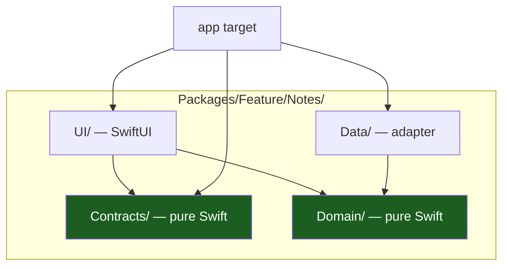
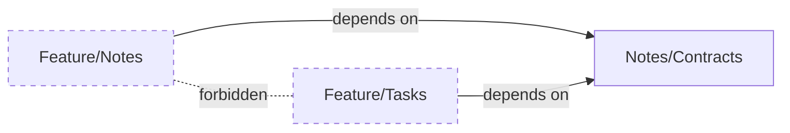

# Vertical Slicing

A **slice** is one feature, cut end to end: its routes, its rules, its ports,
its use cases, its adapter and its screen. Slices are the unit of work, of
review and of ownership. The template ships exactly one, `notes`, as the
reference.

## 1. The four quadrants

Every slice is four SwiftPM packages. The split is not a diagram: it is four
directories, four `Package.swift` files and four sets of allowed dependencies.



| Quadrant | Package kind | Holds | May depend on |
| --- | --- | --- | --- |
| **contracts** | Pure Swift | The `NotesRoute` cases, the interfaces other slices may call | nothing — no package, no framework |
| **domain** | Pure Swift | The entity, the port, the use cases | `Kernel` |
| **data** | Adapter | The adapter that implements the port | the slice's `domain`, `Kernel` |
| **ui** | SwiftUI | The screen, the `@Observable` model, the state, the events and the effects | the slice's `domain` and `contracts`, `Kernel`, `UICore` |

The difference from a convention-based split is the last column. A SwiftPM
package's `dependencies` array is the **complete** list of what that package
may import, so a forbidden edge is a compile error, not a review comment
([ADR 0002](adr/0002-one-swiftpm-package-per-layer.md)). The script
`scripts/check-architecture.sh` gates the two edges the compiler cannot see.

Two shared packages sit above the quadrants and are not part of any slice:

| Package | Kind | Holds |
| --- | --- | --- |
| `Kernel` | Pure Swift | `Outcome`, `AppError`, `ErrorCode`, `NoteID` — the vocabulary every layer shares |
| `UICore` | Pure Swift | `UiStatus`, the closed status set every screen renders |

## 2. What each quadrant owns

| Asset | Owner of the `notes` slice |
| --- | --- |
| Route type | `NotesRoute` in `Contracts` |
| Domain rules | The `Note` entity: an id and a title, plain text only |
| Port | `NoteRepository`, declared in `Domain` |
| Storage | The in-memory list in `Data` |
| UI surface | The SwiftUI screen and the `NotesModel` in `UI` |
| Wiring | The `<APP>` app target — and only it |

Two slices never share a route type, never share a port and never import
each other's `domain` or `data`. The rule is checked by
`scripts/check-architecture.sh`.

## 3. The contracts quadrant

`contracts` is the **published face** of a slice. It holds two kinds of
thing:

| What | Why it is public |
| --- | --- |
| The route cases | The app target must be able to register the screen; a route is a value another package has to hold |
| The cross-slice interfaces | Another slice may call this one, but only through a declared interface |

What `contracts` deliberately does **not** hold:

| Not here | Because |
| --- | --- |
| The entity | It is an implementation detail of the slice; another slice gets a DTO or a projection |
| The port | The port belongs to the slice that consumes it ([03](03-packages-layers-and-udf.md)) |
| The length constants | The contract bounds what may travel; the domain bounds what may exist |

`contracts` is a **pure Swift** package, so the route cases carry no
SwiftUI type and no framework at all. `NotesContracts` depends on nothing —
not even `Kernel` — and `scripts/check-architecture.sh` fails the build if a
`.package(path:)` appears in its manifest.

```swift
// NotesContracts — a route is a value, never a string path.
public enum NotesRoute: Hashable, Sendable {
    case list
    case detail(id: String)
}
```

## 4. The domain quadrant

The domain holds the rules and the use cases, and it is **pure Swift**:

| Holds | Example |
| --- | --- |
| The entity | `Note(id: NoteID, title: String)` with its invariants |
| The port | `NoteRepository` — the protocol the use case needs |
| The use cases | `LoadNotes` — returning `Outcome<[Note]>`. A write use case lands with the first product feature ([08](08-offline-outbox-and-sync.md)) |
| The dispatchers they need | None, in this shape: the use case is an `async` function and the model owns the actor. Never a `Task.detached` inline |

Three rules:

1. **No `import SwiftUI`, no `import UIKit`.** The frameworks are not in the
   manifest, so this is a compile error, not a review comment.
2. **No `Foundation` platform reach-through.** The domain exchanges value
   types; the adapter owns `URLSession`, the Keychain and the disk.
3. **The port is declared here, not in `data`.** The consumer owns the
   interface; the producer implements it.

```swift
// The shape of a use case: it takes the port and returns a value, and
// rethrows a cancellation.
public struct LoadNotes: Sendable {
    private let repository: any NoteRepository

    public func callAsFunction() async throws -> Outcome<[Note]> {
        do {
            return .success(try await repository.load())
        } catch let error as AppError {
            return .failure(error)
        } catch is CancellationError {
            throw CancellationError()
        } catch {
            return .failure(AppError(code: .unknown))
        }
    }
}
```

Expected failures are **values**, not thrown errors: the caller must handle
both branches of the `Outcome` before it can read the result.

## 5. The data quadrant

`data` holds the **adapters**: the implementations of the domain's ports.
Today there is exactly one — an in-memory repository.

```swift
// The shape of the adapter. It implements the port the domain declared and
// knows nothing about the domain's rules beyond the types it exchanges.
public struct InMemoryNoteRepository: NoteRepository {
    public func load() async throws -> [Note] {
        [
            Note(id: NoteID(rawValue: "note-1"), title: "First note"),
            Note(id: NoteID(rawValue: "note-2"), title: "Second note"),
        ]
    }
}
```

Two things about `data` that the package boundary enforces:

| Rule | Consequence |
| --- | --- |
| `data` may use the platform | A `URLSession` call, a GRDB queue, a Keychain query — all allowed here and only here |
| `data` may not know the UI | `NotesUI` is not in `NotesData`'s manifest, and `NotesData` is not in `NotesUI`'s — the gate checks both directions |

The adapter is where the **storage decision** lives. The template's
in-memory adapter is the placeholder for a real store
([08](08-offline-outbox-and-sync.md)); the domain does not change when it is
replaced.

## 6. The ui quadrant

`ui` holds the screen and the model — and it talks to the domain, never to
`data`.

```swift
// The model depends on the use case, not on the repository.
@MainActor
@Observable
public final class NotesModel {
    private let loadNotes: LoadNotes

    public func send(_ event: NotesEvent) { /* ... */ }
}
```

| Rule | Why |
| --- | --- |
| The model takes use cases, not repositories | The rule lives in the use case, not in the model |
| The screen renders `NotesViewState` and sends `NotesEvent` | The UDF contract ([03](03-packages-layers-and-udf.md)) |
| The screen never imports `data` | The presentation layer does not choose the implementation |
| The model is `@MainActor` | Observable state belongs to the main actor; the ports are `Sendable` |

The UDF contract has three parts and they are the slice's public shape:

| Type | Direction | Meaning |
| --- | --- | --- |
| `NotesViewState` | down | An immutable `Equatable` value: `status: UiStatus` plus the notes |
| `NotesEvent` | up | What the user can do: `refresh` or `open(NoteID)` |
| `NotesEffect` | out, once | A one-shot navigation request, delivered through an `AsyncStream` with a single consumer |

The `ui` package is a **library**, not an application target: it has no
`Info.plist`, no entitlement and no launcher icon. It is linked into the
`<APP>` app target.

## 7. Cross-slice access

The rule is the same as in the backend: **cross-slice access only through
`contracts`**.

| Need | Where it goes |
| --- | --- |
| Another slice calls this one | Declare an interface in `contracts`; the caller depends on `contracts` only |
| Two slices need the same entity | It was not slice code: move it to `Kernel` (pure types) |
| Two slices need the same route | It belongs in a shared `contracts` package, or in `UICore` if it is navigation plumbing |
| Two slices need the same rule | Extract it into the domain, or into `Kernel` if it is truly universal |



Two slices must not depend on each other's `domain` or `data`. The reason
is practical: a direct slice-to-slice dependency makes both slices
impossible to delete, to rename or to extract.

> **Known gap.** The architecture check does **not** scan for cross-slice
> imports. The template ships one slice, so the rule cannot be exercised
> against it, and a check with no fixture is a check nobody runs. The rule
> becomes a script rule when the second slice lands
> ([03](03-packages-layers-and-udf.md) §4).

## 8. Adding a slice

The short recipe; the full one is in the `/add-slice` skill and in
[13 — Playbooks](13-playbooks.md).

1. Create `Packages/Feature/<name>/{Contracts,Domain,Data,UI}`, each with a
   `Package.swift` that declares `platforms: [.iOS(.v18), .macOS(.v15)]`,
   `swiftLanguageModes: [.v6]` and only inward dependencies.
2. **Domain first**: the entity, its invariants, the port, the use cases.
   No SwiftUI, no UIKit, no framework.
3. **Contracts**: the route cases and any interface other slices may call.
4. **Data**: the adapter implementing the port.
5. **UI**: the model, the state, the events, the effects, the screen.
6. Register the route in the app target — in the
   `navigationDestination(for:)` switch, and nowhere else
   ([06](06-navigation-routes-and-deep-links.md)).
7. Wire the implementations in `AppEnvironment` — the composition root builds
   the adapter and hands the use case to the model
   ([ADR 0003](adr/0003-explicit-app-environment.md)).
8. Add the package to `project.yml` (`packages:` and, if the app uses it,
   the target's `dependencies:`).
9. Add the package to the two hardcoded lists in the gates:
   `scripts/check-architecture.sh` (the `PURE_PACKAGES` array if the package
   is pure, and the Swift 6 manifest list) and `scripts/native-gates.sh`
   (the `PACKAGES` array, or its tests never run).
10. Write the tests: the use case against a stub repository, the model
    against the same stub.

## Do / don't

| Do | Don't |
| --- | --- |
| Declare the port in the domain | Declare the port in the adapter |
| Depend on another slice's `contracts` | Import another slice's `domain` or `data` |
| Keep the entity inside the slice | Export the entity in `contracts` |
| Choose the adapter in `AppEnvironment` | Let the model construct one |
| Return `Outcome` from a use case | Throw for an expected failure |
| Delete the `notes` slice when you start | Keep it as a second, unused slice |

## See also

- [Packages, Layers & UDF](03-packages-layers-and-udf.md) — the package
  graph.
- [Project Layout & Build Logic](05-project-layout-and-build-logic.md) — the
  tree.
- [Navigation Routes & Deep Links](06-navigation-routes-and-deep-links.md) —
  where a route is registered.
- [Playbooks](13-playbooks.md) — the recipe for adding a slice.
- [ADR 0002 — One SwiftPM package per layer](adr/0002-one-swiftpm-package-per-layer.md)
  — why the dependency rule is a manifest fact.
- [Playbook Native iOS Swift §4](../PLAYBOOK_MOBILE_IOS_SWIFT.md) — the
  layer table.
