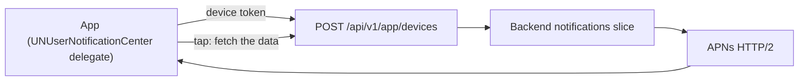

# Push Notifications

Push is a **channel, not a data path**. The payload carries a small hint
("something changed in this category"); the app fetches the real data after
the tap. A payload that carries the content is a payload that leaks on a
locked screen.

> **Known gap — do not copy a fiction.** The template **does not implement**
> push. There is no `UNUserNotificationCenter` delegate, no
> `registerForRemoteNotifications()` call, no notification category, no
> `aps-environment` entitlement and no permission request in the tree. This
> chapter specifies the contract and the adoption path.

## 1. The architecture



The backend owns the device registry, the preferences, the templates and the
scheduling. The app owns the token, the categories and the routing of an
incoming message.

| Component | Owner |
| --- | --- |
| The device registry (`token`, `provider`, `appVariant`, `locale`, `tz`, the authorization state, the categories) | The backend |
| The token lifecycle | The app |
| The notification categories and their options | The app |
| The notification content | The backend, from a template |
| The routing of a tap | The app, through the route allowlist |

### How the backend authenticates to APNs

APNs accepts two kinds of client credential, and the choice is the
backend's, not the app's:

| Auth | What it is | When |
| --- | --- | --- |
| **Token-based (`.p8`)** | A signing key in the Apple developer portal; the backend signs a short-lived **JWT** per request and sends it as `authorization: bearer <jwt>` | The default. One key authenticates every device, and the key can be rotated without touching a device |
| **Certificate-based** | A push certificate (`aps-environment` certificate) per topic | Legacy. The certificate expires on a fixed schedule and must be reissued for every topic |

The iOS playbook fixes the choice: **token-based `.p8` auth**, sent directly
by the backend, with the provider adapter behind a port so APNs-direct and
FCM can coexist across platforms.

The key never ships in the app: the `.p8` file signs the **server's**
requests, so it lives in the CI secret store and in the backend, never in
the bundle ([09](09-security-and-keychain.md) §3).

## 2. The token lifecycle

| Event | The app does |
| --- | --- |
| **After login** | Register the device with the backend ([07](07-auth-and-platform-features.md) §6) |
| **On every app start** | Register again — the backend's registry may be stale |
| **On `didRegisterForRemoteNotificationsWithDeviceToken`** | Enqueue the upload; **do not** call the network on the delegate callback |
| **On token rotation** | The token changed — upload the new one and let the server replace the old |
| **On logout** | Unregister on the server |
| **On account deletion** | The same, plus the server cascades the deletion |
| **On `410 Unregistered` from APNs** | The server prunes the token |

### The registration call

The app asks the system for a token:

```swift
// The registration is one call. The token arrives later, in the delegate.
UIApplication.shared.registerForRemoteNotifications()
```

The token comes back in the delegate, and the delegate must not block on
the network:

```swift
func application(_ app: UIApplication, didRegisterForRemoteNotificationsWithDeviceToken token: Data) {
    let tokenHex = token.map { String(format: "%02x", $0) }.joined()
    Task { await environment.devices.upload(tokenHex: tokenHex) }
}
```

The upload must be a **deferred, retryable job** — a `BGTaskScheduler`
task with a network constraint, or a foreground call — not a blocking call
in the delegate, which the system gives only a few seconds.

### Token rotation

**The token is not permanent.** It changes when the user reinstalls the app,
when the device is restored from a backup, when the user resets the
`aps-environment`, and occasionally on its own. The token is also
**environment-scoped**: a sandbox token is not a production token, and a
build signed for development cannot talk to the production APNs topic.

| Rule | Why |
| --- | --- |
| The token is uploaded on **every** registration callback, not only the first | The callback *is* the rotation signal; there is no other way to learn the token changed |
| The upload carries the **environment** (`sandbox` or `production`) | The backend must route the send to the right APNs host |
| The registration is **idempotent** | The same token uploaded twice is one row |
| The old token is replaced, not duplicated | The server prunes on `410 Unregistered` and on `BadDeviceToken` |

## 3. The message payload

The same shape as the other clients of the platform:

| Field | Meaning |
| --- | --- |
| `v` | The payload schema version |
| `type` | The message type — the routing key |
| `category` | The notification category |
| `deepLink` | The route to open on a tap |
| `correlationId` | The correlation id, carried into the app's own logs |
| `collapse` | The key that collapses a burst into one notification |
| `ttl` | How long the message is worth delivering |
| `priority` | The delivery priority |

On the wire, the payload is the APNs envelope: `aps` for the system
(`alert`, `badge`, `sound`, `content-available`) and the custom fields
alongside it. The delivery controls are **headers**, not body fields:

| Header | What it does |
| --- | --- |
| `apns-topic` | The bundle id of the target app |
| `apns-push-type` | `alert`, `background`, `liveactivity` — the right one matters |
| `apns-priority` | 10 for immediate, 5 for power-friendly |
| `apns-expiration` | The TTL, as a UNIX timestamp |
| `apns-collapse-id` | Collapses a burst into one notification |

Two rules:

| Rule | Why |
| --- | --- |
| The payload is **minimal** | It is visible on a locked screen, and it crosses an unreliable network |
| The payload is **validated against a versioned schema** before use | An unknown or malformed payload is dropped, not rendered |

A **notification message** carries a user-visible alert. A **background
message** (`content-available: 1`) is a sync hint only — the app may use it
to refresh, and it must not be relied on: the system throttles it heavily
and it may never arrive at all.

## 4. Categories

An iOS notification category is a `UNNotificationCategory`: an identifier, a
set of actions and a set of options. The category is what the payload's
`category` field names, and it is what the app registers at launch.

| Category | Purpose | Default |
| --- | --- | --- |
| `transactional` | Order and payment updates | Immediate, interruption level `active` |
| `account-security` | Sign-in alerts, password changes | Immediate, and not disableable |
| `game-events` | Live gameplay events | Silent, or delivered quietly |
| `social` | Messages and reactions | Immediate, interruption level `active` |
| `promotions` | Marketing | **Off until the user opts in** |

The rules:

| Rule | Why |
| --- | --- |
| The categories are registered at app start | A payload for a category that does not exist is dropped silently |
| `promotions` is **not** delivered until the user opts in | Marketing never arrives without an opt-in |
| The category states are reported to the server | The backend needs to know what the user can actually receive |
| A category the user disabled is not re-enabled by the app | The user's choice is final; a new identifier is a new category, and it is only created for a genuinely new purpose |
| The actions are **non-destructive** | An action that deletes from a notification is a decision the user must confirm on screen |
| The interruption level is `passive` or `active` by default | A time-sensitive interruption needs the entitlement and a justification |

The promotion rule is enforced on **both** sides: the category is opt-in on
the device, and the backend's per-category kill switch stops the send. The
device-side opt-in is the one the user can see.

## 5. The permission

Notification authorization is a **runtime prompt**, asked through
`UNUserNotificationCenter`.

| Rule | Why |
| --- | --- |
| Ask at a **contextual moment** — after the first order, after the first catch — not at first launch | A prompt with no context is a denial |
| Show a **primer** first | The user deserves to know what the permission is for |
| After a denial, the system stops prompting | Deep-link to the app's notification settings instead of asking again |
| **Provisional** authorization delivers quietly | It is a soft opt-in, and the user can still see something |
| Report the authorization state to the server | The backend must not send what cannot be shown |

```swift
// The shape of the request. The prompt is asked once, at the moment of use.
let granted = try await UNUserNotificationCenter.current().requestAuthorization(
    options: [.alert, .badge, .sound]
)
```

The states the app must distinguish are `notDetermined`, `denied`,
`authorized` and `provisional` — and only `authorized` and `provisional`
mean the user can be interrupted.

## 6. The tap

A tap must land on a **screen**, with a sensible back stack.

| Rule | Why |
| --- | --- |
| The `deepLink` is parsed by the **same parser** as a Universal Link | One parser, one set of rules ([06](06-navigation-routes-and-deep-links.md)) |
| The parsed result is a **route value**, not a path string | The route vocabulary is a typed enum (`NotesRoute`) in a pure package |
| The route is validated against the allowlist | The payload is untrusted |
| A synthetic back stack is built | Up lands on a sensible parent |
| The link is queued while signed out and resumed after login | The session does not exist yet |
| **No state-changing action from the payload** | A tap may open a screen that offers an action; the user confirms it |

The routing lands in the same place a deep link lands:

```swift
func userNotificationCenter(
    _ center: UNUserNotificationCenter,
    didReceive response: UNNotificationResponse
) async {
    guard let payload = PushPayload(userInfo: response.notification.request.content.userInfo)
    else { return }                              // versioned schema: an unknown payload is dropped
    await environment.router.handle(deepLink: payload.deepLink)   // allowlist, resume after auth
}
```

`Router.path` is a `[NotesRoute]`, and `RootView` maps every case of that
enum through `navigationDestination` — so a push tap and a Universal Link
reach a screen by exactly the same mechanism
([06](06-navigation-routes-and-deep-links.md) §9).

## 7. Lock-screen privacy

| Rule | Why |
| --- | --- |
| No PII in the title or the body | The lock screen shows them to anyone |
| `hiddenPreviewsBodyPlaceholder` for a sensitive category | The preview is a generic placeholder; the real text appears after the unlock |
| The details are **fetched after the tap** | The data never sits in the notification |
| The rich content is skipped on a low tier or a poor network | A notification service extension runs under tight time and memory limits |
| The foreground presentation is decided by category and by the current screen | No duplicate alert for the conversation already on screen |

A **notification service extension** is the only way to attach media or to
decrypt a payload before it is shown. It is an extension: it has its own
memory and time budget, it must never do network work beyond a bounded
download, and it is skipped on a low tier.

## 8. Delivery realities

This is where push delivery actually fails.

| Reality | Consequence |
| --- | --- |
| APNs delivery is **best-effort** | A notification may arrive late, or not at all |
| Low Power Mode defers delivery | The same |
| Focus modes suppress presentation | The notification is delivered and not shown |
| The system throttles background pushes | A silent refresh hint may never arrive |
| The app is suspended | The delegate may not run at all until the next launch |

The rules:

| Rule | Why |
| --- | --- |
| Keep the payload small | It is the only part that must survive a bad network |
| **Never depend on push for correctness** | It is not guaranteed on any device |
| Reconcile on **foreground** | The projection is refreshed anyway ([08](08-offline-outbox-and-sync.md)) |
| Test the sandbox and production APNs, the permission states, the app killed, and a Focus mode | The states that break delivery are the ones nobody tests |
| Test the simulator injection path | `xcrun simctl push <device> <bundle-id> <payload.json>` is the fastest way to exercise a tap before APNs exists ([Admin Guide](admin-guide.md) §10) |

There is no equivalent of the Android battery-optimization exemption to
request, and none should be invented: iOS gives the app the background task
scheduler and the user gives the notification permission, and that is the
whole contract.

## 9. The server side

| Concern | Rule |
| --- | --- |
| The device registry | One row per (app, device, token, environment) |
| The preferences | Per category, per device |
| The templates | Localised, per category |
| The scheduling | By the device's timezone |
| The rate limits and the collapse | A per-category limit and an `apns-collapse-id` |
| The idempotency of a send job | The same job id does not send twice |
| The receipts | A delivery receipt and an open receipt |
| The dead-token pruning | `410 Unregistered` and `BadDeviceToken` remove the token |
| The audit trail | Transactional and security notifications are auditable |
| The kill switch | A per-category switch that stops sending |

## 10. The adoption path

1. **Add the Push Notifications capability.** The `aps-environment`
   entitlement and the `UIBackgroundModes: remote-notification` key, in the
   manifest and in an entitlements file — never in Xcode's UI
   ([ADR 0001](adr/0001-xcodegen-generated-project.md)).
2. **Add the delegate.** A `UIApplicationDelegateAdaptor` in the app target
   that sets `UNUserNotificationCenter.current().delegate`, registers the
   categories and implements the registration, failure and response
   callbacks.
3. **Register the categories** at app start, with the options of §4.
4. **Request the authorization** at a contextual moment, with the primer.
5. **Upload the token** after login and on every registration callback, with
   the environment ([07](07-auth-and-platform-features.md) §6).
6. **Add the tap routing**: the payload schema, the shared deep-link parser,
   the synthetic back stack.
7. **Add the server side**: the registry, the templates, the `.p8` signing,
   the kill switch.
8. **Test the delivery states**: sandbox and production, the simulator
   injection, the permission states, the app killed.

## Do / don't

| Do | Don't |
| --- | --- |
| Fetch the content after the tap | Put the content in the payload |
| Parse the `deepLink` into a route value | Route by a screen name |
| Register the categories at start | Assume the category exists |
| Keep `promotions` off until the user opts in | Create it enabled and hope |
| Ask for the notification permission at a contextual moment | Ask at first launch |
| Reconcile on foreground | Depend on the background wake-up |
| Upload the token on every callback | Upload it once at first launch |
| Report the authorization state to the server | Assume the server knows |

## See also

- [Navigation Routes & Deep Links](06-navigation-routes-and-deep-links.md)
  — the parser a tap shares with a Universal Link.
- [Security & Keychain](09-security-and-keychain.md) — the
  `aps-environment` entitlement and the lock-screen rules.
- [Auth & Platform Features](07-auth-and-platform-features.md) — the device
  registration payload.
- [Offline, Outbox & Sync](08-offline-outbox-and-sync.md) — the foreground
  reconciliation a push never replaces.
- [Playbook Native iOS Swift §8](../PLAYBOOK_MOBILE_IOS_SWIFT.md) — the push
  rules.
