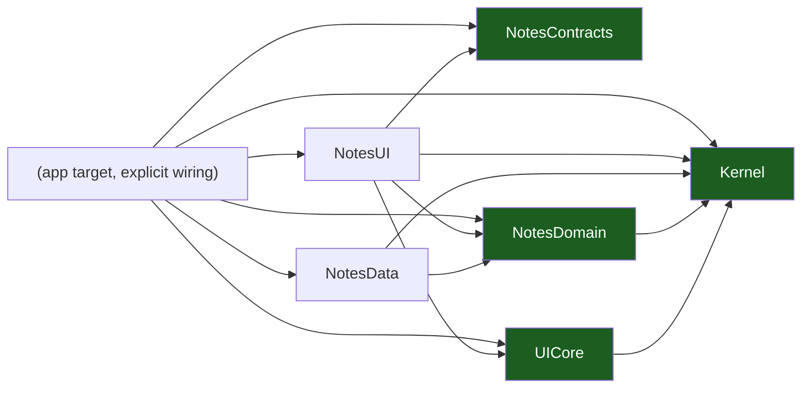

# Native iOS Template — Documentation

The handbook of the native iOS template: **Swift 6, SwiftUI, iOS 18, one
SwiftPM package per layer, XcodeGen**. It describes the kit as it is — the
package graph, the UDF presentation model, the typed navigation, the gates —
and marks the parts that are still to be built as known gaps.

> 15 chapters · 4 reference documents · 3 ADRs.

## The one rule

**The package graph is the architecture.** `Kernel`, `UICore`,
`NotesContracts` and `NotesDomain` are pure Swift packages: SwiftUI and UIKit
are not in their manifest, so they *cannot* import a view framework — not by
convention, not by review, but by the compiler. Only the app target sees every
layer, and it wires them by hand. See
[Packages, Layers & UDF](03-packages-layers-and-udf.md) and
[ADR 0002](adr/0002-one-swiftpm-package-per-layer.md).

## Start here

New to the kit? Read
[00 — Overview & Principles](00-overview-and-principles.md), then
[01 — Platform Model & iOS Runtime](01-platform-model-and-ios-runtime.md) and
[03 — Packages, Layers & UDF](03-packages-layers-and-udf.md). Starting a
project? Jump to
[05 — Project Layout & Build Logic](05-project-layout-and-build-logic.md) and
[13 — Playbooks](13-playbooks.md). Reviewing a change? Read
[06 — Navigation & Deep Links](06-navigation-routes-and-deep-links.md) and
[09 — Security & Keychain](09-security-and-keychain.md).

## Chapters

| #   | Chapter                                                                        | What it covers                                                            |
| --- | ------------------------------------------------------------------------------ | ------------------------------------------------------------------------- |
| 00  | [Overview & Principles](00-overview-and-principles.md)                         | The one rule, ten principles, the chapter map, the known gaps             |
| 01  | [Platform Model & iOS Runtime](01-platform-model-and-ios-runtime.md)           | The process, the main actor, the lifecycle, memory pressure, background limits |
| 02  | [Device Tiers & the Quality Governor](02-device-tiers-and-the-quality-governor.md) | Low, mid and high, the thermal signal, the governor contract, the budgets |
| 03  | [Packages, Layers & UDF](03-packages-layers-and-udf.md)                       | The package graph, `UiStatus`/`NotesEvent`/`NotesEffect`, the model rules  |
| 04  | [Vertical Slicing](04-vertical-slicing.md)                                     | The four quadrants of a slice, cross-slice access through `Contracts`      |
| 05  | [Project Layout & Build Logic](05-project-layout-and-build-logic.md)           | The tree, XcodeGen, SwiftPM manifests, Swift 6 mode, the adoption path      |
| 06  | [Navigation Routes & Deep Links](06-navigation-routes-and-deep-links.md)      | The typed route enum, `NavigationStack`, exhaustive destinations, universal links |
| 07  | [Auth & Platform Features](07-auth-and-platform-features.md)                   | Onboarding, login, registration, forgot password, AuthenticationServices  |
| 08  | [Offline, Outbox & Sync](08-offline-outbox-and-sync.md)                       | The SwiftData projection, the outbox, background tasks, idempotency, conflicts |
| 09  | [Security & Keychain](09-security-and-keychain.md)                            | Keychain, ATS, no secrets in the bundle, integrity, App Store policy       |
| 10  | [Push Notifications](10-push-notifications.md)                                | APNs, notification categories, token rotation, routing, permission prompts |
| 11  | [Telemetry](11-telemetry.md)                                                  | Redaction, crash reporting, performance markers, what must never be logged |
| 12  | [Testing & CI](12-testing-and-ci.md)                                          | Swift Testing, the architecture check, the evals, the gates                |
| 13  | [Playbooks](13-playbooks.md)                                                  | The six changes you will make most                                        |
| 14  | [Glossary](14-glossary.md)                                                    | Every term used in this set                                               |

## Reference

| Document                                                       | What it covers                                                                              |
| -------------------------------------------------------------- | ------------------------------------------------------------------------------------------- |
| [Support Matrix](support-matrix.md)                           | The device tiers, the reference devices, what each tier may enable, the simulator pool      |
| [Data Flows](data-flows.md)                                   | Startup, the notes list, an offline mutation, a deep link, a push tap — a trust boundary on every hop |
| [Admin Guide](admin-guide.md)                                 | Signing, App Store Connect, TestFlight, capabilities, how to verify a deployment            |
| [Dependency Register](dependency-register.md)                 | Every dependency and platform capability: version, why it is there, the path that removes it |
| [ADR 0001 — XcodeGen-generated project](adr/0001-xcodegen-generated-project.md) | Why the project file is generated and never committed                    |
| [ADR 0002 — One SwiftPM package per layer](adr/0002-one-swiftpm-package-per-layer.md) | Why the dependency rule is a manifest fact and not a review comment |
| [ADR 0003 — Explicit AppEnvironment](adr/0003-explicit-app-environment.md) | Why there is no DI framework and how the object graph is built            |

## The gates

| Command                          | What it proves                                                             |
| -------------------------------- | -------------------------------------------------------------------------- |
| `bash scripts/check-architecture.sh` | The package graph: no forbidden edge, no UI framework in a pure package, no tracked `.xcodeproj`, Swift 6 mode everywhere |
| `node --test evals/contracts.test.mjs` | The `.claude` layer: agents, skills, commands, manifest posture        |
| `bash scripts/native-gates.sh`   | `swift test` per package, `xcodegen generate`, `xcodebuild` (macOS; visible SKIP elsewhere) |
| `make lint`                      | The architecture check; after rename, the `.claude` linters and the instruction budget |
| `make ci`                         | The lint set, the contract evals and the native tier, in one go            |
| `bash scripts/verify-template.sh` | The kit still passes every gate after `rename.sh` — the substitution contract, proven |

## Known gaps of the template

The template ships the seams, not the filled-in product. The gaps are listed
in [00 — Overview & Principles](00-overview-and-principles.md) and in each
chapter; the ones that bite first are the missing persistence
([08](08-offline-outbox-and-sync.md)), the missing push pipeline
([10](10-push-notifications.md)) and the missing signing/Keychain wiring
([09](09-security-and-keychain.md), [Admin Guide](admin-guide.md)).

| Gap                                                                       | Where it is documented                                                     |
| ------------------------------------------------------------------------- | -------------------------------------------------------------------------- |
| No persistence: the `notes` repository is an in-memory adapter             | [Offline, Outbox & Sync](08-offline-outbox-and-sync.md)                    |
| No network client and no server contract implemented                       | [Auth & Platform Features](07-auth-and-platform-features.md)                |
| No DI framework: `AppEnvironment` builds the object graph by hand          | [ADR 0003](adr/0003-explicit-app-environment.md)                          |
| No `.xcodeproj` in the tree: it is generated from `project.yml`            | [ADR 0001](adr/0001-xcodegen-generated-project.md)                        |
| No device tier or quality governor implementation                          | [Device Tiers & the Quality Governor](02-device-tiers-and-the-quality-governor.md) |
| No APNs pipeline, no notification categories, no token registration        | [Push Notifications](10-push-notifications.md)                             |
| No deep-link parser, no associated domains, no shared route table          | [Navigation Routes & Deep Links](06-navigation-routes-and-deep-links.md)   |
| No logger, no ring buffer, no remote telemetry sink, no crash reporter      | [Telemetry](11-telemetry.md)                                               |
| No Keychain wrapper, no ATS exceptions, no privacy manifest               | [Security & Keychain](09-security-and-keychain.md)                        |
| No localization catalog: UI strings are literals in the view               | [Packages, Layers & UDF](03-packages-layers-and-udf.md) §7                 |

## Where the code is

| Topic                    | Package / path                              |
| ------------------------ | ------------------------------------------- |
| The composition root     | `Apps/<APP>/Sources/`                       |
| The kernel               | `Packages/Core/Kernel`                      |
| The shared status set     | `Packages/Core/UICore`                     |
| The slice contracts      | `Packages/Feature/Notes/Contracts`          |
| The slice domain         | `Packages/Feature/Notes/Domain`             |
| The slice data adapter   | `Packages/Feature/Notes/Data`               |
| The slice UI             | `Packages/Feature/Notes/UI`                 |
| The `.claude` contract tests | `evals/contracts.test.mjs`             |
| The architecture gate    | `scripts/check-architecture.sh`             |
| This documentation set   | `docs/`                                     |

The package graph, and what each package may depend on, is in
[03 — Packages, Layers & UDF](03-packages-layers-and-udf.md).
