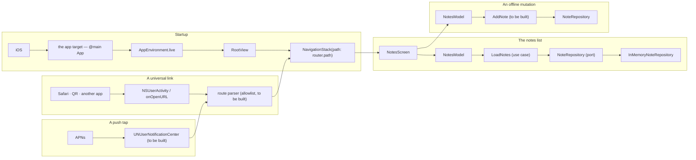
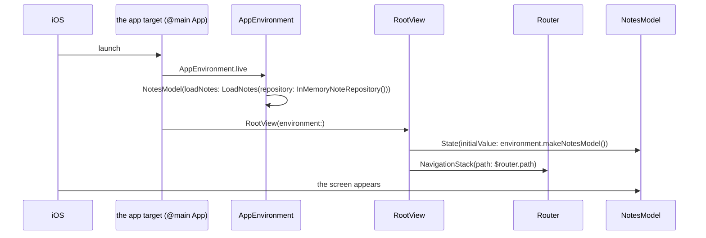
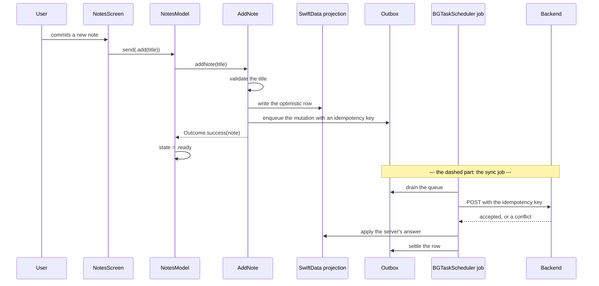
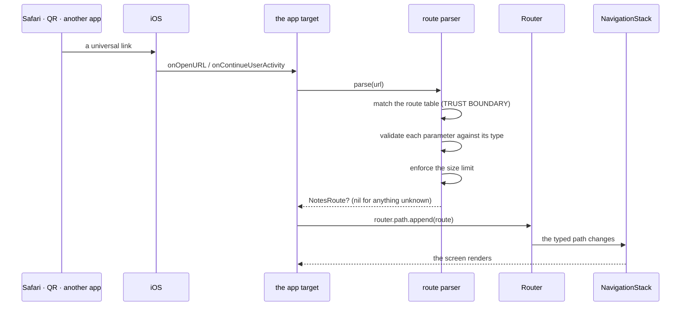
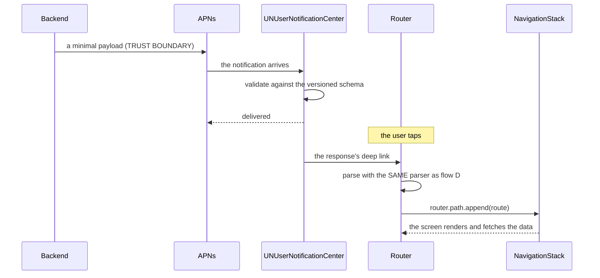

# Data Flows

Five flows, each with the trust boundary written on every hop. A flow that
has no boundary marked is a flow nobody reviewed.

Two of the five exist in the template today (startup, the notes list). The
other three — the offline mutation, the universal-link entry and the push
tap — are drawn so the boundary is designed **before** the code is written;
each says so at its head.

## 1 · The flows at a glance



## 2 · Flow A — startup



| Hop | From → to | Trust boundary | The check |
| --- | --- | --- | --- |
| 1 | iOS → app target | The platform is trusted | — |
| 2 | App target → `AppEnvironment` | Not a trust boundary; a **construction** boundary | The root builds plain objects; it does no I/O |
| 3 | `AppEnvironment.live` → `NotesModel` | Not a trust boundary | The model receives a use case, never a repository it built itself ([ADR 0003](adr/0003-explicit-app-environment.md)) |
| 4 | `RootView` → `Router` | Not a trust boundary | `Router.path` is a typed `[NotesRoute]`, not a string table |
| 5 | Screen → model | Not a trust boundary | The screen sends a typed `NotesEvent`; it never calls a use case |

The rule that matters: **the graph is built in one place, the composition
root**, and it is built from objects that hold no framework handle. A
`NotesModel` that received a repository could not be tested against a stub;
the one that receives a use case is.

`AppEnvironment` holds a **factory**, not a singleton:
`let makeNotesModel: @MainActor () -> NotesModel`. The root can build a
model per screen without sharing mutable state.

## 3 · Flow B — the notes list

The intended path: the screen asks the model, the model asks a use case, the
use case asks the port.

```mermaid
sequenceDiagram
    participant U as User
    participant S as NotesScreen
    participant M as NotesModel
    participant UC as LoadNotes
    participant R as NoteRepository
    participant D as InMemoryNoteRepository
    U->>S: the screen appears
    S->>M: .task { model.send(.refresh) }
    M->>M: state.status = .loading
    M->>UC: await loadNotes()
    UC->>R: repository.load()
    R->>D: load()
    D-->>R: two fixed notes
    R-->>UC: [Note]
    UC-->>M: Outcome.success([Note])
    M->>M: state.notes = notes; status = .ready (or .empty)
    S->>S: re-render from model.state
```

| Hop | From → to | Trust boundary | The check |
| --- | --- | --- | --- |
| 1 | User → screen | The user's input is data | The domain owns the rules; the screen never re-implements them |
| 2 | Screen → model | Not a trust boundary | The screen sends a typed `NotesEvent`; it never calls a use case |
| 3 | Model → use case | Not a trust boundary | The use case is the only thing that knows the rule |
| 4 | Use case → port | The **data boundary** | The port speaks domain types; the adapter translates |
| 5 | Adapter → model | The response is untrusted like any answer | The use case converts a thrown `AppError` into `Outcome.failure`, so a record written by an older build is dropped before it reaches the UI |

The last row is the one people skip: the adapter's output is **validated by
the use case**. The adapter is where the platform lives, and the platform
can return anything.

The status the user sees is a single value: `UiStatus.loading`, `.ready`,
`.empty`, `.offline`, `.forbidden`, `.notFound`, `.error(correlationID:)` or
`.policyBlocked`. Not eight booleans. The notes travel beside the status in
`NotesViewState`, not inside it, so the same closed status set serves every
slice — and a `switch` that misses one does not compile.

Two facts about the shipped adapter that an administrator must not
misread:

- `InMemoryNoteRepository.load()` **never throws**: the shipped adapter
  returns two fixed notes. The `.failure` branch of `LoadNotes` is exercised
  by the stub repository in `Packages/Feature/Notes/Domain/Tests`, not by the
  app.
- A failure reaches the UI as a status, never as a thrown error:
  `LoadNotes` maps an unknown error to `AppError(code: .unknown)` and
  `NotesModel` maps every `ErrorCode` to a `UiStatus`. A cancellation is the
  one exception: the use case rethrows it and the model leaves the state
  untouched.

## 4 · Flow C — an offline mutation

> The template ships **no** write path, **no** persistence and **no** outbox
> ([Offline, Outbox & Sync](08-offline-outbox-and-sync.md)). This is the flow a
> project must build; the dashed hops are the ones that do not exist yet.



| Hop | From → to | Trust boundary | The check |
| --- | --- | --- | --- |
| 1 | User → screen | The user's input is data | The domain validates it |
| 2 | Screen → model | Not a trust boundary | A typed `NotesEvent` |
| 3 | Model → use case | Not a trust boundary | The use case owns the rule |
| 4 | Use case → projection | The **durability boundary** | The projection and the outbox are written **in one `ModelContext` transaction** |
| 5 | Outbox → backend | The **network boundary** | The idempotency key makes a retry safe; the server authorizes |
| 6 | Backend → job | The response is untrusted | The error envelope wins over the status code; a conflict is a typed outcome |
| 7 | Job → projection | Not a trust boundary | The server's version wins; the local pending change is rejected visibly |

Two properties the flow must preserve:

| Property | Where it comes from |
| --- | --- |
| **The user never waits for the network** | The optimistic row is written locally; the sync is a separate job |
| **A rejected mutation is visible** | The outbox row settles into `rejected`, and the screen shows it |

The projection and the outbox are the template's SwiftData analogue of the
Android kit's Room projection; the chapter that specifies them is
[08 — Offline, Outbox & Sync](08-offline-outbox-and-sync.md).

## 5 · Flow D — a universal-link entry

> The template ships **no** route parser, **no** Associated Domains
> entitlement and **no** `apple-app-site-association`
> ([Navigation Routes & Deep Links](06-navigation-routes-and-deep-links.md)).
> This is the flow a project must build; the flow is drawn so the boundary is
> designed before the code exists.



| Hop | From → to | Trust boundary | The check |
| --- | --- | --- | --- |
| 1 | Outside → the app | **Yes — the external boundary** | The link is untrusted, whoever sent it |
| 2 | App → parser | Not a trust boundary; the **validation** point | The path must match the route table; an unknown path returns `nil` |
| 3 | Parser → parameters | The same boundary | Each parameter is validated against its expected type; the size is bounded |
| 4 | Parser → `NotesRoute` | Not a trust boundary | A typed value, never a string |
| 5 | `NotesRoute` → `Router.path` | Not a trust boundary | The path is a typed `[NotesRoute]`, so the destination switch stays exhaustive |
| 6 | Screen → server | The **network boundary** | The server authorizes; the link never authorizes |

The rule that is easiest to get wrong: **a link received while signed out is
queued and resumed after the login**, not dropped and not replayed blindly.
And no state-changing action is ever performed from a link — a link may open
a screen that *offers* an action, and the user confirms it.

The template already provides the destination side of this flow:
`RootView` maps every `NotesRoute` case in `navigationDestination(for:)`, and
`Router.path` is the typed path. What is missing is the parser that turns a
URL into a `NotesRoute`, and the entitlement that lets the system deliver
the link at all.

## 6 · Flow E — a push tap

> The template ships **no** push pipeline, **no** APNs registration and **no**
> notification service ([Push Notifications](10-push-notifications.md)). This
> is the flow a project must build.



| Hop | From → to | Trust boundary | The check |
| --- | --- | --- | --- |
| 1 | Backend → APNs → app | **Yes — the provider boundary** | The payload is minimal and validated against a versioned schema; an unknown type is dropped |
| 2 | Service → notification | Not a trust boundary | No personal data in the title or the body; the interruption level applies |
| 3 | Tap → app | The **external boundary** | The notification carries no action of its own; it routes, and the route is re-validated |
| 4 | Notification → parser | The same boundary as a universal link | The **same parser**, the same allowlist, the same validation |
| 5 | Screen → server | The network boundary | The data is fetched after the tap; the payload never carries it |

The push and the universal link share the parser on purpose. Two parsers mean
two rule sets, and the second one is the one with the bug.

## 7 · Where the boundaries are enforced

| Boundary | Where it lives | Test |
| --- | --- | --- |
| The data boundary (port ↔ adapter) | `NoteRepository` in `NotesDomain` | The use-case test, against the stub |
| The package boundary | The SwiftPM dependency lists | `scripts/check-architecture.sh` |
| The main-actor boundary | `@MainActor` on `NotesModel` and `Router` | The model test runs on the main actor |
| The status boundary | The closed `UiStatus` set in `UICore` | A `switch` that misses a case does not compile |
| The external boundary (links, pushes) | The route parser in `Contracts` — **not implemented** | The parser test |
| The durability boundary | The projection and the outbox — **not implemented** | The migration test and the outbox test |
| The network boundary | The API client — **not implemented** | The contract test, against a mock server |

## 8 · The boundaries that do not exist yet

| Boundary | State |
| --- | --- |
| The external boundary (links, pushes) | **Not implemented** — there is no route parser in the tree ([Navigation Routes & Deep Links](06-navigation-routes-and-deep-links.md)) |
| The network boundary | **Not implemented** — there is no client in the template |
| The durability boundary | **Not implemented** — the repository is in memory |
| The provider boundary (APNs) | **Not implemented** |
| The configuration boundary (managed and remote) | **Not implemented** — there is no configuration reader ([Admin Guide](admin-guide.md)) |

Every boundary the template does not implement is a boundary a project must
build explicitly. The chapters that specify them are
[08](08-offline-outbox-and-sync.md), [07](07-auth-and-platform-features.md),
[10](10-push-notifications.md) and the
[Admin Guide](admin-guide.md).

## See also

- [Navigation Routes & Deep Links](06-navigation-routes-and-deep-links.md)
  — the typed route enum and the universal link.
- [Offline, Outbox & Sync](08-offline-outbox-and-sync.md) — the mutation
  flow.
- [Push Notifications](10-push-notifications.md) — the payload and the tap.
- [Packages, Layers & UDF](03-packages-layers-and-udf.md) — the state and the
  events.
- [ADR 0003 — Explicit AppEnvironment](adr/0003-explicit-app-environment.md)
  — how the graph is built.
