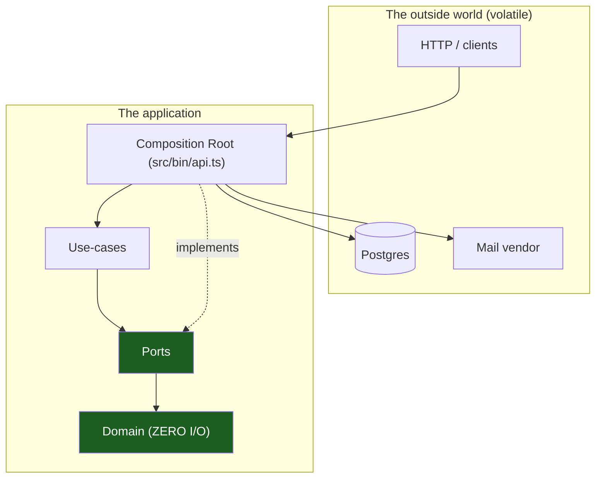
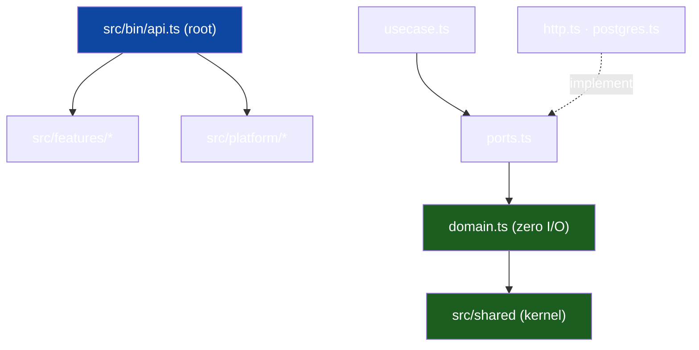

# Overview & Principles

The entry chapter. It states the one structural idea — **hexagonal (ports &
adapters) + vertical slicing, expressed as a single TypeScript project (one
`package.json`, one `tsconfig`)** — and the ~8 principles that follow.
Generic; replace `<app>` with your project and `<scope>` with your module
prefix.

## 1. The problem this solves

An application accumulates two kinds of code that change for different reasons:

- **Business rules** — what the product _means_; changes when the product does.
- **Mechanisms** — how it talks to the world (DB, HTTP, mail); changes when
  infrastructure does.

If tangled, every DB swap risks the rules and every rule change risks the
wiring. The architecture keeps them apart with one discipline: **dependencies
point inward, toward the business rules, never outward toward mechanisms.** The
green nodes of the graph below never import the volatile ones.

## 2. The layers, as files

| Ring          | Where                                     | Knows about                                                         | Volatility |
| ------------- | ----------------------------------------- | ------------------------------------------------------------------- | ---------- |
| **Domain**    | `src/features/<slice>/domain.ts`          | types, IDs, enums, errors, rules — imports `#shared/*` only         | very low   |
| **Ports**     | `…/<slice>/ports.ts`                      | interfaces the use case needs                                       | low        |
| **Use-cases** | `…/<slice>/usecase.ts`                    | one feature's flow                                                  | medium     |
| **Adapters**  | `…/<slice>/{http,postgres}.ts`            | concrete I/O over the slice's `queries.ts` and `src/gen/api` models | high       |
| **Root**      | `src/bin/api.ts`, `module.ts` `register*` | wiring                                                              | highest    |

### Worked example

The import graph of the shipped skeleton:

## 3. Vertical slicing on top of horizontal layers

Each feature owns its stack end to end — `domain.ts` through `module.ts` — in
one directory ("tall, but narrow"). Two slices share code through
`src/shared` (kernel) or `src/platform` (transversal infra), never by
importing each other. [Vertical Slicing](02-vertical-slicing.md) holds the
slice boundaries and the shipped seven.

## 4. The core principles

### P1 — Dependencies point inward

Enforced twice: the TypeScript module graph, and `no-restricted-imports` in
`eslint.config.mjs` turning forbidden files into red lint failures
([Dependency Rules](04-dependency-rules.md)).

### P2 — The domain has zero I/O

`domain.ts` imports `#shared/*` only. If a rule needs data from the world, it
receives it as an argument.

### P3 — Depend on interfaces, not concretions

A use case declares what it needs **as the consumer** in `ports.ts` — a few
methods, satisfied structurally by the adapter (TypeScript interfaces are
structural, exactly like Go's); `src/bin/api.ts` injects the implementation
([Hexagonal Architecture](01-hexagonal-architecture.md) §2).

### P4 — One vertical slice per feature

New capability → new directory under `src/features/`, wired at the root.
The skeleton ships seven — replace `widgets`, keep the rest.

### P5 — A single composition root wires everything

One file knows every concrete type: `src/bin/api.ts` builds pool, adapters,
hub and sender, then calls each slice's `register*(app, deps)`; nothing
depends on `bin/` ([Request Lifecycle](07-request-lifecycle.md)).

### P6 — Lean on the toolchain

`tsc --noEmit` (`make vet`), eslint (architecture guards live in
`eslint.config.mjs`), prettier (`make fmt-check`) — code that compiles can
still fail `make ci`. Generated code (`src/gen/api`) is committed.

### P7 — Reversible migrations

Every node-pg-migrate file ships its rollback (`exports.down` beside
`exports.up`); **migrations never run at server startup** — `make migrate`, or
the one-shot compose `migrations` service, is a deploy/boot step you control.

### P8 — Fakes, not mocks

Port interfaces are small, so unit tests write plain in-memory fakes — no
mocking framework, no database, no network, no timers to fake.

## 5. Runtime cooperation

At runtime control flow crosses outward — root → use case → port → adapter;
the outward _call_ is fine, an outward _import_ is forbidden. The interface is
the seam.

## 6. Why one project, not many

A single project keeps tooling (`pnpm exec node-pg-migrate`,
`openapi-typescript`) and CI simple; TS path aliases via the package
`"imports"` map (`#shared/*`, `#platform/*`, `#features/*`) supply the
namespaces, and eslint supplies the discipline those boundaries cannot.
**Don't:** split into workspaces per slice (version-skew hell) or add an edge
"just for convenience."

## See also

- [Package topology](03-package-topology.md) · [Dependency rules](04-dependency-rules.md)
