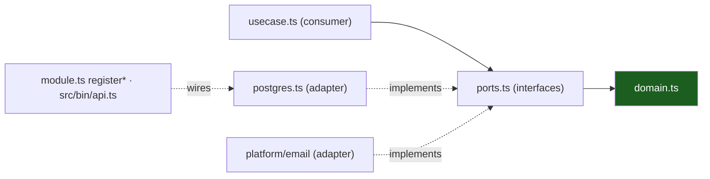

# Hexagonal Architecture

Ports & adapters in TypeScript. The domain sits at the center, declares
nothing, and knows nothing; everything that touches the world enters through a
port the _consumer_ declared.

## 1. The three parts

- **Domain** (`domain.ts`): types, invariants, errors. Pure TypeScript —
  `#shared/*` only. Imports nothing else.
- **Ports**: one or two interfaces per feature, **defined by the consumer**
  (the use case) in `ports.ts`. Not "the repository interface next to the
  adapter" — the interface exists because the use case needs it.
- **Adapters**: classes/functions that _implement_ a port, living in the same
  slice for slice-local ones (`postgres.ts`, `src/platform/email` for mail)
  but wired nowhere but the composition root.



## 2. Consumer-defined ports

The counter-intuitive part, and the important one: the **use case writes the
interface**, in its own directory, shaped exactly to its needs — narrow, often
a handful of methods. The adapter satisfies it structurally; the adapter
imports the port only where it needs a domain type for its signature.

```ts
// src/features/widgets/ports.ts — written for the use case, not the database
export interface Store {
  insert(w: Widget): Promise<void>;
  list(ownerId: string, limit: number, offset: number): Promise<Widget[]>;
  get(id: string, ownerId: string): Promise<Widget | null>;
}

export interface Publisher {
  // platform type, but the name the slice chose
  publish(ev: RealtimeEvent): void;
  subscribe(room: string): Subscriber;
}
```

`usecase.ts` depends only on these types. `postgres.ts` (a Pool-backed
adapter) and the realtime hub satisfy them; `module.ts` wires
`new UseCase(d.store, d.publisher)`. Swapping Postgres for anything else
touches one file.

## 3. Driving vs driven

- **Driving** (left): HTTP handlers, the WS handler — the _world calls us_. In
  this layout they are the `http.ts` adapter: decode request, call the use
  case, encode the `{detail, code}` envelope.
- **Driven** (right): Postgres, mail queue, hub, clock — _we call the world_.
  These are the `postgres.ts` adapters and platform packages.

Both directions cross a port; only the driven side is faked in unit tests.

## 4. The composition root

One file type knows concretions: `src/bin/api.ts` (worker: `src/bin/worker.ts`).

```ts
// module.ts — per-slice entry the root calls
export const registerWidgets = (app: FastifyInstance, d: Deps): void => {
  const uc = new UseCase(d.store, d.publisher);
  const auth = requireAuth(d.verifier, d.cookieName);
  app.get("/api/v1/widgets", { preHandler: [auth] }, h.list);
  app.post("/api/v1/widgets", { preHandler: [auth] }, h.create);
};
```

`register*(app, Deps)` is the whole wiring contract: the root builds `Deps`
(concrete adapters over the Pool + each slice's `queries.ts`, the platform
hub, the mail sender), and the slice exposes nothing else.
`test/acceptance` calls the same `register*` with fakes — the acceptance test
_is_ the proof that the root is the only place that knows types.

## 5. What the seam buys

- **Unit tests without I/O**: fakes implement `ports.ts` in ~10 lines each.
- **Adapter swaps**: SMTP → console sender under `<APP>_OFFLINE=true` is a
  selection function, not a refactor.
- **The linter as lawyer**: eslint forbids `pg`/`kysely`/`fastify` inside
  `domain.ts`; violations are red before review.
- **Onboarding**: read one slice top-down and you have read the entire
  architecture once.

## Do / Don't

- **Do** put the interface where the need lives (`ports.ts`); keep it a few
  methods.
- **Do** make adapters dumb: query, map, return domain types — no rules there.
- **Don't** declare a repository interface "for the future" — no consumer, no
  port (this is TS YAGNI, [Design Patterns](05-design-patterns.md)).
- **Don't** let `domain.ts` import `fastify`, `pg`, or another slice's files.
  eslint will catch you; fix the shape, not the lint.

## Worked example: signup

1. `domain.ts` — `User` pending state, `ERR_EMAIL_TAKEN`, code generator.
2. `ports.ts` — writer + mail-queue interfaces.
3. `usecase.ts` — `Signup(in)` → insert pending user, issue 6-digit code,
   enqueue verification mail; idempotent via re-signup rule.
4. `http.ts` — `POST /api/v1/auth/signup`, validates at the edge, 201/409.
5. `postgres.ts` / `queries.ts` — typed Kysely-style queries (the documented
   codegen delta vs sqlc).
6. `module.ts` — `register*`.
7. `src/bin/api.ts` — wires the pg adapter + `src/platform/email` queue.

Eight files, one feature, zero cross-slice imports.

## See also

- [Vertical Slicing](02-vertical-slicing.md)
- [Design Patterns](05-design-patterns.md)
- [Request Lifecycle](07-request-lifecycle.md)
