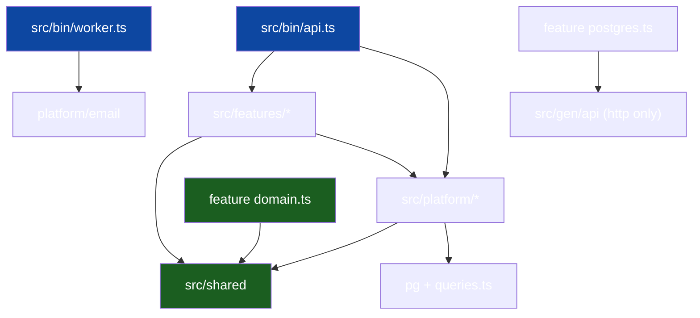

# Package Topology

The dependency graph of the single TypeScript project: which modules exist,
what each is allowed to know, and who sits where. This is the node template's
answer to the sibling languages' module/crate workspaces: one project, many
directories, the edges enforced by eslint's `no-restricted-imports` over the
package `"imports"` map (`#shared/*`, `#platform/*`, `#features/*`, `#gen/*`).

## 1. Module taxonomy

| Module                                | Kind                  | May import                          | Never imports                 |
| ------------------------------------- | --------------------- | ----------------------------------- | ----------------------------- |
| `src/features/<slice>/domain.ts`      | domain                | `#shared/*`                         | anything else                 |
| `…/<slice>/ports.ts`                  | ports                 | domain                              | adapters, other slices        |
| `…/<slice>/usecase.ts`                | use case              | domain, ports                       | `pg`, `fastify`, other slices |
| `…/<slice>/http.ts`                   | driving adapter       | use case, `#platform/*`, `#gen/api` | other slices                  |
| `…/<slice>/postgres.ts`               | driven adapter        | `pg`, own `queries.ts`              | `fastify`, other slices       |
| `…/<slice>/module.ts`                 | wiring                | all files in its slice              | other slices                  |
| `src/shared/*`                        | kernel                | node:stdlib only                    | anything                      |
| `src/platform/*`                      | transversal infra     | stdlib, `pg`, `#shared/*`           | `#features/*`                 |
| `src/gen/api`                         | generated (committed) | —                                   | —                             |
| `src/bin/api.ts`, `src/bin/worker.ts` | composition roots     | everything via the `imports` map    | — (nobody imports them)       |

## 2. The import graph

Arrows converge on `shared/` and each slice's `domain.ts`. Nothing points at
`bin/`; nothing points sideways between features.

## 3. `shared/` vs `platform/`

Both are horizontal, and the line matters:

- **`shared/` is the kernel** — types and rules so fundamental they may never
  depend on a mechanism: `apperr` (stable error codes:
  `AUTH_EMAIL_NOT_VERIFIED`, …, plus the `from()` coercion every error
  renders through), `authz` (self-or-subordinate manage guard), `rolex` (the
  single role definition with `atLeast`), `clockx`, `idgen`. If a file in
  `shared/` grows an import beyond the node stdlib, move it to `platform/`.
- **`platform/` is transversal infra** — `authx` (jose HS256
  minter/verifier, `requireAuth`/`requireRole` preHandlers, password
  hashing), `email` (Message, outbox queue, console/SMTP sender selection,
  `runEmailWorker`), `oauthx` (Google JWKS verifier, GitHub client, link
  tokens), `realtime` (hub + WS session pump), `httpx` (envelope, edge
  decode, pagination), `config` (zod-validated env Load), `pg` (the Pool).
  It may touch `pg` and the generated code; it may **not** import features.
  Features may import platform packages — but prefer declaring the narrow
  port in `ports.ts` and letting platform satisfy it, so the slice stays
  readable as a stand-alone contract.

## 4. `src/gen/api` — generated, committed

`specs/openapi.yaml` → **openapi-typescript** (models/schema only, no runtime
code) → `src/gen/api/schema.d.ts`: wire-format types shared by `http.ts`
adapters and validated at the edge by zod schemas written in the slice. The
Go sibling generated named queries with sqlc; this template's typed queries
are hand-written per slice in `queries.ts` (Kysely-style) — the documented
codegen delta.

Regenerate with `make generate`; never hand-edit `gen/`. CI
asserts regeneration is a no-op (`make gen-check`).

## 5. Role → file map

| Task                   | Lives in                                       |
| ---------------------- | ---------------------------------------------- |
| Business rule change   | `domain.ts` (its tests)                        |
| New query              | the slice's `queries.ts` + `postgres.ts`       |
| New endpoint           | `http.ts`, route in `module.ts`; OpenAPI entry |
| New vendor integration | new `platform/<x>/` port + adapter             |
| Cross-cutting concern  | `src/bin/middleware.ts` + `platform/httpx`     |
| Wiring change          | `src/bin/api.ts` only                          |
| Kernel types           | `src/shared`                                   |

## 6. Why one project, not many

One project keeps `pnpm test`, tool-deps (node-pg-migrate,
openapi-typescript) and CI cheap; the `"imports"` map namespaces the layers
without a bundler. Two projects or a workspace would buy nothing but version
skew between `shared/` copies. ESM tolerates import cycles at runtime, so the
file-level law (`domain.ts` purity, slice isolation) is enforced by eslint's
`no-restricted-imports`, not by the module system.

## See also

- [Vertical Slicing](02-vertical-slicing.md)
- [Dependency Rules](04-dependency-rules.md)
- [Project Skeleton](13-project-skeleton.md)
