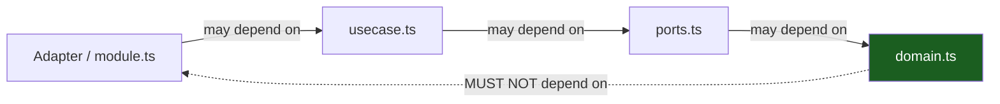

# Dependency Rules & Boundaries

The dependency rule in depth: allowed vs forbidden edges, and how
`no-restricted-imports` in `eslint.config.mjs` turns the architecture into
red-on-save lint output.

## 1. The rule

**Source-code dependencies only point toward more-stable code.** An outer file
may name an inner one; an inner one must never name an outer. ES modules
tolerate cycles at runtime, which makes the linter — not the module system —
the enforcement point for the interesting edges (they are _file-level within
one tree_, invisible to any package tooling).



## 2. Allowed edges

| From                                            | To                                            | OK?                              |
| ----------------------------------------------- | --------------------------------------------- | -------------------------------- |
| `src/bin/api.ts`, `src/bin/worker.ts`           | any internal module                           | yes — the roots know everything  |
| feature `http.ts` / `postgres.ts` / `module.ts` | own slice's files, `#platform/*`, `#shared/*` | yes                              |
| `usecase.ts`                                    | `ports.ts`, `domain.ts`                       | yes                              |
| `ports.ts`                                      | `domain.ts`                                   | yes                              |
| `domain.ts`                                     | node stdlib, `#shared/*`                      | yes                              |
| feature `postgres.ts`                           | `pg`, own `queries.ts`                        | yes                              |
| anything internal                               | `#gen/*`                                      | only http adapters to `#gen/api` |
| `src/platform/*`                                | `#shared/*`, stdlib, `pg`                     | yes (never features)             |

## 3. Forbidden edges

| From                                 | To                                     | Why                                           |
| ------------------------------------ | -------------------------------------- | --------------------------------------------- |
| `domain.ts`                          | `fastify`, `pg`, `kysely`, any adapter | domain is zero-I/O and transport-agnostic     |
| `usecase.ts`                         | `fastify`, `pg`                        | mechanism names belong to adapters            |
| any `src/features/*` file            | another slice's files                  | slices stay independent                       |
| `src/platform/**`                    | `#features/*`                          | platform serves features, never consumes them |
| any module outside a feature's files | its `module.ts` `register*` internals  | wiring is the root's job                      |
| any module                           | `#bin/*` (or importing `src/bin/**`)   | nothing depends on the root                   |
| adapters                             | `#gen/api` models outside `http.ts`    | wire types stop at the edge                   |

## 4. Enforcement: `no-restricted-imports` in `eslint.config.mjs`

The skeleton ships the authoritative file — the essence, condensed. Two rule
groups, the verbatim translation of the Go sibling's depguard pairs:

```js
"no-restricted-imports": [{
  files: ["src/features/**/domain.ts"],           // group 1: domain-pure
  patterns: [
    { group: ["#features/*"], message: "slices never depend on other slices" },
    { group: ["#platform/*"], message: "domain depends on its own ports, not platform infra" },
    { group: ["#gen/*"], message: "generated db/api code is an adapter concern, not domain" },
    { group: ["pg", "kysely"], message: "persistence is a port; use interfaces in ports.ts" },
    { group: ["fastify", "@fastify/*"], message: "domain stays transport-agnostic" },
  ],
}, {
  files: ["src/features/**"],                     // group 2: slice-isolation
  patterns: [
    { group: ["#features/*"], message: "cross-slice imports are forbidden; declare a port instead" },
    { group: ["src/bin/**"], message: "nothing depends on the composition root" },
  ],
}]
```

The rule groups are placeholder-free (`#features/*` survives rename
unchanged); everything else in the config renames with the project via
`scripts/rename.sh` like any other text.

Stacked enforcement, in order:

1. **eslint** — file-level law; `make ci` fails red with the violating edge.
2. **TypeScript module graph** — `make vet` (`tsc --noEmit`) rejects imports
   that resolve to nothing; the `"imports"` map keeps `#*` namespaces
   closed; a wrong-shaped edge that still type-checks is eslint's catch.
3. **Generated-code hygiene** — `make generate`/`make gen-check` must stay
   quiet; CI regenerates and diffs.
4. **Review** — the "depends on the interface but reaches for the adapter"
   smell; eslint cannot see it because it is a constructor argument, not an
   import.

## 5. Invariants the structure protects

- **One error vocabulary.** Adapters map driver errors _inward_ (pg errors
  through `#shared/apperr`'s `from()`); use cases throw domain
  `AppError`s; the stable `code` for the `{detail, code}` envelope is decided
  once, in `src/shared/apperr`. Callers never see raw `pg` error shapes.
- **SQL lives only in per-slice `queries.ts` files.** A raw `pg` query in
  `postgres.ts` bypassing `queries.ts`, or worse in `usecase.ts`, is a leak —
  eslint denies the import shape; review denies the bypass.
- **Wire types stop at the edge.** `#gen/api` types are decoded/encoded in
  `http.ts`; domain types travel inward and back.
- **Slices keep separate migration ownership.** A slice's tables appear
  through its own `queries.ts`; another slice reading them directly is an
  edge violation.
- **Migrations never run at startup.** Nothing in `platform/` knows how to
  apply them; `make migrate` (or the compose `migrations` one-shot service)
  does, in a boot step you control.

## Do / Don't

- **Do** add a narrow port when a slice needs what another slice owns — even
  if its adapter today is a thin proxy to the other slice's adapter.
- **Do** promote a genuinely shared type to `shared/` once two slices need it.
- **Don't** use an `eslint-disable` comment to sneak an edge; if the edge is
  needed, the topology is wrong (or the rule is — fix the rule in review,
  never the call site).
- **Don't** create `src/utils`. `shared/` is a kernel, not a junk drawer;
  anything "util" is either a mechanism (→ `platform/`) or a domain concept
  (→ the slice that owns it).

## See also

- [Package Topology](03-package-topology.md)
- [Testing & CI](11-testing-and-ci.md)
- [Hexagonal Architecture](01-hexagonal-architecture.md)
